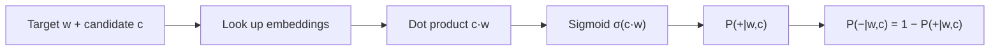

# Module 2 - Vector Semantics and Word Embedding

Vector semantics models the meaning of words using points and directions in high-dimensional space so that computational systems can represent similarity, draw semantic inferences, and process language beyond exact surface matches. By moving from isolated vocabulary indices to count-based and prediction-trained vectors, language processing systems learn representations directly from text distributions and capture relations ranging from topical association to synonymy and affective tone.

## Meaning, Senses, and Lexical Relations

Representing a word merely as a string or an index in a fixed vocabulary list provides an identifier, but it conveys no information about what the word means or how it relates to other concepts. Formal logic models that equate word meaning with an uppercase concept label—such as defining the meaning of *dog* as $\text{DOG}$—similarly fail to provide an operational representation that computational systems can use for language tasks.

**Lexical semantics** is the linguistic study of word meaning. It seeks representations that can distinguish different senses of a word, determine semantic similarity, connect related ideas, and support practical tasks such as question answering, paraphrase detection, and summarization.

A fundamental tool for establishing word meaning without manual annotation is the **distributional hypothesis**.

> Words that occur in similar contexts tend to have similar meanings.

The surrounding words and grammatical environments of a word provide distributional evidence about its meaning. An unfamiliar word can be understood by comparing its context words to the environments of familiar words.

In the case of the borrowed culinary term *ongchoi*, encountering sentences such as "Ongchoi is delicious sautéed with garlic," "Ongchoi is superb over rice," and "ongchoi leaves with salty sauces" places the term alongside contexts typical of *spinach*, *chard*, and *collard greens*. Sharing context words such as *sautéed*, *garlic*, *rice*, *leaves*, and *salty* indicates that *ongchoi* is an edible leafy green vegetable.

:::tip[Think It Through]
**Prompt:** What broad kind of thing would you infer *ongchoi* is, and why does occurring beside *garlic* not justify calling it a synonym of *garlic*?

**Answer:** *Ongchoi* can be inferred to be an edible food ingredient with leaves, specifically a leafy green vegetable. Co-occurring beside *garlic* demonstrates syntagmatic relatedness (participating in the same cooking scene), whereas synonymy would require sharing comparable distributions and substituting for each other without altering truth conditions.
:::

### Lemmas and Polysemy

A **lemma** (or citation form) is the standard dictionary base form of a word, grouping together grammatical variants (for example, *run* serves as the lemma for *run*, *runs*, *ran*, and *running*). Specific inflected occurrences in text are **wordforms**.

A single lemma can have multiple distinct meanings, known as **word senses**. A word with multiple senses is **polysemous**. The lemma *mouse* exemplifies polysemy, having both a biological rodent sense and an electronic computing pointing device sense. Other common examples include *bank* (a river boundary versus a financial institution), *tank* (a military combat vehicle versus a liquid container), and *book* (a written work versus the action of reserving a ticket). Because the surface form is identical across senses, systems rely on surrounding context words to disambiguate the intended sense.

:::tip[Think It Through]
**Prompt:** A search system sees *mouse* near *cheese* and *tail* in one document, and near *cursor* and *screen* in another. Why is that context more useful than storing only one definition for the spelling *mouse*?

**Answer:** Context words distinguish which distinct sense of the polysemous lemma is active in each document, allowing the system to direct queries to the rodent concept or the hardware device rather than conflating two incompatible meanings under a single spelling.
:::

### Synonymy, Similarity, and Relatedness

Lexical semantics distinguishes several distinct structural and conceptual relationships:

- **Synonymy:** Words that share identical or nearly identical propositional meaning in some or all contexts, such as *couch / sofa*, *vomit / throw up*, and *car / automobile*. Strictly defined, two words are synonyms if substituting one for the other in a sentence preserves truth conditions. Because social register, geographic variety, and stylistic connotations introduce differences, true identity of meaning is rare, and synonymy is treated in practice as rough or approximate. For example, *water* and $\text{H}_2\text{O}$ identify the same chemical compound, but $\text{H}_2\text{O}$ is pragmatically inappropriate in a surfing guide; similarly, *my big sister* conveys elder age, whereas *my large sister* describes physical size.
- **Similarity:** Words that share core conceptual features and belong to the same general category without being synonymous, such as *cat / dog*, *car / bicycle*, and *cow / horse*. Although cats and dogs cannot be interchanged in text without changing factual meaning, they have high semantic similarity because both are domestic mammalian companion animals. Word similarity is evaluated in benchmarks such as SimLex-999 through human ratings (typically on scales such as $0\text{--}10$), capturing a spectrum from near-synonyms (*vanish / disappear*, $9.8$) to unrelated concepts (*hole / agreement*, $0.3$).

> ⚠️ **Emphasized by instructor:** In domain-specific language processing (such as legal or medical informatics), generic off-the-shelf similarity assumptions may fail. Practitioners must examine the domain similarity matrix directly to ensure specialized technical jargon is captured at the necessary granularity.

- **Relatedness (Word Association):** Words that are connected through co-participation in a shared scenario, event, or topical domain, even when they share virtually no categorical features. For example, *coffee* is similar to *tea* (both are hot beverages), but *coffee* is related to *cup* because one is consumed from the other. Similarly, *scalpel* is related to *surgeon*, *bat* is related to *ball*, and *police* is related to *robber*.

:::tip[Think It Through]
**Prompt:** If two words receive a high similarity score, is that enough to let a paraphrasing system freely substitute one for the other? Explain using one example.

**Answer:** No. High similarity indicates that two words share conceptual properties, but they may still refer to different entities. For instance, *cat* and *dog* have high similarity as household pets, but substituting *dog* into "I took my cat to the vet" changes the factual truth of the sentence.
:::

### Semantic Fields

A **semantic field** (or semantic frame) is an organized vocabulary covering a particular domain, characterized by structured relations among its constituent concepts:

- **Hospital:** *surgeon*, *scalpel*, *nurse*, *anaesthetic*, *patient*, *illness*, *hospital*
- **Restaurant:** *waiter*, *menu*, *plate*, *food*, *chef*, *customer*, *kitchen*
- **House:** *door*, *roof*, *kitchen*, *family*, *bed*

#### How is a semantic field different from relatedness?

Relatedness describes an associative link between individual concepts (such as an instrument and its user, or an event and its setting). A semantic field is the broader, structured collection of terms that together describe a complete domain. Words within a semantic field exhibit various forms of relatedness rather than uniform similarity.

### Antonymy and Context Sharing

**Antonyms** are words that express opposite meanings with respect to a single feature while remaining alike across other aspects of meaning. They can represent binary oppositions (*in / out*), endpoints of a continuous scale (*hot / cold*, *long / short*, *fast / slow*), or reversive directional actions (*rise / fall*, *up / down*).

Because antonyms describe the same underlying attribute and participate in identical linguistic constructions (such as "the water is hot" versus "the water is cold"), they frequently appear in matching environments. Distributional models that learn solely from surrounding word co-occurrences often assign high similarity to antonyms, capturing their shared semantic domain rather than their opposite polarity.

:::tip[Think It Through]
**Prompt:** Both "The water is hot" and "The water is cold" are natural sentences. Would a system learning only from surrounding words necessarily place *hot* and *cold* far apart? Why?

**Answer:** No. Because *hot* and *cold* modify identical nouns and share nearly identical syntactic environments and topical contexts, a purely distributional model often places them close together in vector space. Distributional context captures shared domain usage, but it does not intrinsically distinguish antonymous contrast from synonymy.
:::

### Connotation and Affective Meaning

Words carry emotional, evaluative, and affective associations beyond their literal denotations. **Sentiment** describes positive or negative evaluation (such as *great* versus *terrible*).

Affective meaning varies across three primary psychological dimensions (**VAD**):

1. **Valence:** The pleasantness of the stimulus, ranging from unpleasant to pleasant (for example, *happy* has high valence; *toxic* has low valence).
2. **Arousal:** The emotional intensity or activation provoked by the stimulus, ranging from calm to excited (for example, *frenzy* has high arousal; *mellow* or *napping* has low arousal).
3. **Dominance:** The degree of control or power exerted by or felt toward the stimulus, ranging from weak or submissive to controlling or powerful (for example, *powerful* or *leadership* has high dominance; *weak* or *empty* has low dominance).

The **NRC VAD Lexicon** is a published word list covering approximately $20{,}000$ words that assigns real-valued scores across valence, arousal, and dominance, derived from human judgments collected through best–worst scaling.

Representing each word by these three coordinates acts as an early spatial model of meaning: each word corresponds to a point in a three-dimensional affective vector space.

:::tip[Think It Through]
**Prompt:** A customer's message has high arousal. Why is that score alone insufficient to decide whether the customer is delighted or upset, and which additional dimension would help?

**Answer:** Arousal reflects emotional intensity rather than emotional polarity; both intense excitement and intense anger exhibit high arousal. Knowing the valence score is necessary to determine whether the high-intensity emotion is positive (delight) or negative (anger).
:::

<details className="alert alert--info">
<summary>Test Your Understanding</summary>

**Questions**
1. Classify each pair as synonymy, similarity, or relatedness, and state why: *couch / sofa*, *cat / dog*, *coffee / cup*.
2. Two words can have opposite meanings and still appear in very similar contexts. What does this demonstrate about using shared context as evidence of meaning?
3. Name the three affective dimensions in the VAD model, state what each measures, and give an example of a word with high dominance.

**Answers**
1. *Couch / sofa* is synonymy because the terms share propositional meaning and can be substituted without changing truth conditions. *Cat / dog* is similarity because both share categorical properties as domestic mammalian pets without meaning the same thing. *Coffee / cup* is relatedness because they are associated through an everyday event (drinking coffee from a cup) despite belonging to different object categories.
2. Shared context provides strong evidence that words belong to the same semantic domain and share topical or structural properties, but shared context alone does not prove synonymy and often yields high distributional similarity for antonym pairs.
3. The dimensions are Valence (pleasantness), Arousal (intensity of emotion or activation), and Dominance (degree of control or social power). An example of a high-dominance word from the lecture is *powerful* (or *leadership*).

</details>

## Vector Semantics and Document Retrieval

To overcome the inability of discrete symbols to express degrees of similarity, **vector semantics** defines the meaning of a word as a **vector**—a point in a multidimensional geometric space. These vectors are called **embeddings** because the semantic properties of a word are mathematically embedded as coordinates within a continuous vector space.

In this spatial model of language:
- Every dimension represents a different attribute, perspective, or pattern of linguistic usage.
- Words that occur in similar environments and share meaning are located near one another in the space (exhibiting small geometric distance or a narrow angle between their vectors).
- Downstream machine-learning models achieve stronger generalization. Under a discrete word-identity representation (where each vocabulary word is a mutually independent feature), learning that *terrible* indicates a negative review provides no information about the unseen word *dreadful*. In an embedding space, *terrible* and *dreadful* share similar vector coordinates, allowing the model's learned weights to transfer naturally to related words.

:::tip[Think It Through]
**Prompt:** Suppose a sentiment classifier is trained on word-identity features and learns that *terrible* is negative. What happens when a test sentence contains *dreadful* instead? How does an embedding representation fix that failure?

**Answer:** Under discrete word-identity features, *terrible* and *dreadful* are separate, orthogonal indicators; the classifier cannot recognize *dreadful* as negative without seeing it explicitly in training. An embedding space represents words by continuous coordinates across multiple dimensions. Because *terrible* and *dreadful* share comparable context distributions, their vectors lie close together (small angle and small distance), allowing a classifier trained on *terrible* to generalize to *dreadful*.
:::

### Sparse Count-Based Vectors Versus Dense Learned Embeddings

Vector representations in NLP fall into two primary families with contrasting mathematical and practical properties:

| Property | Sparse Count-Based Vectors | Dense Learned Embeddings |
|---|---|---|
| **Construction** | Derived directly by counting occurrences across documents or nearby context windows, then optionally re-weighted (e.g., TF-IDF, PPMI). | Learned through self-supervised prediction tasks (e.g., Word2Vec Skip-gram / CBOW) or global matrix optimization (e.g., GloVe). |
| **Dimensionality** | High: vector length equals vocabulary size $\vert V \vert$ (typically $10{,}000\text{--}50{,}000$) or document collection size $\vert D \vert$. | Low: typically $50\text{--}300$ dimensions (rarely exceeding $1{,}000$). |
| **Sparsity** | Highly sparse: the vast majority of entries are zero because any given word appears in only a tiny fraction of contexts. | Dense: virtually all dimensions contain continuous, non-zero real numbers (both positive and negative). |
| **Interpretability** | Explicit: each coordinate corresponds directly to a known vocabulary word or document. | Latent / distributed: meaning is distributed across dimensions without a single-word label per coordinate. |
| **Synonym handling** | Limited: synonyms such as *car* and *automobile* occupy distinct, orthogonal dimensions with no shared weight. | Strong: synonyms that appear in similar environments are drawn toward nearby vector coordinates. |
| **Model complexity** | High parameter count: classifiers require a separate weight for every vocabulary word, raising memory usage and risk of overfitting. | Compact parameter space: classifiers require far fewer weights ($d \ll \vert V \vert$), improving statistical generalization. |

### The Term–Document Matrix and Spatial Retrieval

The earliest vector space model of language is the **term–document matrix**, originally developed for mechanical indexing and Information Retrieval (IR). 

In a term–document matrix:
- **Rows** correspond to vocabulary words (terms).
- **Columns** correspond to individual documents in the collection.
- Each cell records the frequency of that word within the specified document.

Consider four plays by Shakespeare categorized into comedies and histories:

| Word | *As You Like It* (Comedy) | *Twelfth Night* (Comedy) | *Julius Caesar* (History) | *Henry V* (History) |
|---|:---:|:---:|:---:|:---:|
| **battle** | 1 | 0 | 7 | 13 |
| **good** | 114 | 80 | 62 | 89 |
| **fool** | 36 | 58 | 1 | 4 |
| **wit** | 20 | 15 | 2 | 3 |

This table provides two complementary vector views:
1. **Document vectors (columns):** Each document is modeled as a vector of term counts. For example, *Julius Caesar* is represented by the column vector $[7, 62, 1, 2]^T$.
2. **Word vectors (rows):** Each word is modeled by its occurrence distribution across documents. For example, *battle* is represented by the row vector $[1, 0, 7, 13]$.

Plotted in a two-dimensional subspace using the count of *fool* as the horizontal axis and the count of *battle* as the vertical axis:
- The comedies (*As You Like It* and *Twelfth Night*) exhibit high counts for *fool* ($36$ and $58$) and near-zero counts for *battle* ($1$ and $0$). Their vectors lie close to the horizontal axis.
- The history and war plays (*Julius Caesar* and *Henry V*) exhibit substantial counts for *battle* ($7$ and $13$) and minimal counts for *fool* ($1$ and $4$). Their vectors point steeply upward along the vertical axis.

Because documents sharing a central topic use similar vocabularies, their document vectors point in similar directions. In information retrieval systems, a search query is treated as a short pseudo-document vector; retrieving relevant documents corresponds to identifying document vectors that align most closely in direction with the query vector.

:::tip[Think It Through]
**Prompt:** Look at the row for *good* across the four plays ($114, 80, 62, 89$). Why is the raw count of *good* unhelpful for distinguishing whether a play is a comedy or a history play, compared to words like *battle* or *fool*?

**Answer:** The word *good* appears frequently and with roughly similar prevalence across all four documents regardless of genre. Because its distribution is relatively uniform across the collection, raw count along this dimension provides virtually no discriminative power between comedy and history plays.
:::

<details className="alert alert--info">
<summary>Test Your Understanding</summary>

**Questions**
1. In a term–document matrix, what do rows and columns represent? If two documents address the same subject, what geometric relationship do their column vectors exhibit?
2. Compare sparse count-based vectors with dense learned embeddings regarding (a) dimensionality and sparsity, and (b) their ability to capture synonymy.

**Answers**
1. Rows represent vocabulary terms and their prevalence across documents; columns represent individual documents. When two documents address the same subject, their column vectors point in similar directions in vector space (forming a small angle and being geometrically close).
2. (a) Sparse count-based vectors have high dimensionality (equal to vocabulary size $|V|$, typically $10{,}000\text{--}50{,}000$) and high sparsity (mostly zeros). Dense learned embeddings have low dimensionality (typically $50\text{--}300$) and low sparsity (most values are non-zero real numbers). (b) Count-based vectors represent synonyms as separate orthogonal dimensions, failing to link words that share synonyms as neighbours; dense embeddings project synonyms to nearby coordinate locations because they share similar context distributions.

</details>

## Word–Context Vectors and Cosine Similarity

Whole documents are often too broad a context for capturing the meaning of a single word. A tighter notion of context, the words that occur close to a target word, gives every word its own vector. Comparing two such vectors requires a similarity score. The dot product is the natural first candidate, but it is biased by word frequency; cosine similarity removes that bias by comparing direction only.

### The Word–Word Matrix

A **word–word matrix**, also called a **term–context matrix**, has the **target words** of the vocabulary as rows and the **context words** as columns. A symmetric context window of $\pm k$ words, for example $k=4$, is slid over the corpus. Each cell counts how many times the column word appears within that window around the row word. The guiding principle is that two words are similar in meaning if their context vectors are similar.

Consider four target words and five of their many context words, with counts from a large corpus:

| Target word | … | computer | data | result | pie | sugar | … |
|---|:---:|:---:|:---:|:---:|:---:|:---:|:---:|
| **cherry** | … | 2 | 8 | 9 | 442 | 25 | … |
| **strawberry** | … | 0 | 0 | 1 | 60 | 19 | … |
| **digital** | … | 1670 | 1683 | 85 | 5 | 4 | … |
| **information** | … | 3325 | 3982 | 378 | 5 | 13 | … |

*Cherry* and *strawberry* occur often near *pie* and *sugar* but almost never near *computer* or *data*. *Digital* and *information* show the reverse pattern. Each row is the vector of its word. In a real system a row has one entry per vocabulary word, so its length is $\vert V \vert$ (typically $10{,}000\text{--}50{,}000$) and most entries are zero, which makes these sparse vectors.

Two dimensions can be drawn at a time. Taking only the context words *data* (horizontal) and *computer* (vertical), *digital* is the point $[1683, 1670]$ and *information* is $[3982, 3325]$. Their arrows point in nearly the same direction, but the arrow for *information* is longer because it is the more frequent word.


#### How the window size shapes the vectors

The window size is a design choice, typically between 1 and 10 words on each side of the target.

- **Short windows** capture the words immediately beside the target, which carry more syntactic information. The words with the most similar vectors tend to be semantically similar words of the same part of speech.
- **Long windows** capture the broader topic in which the target is used. The closest words tend to be topically related without being similar.

For *Hogwarts*, the school in the Harry Potter series, a $\pm 2$ window finds other fictional schools such as *Sunnydale* and *Evernight*, whereas a $\pm 5$ window finds words from the same story such as *Dumbledore*, *Malfoy*, and *half-blood*.

:::tip[Think It Through]
**Prompt:** Suppose the context window grows from $\pm 1$ word to $\pm 20$ words. How would that change what the co-occurrence counts capture?

**Answer:** They would capture broader context. As the window widens, the counts shift from the immediate, more syntactic neighbours of a word toward the topic in which it is used.
:::

### Dot Product and Its Flaw

The **dot product** multiplies the matching entries of two vectors and adds the results, giving a single number:

$$
\mathbf{v}\cdot\mathbf{w}=\sum_{i=1}^{N}v_iw_i=v_1w_1+v_2w_2+\dots+v_Nw_N
$$

It is high when both vectors have large values in the same dimensions. Two vectors that are zero wherever the other is non-zero are **orthogonal**, with dot product $0$, which signals strong dissimilarity.

Using three of the context words:

| Word | pie | data | computer |
|---|---:|---:|---:|
| **cherry** | 442 | 8 | 2 |
| **digital** | 5 | 1683 | 1670 |
| **information** | 5 | 3982 | 3325 |

$$
\text{cherry}\cdot\text{information}=442(5)+8(3982)+2(3325)=40{,}716
$$

$$
\text{digital}\cdot\text{information}=5(5)+1683(3982)+1670(3325)=12{,}254{,}481
$$

The ranking is correct: *digital* scores about 300 times higher with *information* than *cherry* does. But the size of these numbers depends on how large the counts are.

The dot product favours long vectors. The **length** of a vector is

$$
|\mathbf{v}|=\sqrt{\sum_{i=1}^{N}v_i^{2}}
$$

and it grows with larger values in many dimensions. Frequent words such as *of*, *the*, and *you* co-occur often with many words, so their vectors are long, and a raw dot product rewards them even when their contexts are not especially similar. Length reflects how often a word occurs in the corpus, not how similar two words are.

:::tip[Think It Through]
**Prompt:** Suppose the corpus is doubled, so every count in the *digital* row doubles but the proportions across *pie*, *data*, and *computer* stay the same. What happens to $\text{digital}\cdot\text{information}$? Should the similarity between the two words really change?

**Answer:** The dot product scales with the vector. Doubling only the *digital* row doubles it to $24{,}508{,}962$, and if the *information* row doubles as well, as it would in a genuinely doubled corpus, it becomes four times as large, $49{,}017{,}924$. The similarity should not change, because the proportions of contexts are unchanged.
:::

:::tip[Think It Through]
**Prompt:** For a fairer similarity measure, should the score depend on a vector's length, its direction, or both?

**Answer:** Direction only. Doubling the counts changes the length but not the direction, and it should not change the similarity. Length, which reflects how frequent a word is, should therefore not contribute to the score.
:::

### Cosine Similarity

The dot product combines two factors, the lengths of the vectors and the angle $\theta$ between them:

$$
\mathbf{v}\cdot\mathbf{w}=|\mathbf{v}|\,|\mathbf{w}|\cos\theta
$$

Only the angle reflects shared contexts. Dividing the dot product by both lengths isolates it:

$$
\cos\theta=\frac{\mathbf{v}\cdot\mathbf{w}}{|\mathbf{v}|\,|\mathbf{w}|}
\qquad\Longrightarrow\qquad
\text{cosine}(\mathbf{v},\mathbf{w})=\frac{\sum_{i=1}^{N}v_iw_i}{\sqrt{\sum_{i=1}^{N}v_i^{2}}\;\sqrt{\sum_{i=1}^{N}w_i^{2}}}
$$

This equals the dot product after each vector is scaled to length 1. Scaling a vector changes its length but not its angle, so the cosine is unchanged by how often a word occurs. That is why cosine is preferred over the raw dot product.

| Cosine | Angle | Meaning |
|---:|---:|---|
| $+1$ | $0^\circ$ | The vectors point in the same direction. |
| $0$ | $90^\circ$ | The vectors are orthogonal. |
| $-1$ | $180^\circ$ | The vectors point in opposite directions. |

Raw frequency counts are never negative, so the cosine of two term–term count vectors lies between $0$ and $1$.

To decide which of *cherry* and *digital* is closer to *information*, using the *pie*, *data*, and *computer* columns:

$$
\cos(\text{cherry},\text{information})=\frac{442\cdot5+8\cdot3982+2\cdot3325}{\sqrt{442^2+8^2+2^2}\;\sqrt{5^2+3982^2+3325^2}}=\frac{40{,}716}{442.1\times5187.7}\approx0.018
$$

$$
\cos(\text{digital},\text{information})=\frac{5\cdot5+1683\cdot3982+1670\cdot3325}{\sqrt{5^2+1683^2+1670^2}\;\sqrt{5^2+3982^2+3325^2}}=\frac{12{,}254{,}481}{2371.0\times5187.7}\approx0.996
$$

*Digital* is far closer to *information*, at an angle of about $5^\circ$, than *cherry* is. Geometrically, in the plane of the context words *pie* and *computer*, *cherry* points along the *pie* direction while *digital* and *information* point along the *computer* direction. The angle between *digital* and *information* is small, and the angle between *cherry* and *information* is large. A larger cosine means a smaller angle, with the maximum of $1$ at $0^\circ$.

🎯 **Exam hint:** Questions require recognising when cosine similarity is the right tool to decide which words go together. A question will not say "calculate the cosine similarity", so the student must identify the need and apply the formula.

:::tip[Think It Through]
**Prompt:** Without computing any lengths, what is the cosine of $A=[1,2]$ and $B=[3,6]$, and why?

**Answer:** It is $1$. Since $B=3A$, the vectors point in the same direction, the angle is $0^\circ$, and $\cos 0^\circ=1$. As a check, $A\cdot B=15$, $|A|=\sqrt5$, $|B|=3\sqrt5$, so $\cos=\frac{15}{\sqrt5\cdot3\sqrt5}=1$.
:::

:::tip[Think It Through]
**Prompt:** Two non-negative count vectors have cosine $0$. What does that say about the contexts of the two words?

**Answer:** The vectors are orthogonal, so there is no context dimension in which both are non-zero. The two words share no context words in the counted data. This is weaker than saying the words are unrelated in every sense.
:::

<details className="alert alert--success">
<summary>From Previous Question Papers</summary>

**Questions**
1. **Question 3. [5 Marks] Vector Semantics.** The embedding matrix in a particular vector representation scheme for words is given below:

    $$
    \begin{bmatrix}
    59 & 76 & 64 & 10 & 12 & 31 & 53\\
    53 & 41 & 79 & 5 & 57 & 43 & 21\\
    21 & 7 & 36 & 27 & 65 & 31 & 45\\
    48 & 47 & 30 & 57 & 16 & 20 & 27\\
    49 & 74 & 34 & 43 & 11 & 64 & 9\\
    44 & 65 & 13 & 76 & 79 & 80 & 44\\
    42 & 9 & 82 & 41 & 28 & 65 & 85\\
    28 & 5 & 21 & 42 & 22 & 60 & 40
    \end{bmatrix}
    $$

    The one-hot vector for two words are given below:
    One-Hot_W1 = [0,1,0,0,0,0,0,0]
    One_Hot_W2 = [0,0,0,0,0,0,1,0]
    Answer the following questions:
    3.2 Calculate the Cosine Distance between these words. All major steps and calculations should be explained. (2 marks) *(2023–24 Sem 1 Mid-sem Makeup Q3.2)*
2. **Question 4. [4 Marks]** Assume that the following is a portion of a vocabulary extracted from a large text corpus: Vocabulary = ['river', 'mountain', 'ocean', 'forest', 'desert', 'valley', 'climate', …]. Using a word-embedding method such as Word2Vec, the corresponding portion of the word-embedding matrix (M) for the above vocabulary is shown below, one row per word:

    | Word | Embedding vector |
    |---|---|
    | river | [3, 5, 7] |
    | mountain | [6, 4, 2] |
    | ocean | [5, 8, 6] |
    | forest | [2, 3, 5] |
    | desert | [7, 6, 1] |
    | valley | [4, 5, 3] |
    | climate | [6, 7, 6] |

    (b) Using the embedding matrix, write the embedding vectors for 'ocean' and 'forest'. How would you compute the semantic distance between 'ocean' and 'forest'? [2 marks] *(Dec 2025 Mid-sem Regular Q4b)*
3. **Q3) [2+1+1+1=5 marks]** The number of times each word appears in different documents is given in the table below.

    | Word | D1 | D2 | D3 |
    |---|---:|---:|---:|
    | Data | 25 | 0 | 0 |
    | Science | 40 | 35 | 0 |
    | Machine | 30 | 28 | 20 |
    | Learning | 20 | 25 | 18 |
    | Statistics | 15 | 0 | 0 |

    Answer the following questions:
    c) Using the term-frequency vectors shown in the table, determine which pair of documents (D1–D2, D1–D3, or D2–D3) are likely to be the most similar. Justify your answer briefly. [1 Mark] *(2025–26 Sem 2 Mid-sem Makeup Q3c)*
4. **Question 1.** a) A university develops a plagiarism-detection system. One student writes: "The experiment produced significant results." Another writes: "The study generated important findings." A keyword-based system considers them very different because most words do not match.

    Question: Explain how vector semantics could help identify their semantic similarity. Discuss why cosine similarity alone may not be sufficient for a reliable plagiarism-detection system. *(Sep 2026 End-sem Regular Q1a)*

**Answers**
1. The one-hot vectors select rows 2 and 7 of the matrix: $W_1=[53,41,79,5,57,43,21]$ and $W_2=[42,9,82,41,28,65,85]$. Cosine distance is $1-\text{cosine similarity}$.

    $$
    W_1\cdot W_2=15454,\qquad |W_1|=\sqrt{16295}=127.6519,\qquad |W_2|=\sqrt{22484}=149.9467
    $$

    $$
    \cos=\frac{15454}{127.6519\times149.9467}=0.8074,\qquad \text{cosine distance}=1-0.8074=0.1926
    $$
2. The vectors are $\text{ocean}=[5,8,6]$ and $\text{forest}=[2,3,5]$. Compute the distance from the cosine similarity or cosine distance:

    $$
    \cos=\frac{5(2)+8(3)+6(5)}{\sqrt{125}\,\sqrt{38}}=\frac{64}{68.92}\approx0.929,\qquad \text{cosine distance}\approx0.071
    $$

    No answer key is supplied for this paper. Euclidean distance is an alternative, but cosine is the measure used in the lesson.
3. D1 and D2 are the most similar. The document vectors are the columns: $\text{D1}=(25,40,30,20,15)$, $\text{D2}=(0,35,28,25,0)$, and $\text{D3}=(0,0,20,18,0)$. For example, $\text{D1}\cdot\text{D2}=40(35)+30(28)+20(25)=2740$, so $\cos=\frac{2740}{\sqrt{3750}\,\sqrt{2634}}\approx0.872$.

    | Pair | Cosine |
    |---|---:|
    | D1–D2 | 0.872 |
    | D1–D3 | 0.583 |
    | D2–D3 | 0.731 |

    D1 and D2 share *Science*, *Machine*, and *Learning* with comparable counts.
4. No answer key is supplied; this answer is built from the lesson.
    - **How vectors help:** *experiment/study*, *produced/generated*, *significant/important*, and *results/findings* occur in similar contexts. Their vectors lie close together, so their cosines are high even though the words differ.
    - **Why cosine alone is not enough:**
      - A high cosine can arise from antonyms or merely related words, not only synonyms, because contexts are shared even when meanings differ.
      - Static embeddings give one vector per word, so different senses of a word are not separated.
      - General embeddings may not suit specialised jargon, so the domain similarity matrix should be checked first.
      - Two texts on the same topic can score highly without one copying the other.

</details>

<details className="alert alert--info">
<summary>Test Your Understanding</summary>

**Questions**
1. In a word–word (term–context) matrix, what do the rows, columns, and cells represent? What does a short window tend to capture compared with a long one?
2. Why is the raw dot product a poor similarity measure for count vectors, and how does cosine similarity fix this?
3. Compute the cosine similarity of $A=[1,2,0]$ and $B=[0,3,4]$.

**Answers**
1. Rows are target words and columns are context words. Each cell counts how often the column (context) word appears within a window around the row (target) word. A short window captures immediate neighbours, so the nearest words tend to be semantically similar words, often of the same part of speech. A long window captures broader topical context, so the nearest words tend to be topically related but not necessarily similar.
2. The dot product grows with the lengths of the vectors, so frequent words, which have long vectors, score high even when their contexts are not similar. Length reflects how often a word occurs, not how similar two words are. Cosine similarity divides by both lengths, which normalises the vectors and compares only the angle between them, regardless of length.
3. $A\cdot B=1(0)+2(3)+0(4)=6$, $|A|=\sqrt5\approx2.236$, and $|B|=5$, so $\cos=\frac{6}{5\sqrt5}=\frac{6}{11.18}\approx0.537$, an angle of about $57.5^\circ$.

</details>

## TF-IDF and Sparse versus Dense Representations

Raw word counts preserve useful information, but they also reward words that appear everywhere. **TF-IDF** combines how often a term appears in one document with how unusual it is across the collection. It gives high weight to words that occur often in this document but in relatively few other documents.

### Term Frequency and Document Frequency

**Term frequency (tf)** measures how often term $t$ appears in document $d$. The lecture's formula squashes large counts logarithmically:

$$
\operatorname{tf}_{t,d}=\log_{10}(\text{count}(t,d)+1)
$$

The $+1$ makes the value defined when the count is zero. For example, 1000 occurrences give $\log_{10}(1001)\approx3.00$, whereas 10 occurrences give $\log_{10}(11)\approx1.04$. A hundredfold increase in count produces only about a threefold increase in tf.

**Document frequency (df)** is the number of documents that contain a term at least once. It is not the term's total count across the collection. For example, *Romeo* can appear 113 times in one play, while *action* also appears 113 times but is spread across 31 plays. The total counts are equal, but *Romeo* is more distinctive because its document frequency is smaller.

**Inverse document frequency (idf)** assigns larger weights to terms found in fewer documents. If $N$ is the total number of documents:

$$
\operatorname{idf}_t=\log_{10}\left(\frac{N}{\text{df}_t}\right)
$$

With $N=37$ plays, *good* appears in every play, so $\text{idf}=\log_{10}(37/37)=0$. *Romeo* appears in one play, so $\text{idf}=\log_{10}(37/1)\approx1.57$. If the collection instead had 30 documents, a term in just one would have idf $\log_{10}(30)\approx1.48$, not 1.57.

⚠️ **Emphasized by instructor:** Document frequency, not collection frequency, determines how broadly a term is distributed. Terms such as *the*, *it*, and *or* receive very low idf because they appear throughout the collection; a domain-specific term such as *oncology* or *retinopathy* is more discriminative.

:::tip[Think It Through]
**Prompt:** In the Shakespeare table, *good* appears in all four plays while *battle* is concentrated in the history plays. Which should retain a higher TF-IDF weight, and what should happen to *good*?

**Answer:** *Battle* should retain a much higher weight because it is concentrated in a subset of plays. *Good* appears throughout the collection, so its idf shrinks to zero and its TF-IDF weight becomes zero.
:::

:::tip[Think It Through]
**Prompt:** A term appears 20 times in one document and nowhere else in a 30-document collection. Using the lecture's formulas, is its TF-IDF weight high or low?

**Answer:** High. Its term frequency is $\log_{10}(20+1)\approx1.322$, its inverse document frequency is $\log_{10}(30/1)\approx1.477$, and its TF-IDF weight is about $1.953$.
:::

### Combining TF and IDF

The final weight is the product of the within-document frequency and collection-wide distinctiveness:

$$
w_{t,d}=\text{tf}_{t,d}\times\text{idf}_t
$$

Consider four Shakespeare plays. The table shows raw term counts and the resulting TF-IDF weights:

| Term | As You Like It (raw) | Twelfth Night (raw) | Julius Caesar (raw) | Henry V (raw) | As You Like It (TF-IDF) | Twelfth Night (TF-IDF) | Julius Caesar (TF-IDF) | Henry V (TF-IDF) |
|---|---:|---:|---:|---:|---:|---:|---:|---:|
| **battle** | 1 | 0 | 7 | 13 | 0.074 | 0.000 | 0.222 | 0.282 |
| **good** | 114 | 80 | 62 | 89 | 0.000 | 0.000 | 0.000 | 0.000 |
| **fool** | 36 | 58 | 1 | 4 | 0.019 | 0.021 | 0.004 | 0.008 |
| **wit** | 20 | 15 | 2 | 3 | 0.049 | 0.044 | 0.018 | 0.022 |

In *Julius Caesar*, *battle* has tf $\log_{10}(7+1)=\log_{10}(8)\approx0.903$ and idf $\log_{10}(37/21)\approx0.246$, so its TF-IDF weight is $0.903\times0.246\approx0.222$. *Good* has zero idf, so all its weights are zero despite its high raw counts. The weighted table makes the distinguishing term *battle* prominent in the histories while suppressing *good*.

Some questions specify a different tf convention. For example, they may use raw count, relative frequency (count divided by document length), or $1+\log_{10}(\text{count})$. Follow the convention stated in each question. Use the lecture's $\log_{10}(\text{count}+1)$ when no alternative is specified.

### Sparse Count Vectors and Dense Learned Embeddings

TF-IDF improves which count information is emphasized, but it does not change the basic shape of the vector. A count or TF-IDF vector still has one dimension per vocabulary term, typically tens of thousands of dimensions, and most entries remain zero. These are **sparse vectors**.

**Dense embeddings** instead have a short vector, typically 50 to 1000 dimensions, with most entries non-zero. Their values are learned, and meaning is distributed across the vector rather than each dimension naming a specific word. This compact representation gives machine-learning models fewer parameters to tune, can generalize better than explicit counts, and can represent synonymy: *car* and *automobile* are distinct count dimensions, but dense embeddings can place them near one another because they occur in similar contexts.

### Static and Contextual Embeddings

Word2Vec (Skip-gram and CBOW) and GloVe are static embedding methods: a word receives one fixed vector. ELMo and BERT are contextual methods that compute a distinct representation for a word token in its context. Thus, static *bank* has one vector for both river and financial senses; a contextual method can represent the token differently depending on surrounding words.

:::tip[Think It Through]
**Prompt:** A fixed vector is assigned to *bank*. Why can it struggle to represent both a river bank and a financial bank, and how can a contextual embedding help?

**Answer:** The fixed static embedding cannot adapt to context, so one vector must stand for both senses. A contextual embedding uses surrounding words to produce different representations for the river and financial uses.
:::

<div className="alert alert--success previous-question-papers">

**From Previous Question Papers**

**Questions**
1. **Question 4. (4 Marks)** Consider the following statements: (a) "The cat saw the dog." (b) "The dog barked at the cat." Convert all words to lowercase and, without further preprocessing (do not remove stop words, lemmatize, stem, etc.), carry out the following tasks: (1) create a vocabulary (1 mark); (2) establish term frequency and document frequency (1 mark); (3) establish the TF-IDF vector for each document (2 marks). Use TF = word frequency / sentence length and use the natural logarithm where required. *(2023–24 Sem 1 Mid-sem Regular Q4)*
2. **Q1(b).** Consider the following documents consisting of one sentence each: "Machine learning improves prediction accuracy." and "Prediction models use machine learning techniques." Convert all words to lowercase. Do not remove stop words, lemmatize, stem, etc. (1) Calculate TF and DF for all terms (2 marks). (2) Compute the TF-IDF vector for each document (2 marks). Use TF = word frequency in document / document length. *(2025–26 Sem 1 Mid-sem Regular Q1b)*
3. **Q3) [2+1+1+1=5 marks]** The number of times each word appears in different documents is given below.

    | Word | D1 | D2 | D3 |
    |---|---:|---:|---:|
    | Data | 25 | 0 | 0 |
    | Science | 40 | 35 | 0 |
    | Machine | 30 | 28 | 20 |
    | Learning | 20 | 25 | 18 |
    | Statistics | 15 | 0 | 0 |

    (a) Calculate the TF-IDF value for each term in D1. Assume a term appears in a document if its frequency is greater than zero. (2 marks). (b) Represent each word as a TF-IDF word embedding using its TF-IDF value in D1. Based on these embeddings, identify the two words that are most similar. (1 mark). (d) State one disadvantage of using TF-IDF values as word embeddings compared to modern neural word embeddings such as Word2Vec or GloVe. (1 mark). *(2025–26 Sem 2 Mid-sem Makeup Q3a,b,d)*
4. **Question 1(b).** Consider these one-sentence documents: "Machine learning improves prediction accuracy." and "Prediction models use machine learning techniques." Convert all words to lowercase; do not remove stop words, lemmatize, stem, etc. (1) Calculate TF and DF for all terms (2 marks). (2) Compute the TF-IDF vector for each document (2 marks). Use TF = word frequency in document / document length. *(2025–26 Sem 2 Mid-sem Regular Q1b)*
5. **Question 4. (1.5 + 1.5 + 3 = 6 Marks)** Consider the sentence: "The cat sat". You are given the following information: Word embeddings: x_the = [1,0,1], x_cat = [0,1,1], x_sat = [1,1,0]; Attention weights for 'cat': α = [0.2, 0.5, 0.3] (for the, cat, sat respectively); Value vectors: v_the = [1,0], v_cat = [1,1], v_sat = [0,1]. (a) Explain what contextual embeddings are and why they are important in NLP. [1.5 marks] (b) How do contextual embeddings differ from static word embeddings like Word2Vec? [1.5 marks] *(Feb 2026 End-sem Regular Q4a, Q4b)*

**Answers**
1. Vocabulary in the answer key: $[\text{the},\text{cat},\text{saw},\text{dog},\text{barked},\text{at}]$. The TF values are:

    | Term | D1 TF | D2 TF | DF |
    |---|---:|---:|---:|
    | the | 2/5 | 1/6 | 2 |
    | cat | 1/5 | 1/6 | 2 |
    | saw | 1/5 | 0 | 1 |
    | dog | 1/5 | 1/6 | 2 |
    | barked | 0 | 1/6 | 1 |
    | at | 0 | 1/6 | 1 |

    With $N=2$ and natural-log idf, $\text{idf}=\ln(N/\text{df})$. The resulting vectors in that vocabulary order are $D1=[0,0,\ln2/5,0,0,0]$ and $D2=[0,0,0,0,\ln2/6,\ln2/6]$.
2. In first-appearance vocabulary order $[\text{machine},\text{learning},\text{improves},\text{prediction},\text{accuracy},\text{models},\text{use},\text{techniques}]$, the terms *machine*, *learning*, and *prediction* have DF 2, while *improves*, *accuracy*, *models*, *use*, and *techniques* have DF 1. Using $\text{idf}=\log_{10}(2/\text{df})$, the answer key gives $D1=[0,0,0.0602,0,0.0602,0,0,0]$ and $D2=[0,0,0,0,0,0.0503,0.0503,0.0503]$. Directly rounding $(1/6)\log_{10}(2)$ to four decimals gives 0.0502; the answer key reports 0.0503 for D2.
3. D1 has 130 total terms; the document counts are DF 1 for *Data*, *Statistics* and DF 2 for *Science*, *Machine*, *Learning*. Using relative TF and $\text{idf}=\log_{10}(3/\text{df})$ gives:

    | Term | D1 TF | IDF | TF-IDF |
    |---|---:|---:|---:|
    | Data | 25/130 = 0.1923 | 0.4771 | 0.0918 |
    | Science | 40/130 = 0.3077 | 0.1761 | 0.0542 |
    | Machine | 30/130 = 0.2308 | 0 | 0 |
    | Learning | 20/130 = 0.1538 | 0 | 0 |
    | Statistics | 15/130 = 0.1154 | 0.4771 | 0.0550 |

    Using the answer key's one-dimensional values for D1, *Machine* and *Learning* both have value 0 and are identified as the most similar in that representation. These identical zero weights mean neither term distinguishes D1 from the rest of the collection; they do not establish that the words are semantically similar. TF-IDF does not capture semantic relationships between words, while Word2Vec and GloVe can place words with similar usage near each other.
4. This repeats the same two-sentence setup and asks for TF, DF, and document TF-IDF vectors with the stated relative-frequency TF formula. The answer key uses the vocabulary in first-appearance order above and gives $D1=[0,0,0.0602,0,0.0602,0,0,0]$ and $D2=[0,0,0,0,0,0.0503,0.0503,0.0503]$. The three terms unique to each document receive the positive weights; shared terms have idf zero.
5. (a) Contextual embeddings are vector representations of word tokens that change with the surrounding words, so the same word can receive different representations in different sentences. They matter because they let a system distinguish senses, such as *bank* as a financial institution versus a river bank, and represent each use of a word according to its context. (b) A static embedding such as Word2Vec or GloVe gives a word one fixed vector regardless of context, so a single vector must stand for all of its senses. A contextual method such as ELMo or BERT computes a distinct representation for each token in its context. Part (c), the attention calculation, belongs to a later module.

</div>

<details className="alert alert--info">
<summary>Test Your Understanding</summary>

**Questions**
1. A term appears 20 times in one document and nowhere else in a collection of 30 documents. Using the lecture's formulas, compute its TF-IDF weight.
2. Contrast sparse count-based vectors with dense learned embeddings in dimensionality, sparsity, and synonym handling. How do contextual embeddings differ from static ones?

**Answers**
1. $\text{tf}=\log_{10}(20+1)\approx1.322$, $\text{idf}=\log_{10}(30/1)\approx1.477$, so $\text{tf-idf}\approx1.953$ (high).
2. Sparse count-based vectors have vocabulary-sized dimensions and are mostly zero; synonyms such as *car* and *automobile* occupy separate dimensions. Dense learned embeddings use far fewer, mostly non-zero dimensions and place words with similar context distributions near one another. A static embedding gives a word one fixed vector, whereas a contextual embedding represents the word differently according to its surrounding words.

</details>

## Word2Vec, Embedding Lookup, and Skip-gram

Count-based vectors are long and sparse. Word2Vec produces short, dense vectors without counting anything: it trains a simple classifier to predict whether one word appears near another, and keeps the classifier's learned weights as the word embeddings. The text itself supplies the training labels, so no human annotation is needed.

This topic follows the idea from start to finish. It begins with why one-hot vectors cannot carry meaning, shows how a word retrieves its dense vector from an embedding matrix, and then builds the Skip-gram classifier: training pairs, a dot product turned into a probability by the sigmoid, and the two embedding matrices learned through negative sampling.

### Predicting Instead of Counting

Instead of counting how often a word $w$ occurs near *apricot*, Word2Vec trains a classifier on a binary question: *is $w$ likely to show up near "apricot"?* The answer to this question is not the goal. The weights the classifier learns while answering it become the word embeddings.

⚠️ **Emphasized by instructor:** the learned weights are what matter. Whether the classifier itself predicts well is secondary; the weights learned during classification are reused as the embeddings.

The labels come free from the corpus. A word $c$ that actually occurs near *apricot* serves as the gold "correct answer" for supervised learning. This is **self-supervision**: there are no human labels, so the method is not supervised in the usual sense, yet it is not unsupervised either, because every sentence provides its own answers. This ability of text to supply its own training signal is a major advantage throughout NLP.

Word2Vec has several variants; the one studied here is **skip-gram with negative sampling (SGNS)**. Word2Vec is popular, very fast to train, and freely available. Pretrained static embeddings can be downloaded for both Word2Vec (Mikolov et al., Google) and GloVe (Pennington, Socher, and Manning, Stanford).

:::tip[Think It Through]
**Prompt:** Word2Vec discards the yes/no classifier and keeps only its weights. Why would weights trained on "is $c$ near $w$?" end up placing *apple* and *orange* close together?

**Answer:** Words used in similar contexts tend to have similar meanings and can be substituted for each other to some extent. Training pushes a word's vector to score high against the vectors of the words it actually appears near. *Apple* and *orange* share many neighbours, such as *glass*, *of*, and *juice*, so both vectors are pushed toward the same context vectors and end up close to each other.
:::

### One-Hot Vectors

The simplest way to represent a word is by its position in a fixed vocabulary, such as $V=[\text{a},\text{aaron},\dots,\text{zulu},\langle\text{UNK}\rangle]$ with 10,000 entries. Each word receives an index, and its **one-hot vector** has length $|V|$, with a 1 at that index and 0 everywhere else. The special token $\langle\text{UNK}\rangle$ has its own slot for words not in the vocabulary.

Each position in a one-hot vector stands for a vocabulary word, not a feature of the word. The vector identifies the word but says nothing about what it means. Consider the sentences "I want a glass of orange juice" and "I want a glass of apple ___". A model that has learned *orange juice* should be able to complete *apple juice*, but with one-hot inputs *orange* and *apple* are just two unrelated positions.

:::tip[Think It Through]
**Prompt:** What is the cosine similarity between the one-hot vectors of *apple* and *orange*? Between *apple* and *king*? What does that say about why one-hot vectors cannot carry the "orange juice → apple juice" idea?

**Answer:** Both cosines are 0. Two different one-hot vectors have their 1 in different positions, so their dot product is 0. Every pair of words is therefore equally unrelated: *apple*–*orange* looks the same as *apple*–*king*. A one-hot vector encodes only the word's index in the vocabulary, not its meaning, so nothing learned about *orange* can transfer to *apple*.
:::

### Feature Vectors

A word can instead be described by a short column of numbers, each measuring how much of some property the word has. The following illustrative table describes six words with four named features:

| Feature | Man (5391) | Woman (9853) | King (4914) | Queen (7157) | Apple (456) | Orange (6257) |
| --- | ---: | ---: | ---: | ---: | ---: | ---: |
| Gender | −1 | 1 | −0.95 | 0.97 | 0.00 | 0.01 |
| Royal | 0.01 | 0.02 | 0.93 | 0.95 | −0.01 | 0.00 |
| Age | 0.03 | 0.02 | 0.70 | 0.69 | 0.03 | −0.02 |
| Food | 0.09 | 0.01 | 0.02 | 0.01 | 0.95 | 0.97 |

*Apple* and *orange* have nearly identical columns: high on Food and near zero on everything else. Because their inputs look almost the same, a model that has learned "a glass of orange **juice**" can complete "a glass of apple ___" in the same way.

The table supports several comparisons:

- **Man and woman:** opposite on Gender ($-1$ and $1$), and similarly low on Royal ($0.01$ and $0.02$).
- **King and queen:** both strongly royal ($0.93$ and $0.95$) and similar on Age ($0.70$ and $0.69$), reflecting that kings and queens are typically older. They differ mainly on Gender, just like man and woman.
- **Apple and orange:** strongly food-like ($0.95$ and $0.97$), with no meaningful gender, royalty, or age.

The exact values are illustrative and should not be read literally. What matters is the pattern: words used in similar ways receive similar columns.

#### What do the rows and columns of the feature table represent?

- **Columns are words.** The number in brackets is the word's index in the vocabulary, the same index that positions its 1 in the one-hot vector. *Man (5391)* means *man* is vocabulary word 5391. The index is not one of the word's values.
- **Rows are features (dimensions).** Gender runs from $-1$ (male) to $+1$ (female), with values near 0 meaning gender does not apply. Royal, Age, and Food measure how royal, how old or senior, and how food-like the word is.
- **Each cell** states how much of that feature (row) the word (column) has. For example, Man has Gender $=-1$, Queen has Royal $=0.95$, and Apple has Gender $=0.00$.
- **One whole column is the word's embedding:**

$$
e_{\text{man}}=\begin{bmatrix}-1\\0.01\\0.03\\0.09\end{bmatrix},\qquad
e_{\text{orange}}=\begin{bmatrix}0.01\\0.00\\-0.02\\0.97\end{bmatrix}
$$

| | One-hot vector | Feature vector |
| --- | --- | --- |
| Length | 10,000 (vocabulary size) | 4 in the table; 300 in a typical embedding matrix |
| Contents | A single 1; all other entries 0 | Every entry is a meaningful number |
| Meaning of a position | "Is this word number $k$?" | "How much of feature $k$ does the word have?" |
| Similar words look similar? | No, each word is just a different position | Yes, words with similar features get similar columns |

#### Where do the feature names come from?

No algorithm produces them. The names in the table are chosen so that a person can read the idea of an embedding. In a real Word2Vec embedding:

| What | Who decides it |
| --- | --- |
| Number of dimensions $d$ | The designer chooses it, for example 300 |
| Values in each dimension | Learned by stochastic gradient descent during training |
| A name for each dimension | Nobody; training never assigns one |

Training adjusts the numbers in whatever way helps the classifier answer "is $c$ near $w$?". Nothing tells a particular dimension to mean "royal". As with all dense learned embeddings, meaning is spread across dimensions rather than labelled per coordinate. Count vectors are different: every position there has a name, because each is a context word or a document.

A property such as gender appears in a learned space through the way words relate to each other, not through a named row. If *man → woman* and *king → queen* differ in a consistent way, the embedding has captured something like gender even though no row is called "Gender".

### Embedding Lookup

An embedding matrix stores one learned vector per vocabulary word. Multiplying a word's one-hot vector by this matrix selects exactly that word's vector. For example, the one-hot vector for word index 2 (counting from 0) is $[0,0,1,0]$, and multiplying it by a $4\times5$ weight matrix picks out the third row:

$$
\begin{bmatrix}0&0&1&0\end{bmatrix}
\begin{bmatrix}
5.1&-0.3&0.1&3.2&1.3\\
-1&7.5&-2&3.4&0.5\\
1.2&27&0.4&-1&2.8\\
1&-5&2.1&0.2&11
\end{bmatrix}
=\begin{bmatrix}1.2&27&0.4&-1&2.8\end{bmatrix}
$$

The weight matrix is the learned part, trained by stochastic gradient descent. The one-hot vector only selects which row to read.

The same lookup appears at full scale with the matrix stored the other way round. The embedding matrix $E$ is $300\times10{,}000$: 300 embedding dimensions and one **column** per vocabulary word. The one-hot vector for *orange* is $o_{6257}$, a $10{,}000\times1$ column with a 1 only at index 6257. Then:

$$
E\cdot o_{6257}=e_{6257}\qquad\text{and in general}\qquad E\cdot o_j=e_j
$$

where $e_j$ is the $300\times1$ embedding of word $j$. In practice, a specialised lookup function reads the column directly instead of performing the multiplication.


In the diagram, the columns of $E$ are labelled *a*, *aaron*, …, *orange*, …, *zulu*, $\langle\text{UNK}\rangle$ across 10,000 positions, and its height is 300. The one-hot column $o_{6257}$ on the right has a single 1 at position 6257. Each coloured row of $E$ contributes one entry to the result, so the product is the highlighted *orange* column $e_{6257}$ of shape (300, 1).

The first example stores words as rows and multiplies a row one-hot vector from the left. The second stores words as columns and multiplies a column one-hot vector from the right. Both retrieve one word's vector, so the matrix layout in any given question must be checked before computing.

### The Skip-gram Framework

The idea of learning word vectors through prediction traces back to Bengio et al. (2003) and Collobert et al. (2011). Google released it as Word2Vec in 2013 (Mikolov et al.). The model inside is logistic regression, a very simple neural network.

The framework works as follows:

1. Take a large corpus and represent every word in a fixed vocabulary by a vector.
2. Go through each position $t$ in the text. Each position has a **centre word** $c$ and surrounding **context (outside) words** $o$.
3. Use the similarity of the vectors for $c$ and $o$ to compute the probability of $o$ given $c$, or of $c$ given $o$.
4. Keep adjusting the word vectors to maximise this probability.

Predicting the context from the centre word is **Skip-gram**; predicting the centre from the context is **CBOW**. Although Word2Vec is sometimes called unsupervised, the accurate description is self-supervised: there are no human labels, and the text supplies the answers.

SGNS turns this into a binary classification recipe:

1. Treat the target word $t$ and a neighbouring context word $c$ as **positive** examples.
2. Randomly sample other words in the lexicon to get **negative** examples.
3. Use logistic regression to train a classifier to distinguish the two cases.
4. Use the learned weights as the embeddings.

Negative examples are needed because a neural network learns from both positive and negative samples.

With a $\pm2$ word window, consider the training text:

> …lemon, a [tablespoon of **apricot** jam, a] pinch…

The target is *apricot*, and the four context words are $c_1=$ *tablespoon*, $c_2=$ *of*, $c_3=$ *jam*, and $c_4=$ *a*. The classifier receives a candidate (word, context) pair, such as *(apricot, jam)* or *(apricot, aardvark)*, and assigns it a probability $P(+\mid w,c)$ that $c$ is a real context word for $w$. The two outcomes are complementary:

$$
P(-\mid w,c)=1-P(+\mid w,c)
$$

For example, if $P(+\mid\text{apricot},\text{jam})=0.9$, then $P(-\mid\text{apricot},\text{jam})=0.1$. If $P(+\mid\text{apricot},\text{automobile})=0.01$, then $P(-\mid\text{apricot},\text{automobile})=0.99$.

### From Dot Product to Probability

Two vectors are similar if they have a high dot product, so the classifier scores a pair by

$$
\text{Similarity}(w,c)\propto\mathbf{w}\cdot\mathbf{c}
$$

Cosine is just a normalised dot product; normalising makes the score depend on the angle rather than on vector lengths. Neither is a probability, however: a dot product can be any real number, and cosine runs from $-1$ to $1$. The score needs one more step to become a probability.

The **sigmoid** from logistic regression maps any real number into $(0,1)$:

$$
P(+\mid w,c)=\sigma(\mathbf{c}\cdot\mathbf{w})=\frac{1}{1+\exp(-\mathbf{c}\cdot\mathbf{w})}
$$

$$
P(-\mid w,c)=1-P(+\mid w,c)=\sigma(-\mathbf{c}\cdot\mathbf{w})=\frac{1}{1+\exp(\mathbf{c}\cdot\mathbf{w})}
$$

The minus sign sits inside the exponent for $P(+)$ and is absent for $P(-)$.

#### Why does $1-\sigma(x)$ equal $\sigma(-x)$?

Write $x=\mathbf{c}\cdot\mathbf{w}$ and start from $\sigma(x)=\frac{1}{1+e^{-x}}$:

$$
1-\sigma(x)=1-\frac{1}{1+e^{-x}}=\frac{(1+e^{-x})-1}{1+e^{-x}}=\frac{e^{-x}}{1+e^{-x}}
$$

Multiplying the numerator and denominator by $e^{x}$, and using $e^{-x}\cdot e^{x}=1$:

$$
\frac{e^{-x}\cdot e^{x}}{(1+e^{-x})\cdot e^{x}}=\frac{1}{e^{x}+1}=\sigma(-x)
$$

The sigmoid curve is symmetric about the point $(0,\,0.5)$: the height at $-x$ is exactly what the height at $+x$ is missing from 1. For example, $\sigma(2)\approx0.88$ and $\sigma(-2)\approx0.12$, which sum to 1.

:::tip[Think It Through]
**Prompt:** What is $P(+\mid w,c)$ when $\mathbf{c}\cdot\mathbf{w}=0$? If $\mathbf{c}\cdot\mathbf{w}=2$ for *(apricot, jam)*, roughly what are $P(+)$ and $P(-)$? Use $e^{-2}\approx0.135$.

**Answer:** $\sigma(0)=\frac{1}{1+1}=0.5$, so the classifier has no preference either way. For a dot product of 2, $P(+)=\sigma(2)=\frac{1}{1.135}\approx0.88$ (88%) and $P(-)=\sigma(-2)\approx0.12$ (12%).
:::

A target word has several context words, four in the *apricot* example. Assuming the context words are **independent** of one another, their probabilities multiply. Taking logs turns the product into a sum:

$$
P(+\mid w,c_{1:L})=\prod_{i=1}^{L}\sigma(\mathbf{c}_i\cdot\mathbf{w}),\qquad
\log P(+\mid w,c_{1:L})=\sum_{i=1}^{L}\log\sigma(\mathbf{c}_i\cdot\mathbf{w})
$$

Independence means that $w$ appearing with $c_1$ is treated as having no effect on $w$ appearing with $c_2$.

#### How do logs turn the product into a sum, and why does that keep numbers manageable?

The logarithm rule is

$$
\log(ab)=\log a+\log b
\quad\Longrightarrow\quad
\log\prod_{i=1}^{L}p_i=\sum_{i=1}^{L}\log p_i
$$

Every probability lies between 0 and 1, so multiplying many of them shrinks the product very quickly:

| Number of factors, each 0.5 | Product | Sum of natural logs |
| ---: | ---: | ---: |
| 4 | 0.0625 | −2.77 |
| 100 | ≈ $7.9\times10^{-31}$ | −69.3 |
| 1,000 | ≈ $9.3\times10^{-302}$ | −693 |

Training involves a very large number of pairs. Because computers store numbers with limited precision, a product this small is rounded to 0 and its information is lost. The sum of logs simply becomes more negative and stays easy to represent. Two further benefits follow:

- **Same winner:** the logarithm only increases as its input increases, so maximising the log-probability also maximises the probability.
- **Easier gradients:** a sum is easier to differentiate than a product, which matters when the embeddings are trained.

:::tip[Think It Through]
**Prompt:** The classifier assumes the four context words of *apricot* are independent. Is that realistic for "tablespoon of apricot jam, a"? Why make the assumption anyway?

**Answer:** No. The words appear in the corpus in that order, and phrases such as *tablespoon of* clearly belong together, so their positions are not independent. The assumption simplifies the calculation, much as Naive Bayes does: it splits one window into separate (target, context) pairs, each scored on its own, which is exactly how the training data is built.
:::

In summary, the Skip-gram classifier is a probabilistic classifier. Given a target word $w$ and its context window of $L$ words $c_{1:L}$, it estimates the probability that $w$ occurs in this window from the similarity of $w$'s embedding to the embeddings of $c_{1:L}$. To compute this, it needs only an embedding for every word.



### Two Embedding Matrices: W and C

SGNS learns two embeddings for every word, one for each role the word plays in training:

- **W (target embeddings):** used when the word is the **target**.
- **C (context embeddings):** used when the word is a **context or noise** word.

All parameters $\theta$ can be viewed as one stack of $2|V|$ vectors, each of dimension $d$. Rows 1 to $|V|$ form W (*aardvark*, *apricot*, …, *zebra*), and rows $|V|+1$ to $2|V|$ form C (the same words again). Equivalently, there are two matrices, an embedding matrix and a context matrix, each of size vocabulary size × embedding size. After training, it is common to add the two vectors and represent word $i$ as $\mathbf{w}_i+\mathbf{c}_i$.


The green block is W (target words, rows 1 to $|V|$) and the purple block is C (context and noise words, rows $|V|+1$ to $2|V|$). Each row holds a $d$-dimensional vector, and the same vocabulary appears in both blocks.

Both tables are needed because a word can be the centre word in one window and a context word for another centre word. W and C are role-specific parameter tables, not contextual embeddings. Word2Vec remains **static**: once training is finished, each word has one fixed vector, either $\mathbf{w}_i$ or $\mathbf{w}_i+\mathbf{c}_i$, regardless of the sentence it appears in. A contextual method such as ELMo or BERT is what changes a word's representation according to its surrounding words, for example *book* as a noun versus a verb.

### Positive and Negative Training Pairs

Every observed (target, neighbour) pair inside the window becomes a positive example. For each positive example, SGNS draws $k$ negative examples by pairing the target with a randomly sampled **noise word**. A noise word is a random word from the lexicon, constrained not to be the target word itself. With the $\pm2$ window and $k=2$, *apricot* produces:

| Positive pairs (label 1) | Negative pairs for $k=2$ (label 0) |
| --- | --- |
| (apricot, tablespoon) | (apricot, aardvark), (apricot, my) |
| (apricot, of) | (apricot, where), (apricot, coaxial) |
| (apricot, jam) | (apricot, seven), (apricot, forever) |
| (apricot, a) | (apricot, dear), (apricot, if) |

The noise words are sampled according to frequency, which is why common words such as *my*, *where*, and *if* appear among the negatives.


The window brackets *tablespoon of apricot jam, a* around the target; the four context positions c1 to c4 give the four positive pairs on the left, and the eight negative pairs on the right pair *apricot* with sampled noise words.

The number of negatives depends on the amount of data: Mikolov et al. (2013) report that $K=2$–$5$ works for large datasets and $K=5$–$20$ for small datasets. Large datasets already provide so much positive evidence that fewer negatives are needed; a small dataset has few positive pairs, so each needs more negatives to give the model enough to learn from.

⚠️ **Emphasized by instructor:** remember the K ranges, 2–5 for large datasets and 5–20 for small datasets. Values in the hundreds are never needed.

A negative label marks a sampled noise pair for that training step. It does not mean that the two words can never occur together. *Lemon*, for instance, lies outside the $\pm2$ window, so (apricot, lemon) is not a positive pair for this window; *lemon* could still be drawn as a noise word.

:::tip[Think It Through]
**Prompt:** With the $\pm2$ window and $k=3$, how many training pairs in total does the target *apricot* produce from the example sentence?

**Answer:** 16. The four positive pairs each receive three negatives, giving $4+(4\times3)=16$ pairs.
:::

The value of $k$ therefore controls how much negative evidence accompanies each positive pair.

:::tip[Think It Through]
**Prompt:** Why might a small dataset need more negatives per positive ($K=5$–$20$) than a large one ($K=2$–$5$)?

**Answer:** A large dataset provides so much positive evidence, with every word appearing in many positive pairs, that a few negatives per positive are enough. A small dataset has few positive pairs, so each needs more negatives to supply enough learning signal. The learner reasoned that a large dataset already provides wide variation, which agrees with this. The idea that a small $K$ causes memorisation is a plausible intuition, but the stated reason is the amount of learning signal.
:::

#### How are noise words weighted by frequency?

Sampling by raw unigram frequency would choose each word with probability

$$
P(w)=\frac{\text{count}(w)}{\sum_{w'}\text{count}(w')}
$$

so *the* would be chosen with probability $P(\text{the})$, *aardvark* with probability $P(\text{aardvark})$, and so on. Very common words would dominate the noise, and rare words would almost never become negatives.

The common practice is the **weighted unigram** distribution, which raises each count to a power $\alpha$ and renormalises:

$$
P_\alpha(w)=\frac{\text{count}(w)^{\alpha}}{\sum_{w'}\text{count}(w')^{\alpha}},\qquad \alpha=0.75
$$

Setting $\alpha=0.75$ gives better performance because it gives rare noise words a slightly higher probability: for rare words, $P_\alpha(w)>P(w)$. With two events where $P(a)=0.99$ and $P(b)=0.01$:

$$
P_\alpha(a)=\frac{0.99^{0.75}}{0.99^{0.75}+0.01^{0.75}}=\frac{0.9925}{0.9925+0.0316}\approx0.97,
\qquad
P_\alpha(b)=\frac{0.0316}{1.0241}\approx0.03
$$

The rare event's probability roughly triples, from 0.01 to 0.03, while the common event drops only slightly. A three-word example with illustrative counts shows the same pattern:

| Word | Count | Raw $P(w)$ | $\text{count}^{0.75}$ | $P_{0.75}(w)$ | Change |
| --- | ---: | ---: | ---: | ---: | --- |
| the | 1000 | 0.989 | 177.83 | 0.964 | slightly down |
| apricot | 10 | 0.0099 | 5.62 | 0.0305 | about 3× up |
| aardvark | 1 | 0.00099 | 1.00 | 0.0054 | about 5.5× up |
| **Total** | 1011 | 1 | 184.45 | 1 | |

The rarer the word, the larger its relative boost. Under raw frequency, the ratio between two words' probabilities equals the ratio of their counts, so *the* is 1000 times more likely than *aardvark*. Under the weighting, the ratio becomes $1000^{0.75}\approx178$. The power shrinks the gaps between frequent and rare words without removing them. Setting $\alpha=1$ recovers raw frequency, and $\alpha=0$ makes every word equally likely; $\alpha=0.75$ lies between the two.

<details className="alert alert--success">
<summary>From Previous Question Papers</summary>

**Questions**
1. **Question 3. [5 Marks] Vector Semantics.** The embedding matrix in a particular vector representation scheme for words is given below:

    $$
    \begin{bmatrix}
    59 & 76 & 64 & 10 & 12 & 31 & 53\\
    53 & 41 & 79 & 5 & 57 & 43 & 21\\
    21 & 7 & 36 & 27 & 65 & 31 & 45\\
    48 & 47 & 30 & 57 & 16 & 20 & 27\\
    49 & 74 & 34 & 43 & 11 & 64 & 9\\
    44 & 65 & 13 & 76 & 79 & 80 & 44\\
    42 & 9 & 82 & 41 & 28 & 65 & 85\\
    28 & 5 & 21 & 42 & 22 & 60 & 40
    \end{bmatrix}
    $$

    The one-hot vector for two words are given below:
    One-Hot_W1 = [0,1,0,0,0,0,0,0]
    One_Hot_W2 = [0,0,0,0,0,0,1,0]
    Answer the following questions:
    3.1 Find out the vector embedding for words W1 and W2. Explain the steps. (2 marks) *(2023–24 Sem 1 Mid-sem Makeup Q3.1)*
2. **Question 4. [4 Marks]** Assume that the following is a portion of a vocabulary extracted from a large text corpus: Vocabulary = ['river', 'mountain', 'ocean', 'forest', 'desert', 'valley', 'climate', …]. Using a word-embedding method such as Word2Vec, the corresponding portion of the word-embedding matrix (M) for the above vocabulary is shown below, one row per word:

    | Word | Embedding vector |
    | --- | --- |
    | river | [3, 5, 7] |
    | mountain | [6, 4, 2] |
    | ocean | [5, 8, 6] |
    | forest | [2, 3, 5] |
    | desert | [7, 6, 1] |
    | valley | [4, 5, 3] |
    | climate | [6, 7, 6] |

    (a) Explain the steps required to extract the embedding vector for the word 'desert' and write the resulting vector. [1 mark] (c) Using the word embedding vectors, compute the embedding vector representation of the sentence: 'forest Climate Mountain'. Assume simple vector addition. [1 mark] *(Dec 2025 Mid-sem Regular Q4a, Q4c)*
3. **Skip-gram centre-context pairs, hidden representation, and output scores.** This question appeared twice with different data.

    *Regular version.* **Q3. [5 marks]** Consider the sentence: "We love NLP". A Skip-gram Neural Language Model is trained with a window size of 1. Assume the vocabulary is: &#123;We, love, NLP&#125;. The embedding dimension is 2. Input-to-hidden weight matrix: $W=\begin{bmatrix}0.2&0.4\\0.5&0.1\\0.3&0.6\end{bmatrix}$. Hidden-to-output weight matrix: $W'=\begin{bmatrix}0.1&0.3&0.2\\0.4&0.2&0.5\end{bmatrix}$. Assume that "love" is the centre word. (a) Using the Skip-gram model with window size = 1, identify all centre-context training pairs generated from the sentence. (1 Mark) (b) Compute the hidden layer representation for the centre word "love". (2 Marks) (c) Using the hidden representation obtained in part (b), compute the output scores before applying the SoftMax function. (2 Marks) Show all intermediate calculations clearly. *(2025–26 Sem 2 Mid-sem Regular Q3a–c)*

    *Makeup version.* **Q5. [1+2+2=5 marks]** Consider the sentence: "Speech enables communication". Vocabulary: V = &#123;Speech, enables, communication&#125;. Assume that "enables" is the center word. A Skip-gram Neural Language Model is trained with a window size of 1. The embedding dimension is 2. The input-to-hidden weight matrix is: $W=\begin{bmatrix}0.3&0.2\\0.5&0.4\\0.1&0.6\end{bmatrix}$. The hidden-to-output weight matrix is: $W'=\begin{bmatrix}0.2&0.4&0.3\\0.5&0.1&0.2\end{bmatrix}$. (a) Using the Skip-gram model with window size = 1, list all center-context training pairs generated from the sentence. [1 Mark] (b) Compute the hidden layer representation h for the center word "love". [2 Marks] (c) Using the hidden representation obtained in part (b), compute the output scores u before applying the softmax function. [2 Marks] Show all intermediate calculations clearly. *(2025–26 Sem 2 Mid-sem Makeup Q5a–c)*
4. **Question 1(b).** Given the training corpus: "Students learn machine learning". Consider the vocabulary: [not specified in the paper]. The initial input embedding matrix has dimensions [not specified in the paper] and is given below:

    | Word | Dim 1 | Dim 2 | Dim 3 |
    | --- | ---: | ---: | ---: |
    | Students | 1 | 0 | 1 |
    | learn | 0 | 1 | 1 |
    | machine | 1 | 1 | 0 |
    | learning | 0 | 1 | 0 |

    The initial context matrix is:

    | Word | Dim 1 | Dim 2 | Dim 3 |
    | --- | ---: | ---: | ---: |
    | Students | 1 | 0 | 0 |
    | learn | 0 | 1 | 0 |
    | machine | 1 | 0 | 1 |
    | learning | 0 | 1 | 1 |

    For the Skip-gram with Negative Sampling (SGNS) model, consider "Students" as the input word. Use a context window of 1 next word and set the number of negative samples to: k=2. Answer the following: a) Generate the positive and negative training pairs for the input word "Students". Clearly indicate the target value (1 for a positive sample and 0 for a negative sample). Assumption: Since no negative-sampling distribution is specified, select the negative samples from the remaining vocabulary words as appropriate. [5 Marks] *(Sep 2026 End-sem Regular Q1b(a))*
5. **Q2. [1+2+1+1= 5marks]** A Smart Healthcare Chatbot uses the neural network architecture shown below to predict the next word in a patient query. For the input phrase: "The doctor prescribed a ____" answer the following: (a) What is the role of the embedding layer *e* in this architecture? [1 Mark]. Assume: V=15, Embedding dimensions =5, h1 =4 neurons, h2 =3 neurons, no bias terms are used.

    The architecture in the paper takes three one-hot inputs, X1 (*doctor*), X2 (*prescribed*), and X3 (*a*), each of length 15. Each passes through the embedding lookup E to give a 5-dimensional embedding *e*. The three embeddings are combined by addition and fed through W1 to hidden layer h1 (sigmoid, 4 neurons), then through W2 to hidden layer h2 (sigmoid, 3 neurons), and finally through U to 15 continuous output values $y_1,\dots,y_{15}$. *(2025–26 Sem 2 Mid-sem Makeup Q2a)*

**Answers**
1. Multiply each one-hot vector by the embedding matrix. The single 1 selects one row, so $W_1$ is row 2 and $W_2$ is row 7: $W_1=[53,41,79,5,57,43,21]$ and $W_2=[42,9,82,41,28,65,85]$.
2. (a) *desert* is the fifth vocabulary word, so its one-hot vector has a 1 in position 5 and 0 elsewhere. Multiplying it by M selects row 5: $\text{desert}=[7,6,1]$. (c) Look up each word, then add the vectors: $\text{forest}+\text{climate}+\text{mountain}=[2,3,5]+[6,7,6]+[6,4,2]=[14,14,13]$.
3. In both versions, the centre word's one-hot vector selects its row of $W$, and each output score is the dot product of that hidden vector with one column of $W'$.

    *Regular version.* (a) The pairs are (love, We) and (love, NLP). (b) The one-hot vector $[0,1,0]$ selects row 2 of $W$, so $h=[0.5,\,0.1]$. (c) $u=hW'$: $u_{\text{We}}=0.5(0.1)+0.1(0.4)=0.09$, $u_{\text{love}}=0.5(0.3)+0.1(0.2)=0.17$, and $u_{\text{NLP}}=0.5(0.2)+0.1(0.5)=0.15$, so $u=[0.09,\,0.17,\,0.15]$.

    *Makeup version.* (a) The pairs are (enables, Speech) and (enables, communication). (b) Part (b) names "love", which is not in this vocabulary; the answer key uses the stated centre word *enables*. Its one-hot vector $[0,1,0]$ selects row 2 of $W$, so $h=[0.5,\,0.4]$. (c) $u_{\text{Speech}}=0.5(0.2)+0.4(0.5)=0.30$, $u_{\text{enables}}=0.5(0.4)+0.4(0.1)=0.24$, and $u_{\text{communication}}=0.5(0.3)+0.4(0.2)=0.23$, so $u=[0.30,\,0.24,\,0.23]$.

    These questions score every vocabulary word and then apply softmax. SGNS instead passes the dot product of one (target, candidate) pair through a sigmoid.
4. With a window of one next word, the only positive pair is (Students, learn) with target 1. Taking the negatives from the remaining vocabulary words gives (Students, machine) with target 0 and (Students, learning) with target 0. Part (b), the loss for the first training iteration, uses the SGNS loss and is covered with loss and gradient updates.
5. The embedding layer maps each one-hot word vector (length 15) to a 5-dimensional dense vector that captures semantic relationships between words. It works as an embedding lookup: multiplying a one-hot input by the embedding matrix E selects that word's learned vector. The dense vectors for *doctor*, *prescribed*, and *a* then replace the sparse one-hot inputs as the input to the rest of the network.

</details>

<details className="alert alert--info">
<summary>Test Your Understanding</summary>

**Questions**
1. A model has the embedding matrix $E=\begin{bmatrix}0.2&1.5&-0.3&0.8\\0.7&-0.4&0.9&0.1\\-1.1&0.6&0.5&0.0\end{bmatrix}$, where each column is one word ($w_1$ to $w_4$). (a) What are the embedding dimension $d$ and the vocabulary size $\vert V\vert$? (b) Compute $E\cdot o_3$, where $o_3$ is the one-hot vector for $w_3$.
2. Target *apricot* has $\mathbf{w}=[1,0,2]$. Context vectors are $\mathbf{c}_{\text{jam}}=[0.5,1,0.5]$ (a positive pair) and $\mathbf{c}_{\text{my}}=[-1,0.5,0]$ (a sampled noise word). Compute $P(+\mid\text{apricot},\text{jam})$ and $P(-\mid\text{apricot},\text{my})$, using $e^{-1.5}\approx0.223$ and $e^{-1}\approx0.368$.
3. A classmate says: "Word2Vec stores two vectors for *bank*, one in W and one in C, so it is a contextual embedding: one vector is for the river bank and the other for the money bank." What is wrong with this claim? What are W and C for, and what kind of embedding does Word2Vec produce?

**Answers**
1. (a) $d=3$ (rows) and $\vert V\vert=4$ (columns). (b) $E\cdot o_3$ selects column 3: $[-0.3,\ 0.9,\ 0.5]^\top$.
2. $\mathbf{c}_{\text{jam}}\cdot\mathbf{w}=0.5+0+1=1.5$, so $P(+)=\sigma(1.5)=\frac{1}{1+0.223}\approx0.818$. $\mathbf{c}_{\text{my}}\cdot\mathbf{w}=-1+0+0=-1$, so $P(-)=\sigma(-(-1))=\sigma(1)=\frac{1}{1+0.368}\approx0.731$.
3. Word2Vec is not contextual. Once trained, its embeddings are fixed, whereas a contextual embedding changes with the word's use in each sentence. W holds each word's vector when it is the target, and C holds its vector when it is a context or noise word during training. The final static embedding is taken from W or as $\mathbf{w}_i+\mathbf{c}_i$, so the river and financial senses of *bank* share one vector.

</details>

## SGNS Loss, Gradients, and Updates

The Skip-gram classifier scores a (target, context) pair by passing the dot product of their embeddings through a sigmoid. Training turns that scoring rule into learning: a loss function measures how wrong the current embeddings are on the positive and noise pairs, and stochastic gradient descent repeatedly nudges the vectors to reduce that loss.

Every quantity in this process reduces to one pattern. For each pair, the model's prediction $\sigma(\mathbf{c}\cdot\mathbf{w})$ is compared with the correct label $t$ (1 for a real neighbour, 0 for a noise word). The difference $\sigma-t$ decides how far and in which direction each vector moves.

### The Training Goal

Training starts with the positive and negative training pairs and an initial set of embedding vectors, usually random. The goal is to adjust the vectors so that:

- **Positive pairs $(w, c_{pos})$:** the similarity of the target with its real context words is maximised.
- **Negative pairs $(w, c_{neg})$:** the similarity of the target with the sampled noise words is minimised.

The suffix *pos* marks the real context word and *neg* marks each sampled noise word.

### The Cross-Entropy Loss

Consider one positive pair together with its $k$ noise words. The classifier should judge the real neighbour as positive and every noise word as negative. Treating these as independent events, the probability of getting all of them right is a product. Training minimises the negative log of that probability, the **cross-entropy loss** $L_{CE}$:

$$
\begin{aligned}
L_{CE} &= -\log\Big[P(+\mid w,c_{pos})\prod_{i=1}^{k}P(-\mid w,c_{neg_i})\Big]\\
&= -\Big[\log P(+\mid w,c_{pos})+\sum_{i=1}^{k}\log P(-\mid w,c_{neg_i})\Big]\\
&= -\Big[\log P(+\mid w,c_{pos})+\sum_{i=1}^{k}\log\big(1-P(+\mid w,c_{neg_i})\big)\Big]\\
&= -\Big[\log\sigma(\mathbf{c}_{pos}\cdot\mathbf{w})+\sum_{i=1}^{k}\log\sigma(-\mathbf{c}_{neg_i}\cdot\mathbf{w})\Big]
\end{aligned}
$$

Each line rests on an earlier result:

1. The probability of judging every pair correctly is the product of the individual probabilities.
2. The log of a product is the sum of the logs.
3. $P(-)=1-P(+)$.
4. $P(+)=\sigma(\mathbf{c}\cdot\mathbf{w})$, and $1-\sigma(x)=\sigma(-x)$.

The minus sign converts "make the probability large" into "make the loss small", which is what gradient descent can do. A pair the model already handles well costs almost nothing, while a badly handled pair costs a lot:

| Probability that should be high, $p$ | Loss contribution, $-\ln p$ |
| ---: | ---: |
| 0.99 | 0.01 |
| 0.9 | 0.105 |
| 0.5 | 0.693 |
| 0.1 | 2.303 |

Cross-entropy is a probabilistic way of measuring the distance between two probability distributions: the target labels and the model's current predictions. Minimising it makes the predicted distribution agree with the target. Here each pair is either positive or negative, so this is the binary (two-class) form of cross-entropy.

The loss uses the **natural logarithm** (ln). This differs from the TF-IDF convention, which uses $\log_{10}$. To convert, $\ln x=2.3026\times\log_{10}x$. When a question does not state the base, state the assumption "natural log" at the start of the answer.

:::tip[Think It Through]
**Prompt:** For the target *doctor* $=[1.0,2.0,-1.0]$ with positive context *hospital* $=[2.0,-1.0,1.0]$ and noise words *car* $=[-1.0,1.0,0.5]$ and *banana* $=[0.5,-0.5,-1.0]$, compute the total SGNS loss using the natural log.

**Answer:** The dot products are $-1$ (hospital), $0.5$ (car), and $0.5$ (banana). The loss is $-\ln\sigma(-1)-\ln\sigma(-0.5)-\ln\sigma(-0.5)=1.3133+0.9741+0.9741\approx3.2614$. The learner initially used $\log_{10}$, which gives a different value; the SGNS loss uses the natural log. The real neighbour has a negative dot product while both noise words have positive ones, so the model is currently wrong on all three pairs and the loss is high.
:::

:::tip[Think It Through]
**Prompt:** A positive pair has $\sigma(\mathbf{c}_{pos}\cdot\mathbf{w})=0.99$, while a noise pair has $\sigma(\mathbf{c}_{neg}\cdot\mathbf{w})=0.9$. Which contributes more to the loss, and what does that say about which pairs drive learning?

**Answer:** The noise pair contributes $-\ln(1-0.9)=-\ln0.1\approx2.303$, while the positive pair contributes only $-\ln0.99\approx0.01$. The positive pair is already handled correctly and contributes almost nothing to learning. The noise pair, which the model gets badly wrong, has the large loss and the large gradient, so it drives learning, and the update pushes its $\sigma$ down.
:::

### Stochastic Gradient Descent

The classifier is trained with **stochastic gradient descent (SGD)**. SGD adjusts the word weights to make the positive pairs more likely and the negative pairs less likely, over the entire training set.


The diagram shows all parameters $\theta$ as one stack: the green W block holds target vectors and the purple C block holds context vectors. For the text "…apricot jam…" with $k=2$, one gradient step makes three moves:

| Pair | Role | Effect of one step |
| --- | --- | --- |
| *apricot* (W) and *jam* (C) | positive | Moved closer, increasing $\mathbf{c}_{pos}\cdot\mathbf{w}$ |
| *apricot* (W) and *matrix* (C) | noise 1 | Moved apart, decreasing $\mathbf{c}_{neg_1}\cdot\mathbf{w}$ |
| *apricot* (W) and *Tolstoy* (C) | noise 2 | Moved apart, decreasing $\mathbf{c}_{neg_2}\cdot\mathbf{w}$ |

The target embedding for *apricot* ends up with a higher dot product with the context embeddings of nearby words and a lower dot product with the context embeddings of noise words. Both blocks change: *apricot*'s row in W, and the rows for *jam*, *matrix*, and *Tolstoy* in C.

Each gradient descent step follows the rule

$$
w^{t+1}=w^{t}-\eta\,\frac{d}{dw}L\big(f(x;w),\,y\big)
$$

where $f(x;w)$ is the model's current output and $y$ is the expected output.

- **Direction:** move opposite to the gradient of the loss, because the gradient points where the loss rises fastest.
- **Magnitude:** the gradient weighted by the **learning rate** $\eta$. A higher learning rate moves $w$ faster.

A learning rate that is too large overshoots the minimum: the weights jump past the lowest point, swing back past it again, and keep oscillating without settling. Small steps approach the minimum steadily, so the learning rate is kept small.

### Gradients of the Loss

The loss depends on three kinds of vectors: the positive context vector, the noise context vectors, and the target vector. Its derivatives are:

$$
\frac{\partial L_{CE}}{\partial \mathbf{c}_{pos}}=[\sigma(\mathbf{c}_{pos}\cdot\mathbf{w})-1]\,\mathbf{w}
\qquad
\frac{\partial L_{CE}}{\partial \mathbf{c}_{neg}}=[\sigma(\mathbf{c}_{neg}\cdot\mathbf{w})]\,\mathbf{w}
$$

$$
\frac{\partial L_{CE}}{\partial \mathbf{w}}=[\sigma(\mathbf{c}_{pos}\cdot\mathbf{w})-1]\,\mathbf{c}_{pos}+\sum_{i=1}^{k}[\sigma(\mathbf{c}_{neg_i}\cdot\mathbf{w})]\,\mathbf{c}_{neg_i}
$$

These follow from the slope of the sigmoid, $\sigma'(x)=\sigma(x)(1-\sigma(x))$, which gives $\frac{d}{dx}[-\ln\sigma(x)]=\sigma(x)-1$ and $\frac{d}{dx}[-\ln\sigma(-x)]=\sigma(x)$. By the chain rule, the derivative of $\mathbf{c}\cdot\mathbf{w}$ is $\mathbf{w}$ with respect to $\mathbf{c}$ and $\mathbf{c}$ with respect to $\mathbf{w}$.

All three brackets share one form. With label $t=1$ for the positive pair and $t=0$ for each noise pair, every bracket is the **prediction error**

$$
\sigma(\mathbf{c}\cdot\mathbf{w})-t
$$

the model's prediction minus the correct answer. The positive pair's error $\sigma-1$ is never positive, and a noise pair's error $\sigma-0=\sigma$ is never negative. A well-handled pair has an error near 0 and barely moves. For example, a positive pair at $\sigma=0.99$ has error $-0.01$, while a noise pair at $\sigma=0.9$ has error $0.9$.

:::tip[Think It Through]
**Prompt:** Why does the gradient for $\mathbf{w}$ sum over $k+1$ context vectors, while each context vector's gradient involves only $\mathbf{w}$?

**Answer:** The target vector $\mathbf{w}$ appears in every term of the loss: the positive pair and all $k$ noise pairs. Its gradient therefore adds one contribution per pair. Each context vector appears in only one term, its own pair with $\mathbf{w}$, so its gradient involves only $\mathbf{w}$. As a result, one update pulls the target toward its real neighbour and pushes it away from every noise word at the same time.
:::

### Update Equations

Training starts with randomly initialised C and W matrices and incrementally applies "new value = old value − learning rate × gradient":

$$
\mathbf{c}_{pos}^{t+1}=\mathbf{c}_{pos}^{t}-\eta\,[\sigma(\mathbf{c}_{pos}^{t}\cdot\mathbf{w}^{t})-1]\,\mathbf{w}^{t}
$$

$$
\mathbf{c}_{neg}^{t+1}=\mathbf{c}_{neg}^{t}-\eta\,[\sigma(\mathbf{c}_{neg}^{t}\cdot\mathbf{w}^{t})]\,\mathbf{w}^{t}
$$

$$
\mathbf{w}^{t+1}=\mathbf{w}^{t}-\eta\Big[[\sigma(\mathbf{c}_{pos}\cdot\mathbf{w}^{t})-1]\,\mathbf{c}_{pos}+\sum_{i=1}^{k}[\sigma(\mathbf{c}_{neg_i}\cdot\mathbf{w}^{t})]\,\mathbf{c}_{neg_i}\Big]
$$

The minus sign comes from stepping against the gradient, the direction in which the loss falls. Individual weights can rise or fall depending on the sign of the bracket:

- **Positive pair:** the bracket is negative, so subtracting it adds a multiple of $\mathbf{w}$ to $\mathbf{c}_{pos}$ and pulls the two vectors together.
- **Noise pair:** the bracket is positive, so subtracting it moves $\mathbf{c}_{neg}$ away from $\mathbf{w}$.

A small Skip-gram training example shows one such step for the input word *not* with $k=2$:


| Input word | Output word | Target | input · output | sigmoid | Error (target − sigmoid) |
| --- | --- | ---: | ---: | ---: | ---: |
| not | thou | 1 | 0.2 | 0.55 | 0.45 |
| not | aaron | 0 | −1.11 | 0.25 | −0.25 |
| not | taco | 0 | 0.74 | 0.68 | −0.68 |

The errors update the model parameters: *not*'s row in the input (target) matrix and the rows for *thou*, *aaron*, and *taco* in the output (context) matrix. *Taco* is the worst-handled pair, a noise word scored at 0.68, so it receives the largest push.

This example records the error as **target − sigmoid**, the opposite sign of the $\sigma-t$ bracket in the derivatives. Both conventions give the same update as long as the sign in front of $\eta$ is flipped to match: subtract $\eta(\sigma-t)$, or add $\eta(t-\sigma)$.

:::tip[Think It Through]
**Prompt:** A chatbot uses $v(\text{happy})=[0.45,0.12,-0.18]$, $u(\text{joyful})=[0.18,0.38,0.20]$ with target 1, and $u(\text{sad})=[-0.08,0.55,-0.10]$ with target 0. Compute the two dot products, the two sigmoid values, and $\sigma-\text{target}$ for each, then explain what the signs of the errors say about adjusting the relationships.

**Answer:** The dot products are $0.081+0.0456-0.036=0.0906$ for *joyful* and $-0.036+0.066+0.018=0.048$ for *sad*. The sigmoids are $\sigma(0.0906)\approx0.5226$ and $\sigma(0.048)\approx0.5120$. The errors are $0.5226-1=-0.4774$ for *joyful* and $0.5120-0=+0.5120$ for *sad*. The negative error means gradient descent raises happy·joyful, pulling the words together; the positive error means it lowers happy·sad, pushing them apart. Both sigmoids are near 0.5, so the model cannot yet distinguish the two relationships and both errors are large.
:::

### Summary of Word2Vec Training

SGNS learns two sets of embeddings, a target embedding matrix W and a context embedding matrix C, and commonly represents word $i$ as $\mathbf{w}_i+\mathbf{c}_i$. The full procedure is:

1. Start with $|V|$ random $d$-dimensional vectors as initial embeddings.
2. Take pairs of words that co-occur in a corpus as positive examples.
3. Take pairs of words that do not co-occur as negative examples.
4. Train a classifier to distinguish these by slowly adjusting all the embeddings to improve its performance.
5. Throw away the classifier code and keep the embeddings.

The trained embeddings are then used through the same lookup as before: a $d\times|V|$ embedding matrix $E$ multiplied by a one-hot vector with a 1 at index 5 returns the $d$-dimensional embedding $e_5$ of word $V_5$.


### Worked Example: One Full SGNS Update

A complete update with real numbers shows every step together. The corpus is "Ned Stark is the most honourable man", the current pair is (Ned, Stark), and the sampled noise words are *pimples*, *zebra*, and *idiot*, so $k=3$. Embeddings have 3 dimensions and the learning rate is $\eta=0.05$.


The setup has two separate matrices: the **initial embedding matrix** W, used for target words, and the **initial context matrix** C, used for context and noise words. The values in W are not a combination of target and context vectors; W and C are separate tables. Each matrix covers the full vocabulary: *honorable, is, man, most, ned, stark, the*, the noise words, and other words such as *coins, donkey, machine*.


**Step 1: look up the target.** The one-hot vector for *ned* selects its row of W, called the hidden layer $\mathbf{h}$:

$$
\mathbf{h}=\mathbf{w}_{\text{ned}}=[-0.018,\ 0.404,\ -0.317]
$$

**Step 2: forward pass.** Each relevant row of C is dotted with $\mathbf{h}$ and passed through the sigmoid. Noise words also use $\sigma(+\mathbf{c}\cdot\mathbf{h})$.


| Word | $\mathbf{c}$ (from C) | $\mathbf{c}\cdot\mathbf{h}$ | $\sigma(\mathbf{c}\cdot\mathbf{h})$ |
| --- | --- | ---: | ---: |
| stark (positive) | [0.116, 0.723, −0.689] | 0.508 | 0.624 |
| pimples | [−0.94, 0.601, 0.146] | 0.213 | 0.553 |
| zebra | [−0.622, 0.811, 0.64] | 0.136 | 0.534 |
| idiot | [−0.077, −0.375, −0.056] | −0.132 | 0.467 |

**Step 3: prediction error.** The label is $t_j=1$ for *stark* and $t_j=0$ for each noise word, so the error is $\sigma-t$:


| | stark | pimples | zebra | idiot |
| --- | ---: | ---: | ---: | ---: |
| $\sigma-t$ | −0.376 | 0.553 | 0.534 | 0.467 |

The positive word's error stays negative until its sigmoid reaches 1; for a noise word, the error equals its sigmoid.

**Step 4: gradient for the target.** Each context vector is multiplied by its error, and the rows are summed:


| Word | $(\sigma-t)\times\mathbf{c}$ |
| --- | --- |
| stark | [−0.0436, −0.2718, 0.2591] |
| pimples | [−0.5198, 0.3324, 0.0807] |
| zebra | [−0.3322, 0.4331, 0.3418] |
| idiot | [−0.0360, −0.1751, −0.0262] |
| **Sum** $=\partial L/\partial\mathbf{w}$ | **[−0.932, 0.319, 0.655]** |

**Step 5: update the target.**


$$
\mathbf{w}^{new}_{\text{ned}}=[-0.018,\ 0.404,\ -0.317]-0.05\times[-0.932,\ 0.319,\ 0.655]=[0.029,\ 0.388,\ -0.350]
$$

Only the *ned* row of W changes.

**Step 6: gradients for the context vectors.** Each context gradient is that word's error multiplied by $\mathbf{h}$:


| Word | $(\sigma-t)\times\mathbf{h}$ |
| --- | --- |
| stark | [0.007, −0.152, 0.119] |
| pimples | [−0.010, 0.223, −0.175] |
| zebra | [−0.010, 0.216, −0.169] |
| idiot | [−0.008, 0.189, −0.148] |

**Step 7: update the context vectors.** New value = old value $-\,0.05\times$ gradient:


| Word | Old | New |
| --- | --- | --- |
| stark | [0.116, 0.723, −0.689] | [0.116, 0.731, −0.695] |
| pimples | [−0.94, 0.601, 0.146] | [−0.940, 0.590, 0.155] |
| zebra | [−0.622, 0.811, 0.64] | [−0.622, 0.800, 0.648] |
| idiot | [−0.077, −0.375, −0.056] | [−0.077, −0.384, −0.049] |

All gradients are computed from the old values: the target gradient uses the old context vectors, and the context gradients use the old $\mathbf{h}$. The updates are applied together afterwards. The changes appear only at the third decimal place, so many iterations are needed before the embeddings settle.

:::tip[Think It Through]
**Prompt:** After the update, *ned* is $[0.029,0.388,-0.350]$ and *stark* is $[0.116,0.731,-0.695]$. Compute the new dot product and sigmoid. Is it higher than the original 0.624?

**Answer:** The dot product is $0.0034+0.2836+0.2433\approx0.530$, and $\sigma(0.530)=\frac{1}{1+e^{-0.530}}=\frac{1}{1.589}\approx0.629$, which is higher than 0.624, as expected. The learner first reported 0.59, which is $e^{-0.530}\approx0.589$; the step $\frac{1}{1+e^{-x}}$ had been left out. The increase is small because $\eta=0.05$ and the gradients are small. The noise words move the other way: for example, ned·pimples falls from 0.213 to about 0.147, so its sigmoid drops from 0.553 to about 0.537.
:::

:::tip[Think It Through]
**Prompt:** In this step, the rows for *coins*, *donkey*, *machine*, *honorable*, and the other words did not change in either W or C. Why not?

**Answer:** They are neither the target nor one of the context or noise words in this training instance, so the loss does not involve them and their gradient is zero. Each step updates only one row of W and $k+1$ rows of C rather than the whole vocabulary, which keeps skip-gram with negative sampling computationally efficient.
:::

<details className="alert alert--success">
<summary>From Previous Question Papers</summary>

**Questions**
1. **Question 3. [5 Marks]** Consider a Skip-Gram neural language model trained using the Negative Sampling optimization technique. The model processes the following training example: Target Word: "doctor" ($w_t$); Positive Context Word: "hospital" ($w_c$); Negative Samples (k=2): "car" ($w_1$) and "banana" ($w_2$).

    | Word | Vector |
    | --- | --- |
    | doctor | [1.0, 2.0, −1.0] |
    | hospital | [2.0, −1.0, 1.0] |
    | car | [−1.0, 1.0, 0.5] |
    | banana | [0.5, −0.5, −1.0] |

    Compute the total SGNS loss for this training example assuming k = 2 negative samples. *(Dec 2025 Mid-sem Regular Q3)*
2. **Question 5. [5 Marks]** A customer-support chatbot is being trained to recognize emotions and encounters the sentence "I am happy with the product." To learn whether "happy" should be more closely related to the positive word "joyful" or kept distant from the negative word "sad," the model uses v(happy) = [0.45, 0.12, −0.18], u(joyful) = [0.18, 0.38, 0.20] with target 1, and u(sad) = [−0.08, 0.55, −0.10] with target 0. Compute the two dot products, compute the two sigmoid values, compute sigma minus target for each, and explain in one comment what these error signs tell the chatbot about adjusting the relationships between "happy," "joyful," and "sad." *(Dec 2025 Mid-sem Regular Q5)*
3. **Question 1(b).** Given the training corpus: "Students learn machine learning". The initial input embedding matrix is: Students [1, 0, 1], learn [0, 1, 1], machine [1, 1, 0], learning [0, 1, 0]. The initial context matrix is: Students [1, 0, 0], learn [0, 1, 0], machine [1, 0, 1], learning [0, 1, 1]. For the Skip-gram with Negative Sampling (SGNS) model, consider "Students" as the input word. Use a context window of 1 next word and set the number of negative samples to: k=2. b) Using the given input and context embedding matrices, calculate the Skip-gram negative-sampling loss/error for the first training iteration. Assumption: Since no negative-sampling distribution is specified, select the negative samples from the remaining vocabulary words as appropriate. [5 Marks] *(Sep 2026 End-sem Regular Q1b(b))*
4. **Word2Vec update of the target's input embedding after one iteration.** This question appeared twice with different data.

    *Regular version.* **Question 5.** Consider the following sentence: "I bank on my best friend to accompany me to the bank located near the river bank." Your task is to train a classifier such that, given the tuple ("bank", "located") where "bank" is the target word and "located" is the candidate context word, the classifier returns the probability that "located" is a real context word for "bank". Provide the updated Input weight matrix for the Target Word after one iteration of the Word2Vec algorithm. Support your answer with detailed steps and rationale on the logic and computation. [5 marks] The following additional information are provided: Use Word2Vec with Skip Gram Classifier with a Single Hidden Layer. Negative Sampling words have been specified for you and they are "Purple", "Rain". The One Hot Encoded Input Vectors are: Bank [1,0,0,0], Located [0,1,0,0], Purple [0,0,1,0], Rain [0,0,0,1]. Learning Rate = 0.05. Activation Function is Sigmoid. *(2023–24 Sem 1 Mid-sem Regular Q5)*

    | Word | Initial embedding (hidden layer) | Initial embedding (output layer) |
    | --- | --- | --- |
    | Bank | [0.1, 0.2, 0.3] | [0.2, 0.3, 0.4] |
    | Located | [0.2, 0.3, 0.4] | [0.3, 0.4, 0.5] |
    | Purple | [0.3, 0.4, 0.5] | [0.4, 0.5, 0.6] |
    | Rain | [0.4, 0.5, 0.5] | [0.5, 0.4, 0.6] |

    *Makeup version.* **Question 5.** Consider the following sentence: "It always seems impossible until it's done." Your task is to train a classifier such that, given the tuple ("impossible", "until") where "impossible" is the target word and "until" is the candidate context word, the classifier returns the probability that "until" is a real context word for "impossible". Give detail computation steps and provide the updated Input weight matrix for the Target Word after one iteration of the Word2Vec algorithm [5 marks]. The following information are provided: Use Word2Vec with Skip Gram Classifier with a Single Hidden Layer. Use learning rate as 0.05 and Sigmoid as activation function. Negative Sampling words have been specified as "Table", "Window". *(2023–24 Sem 1 Mid-sem Makeup Q5)*

    | Word | Initial embedding (hidden layer) | Initial context embedding (output layer) |
    | --- | --- | --- |
    | Impossible | [0.05, 0.01, 0.03] | [0.01, 0.02, 0.05] |
    | Until | [0.04, 0.02, 0.25] | [0.04, 0.03, 0.04] |
    | Table | [0.01, 0.05, 0.05] | [0.01, 0.01, 0.05] |
    | Window | [0.01, 0.05, 0.04] | [0.02, 0.01, 0.04] |

**Answers**
1. Using the natural log, the dot products with $\mathbf{w}_{\text{doctor}}$ are $-1$ (hospital), $0.5$ (car), and $0.5$ (banana). $L=-\ln\sigma(-1)-\ln\sigma(-0.5)-\ln\sigma(-0.5)=1.3133+0.9741+0.9741\approx3.2614$.
2. Dot products: $0.0906$ (joyful) and $0.048$ (sad). Sigmoids: $0.5226$ and $0.5120$. Errors: $-0.4774$ (joyful) and $+0.5120$ (sad). The negative error tells the chatbot to increase happy·joyful, pulling the words together; the positive error tells it to decrease happy·sad, pushing them apart. Both sigmoids are near 0.5, so the relationships are not yet learned.
3. The pairs are (Students, learn) with target 1, and (Students, machine) and (Students, learning) with target 0. With $\mathbf{w}_{\text{Students}}=[1,0,1]$ from the input matrix and context vectors from the context matrix, the dot products are 0 (learn), 2 (machine), and 1 (learning). $L=-\ln\sigma(0)-\ln\sigma(-2)-\ln\sigma(-1)=0.6931+2.1269+1.3133\approx4.1333$. The noise word *machine* contributes most because it currently has the highest dot product with *Students*.
4. In both versions, the hidden layer is the target's row of the input matrix. Each candidate's output-layer row is dotted with it, the error is $\sigma(\mathbf{c}\cdot\mathbf{w})-t$, the gradient is $\sum(\sigma-t)\,\mathbf{c}$, and the new vector is $\mathbf{w}-0.05\times\text{gradient}$.

    *Regular version.* $\mathbf{h}=\mathbf{w}_{\text{bank}}=[0.1,0.2,0.3]$. Dot products: 0.26 (located), 0.32 (purple), 0.31 (rain). Sigmoids: 0.5646, 0.5793, 0.5769. Errors: $-0.4354$, $0.5793$, $0.5769$. Gradient: $[0.3896,\ 0.3463,\ 0.4760]$. Updated *bank* vector: $[0.1,0.2,0.3]-0.05\times[0.3896,0.3463,0.4760]\approx[0.081,\ 0.183,\ 0.276]$. The classifier's probability that *located* is a real context word is $\sigma(0.26)\approx0.5646$.

    *Makeup version.* $\mathbf{h}=\mathbf{w}_{\text{impossible}}=[0.05,0.01,0.03]$. Dot products: 0.0035 (until), 0.0021 (table), 0.0023 (window). Errors: $-0.4991$, $0.5005$, $0.5006$. Gradient: $[-0.00495,\ -0.00496,\ 0.02508]$. Updated *impossible* vector: $\approx[0.050,\ 0.010,\ 0.029]$. The probability that *until* is a real context word is $\sigma(0.0035)\approx0.5009$.

    The answer keys for both versions compute each noise word's error from $\sigma(-\mathbf{c}\cdot\mathbf{w})$ instead of $\sigma(+\mathbf{c}\cdot\mathbf{w})$; for example, they use 0.4207 for *purple*. This gives $[0.088,\ 0.190,\ 0.286]$ for *bank*. The gradient formula uses $\sigma(\mathbf{c}_{neg}\cdot\mathbf{w})$, as in the worked Ned Stark example. For the Makeup version, the dot products are so small that both methods round to the same answer.

</details>

<details className="alert alert--info">
<summary>Test Your Understanding</summary>

**Questions**
1. Target $\mathbf{w}=[1,0]$, positive context $\mathbf{c}_{pos}=[0,1]$, one noise word $\mathbf{c}_{neg}=[1,1]$ ($k=1$), and learning rate $\eta=0.1$. Using $e^{-1}\approx0.368$: (a) find the prediction error $\sigma-t$ for each pair; (b) compute $\partial L/\partial\mathbf{w}$ and the updated target vector $\mathbf{w}^{new}$.
2. A classmate raises the learning rate from 0.05 to 5 to train faster. What would you expect to happen to the loss during training, and why?
3. One worked example records the error as target − sigmoid, while the derivatives use sigmoid − target. If the error is computed as $t-\sigma$, how should the update for $\mathbf{w}$ be written?

**Answers**
1. (a) Positive pair: $\mathbf{c}_{pos}\cdot\mathbf{w}=0$, so $\sigma(0)=0.5$ and the error is $0.5-1=-0.5$. Noise pair: $\mathbf{c}_{neg}\cdot\mathbf{w}=1$, so $\sigma(1)=\frac{1}{1.368}\approx0.731$ and the error is $0.731-0=0.731$. (b) $\partial L/\partial\mathbf{w}=-0.5\,[0,1]+0.731\,[1,1]=[0.731,\ 0.231]$, so $\mathbf{w}^{new}=[1,0]-0.1\times[0.731,\ 0.231]=[0.927,\ -0.023]$. The target moves away from the noise word.
2. With a very high learning rate, each step overshoots the minimum, so the weights oscillate around it and fail to converge; the loss jumps around instead of decreasing steadily.
3. Flip the sign in front of $\eta$: $\mathbf{w}^{t+1}=\mathbf{w}^{t}+\eta\sum_j(t_j-\sigma_j)\,\mathbf{c}_j$. This is the same update as subtracting $\eta\sum_j(\sigma_j-t_j)\,\mathbf{c}_j$.

</details>

## Window Effects, Semantic Change, and Embedding Bias

An embedding learns only from the text it is trained on, so it captures more than word meaning. It also reflects how the context window was set, when the text was written, and the attitudes of the people who wrote it. These properties make embeddings useful for studying language and society, but they also mean that an embedding can reproduce outdated meanings and social stereotypes.

### Window Size and the Kind of Similarity

The context window is a design parameter for both sparse count vectors and dense Word2Vec embeddings, and it determines what "nearest neighbour" means (see [[#How the window size shapes the vectors]]):

| Window | Nearest words | Neighbours of *Hogwarts* |
| --- | --- | --- |
| Small ($\pm2$) | Syntactically similar words in the same taxonomy | Other fictional schools: *Sunnydale*, *Evernight*, *Blandings* |
| Large ($\pm5$) | Related words in the same semantic field | Words from the Harry Potter world: *Dumbledore*, *half-blood*, *Malfoy* |

A short window sees only the words immediately beside the target, which carry grammatical information, so words that fit the same slot in a sentence end up close together. Two kinds of association are useful to distinguish:

- **First-order co-occurrence (syntagmatic association):** two words typically appear near each other, as *wrote* and *book* do.
- **Second-order co-occurrence (paradigmatic association):** two words have similar neighbours, as *wrote* and *said* do.

### Embeddings and Historical Semantics

Embeddings can track how word meanings change over time. A corpus is divided by period, and a separate embedding space is trained on each decade's text, for example about 30 million books from 1850 to 1990 in Google Books, or the Corpus of Historical American English. Comparing a word's position across these spaces shows how its meaning has shifted.


The figure is a two-dimensional t-SNE projection. Each bold label is the same word positioned using a different decade's embedding, the arrows trace its path over time, and the grey words are its neighbours in the most recent space.

| Word | Path of meaning |
| --- | --- |
| *gay* | 1900s near *cheerful*, *sweet*, *frolicsome* → 1950s near *witty*, *bright* → 1990s near *homosexual*, *lesbian* |
| *broadcast* | 1850s near *sow*, *seed*, *scatter* (scattering seeds) → 1900s near *newspapers*, *television*, *radio* → 1990s near *bbc* |
| *awful* | 1850s near *majestic*, *solemn*, *awe* ("full of awe") → 1900s near *terrible*, *horrible*, *appalling* → 1990s near *wonderful*, *weird*, *awfully* |

*Broadcast* has since gained further senses, such as sending a message to every machine on a computer network and spreading publicity. *Awful* now also appears as an intensifier, as in "awfully happy". Its earlier shift from "awe-inspiring" to "terrible" is an example of **pejoration**, a word acquiring a more negative meaning.

The time span of the training corpus therefore matters. An embedding trained on a century of text blends contradictory senses of the same word into one vector, whereas an embedding trained on the last 10 to 20 years reflects current usage. Each decade's space is still static, with one vector per word; the vector differs between time periods, not between sentences as in contextual embeddings.

### Embeddings Reflect Cultural Bias

An **analogy** question has the form $a : b :: a^* : x$, read "$a$ is to $b$ as $a^*$ is to $x$". The task is to find the word $x$ that relates to $a^*$ in the same way that $b$ relates to $a$. Embeddings answer such questions, and the same mechanism that recovers facts also recovers stereotypes present in the training text:

| Analogy | Embedding's answer | What it shows |
| --- | --- | --- |
| Paris : France :: Tokyo : $x$ | Japan | A factual relation, capital → country |
| father : doctor :: mother : $x$ | nurse | A gender stereotype |
| man : computer programmer :: woman : $x$ | homemaker | A gender stereotype |

These results come from static Word2Vec embeddings; the bias resides in the fixed word vectors themselves. Algorithms that use such embeddings, for example in hiring searches for programmers, can produce biased outcomes. Two kinds of harm are distinguished:

- **Allocational harm:** a system allocates resources such as jobs or credit unfairly between groups, for example by down-weighting documents that contain women's names in a search for programmers or doctors.
- **Representational harm:** a system demeans or ignores a social group. The Implicit Association Test measures people's hidden associations between concepts and pleasant or unpleasant attributes; the same associations were replicated using GloVe vectors and cosine similarity, with names from some groups closer to unpleasant words.

Embeddings do not merely copy the bias in their input. They exhibit **bias amplification**: gendered terms become more gendered in embedding space than in the input text statistics, and biases are more exaggerated than in actual employment statistics.

**Debiasing** methods transform the embedding space to remove stereotypes while preserving definitional gender, such as *king* and *queen*, or change the training procedure. These methods reduce bias but do not eliminate it, and removing bias from embeddings remains an open problem.

### Historical Embeddings as a Tool to Study Bias

Embeddings trained on historical text can also measure the stereotypes of past societies. A gender or ethnic bias score is computed for each adjective as how much closer the adjective lies to words for women than to words for men, or to names associated with particular ethnicities. Applied across the 20th century:

- **Competence adjectives** such as *smart*, *wise*, *brilliant*, *resourceful*, *thoughtful*, and *logical* were biased toward men, a bias that slowly decreased from 1960 to 1990.
- **Dehumanising adjectives** such as *barbaric*, *monstrous*, and *bizarre* were biased toward Asians in 1930s text, a bias that decreased over the 20th century.
- **Surveys:** the measurements match surveys of people conducted in the 1930s. Adjectives such as *industrious* and *superstitious*, which 1933 survey participants associated with Chinese people, had high cosine with Chinese surnames in embeddings trained on 1930s text.
- **Occupations:** the cosine between occupation words and women's names tracked the historical percentage of women in those occupations.

⚠️ **Emphasized by instructor:** the choice of training data decides how the system behaves. A corpus that reaches back a century carries that era's stereotypes; a recent corpus may carry fewer, but it is not automatically free of bias.

<details className="alert alert--info">
<summary>Test Your Understanding</summary>

**Questions**
1. One tool suggests words that could replace *car* in a sentence; another lists words from the same subject area as *car*, such as *fuel*, *driver*, and *highway*. Which window size suits each tool, and why?
2. A company trains Word2Vec on 100 years of newspaper text and uses the embeddings to rank applicants for programming jobs. Name two distinct risks, suggest one step that reduces the problem, and state its limitation.
3. Why are separate embedding spaces trained for each decade to show how the meaning of *awful* changed, instead of one embedding trained on all the text?

**Answers**
1. The replacement tool needs a small window ($\pm2$): it seeks words that fit the same slot in a sentence, which a short, syntax-focused window places close together. The subject-area tool needs a large window ($\pm5$): it seeks words from the same semantic field, which tend to occur near each other within the broader context.
2. First, the corpus carries the stereotypes of every era it covers, such as associating competence with men, and embeddings amplify such bias; ranking applicants with them is an allocational harm, unfairly allocating jobs between groups. Second, words whose meanings changed over the century have their senses blended into one vector, distorting similarity judgements. Training on a recent corpus or applying a debiasing transformation reduces the problem, but neither removes it: recent text still contains bias, and debiasing reduces bias without eliminating it.
3. A static embedding gives each word one vector. Trained on all the text, *awful* would receive a single vector blending its "full of awe" and "terrible" senses, with nothing to compare. Separate spaces give one vector per decade, so the word's position and neighbours can be compared across periods to trace the change.

</details>

## CBOW and Skip-gram

Word2Vec comes in two architectures that solve mirror-image prediction problems. **Skip-gram** takes a centre word and predicts the words around it; **CBOW** (Continuous Bag of Words) takes the surrounding words and predicts the centre word. Both learn word embeddings as a by-product of prediction, but they build their training data differently, which makes them suit different amounts of data and different kinds of words.

### Two Architectures


| | Input | Projection | Output |
| --- | --- | --- | --- |
| CBOW | Context words $w(t-2), w(t-1), w(t+1), w(t+2)$ | Their embeddings are summed | The centre word $w(t)$ |
| Skip-gram | The centre word $w(t)$ | Its embedding is looked up | Each context word $w(t\pm1), w(t\pm2)$ |

CBOW predicts the current word from its context, like filling in a blank. Skip-gram predicts the surrounding words from the current word; it behaves almost like a generator of the words that can appear around a given word.

:::tip[Think It Through]
**Prompt:** CBOW adds the context embeddings together before predicting. What information about the context does the addition discard, and how does that explain "bag of words" in the name?

**Answer:** Addition is order-insensitive, since $\mathbf{a}+\mathbf{b}=\mathbf{b}+\mathbf{a}$, so the sum loses word order and position: which word stood on the left or right, and which was nearer or farther. The contexts *(I, am, because, I)* and *(because, I, I, am)* give the same sum. The sum still counts a repeated word as many times as it occurs, so what remains is the collection of words with their counts, an unordered bag. The bag is "continuous" because it is represented by a dense, real-valued embedding vector rather than by word counts.
:::

### From Corpus to CBOW Training Examples


CBOW turns a corpus into training examples, learns from them, and outputs word embeddings. In the fill-in-the-blank example "I think [???] I am", the model uses the four context words to predict the missing centre word *therefore*. Three terms describe a training window, illustrated with the sentence *"I am happy because I am learning"*:

- **Centre word:** the word to be predicted, such as *happy*.
- **Context words:** the words on either side, such as *I*, *am*, *because*, and *I*.
- **Context half-size $C$:** the number of context words on each side, here 2. The window contains the centre word and its context, so the **window size** is $2C+1=5$.

This $C$ is a window setting, unrelated to the context matrix C of Skip-gram with negative sampling.

The window slides along the corpus one word at a time, and each position yields one training example of the form (context words → centre word):


| Window position | Context words (input) | Centre word (target) |
| --- | --- | --- |
| *I am* **happy** *because I* | I, am, because, I | happy |
| *am happy* **because** *I am* | am, happy, I, am | because |
| *happy because* **I** *am learning* | happy, because, am, learning | I |

The first two words and the last two words never become centre words, because they lack two neighbours on one side; the window cannot extend past the ends of the sentence.

Skip-gram treats the same window differently. For the centre *happy* with $C=2$, it creates four separate pairs, (happy, I), (happy, am), (happy, because), and (happy, I), whereas CBOW creates one example with four inputs and one output.

:::tip[Think It Through]
**Prompt:** For *"I am happy because I am learning"* with $C=1$ (window size 3), list every CBOW training example. How many are there, and how many (centre, context) pairs would Skip-gram produce?

**Answer:** There are five CBOW examples: (I, happy) → am; (am, because) → happy; (happy, I) → because; (because, am) → I; and (I, learning) → am. Skip-gram produces 10 pairs, because each of the five centre words pairs with its two neighbours. If the edge words *I* and *learning* were also allowed as centres with only one neighbour each, two more pairs would be added, giving 12.
:::

### The CBOW Network


The network is drawn for two context words, $w_{t-1}$ and $w_{t+1}$; the inset shows the same design with four context inputs.

1. **Input layer:** each context word enters as a one-hot vector of shape $1\times|V|$, with a single 1 at the word's vocabulary index.
2. **Embedding lookup:** every one-hot vector is multiplied by the same matrix $W$ of shape $|V|\times d$, selecting that word's $1\times d$ embedding.
3. **Projection layer:** the context embeddings are summed into $\mathbf{h}=\sum_j\mathbf{x}_jW$, of shape $1\times d$.
4. **Output layer:** $\mathbf{h}$ is multiplied by $W'$ of shape $d\times|V|$, giving one score per vocabulary word, $\mathbf{u}=\mathbf{h}W'$.
5. **Softmax:** the scores become probabilities over the vocabulary, $\hat y_k=\dfrac{e^{u_k}}{\sum_j e^{u_j}}$; the most probable word is the predicted centre word $w_t$.

The computation after the projection matches the Skip-gram hidden-representation questions, $\mathbf{h}=\mathbf{x}W$ followed by $\mathbf{u}=\mathbf{h}W'$. The difference is that CBOW's $\mathbf{h}$ is the sum of several context lookups, whereas Skip-gram's is the lookup of the single centre word.

For example, take the vocabulary &#123;We, love, NLP&#125; with $W=\begin{bmatrix}0.2&0.4\\0.5&0.1\\0.3&0.6\end{bmatrix}$ and $W'=\begin{bmatrix}0.1&0.3&0.2\\0.4&0.2&0.5\end{bmatrix}$, whose columns score *We*, *love*, and *NLP*. To predict the centre of *"We love NLP"* from its context:

$$
\mathbf{h}=\mathbf{w}_{\text{We}}+\mathbf{w}_{\text{NLP}}=[0.2,0.4]+[0.3,0.6]=[0.5,\ 1.0]
$$

$$
\mathbf{u}=\mathbf{h}W'=[0.5(0.1)+1.0(0.4),\ 0.5(0.3)+1.0(0.2),\ 0.5(0.2)+1.0(0.5)]=[0.45,\ 0.35,\ 0.60]
$$

Softmax gives $e^{0.45}=1.568$, $e^{0.35}=1.419$, and $e^{0.60}=1.822$, which sum to 4.810, so the probabilities are $[0.326,\ 0.295,\ 0.379]$. The untrained network predicts *NLP* instead of *love*; training would adjust $W$ and $W'$ to raise the probability of *love*.

### Choosing Between Skip-gram and CBOW

| Model | Strengths |
| --- | --- |
| Skip-gram | Works well with a small amount of training data; represents even rare words or phrases well |
| CBOW | Several times faster to train; slightly better accuracy for frequent words |

CBOW therefore needs more data but reaches a result much faster.

:::tip[Think It Through]
**Prompt:** One sentence gave 5 CBOW examples but 10 Skip-gram pairs. Why would CBOW be several times faster to train?

**Answer:** For each window, Skip-gram creates $2C$ separate training examples, one per (centre, context) pair, and with negative sampling each also brings $k$ noise pairs. CBOW sums the whole context and makes a single prediction per window. Fewer examples mean fewer forward and backward passes, so CBOW trains faster. Both architectures use two weight matrices, so the matrices are not the source of the difference.
:::

:::tip[Think It Through]
**Prompt:** A hospital wants embeddings from a small collection of clinical notes in which important terms, such as rare drug names, appear only a handful of times. Which architecture fits, and why?

**Answer:** Skip-gram, because it works well with a small amount of training data and represents rare words well. Each occurrence of a rare drug name as a centre word yields $2C$ training pairs of its own, whereas in CBOW the occurrence is a single prediction, and when the drug name is a context word its embedding is summed with its neighbours'.
:::

<details className="alert alert--info">
<summary>Test Your Understanding</summary>

**Questions**
1. For *"deep learning improves prediction accuracy"* with $C=1$: (a) write the CBOW training example whose target is *prediction*; (b) write the Skip-gram (centre, context) pairs for the same centre word.
2. With $|V|=10{,}000$, $d=300$, and $C=2$, give the shapes of each one-hot input, $W$, the projection $\mathbf{h}$, $W'$, and the output vector. How many one-hot inputs does one training example have?
3. A team has a very large news corpus, is concerned about training time, and will mainly use the embeddings for common words. Which architecture fits, and why?

**Answers**
1. (a) (improves, accuracy) → prediction. (b) (prediction, improves) and (prediction, accuracy).
2. One-hot input: $1\times10{,}000$; $W$: $10{,}000\times300$; $\mathbf{h}$: $1\times300$; $W'$: $300\times10{,}000$; output: $1\times10{,}000$. With $C=2$, one example has $2C=4$ one-hot inputs.
3. CBOW: the corpus is large, CBOW trains several times faster than Skip-gram, and it has slightly better accuracy for frequent words. Skip-gram's advantages with small data and rare words matter little here.

</details>

## Visualising Embeddings and Analogies

Embeddings have hundreds of dimensions, so their structure cannot be seen directly. Projecting them into two dimensions shows that words with related meanings form clusters, even though no categories were given during training. Beyond grouping similar words, embeddings also encode relationships between words as consistent directions in the space, which makes it possible to solve analogy problems with simple vector arithmetic.

### Visualising Embeddings with t-SNE


In this two-dimensional projection, the words fall into clear groups that the model learned from context alone:

| Group | Words |
| --- | --- |
| People | *man*, *woman*, *king*, *queen*, with *king* and *queen* close together |
| Animals | *dog*, *cat*, *fish* |
| Numbers | *one*, *two*, *three*, *four* |
| Fruit | *apple*, *grape*, *orange* |

**t-SNE (t-distributed Stochastic Neighbor Embedding)** is a non-linear dimensionality-reduction method that projects high-dimensional dense vectors into two or three dimensions. It prioritises **local neighbourhood structure**, keeping words that are close in the original space close in the projection. Other projection methods are also available.

In practice, t-SNE is often the second stage of a two-stage pipeline:

1. **PCA (principal component analysis)** first reduces, for example, 1024-dimensional embeddings to about 50 dimensions. This suppresses noise and speeds up the pairwise-distance computations that t-SNE needs.
2. **t-SNE** then reduces the 50 dimensions to 2 for plotting.

In a t-SNE plot of sentiment words, for example, *not good*, *dislike*, and *incredibly bad* form one cluster, while *very good* and *incredibly good* form another.

#### What does t-SNE stand for, and how can it be run in Python?

t-SNE stands for t-distributed Stochastic Neighbor Embedding. It was introduced by L. van der Maaten and G. Hinton in "Visualizing Data using t-SNE" (*Journal of Machine Learning Research*, 2008). The scikit-learn library provides it as `sklearn.manifold.TSNE`, and the two-stage pipeline can be written as:

```python
from sklearn.decomposition import PCA
from sklearn.manifold import TSNE

# X: (n_words, 1024) array of embeddings
X50 = PCA(n_components=50).fit_transform(X)
X2 = TSNE(n_components=2, perplexity=30, random_state=0).fit_transform(X50)
```

`X2` contains one $(x, y)$ point per word, ready to plot with labels. The `perplexity` parameter roughly sets how many neighbours each point tries to stay close to, and it must be smaller than the number of points.

### The Parallelogram Model of Analogy

An analogy problem asks "*apple* is to *tree* as *grape* is to ___?". The **parallelogram model** (Rumelhart and Abrahamson, 1973) treats the four words as corners of a parallelogram:


The arrow from *apple* to *tree* is the vector $\textit{tree}-\textit{apple}$; it represents the relationship from a fruit to the plant it grows on. Following a parallel arrow from *grape* leads near *vine*:

$$
\textit{vine}\approx\textit{tree}-\textit{apple}+\textit{grape}
$$

The difference $\textit{tree}-\textit{apple}$ is the transformation that takes *apple* to *tree*; adding it to *grape* applies the same transformation.

### Solving Analogies with Embeddings

The parallelogram method solves analogies with both sparse embeddings (Turney and Littman, 2005) and dense embeddings (Mikolov et al., 2013):

$$
\textit{king}-\textit{man}+\textit{woman}\approx\textit{queen}
\qquad
\textit{Paris}-\textit{France}+\textit{Italy}\approx\textit{Rome}
$$

The difference that turns *man* into *king* also turns *woman* into *queen*, and the step from the country *France* to its capital *Paris*, applied to *Italy*, gives *Rome*. Embedding spaces therefore appear to capture relations such as MALE–FEMALE, CAPITAL-CITY-OF, and even COMPARATIVE–SUPERLATIVE.


For a problem $a : a^* :: b : b^*$, the method computes the point $\mathbf{a}^*-\mathbf{a}+\mathbf{b}$ and returns the vocabulary word nearest to it:

$$
\hat b^*=\operatorname*{argmin}_x\ \text{distance}(x,\ \mathbf{a}^*-\mathbf{a}+\mathbf{b})
\;=\;\operatorname*{argmax}_x\ \cos(x,\ \mathbf{a}^*-\mathbf{a}+\mathbf{b})
$$

#### Should the formula use argmin rather than argmax?

Yes. The slide image writes $\operatorname{argmax}$ distance, which would return the word farthest from the target point. The answer must be the word closest to $\mathbf{a}^*-\mathbf{a}+\mathbf{b}$, so the formula takes the $\operatorname{argmin}$ of the distance, or equivalently the $\operatorname{argmax}$ of a similarity such as cosine.

:::tip[Think It Through]
**Prompt:** Using the illustrative feature vectors (Gender, Royal, Age, Food) $\textit{man}=[-1,0.01,0.03,0.09]$, $\textit{woman}=[1,0.02,0.02,0.01]$, $\textit{king}=[-0.95,0.93,0.70,0.02]$, $\textit{queen}=[0.97,0.95,0.69,0.01]$, and $\textit{apple}=[0.00,-0.01,0.03,0.95]$, compute $\textit{king}-\textit{man}+\textit{woman}$. Which of *queen* and *apple* is nearer to it?

**Answer:** $\textit{king}-\textit{man}+\textit{woman}=[1.05,\ 0.94,\ 0.69,\ -0.06]$. Its Euclidean distance to *queen* is $\sqrt{0.08^2+0.01^2+0^2+0.07^2}\approx0.107$, and to *apple* is $\sqrt{1.05^2+0.95^2+0.66^2+1.01^2}\approx1.860$, so *queen* is much nearer. Subtracting *man* and adding *woman* flips Gender from about $-1$ to about $+1$ while leaving Royal and Age almost unchanged, which lands beside *queen*.
:::

The method has important caveats:

- **Input words:** the closest vector is usually one of the three input words or a morphological variant of one. For *cherry : red :: potato : x*, the raw answer is *potato* or *potatoes* rather than *brown*, so the input words must be explicitly excluded.
- **Limited scope:** it works well for frequent words, small distances, and certain relations, such as countries and their capitals or words and their inflected forms, but much less well for other relations.
- **Cognitive realism:** the parallelogram method may be too simple to model how humans form analogies.

:::tip[Think It Through]
**Prompt:** The formula for $\hat b^*$ as written would return the wrong word. What is wrong, and how is it fixed?

**Answer:** Two fixes are needed. The formula must take the $\operatorname{argmin}$ of the distance rather than the $\operatorname{argmax}$, since the answer is the word closest to $\mathbf{a}^*-\mathbf{a}+\mathbf{b}$. In addition, the input words and their close variants must be removed from the candidates, because the nearest vector is otherwise usually one of the inputs.
:::

The same arithmetic that recovers factual relations such as *Paris : France :: Tokyo : Japan* also recovers stereotypes such as *man : computer programmer :: woman : homemaker*, as described in [[#Embeddings Reflect Cultural Bias]].

<details className="alert alert--info">
<summary>Test Your Understanding</summary>

**Questions**
1. Solve "Tokyo is to Japan as Paris is to ___" with the parallelogram method, written as $a : a^* :: b : b^*$. Give the vector expression for the target point, the words to exclude from the search, and the expected answer.
2. In the two-stage visualisation pipeline, why is PCA run before t-SNE, and what does t-SNE try hardest to preserve?
3. For $\textit{king}-\textit{man}+\textit{woman}\approx\textit{queen}$ to work, what must be true of how the embedding space represents the *man*–*woman* and *king*–*queen* relationships?

**Answers**
1. With $a=\textit{Tokyo}$, $a^*=\textit{Japan}$, and $b=\textit{Paris}$, the target point is $\mathbf{J}-\mathbf{T}+\mathbf{P}$, where $\mathbf{T}$, $\mathbf{J}$, and $\mathbf{P}$ are the embeddings of *Tokyo*, *Japan*, and *Paris*. The search must exclude the three input words *Tokyo*, *Japan*, and *Paris*, along with close morphological variants. The expected answer is *France*.
2. PCA first reduces the embeddings to their main components, for example from 1024 to 50 dimensions, which suppresses noise and speeds up the pairwise-distance computations that t-SNE requires. t-SNE then projects to two dimensions while preserving local neighbourhood structure, keeping nearby words near each other.
3. The two relationships must be encoded by roughly the same offset vector: $\textit{woman}-\textit{man}\approx\textit{queen}-\textit{king}$. The relative position of *woman* to *man* must match that of *queen* to *king*, in both direction and length, so that the four vectors form an approximate parallelogram.

</details>

## Count-Based versus Prediction-Based Embeddings and GloVe

The module has built two families of word vectors. Count-based methods, such as term–document and word–context matrices weighted by TF-IDF, read statistics directly off the whole corpus. Prediction-based methods, such as Skip-gram and CBOW, learn dense vectors by repeatedly predicting words from their neighbours. Each family has strengths the other lacks, and GloVe was designed to combine them.

### Count-Based and Prediction-Based Embeddings


| Count-based | Prediction-based |
| --- | --- |
| Fast training | Training time scales with corpus size |
| Efficient usage of statistics | Inefficient usage of statistics |
| Primarily used to capture word similarity | Generates improved performance on other tasks |
| Disproportionate importance given to large counts | Can capture complex patterns beyond word similarity |

On the slide, the red items mark each family's drawbacks.

- **Efficient usage of statistics:** a count method gathers corpus-wide co-occurrence totals in one pass, whereas a prediction method learns window by window and never uses those totals directly.
- **Disproportionate importance to large counts:** very frequent words such as *the* dominate raw counts, which is why raw dot products favour frequent words and why idf down-weights terms that appear everywhere.
- **Scales with corpus size:** this is a cost for prediction-based methods. Every training window must be processed, so training time grows with the size of the corpus. It is sometimes read instead as the ability to cope with corpora of any size, but in this comparison it denotes the training cost.
- **Beyond word similarity:** prediction-based vectors encode relations as consistent offsets, as in $\textit{king}-\textit{man}+\textit{woman}\approx\textit{queen}$, and a trained model can be reused across many tasks.

The two families are more closely related than the table suggests: Word2Vec can be shown to implicitly optimise a function of a weighted count matrix.

### GloVe: Global Vectors

**GloVe** (Global Vectors for word representation) was developed at Stanford (Pennington et al., 2014) to generate word embeddings that use the strengths of both families:

- **Global co-occurrence matrix:** it aggregates word–word co-occurrence counts over the entire corpus.
- **Global and local statistics:** it captures both corpus-wide statistics and local context to produce dense word vectors.
- **Ratios:** its learning is based on ratios of co-occurrence probabilities rather than on the probabilities themselves.
- **Advantage over Word2Vec:** Word2Vec relies only on local context windows, whereas GloVe also incorporates global co-occurrence statistics.

GloVe is often described as unsupervised; like Word2Vec, it is more precisely self-supervised, since the text supplies its own training signal.

#### Is GloVe superior to Word2Vec?

Not in general. GloVe's stated advantage is specific: it uses global corpus-wide co-occurrence statistics in addition to local context, so in that respect it can work somewhat better. Both are static embeddings, with one vector per word, the same difficulty with polysemy, and the same susceptibility to bias, and both are widely used alternatives. The relationship between Word2Vec and weighted count matrices also shows that the two approaches are closely connected. Which performs better depends on the task, the corpus, and the training settings. When asked for GloVe's advantage, the expected answer is its use of global co-occurrence statistics.

### The Word–Word Co-occurrence Matrix


For the corpus *"I like deep learning." "I like NLP." "I enjoy flying."*, each cell counts how often the column word appears immediately next to the row word (a $\pm1$ window), with the full stop treated as a token:

| counts | I | like | enjoy | deep | learning | NLP | flying | . |
| --- | ---: | ---: | ---: | ---: | ---: | ---: | ---: | ---: |
| **I** | 0 | 2 | 1 | 0 | 0 | 0 | 0 | 0 |
| **like** | 2 | 0 | 0 | 1 | 0 | 1 | 0 | 0 |
| **enjoy** | 1 | 0 | 0 | 0 | 0 | 0 | 1 | 0 |
| **deep** | 0 | 1 | 0 | 0 | 1 | 0 | 0 | 0 |
| **learning** | 0 | 0 | 0 | 1 | 0 | 0 | 0 | 1 |
| **NLP** | 0 | 1 | 0 | 0 | 0 | 0 | 0 | 1 |
| **flying** | 0 | 0 | 1 | 0 | 0 | 0 | 0 | 1 |
| **.** | 0 | 0 | 0 | 0 | 1 | 1 | 1 | 0 |

The matrix is written $X$:

- $X_{ij}$ is the number of times word $j$ occurs in the context of word $i$.
- $X_i=\sum_k X_{ik}$ is the number of times any word appears in the context of word $i$, the row total. It is a count, not a probability.
- $P_{ij}=P(j\mid i)=X_{ij}/X_i$ is the probability that word $j$ appears in the context of word $i$.

The slide image writes $P_{ij}=P(i\mid j)$; the definition and the formula $X_{ij}/X_i$ correspond to $P(j\mid i)$.

For example, the row for *I* gives $X_I=2+1=3$, so $P(\textit{like}\mid I)=2/3$ and $P(\textit{enjoy}\mid I)=1/3$. *Like* is the most likely neighbour of *I* because it is the only pair that occurs more than once.

:::tip[Think It Through]
**Prompt:** From the matrix, compute $P(\textit{learning}\mid\textit{deep})$ and $P(\textit{flying}\mid\textit{enjoy})$.

**Answer:** The row for *deep* has $X_{\textit{deep}}=1+1=2$, so $P(\textit{learning}\mid\textit{deep})=1/2=0.5$. The row for *enjoy* has $X_{\textit{enjoy}}=1+1=2$, so $P(\textit{flying}\mid\textit{enjoy})=1/2=0.5$.
:::

### Ratios of Co-occurrence Probabilities

The intuition behind GloVe is that the ratio of conditional probabilities reveals word meaning. Taking the related words *ice* and *steam*, compare how often several probe words $k$ appear near each:


| | $k=$ solid | $k=$ gas | $k=$ water | $k=$ fashion |
| --- | ---: | ---: | ---: | ---: |
| $P(k\mid\textit{ice})$ | $1.9\times10^{-4}$ | $6.6\times10^{-5}$ | $3.0\times10^{-3}$ | $1.7\times10^{-5}$ |
| $P(k\mid\textit{steam})$ | $2.2\times10^{-5}$ | $7.8\times10^{-4}$ | $2.2\times10^{-3}$ | $1.8\times10^{-5}$ |
| $P(k\mid\textit{ice})/P(k\mid\textit{steam})$ | 8.9 | $8.5\times10^{-2}$ | 1.36 | 0.96 |

- **Large ratio:** the probe is related to *ice* but not *steam*, as for *solid*.
- **Small ratio:** the probe is related to *steam* but not *ice*, as for *gas*.
- **Ratio close to 1:** the probe is related to both, as for *water*, or to neither, as for *fashion*.

Raw probabilities alone are misleading. *Water* has the largest probability with both words simply because it is common around both, which says nothing about how *ice* differs from *steam*. Dividing the two probabilities cancels what the words share and leaves what distinguishes them, so the ratio expresses a relation among three words: the probe and the two compared words.

:::tip[Think It Through]
**Prompt:** For the *ice*/*steam* pair, would $P(k\mid\textit{ice})/P(k\mid\textit{steam})$ be large, small, or close to 1 for $k=$ *the* and for $k=$ *vapour*?

**Answer:** For *the*, the ratio is close to 1. *The* is a common word that appears about equally often near both *ice* and *steam*, so the two probabilities are similar. For *vapour*, the ratio is small: *vapour* is related to *steam*, so the denominator $P(\textit{vapour}\mid\textit{steam})$ is much larger than the numerator.
:::

<details className="alert alert--info">
<summary>Test Your Understanding</summary>

**Questions**
1. Using the co-occurrence matrix for *"I like deep learning." "I like NLP." "I enjoy flying."*: (a) find the row total $X_{\textit{like}}$; (b) compute $P(\textit{NLP}\mid\textit{like})$ and $P(\textit{I}\mid\textit{like})$.
2. *Water* has the largest raw probability with both *ice* and *steam*, yet it does not help tell them apart. Why does GloVe learn from ratios of co-occurrence probabilities rather than from the probabilities themselves?
3. Give one strength and one drawback of count-based embeddings and of prediction-based embeddings, and explain how GloVe combines the two.

**Answers**
1. (a) The row for *like* contains 2 (*I*), 1 (*deep*), and 1 (*NLP*), so $X_{\textit{like}}=4$. (b) $P(\textit{NLP}\mid\textit{like})=1/4=0.25$ and $P(\textit{I}\mid\textit{like})=2/4=0.5$.
2. Raw probabilities are high for any common word, whether it relates to both compared words or to neither, so they do not reveal how the two words differ. The ratio divides the two probabilities: shared or irrelevant probes give a ratio near 1 and cancel out, while discriminative probes give large or small ratios. The ratio therefore captures the relation among the probe and the two compared words.
3. Count-based embeddings train fast and use corpus statistics efficiently, but they give disproportionate importance to large counts and mainly capture word similarity. Prediction-based embeddings improve performance on other tasks and capture complex patterns such as analogies, but their training time grows with corpus size and they use corpus statistics inefficiently. GloVe aggregates a global co-occurrence matrix, keeping the efficient use of corpus-wide statistics, and learns dense vectors from ratios of co-occurrence probabilities, keeping the rich structure of prediction-based embeddings.

</details>

## Quick Reference

### Definitions and Keywords

*Word meaning*

- **Lexical semantics:** the study of word meaning, including senses, similarity, and relations between words.
- **Distributional hypothesis:** words that occur in similar contexts tend to have similar meanings.
- **Lemma:** the dictionary base form that groups a word's inflected variants, such as *run* for *runs*, *ran*, and *running*.
- **Wordform:** a specific inflected occurrence of a word in text.
- **Word sense:** one distinct meaning of a lemma.
- **Polysemy:** a single lemma having multiple senses, such as *mouse* as a rodent or a pointing device.
- **Synonymy:** words with the same or nearly the same propositional meaning, substitutable without changing truth conditions.
- **Similarity:** words that share core conceptual features without being synonyms, such as *cat* and *dog*.
- **Relatedness (word association):** words linked by a shared scenario or domain without shared features, such as *coffee* and *cup*.
- **Semantic field:** an organised vocabulary covering one domain, such as hospital terms.
- **Antonym:** a word with the opposite meaning on one feature that remains alike on others, such as *hot* and *cold*.
- **Sentiment:** the positive or negative evaluation a word carries.
- **VAD (Valence, Arousal, Dominance):** the three affective dimensions of pleasantness, emotional intensity, and degree of control.

*Vectors and counts*

- **Vector semantics:** representing word meaning as a point in a multidimensional space.
- **Embedding:** a vector representation of a word in which semantic properties are encoded as coordinates.
- **Term–document matrix:** a matrix with vocabulary words as rows, documents as columns, and word counts as cells.
- **Word–word (term–context) matrix:** a matrix counting how often each context word appears within a window around each target word.
- **Context window:** the span of $\pm k$ words around a target word that counts as its context.
- **Sparse vector:** a long vector, of vocabulary size, in which most entries are zero.
- **Dense embedding:** a short vector, typically 50 to 1000 dimensions, with mostly non-zero learned values.
- **Dot product:** the sum of products of matching entries of two vectors, biased toward long vectors.
- **Orthogonal vectors:** vectors with dot product 0, sharing no non-zero dimension.
- **Cosine similarity:** the dot product divided by both vector lengths, measuring only the angle between vectors.
- **Cosine distance:** one minus the cosine similarity.
- **Term frequency (tf):** a measure of how often a term appears in a document.
- **Document frequency (df):** the number of documents that contain a term at least once.
- **Collection frequency:** the total count of a term across the whole collection.
- **Inverse document frequency (idf):** a weight that is larger for terms appearing in fewer documents.
- **TF-IDF:** a term weight combining frequency within a document with rarity across the collection.
- **Static embedding:** one fixed vector per word regardless of context, as in Word2Vec and GloVe.
- **Contextual embedding:** a representation of each word token that changes with its surrounding words, as in ELMo and BERT.

*Word2Vec and Skip-gram*

- **Word2Vec:** a method that learns dense embeddings by training a classifier to predict whether words occur near each other.
- **Self-supervision:** learning in which the training labels come from the text itself rather than from human annotation.
- **SGNS (Skip-gram with negative sampling):** the Word2Vec variant that classifies (target, candidate) pairs as real neighbours or sampled noise.
- **One-hot vector:** a vocabulary-length vector with a single 1 at the word's index and 0 elsewhere.
- **$\langle\text{UNK}\rangle$:** the vocabulary token reserved for unknown words.
- **Embedding matrix:** the learned matrix that stores one embedding per vocabulary word.
- **Embedding lookup:** retrieving a word's embedding by multiplying its one-hot vector by the embedding matrix.
- **Centre (target) word:** the word at the current position whose neighbours are being predicted.
- **Context (outside) word:** a word within the window around the centre word.
- **Positive example:** an observed (target, neighbour) pair labelled 1.
- **Negative example (noise word):** a target paired with a randomly sampled word, labelled 0 for that training step.
- **$k$ (negative samples):** the number of noise words drawn per positive pair, typically 2 to 5 for large datasets and 5 to 20 for small ones.
- **Weighted unigram distribution:** the noise-sampling distribution that raises word counts to the power 0.75 to give rare words a higher chance.
- **Target embedding matrix W:** the parameters holding each word's vector when it is the target.
- **Context embedding matrix C:** the parameters holding each word's vector when it is a context or noise word.

*Training*

- **Cross-entropy loss:** the negative log probability of classifying the positive pair and all noise pairs correctly.
- **Stochastic gradient descent (SGD):** repeatedly moving parameters a small step against the gradient of the loss.
- **Learning rate ($\eta$):** the step size of each update; too large a value overshoots and oscillates.
- **Prediction error:** $\sigma-t$, the model's predicted probability minus the correct label.

*Properties of embeddings*

- **First-order co-occurrence (syntagmatic association):** two words typically appear near each other.
- **Second-order co-occurrence (paradigmatic association):** two words have similar neighbours.
- **Historical (diachronic) embeddings:** separate embedding spaces trained on different time periods to track meaning change.
- **Pejoration:** a word acquiring a more negative meaning over time, as *awful* did.
- **Analogy:** a problem of the form $a : a^* :: b : b^*$, asking which word relates to $b$ as $a^*$ relates to $a$.
- **Allocational harm:** a system allocating resources such as jobs or credit unfairly between groups.
- **Representational harm:** a system demeaning or ignoring a social group.
- **Bias amplification:** embeddings exaggerating the biases present in their training text.
- **Debiasing:** methods that reduce stereotypes in embeddings without fully eliminating them.

*Architectures and visualisation*

- **CBOW (Continuous Bag of Words):** the Word2Vec architecture that predicts the centre word from the sum of its context embeddings.
- **Skip-gram:** the Word2Vec architecture that predicts each context word from the centre word.
- **Context half-size ($C$):** the number of context words on each side of the centre word.
- **Projection layer:** in CBOW, the sum of the context words' embeddings.
- **Softmax:** a function that turns a vector of scores into probabilities over the vocabulary.
- **t-SNE (t-distributed Stochastic Neighbor Embedding):** a non-linear projection to two or three dimensions that preserves local neighbourhoods.
- **PCA (principal component analysis):** a linear reduction to the main components, used before t-SNE to remove noise and speed up computation.
- **Parallelogram model:** solving analogies by adding the offset between two words to a third word.

*Count, prediction, and GloVe*

- **Count-based embeddings:** vectors built directly from co-occurrence statistics; fast and statistically efficient but dominated by large counts.
- **Prediction-based embeddings:** vectors learned by predicting words from context; richer patterns, but training time grows with corpus size.
- **GloVe (Global Vectors):** an embedding method that learns from ratios of probabilities in a global word–word co-occurrence matrix.
- **Probe word:** a word $k$ whose co-occurrence ratio $P(k\mid i)/P(k\mid j)$ reveals how two words $i$ and $j$ differ.

### Exam Formulas

**Dot product and vector length**

$$
\mathbf{v}\cdot\mathbf{w}=\sum_{i=1}^{N}v_iw_i,\qquad |\mathbf{v}|=\sqrt{\sum_{i=1}^{N}v_i^{2}}
$$

**Cosine similarity and cosine distance**

$$
\cos(\mathbf{v},\mathbf{w})=\frac{\mathbf{v}\cdot\mathbf{w}}{|\mathbf{v}|\,|\mathbf{w}|},\qquad \text{cosine distance}=1-\cos(\mathbf{v},\mathbf{w})
$$

For non-negative count vectors, the cosine lies between 0 and 1.

**TF-IDF** (lecture convention; follow any other convention a question states, such as raw count or count divided by document length)

$$
\text{tf}_{t,d}=\log_{10}(\text{count}(t,d)+1),\qquad \text{idf}_t=\log_{10}\frac{N}{\text{df}_t},\qquad w_{t,d}=\text{tf}_{t,d}\times\text{idf}_t
$$

**Embedding lookup**

$$
\text{one-hot}(j)\cdot M=\text{row } j \text{ of } M,\qquad E\cdot o_j=e_j \ \text{(words as columns)}
$$

**Sentence vector by simple addition**

$$
\mathbf{s}=\sum_{w\in\text{sentence}}\mathbf{e}_w
$$

**Sigmoid and its symmetry**

$$
\sigma(x)=\frac{1}{1+e^{-x}},\qquad 1-\sigma(x)=\sigma(-x),\qquad \sigma'(x)=\sigma(x)\big(1-\sigma(x)\big)
$$

**Skip-gram classifier probabilities**

$$
P(+\mid w,c)=\sigma(\mathbf{c}\cdot\mathbf{w}),\qquad P(-\mid w,c)=\sigma(-\mathbf{c}\cdot\mathbf{w})
$$

$$
\log P(+\mid w,c_{1:L})=\sum_{i=1}^{L}\log\sigma(\mathbf{c}_i\cdot\mathbf{w})
$$

**Training-pair counts** (window $\pm C$, $k$ negatives per positive)

$$
\text{pairs per target}=2C+2Ck,\qquad \text{window size}=2C+1
$$

**Weighted unigram noise distribution**

$$
P_\alpha(w)=\frac{\text{count}(w)^{\alpha}}{\sum_{w'}\text{count}(w')^{\alpha}},\qquad \alpha=0.75
$$

**SGNS loss** (natural log; $\ln x=2.3026\times\log_{10}x$)

$$
L_{CE}=-\Big[\ln\sigma(\mathbf{c}_{pos}\cdot\mathbf{w})+\sum_{i=1}^{k}\ln\sigma(-\mathbf{c}_{neg_i}\cdot\mathbf{w})\Big]
$$

**Gradients** (prediction error $\sigma-t$, with $t=1$ for the positive pair and $t=0$ for noise pairs)

$$
\frac{\partial L_{CE}}{\partial \mathbf{c}_{pos}}=[\sigma(\mathbf{c}_{pos}\cdot\mathbf{w})-1]\,\mathbf{w},\qquad
\frac{\partial L_{CE}}{\partial \mathbf{c}_{neg}}=[\sigma(\mathbf{c}_{neg}\cdot\mathbf{w})]\,\mathbf{w}
$$

$$
\frac{\partial L_{CE}}{\partial \mathbf{w}}=[\sigma(\mathbf{c}_{pos}\cdot\mathbf{w})-1]\,\mathbf{c}_{pos}+\sum_{i=1}^{k}[\sigma(\mathbf{c}_{neg_i}\cdot\mathbf{w})]\,\mathbf{c}_{neg_i}
$$

**Gradient descent and SGNS updates**

$$
w^{t+1}=w^{t}-\eta\,\frac{d}{dw}L\big(f(x;w),y\big)
$$

$$
\mathbf{c}_{pos}^{t+1}=\mathbf{c}_{pos}^{t}-\eta[\sigma(\mathbf{c}_{pos}^{t}\cdot\mathbf{w}^{t})-1]\mathbf{w}^{t},\qquad
\mathbf{c}_{neg}^{t+1}=\mathbf{c}_{neg}^{t}-\eta[\sigma(\mathbf{c}_{neg}^{t}\cdot\mathbf{w}^{t})]\mathbf{w}^{t}
$$

$$
\mathbf{w}^{t+1}=\mathbf{w}^{t}-\eta\Big[[\sigma(\mathbf{c}_{pos}\cdot\mathbf{w}^{t})-1]\mathbf{c}_{pos}+\sum_{i=1}^{k}[\sigma(\mathbf{c}_{neg_i}\cdot\mathbf{w}^{t})]\mathbf{c}_{neg_i}\Big]
$$

All gradients use the old values. If the error is written as $t-\sigma$, the sign before $\eta$ becomes $+$.

**Final word vector**

$$
\text{embedding}_i=\mathbf{w}_i\quad\text{or}\quad\mathbf{w}_i+\mathbf{c}_i
$$

**Skip-gram hidden representation and output scores**

$$
\mathbf{h}=\mathbf{x}W,\qquad \mathbf{u}=\mathbf{h}W'
$$

**CBOW projection, scores, and softmax**

$$
\mathbf{h}=\sum_{j}\mathbf{x}_jW,\qquad \mathbf{u}=\mathbf{h}W',\qquad \hat y_k=\frac{e^{u_k}}{\sum_{j}e^{u_j}}
$$

**Analogy (parallelogram method)**, excluding the three input words and their variants

$$
\hat b^*=\operatorname*{argmin}_x\ \text{distance}(x,\ \mathbf{a}^*-\mathbf{a}+\mathbf{b})=\operatorname*{argmax}_x\ \cos(x,\ \mathbf{a}^*-\mathbf{a}+\mathbf{b})
$$

**GloVe co-occurrence definitions and ratio**

$$
X_i=\sum_k X_{ik},\qquad P_{ij}=P(j\mid i)=\frac{X_{ij}}{X_i},\qquad \text{ratio}=\frac{P(k\mid i)}{P(k\mid j)}
$$

A ratio much greater than 1 means $k$ relates to $i$ but not $j$; much less than 1 means it relates to $j$ but not $i$; close to 1 means it relates to both or neither.
