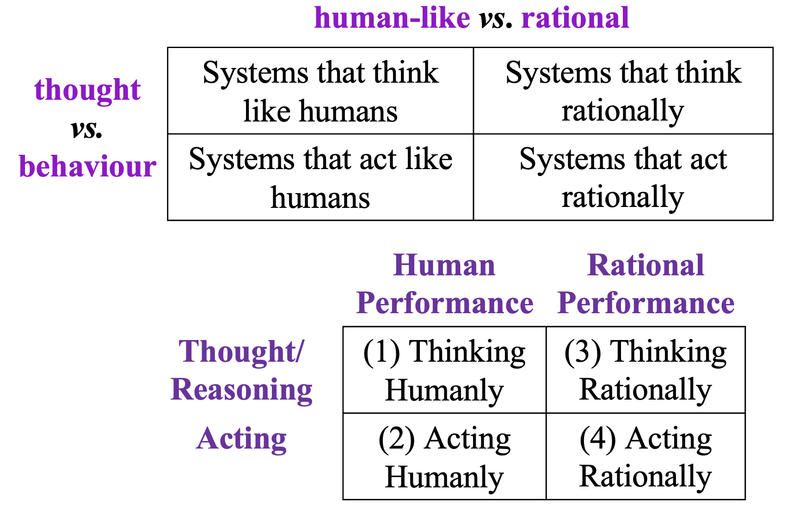

---
Notes completion status:
  - completed
---
# Module 1: Introduction

## AI Timeline

### Computing Foundations to the First AI Winter

The history of AI moves from building computing machinery to investigating machine intelligence, followed by periods when expectations exceeded results. The dates and claims of historical "firsts" are simplified markers and should not be treated as independently verified history.

- **Computing foundations (1900–1950):** Vacuum tubes, early robots, digital logic, and cybernetics helped make AI research possible; computation alone does not establish intelligence.
- **Turing test (1950):** Evaluates outward behavior through written interaction, rather than directly inspecting internal thought. The question shifts from what a machine can calculate to whether its responses can appear human.
- **Dartmouth milestone (1956):** John McCarthy and the Dartmouth proposal are associated with establishing *artificial intelligence* as a research field.
- **Early demonstrations:** The perceptron and an early AI program are placed in 1957; an industrial robot and ELIZA, a text-based conversation program, are placed in 1965. Public, media, and defense interest grew around early AI demonstrations.
- **ELIZA:** Its conversational behavior was rule-based. Human-like responses do not establish human-like thought, and using rules does not by itself exclude a system from AI.
- **First AI winter:** The period around 1973–1980 followed overpromising relative to actual capabilities. A downturn in enthusiasm did not mean all research stopped.
- **Central lesson:** Success at a narrow task does not establish broad intelligence. Exciting demonstrations and unmet expectations can coexist.

Test Your Understanding

**Questions**
1. What did the Turing test propose evaluating: a machine's internal thought process or its outward behavior?
2. Why is the Dartmouth milestone important in the development of AI?
3. Why did early excitement give way to the first AI winter?

**Answers**
1. Outward behavior, assessed through written responses rather than direct inspection of thought processes.
2. It is associated with the term artificial intelligence and the organization of machine intelligence as a research field.
3. Promises and expectations exceeded what AI systems could actually deliver.

### Continued Research, the Second Winter, and Deep Blue

- **Research continued:** Reduced enthusiasm did not stop technical developments. WABOT-2 (1980), Hopfield artificial neural networks (1982), parallel processing and backpropagation (1986), and convolutional neural networks (1989) mark continued progress.
- **Backpropagation:** This method allows multilayer networks to learn nonlinear mappings. It renewed hope, although much work remained in research laboratories.
- **Second AI winter:** Another downturn is placed between the 1980–1987 and 1993–2000 periods. Ambitious projects again failed to deliver, and some researchers identified with narrower fields rather than the broad AI label.
- **Other milestones:** RoboCup (1994), LSTM neural networks (1997), Sony AIBO (1999), and the Kismet robot (2000) show continued work in neural networks and robotics.
- **Deep Blue (1997):** IBM's chess system defeated world champion Garry Kasparov. This demonstrated a specific, measurable capability, not proof of human-like thought or general intelligence beyond chess.
- **Central lesson:** Progress in individual techniques and tasks can continue even when confidence in broader claims about AI declines.

Test Your Understanding

**Questions**
1. Why does an AI winter not mean that technical progress stopped?
2. What milestone did Deep Blue achieve in 1997?
3. Why does Deep Blue's achievement not establish human-like thought or general intelligence?

**Answers**
1. Research and new developments continued despite reduced interest and enthusiasm.
2. IBM's Deep Blue defeated the then-world chess champion, Garry Kasparov.
3. Winning at chess demonstrates performance in that task, not how closely its thinking resembles human thought or whether it can perform intelligently across other tasks.

### Research Milestones, Everyday AI, and Future Possibilities

- **The 2000s:** DARPA challenges, deep-belief neural networks, IBM Blue Brain, and Apple Siri mark a period when much AI activity remained centered on laboratories and competitions rather than widespread public use.
- **Deep learning:** AlexNet's 2012 performance on the ImageNet benchmark was followed by milestones including DeepMind, an AI research organization; generative adversarial networks, a model family; TensorFlow, a software framework; and AlphaGo, a game-playing system.
- **Transformers (2017):** *Attention Is All You Need* marked a major architectural development followed by rapid language-model development. Nearby timeline entries include WaveNet, GPT-1, BERT, and GPT-3; their placement does not imply that all share one architecture.
- **DALL-E:** Illustrates generating images from written descriptions, rather than only recognizing or classifying inputs.
- **ChatGPT (2022):** Its rapid public adoption illustrates the difference between technical progress, which concerns what systems can do, and adoption, which concerns whether people access and use those capabilities. Transformers preceded ChatGPT.
- **Deployment and governance:** Self-driving vehicles, regulation and ethics, Sora, the EU AI Act, and DeepSeek show that deployment, competition, and governance matter alongside technical performance.
- **Evaluating claims:** Adoption rankings are time-dependent. Claims that one model surpasses another need a specified task, model, and metric. A self-driving label does not by itself establish unrestricted autonomy.
- **Future possibilities:** AGI, ASI, singularity, and superhuman capabilities are possibilities, not established achievements.
- **Central distinction:** Technical progress, widespread adoption, and predictions about future capabilities are different things. Historical dates and claims require careful interpretation.

Test Your Understanding

**Questions**
1. How is technical progress different from public adoption? Use ChatGPT to illustrate.
2. What capability does DALL-E demonstrate?
3. Why are AGI, ASI, and singularity different from Deep Blue's 1997 achievement?

**Answers**
1. Technical progress improves what systems can do; public adoption concerns whether people access and use those capabilities. Transformers appeared in 2017, before ChatGPT in 2022, illustrating that adoption can follow earlier technical developments.
2. Generating images from written descriptions.
3. AGI, ASI, and singularity are future possibilities, whereas Deep Blue's victory over Garry Kasparov is a historical achievement.

## AI's Progress, Impact, and Application Areas

- **Recent progress:** More available data, greater computational power, and stronger algorithms and architectures, including deep learning, have contributed to faster AI progress.
- **AI's impact:** As AI takes on more tasks, its effects on jobs and people's roles remain an ongoing debate.
- **Application areas:** AI is used in healthcare, finance, education, automotive, retail, manufacturing, customer service, natural language processing, computer vision, robotics, smart cities, agriculture, entertainment, cybersecurity, environmental conservation, culinary work, and transportation.
- **Healthcare example:** Past patient data can support pre-screening, while a summary of a patient's history can help a doctor prepare for a consultation.
- **Future challenge:** A proposed 2030 goal is a team of fully autonomous humanoid robots defeating the human world-champion soccer team.
- AI has also advanced in vision, speech, translation, medical diagnosis, and game playing. Reported performance figures from 2018–2019 are historical snapshots, not current measurements.

Test Your Understanding

**Questions**
1. What three developments contributed to faster AI progress?
2. Name two AI application areas, and give one healthcare use.
3. What is the proposed 2030 humanoid-robot challenge?

**Answers**
1. Increased data availability, increased computational power, and improvements in AI algorithms and architectures.
2. Agriculture and healthcare are two application areas. Past data can support healthcare pre-screening.
3. Develop a team of fully autonomous humanoid robots that can beat the human world-champion soccer team.

## Foundations of AI and Intelligence

- **Disciplines contributing to AI:** Philosophy, mathematics, economics, neuroscience, psychology, computer engineering, control theory and cybernetics, and linguistics.
- **Contributions:**
  - Philosophy: logic and reasoning; questions about knowledge, learning, language, and rationality.
  - Mathematics: formal logic, representation and proof, computation, and algorithms.
  - Economics: rational decisions, decision theory under uncertainty, game theory, and Markov decision processes.
  - Neuroscience: brain function and comparison between brains and computers.
  - Psychology: how people think and act; cognitive psychology and cognitive science.
  - Computer engineering: building powerful machines that make AI possible.
  - Control theory and cybernetics, and linguistics are also named as contributing fields.
- **Intelligence:** Intelligent behavior involves learning, reasoning, understanding, perceiving, and acting in the world.
- **Examples of capabilities:** Reasoning can prove theorems or support medical diagnosis; planning selects actions; learning and adaptation can improve recommendations or respond to traffic patterns; understanding applies to text, speech, and visual scenes.
- **Human comparison:** Replicating human behavior was an early hallmark of intelligence, but humans do not always behave intelligently, and intelligent behavior need not look human.
- Philosophy contributes ideas about logic, knowledge, and action; mathematics contributes formal logic, probability, and computation; economics contributes decision theory and game theory; neuroscience studies brain function; and psychology develops models of cognition.

Test Your Understanding

**Questions**
1. Name three fields that contribute ideas to AI and one contribution from each.
2. What four capabilities are used here to describe intelligence?
3. Why does intelligence not have to look human?

**Answers**
1. Philosophy contributes logic and reasoning; computer engineering makes powerful machines possible; neuroscience studies brain function.
2. Reasoning, planning, learning and adaptation, and understanding.
3. Humans do not always behave intelligently, and intelligent behavior need not look human.

## Four Perspectives on AI

The diagram crosses two dimensions. Its columns distinguish human-like performance from rational performance; its rows distinguish thought from outward behavior. The four intersections are thinking humanly, acting humanly, thinking rationally, and acting rationally.

- **Human-like vs. rational:** Does the system imitate human performance, or aim for the right result?
- **Thought vs. behavior:** Is the focus on internal reasoning, or outward action?

| Perspective | Focus |
|---|---|
| Thinking humanly | Modeling human thought processes |
| Acting humanly | Producing behavior that appears human |
| Thinking rationally | Deriving correct conclusions through logical reasoning |
| Acting rationally | Choosing actions expected to achieve the best outcome |

- **Thinking humanly:** Introspection, psychological experiments, and brain imaging can inform models of human thought. Newell and Simon's General Problem Solver was assessed by comparing its reasoning traces with people's, not only by whether it solved a problem. Cognitive science combines computational models and psychological methods.
- **Acting humanly:** The Turing test asks whether a human interrogator can distinguish a computer's written responses from a person's. T1 describes natural-language processing, knowledge representation, automated reasoning, and machine learning as capabilities needed for this test. The total Turing test adds perception and physical interaction, requiring computer vision and robotics.
- **Thinking rationally:** The laws-of-thought approach formalizes valid reasoning. Aristotle's syllogisms illustrate how correct conclusions follow from correct premises. Logical deliberation is not behind every intelligent action, and large logical systems can be computationally expensive.
- **Acting rationally:** An agent chooses actions to achieve the best outcome, or the best expected outcome under uncertainty. Rational action may involve logical reasoning, but can also be a reflex that succeeds without explicit inference. Limited computational resources can prevent perfect rationality.
- **Examples:** Human-like thinking can draw on memory or habit; rational thinking follows a logical chain; human-like acting responds empathetically; rational acting selects a fast route toward a goal.
- Machine learning is a subfield of AI, not a requirement for every AI system. Real-world objectives can also be difficult to specify fully and correctly, creating a value-alignment problem.

Test Your Understanding

**Questions**
1. What two dimensions create the four perspectives on AI?
2. How does the Turing test differ from the thinking-humanly approach?
3. Why can an agent act rationally without explicit logical reasoning?

**Answers**
1. Human-like versus rational performance, and thought versus behavior.
2. The Turing test evaluates outward behavior: whether an interrogator can distinguish the machine's responses from a human's. Thinking humanly instead models internal human thought processes.
3. Rational action is judged by expected outcomes, not by whether it uses explicit logical steps. A reflex or action under uncertainty can be rational if it is expected to achieve the best result.

## Risks and Benefits of AI

- **Lethal autonomous weapons:** These weapons can locate, select, and eliminate human targets without human intervention; scaling deployment without human supervision creates serious risks.
- **Surveillance and persuasion:** AI can support mass surveillance and targeted information flows that may influence people's behavior.
- **Biased decisions:** Machine-learning systems used in decisions such as parole or loan applications can reproduce or amplify bias, including bias present in their data.
- **Employment:** AI may take on tasks people otherwise perform, while also increasing productivity and creating opportunities. The effects may include shifting wealth from labor to capital and worsening inequality.
- **Safety-critical applications:** Errors in driving or city water management can affect people's lives, so these systems need appropriate technical and ethical standards.
- **Cybersecurity:** AI can help detect unusual behavior and defend against attacks, but can also increase the effectiveness and spread of malicious software and automated abuse.
- **Other concerns:** Sustainability and deepfakes also raise concerns.
- **Potential benefits:** AI can reduce repetitive work, increase production, and accelerate research on diseases, climate change, and resource shortages. Governance and regulation matter alongside the risks above.

Test Your Understanding

**Questions**
1. Name two AI risks, and briefly describe one.
2. How can AI affect employment in both positive and negative ways?
3. Name one potential benefit of AI.

**Answers**
1. Risks include autonomous weapons, surveillance, biased decisions, employment disruption, safety-critical failures, and cybersecurity misuse. Autonomous weapons can locate, select, and eliminate human targets without human intervention.
2. AI may take over tasks and disrupt some jobs, but it can also increase productivity and create new kinds of work. Its benefits and economic effects may not be distributed evenly.
3. AI could increase production, reduce repetitive work, or accelerate scientific research on diseases, climate change, and resource shortages.

## Agents, Environments, and Rationality

- **Agent:** An entity that perceives its environment through sensors and acts on it through actuators. Examples include a human using eyes and hands, and a robot using cameras and motors.
- **Agent function:** Maps percept histories to actions, $f: P^* \rightarrow A$. An agent program runs on an architecture to produce the function: **agent = architecture + program**.

Consider a simple vacuum-cleaner world with two locations, A and B. The cleaning agent can sense its current location and whether that location is dirty; it can move left or right, suck up dirt, or do nothing.

- **Percept:** The information an agent receives from its environment at a particular time. In this world, `[A, Dirty]` means the agent is at A and perceives dirt there.
- **Percept history:** The agent function can depend on the sequence of percepts, not just the latest one. The agent senses, acts, and senses again.

| Current percept | Action |
|---|---|
| `[A, Clean]` | `Right` |
| `[A, Dirty]` | `Suck` |
| `[B, Clean]` | `Left` |
| `[B, Dirty]` | `Suck` |

- **Performance measure:** An objective criterion for success. For the vacuum agent, measures can include dirt cleaned, time taken, electricity consumed, and noise generated.
- **Rational agent:** Chooses an action expected to maximize its performance measure, based on percepts so far and built-in knowledge. Rationality is distinct from omniscience; agents may gather information to improve future decisions.
- **Autonomy:** An agent is more autonomous when behavior depends on its own experience, including learning and adaptation.
- **Bounded rationality:** Limited knowledge and computational resources can prevent an agent from calculating a perfect optimum. It chooses the best action it can determine within those limits.

Test Your Understanding

**Questions**
1. In the vacuum example, what does the percept `[B, Dirty]` tell the agent?
2. What action does the simple table prescribe for `[B, Clean]`, and why?
3. How does bounded rationality affect an agent's ability to choose the “best” action?

**Answers**
1. The agent is at location B and perceives that B is dirty.
2. `Left`, to move from B toward A.
3. Limited information and computational resources may prevent the agent from finding the perfect optimum. It chooses the best action it can determine with the resources and knowledge available.

## PEAS and Task Environments

PEAS stands for **Performance measure, Environment, Actuators, Sensors**. It specifies what counts as success, where the agent operates, how it acts, and what information it can sense.

Two systems make the categories concrete. A medical-diagnosis system gathers a patient's symptoms and findings, then presents questions, tests, diagnoses, treatments, or referrals. A part-picking robot monitors components on a conveyor and uses its arm to sort them into bins.

| PEAS element | Medical-diagnosis system | Part-picking robot |
|---|---|---|
| **Performance measure** | Healthy patient; minimize costs and lawsuits | Percentage of parts in the correct bins |
| **Environment** | Patient, hospital, staff | Conveyor belt, parts, bins |
| **Actuators** | Screen display for questions, tests, diagnoses, treatments, referrals | Jointed arm and hand; motors |
| **Sensors** | Keyboard entries for symptoms, findings, and patient answers; voice input may also be used | Camera and joint-angle sensors; infrared sensors may also be used |

The performance measure describes the desired result, not the mechanism used to produce it. A diagnosis system's displayed test recommendation is an actuator because it communicates an action to the patient or clinician. A healthy patient is part of the performance measure.

:::tip[Think It Through]
**Prompt:** In the medical-diagnosis example, is displaying a recommended test an actuator or part of the performance measure?

**Answer:** It is an actuator because the display communicates the test recommendation to the patient or clinician, allowing the agent to affect the environment. The desired outcome, such as a healthy patient, belongs in the performance measure.
:::

For the part-picking robot, correct sorting is the primary performance measure. Speed, noise, and energy use can be additional measures, depending on how success is defined. Its environment includes the conveyor belt, the parts being moved, and the bins where they belong; naming only the conveyor leaves out both the items and their destinations.

:::tip[Think It Through]
**Prompt:** If the robot sorts almost every part correctly but uses excessive energy and makes a lot of noise, how could its performance measure represent both the primary goal and those secondary concerns?

**Answer:** Correct-bin percentage can remain the primary measure, while energy use and noise are secondary performance metrics or penalties. Their weights depend on how performance is defined; the materials do not specify them.
:::

A driverless taxi carries passengers to requested destinations through roads and traffic. Its performance measures can include safety, legality, speed, passenger comfort, profit, and fuel efficiency. Roads, traffic, signals, pedestrians, other vehicles, carts, and customers are part of its environment. Steering, acceleration, braking, signaling, and the horn are actuators; cameras, sonar, speedometer, GPS, odometer, engine sensors, and passenger input provide percepts.

A domestic trading agent helps a family buy needed items by collecting purchase requirements and comparing offers from online sellers. Family members submit each item's name, needed-by date, and price limit. The agent sends the purchase details to seller agents, receives their bids, compares them, and places orders. Its utility improves when orders meet the delivery date and cost less. Mapping the family requirements and seller bids to sensors, and publishing requests and placing orders to actuators, is an interpretation of the stated interactions; the exam question does not specify a particular interface.

:::tip[Think It Through]
**Prompt:** Which details of the domestic trading agent are explicitly given, and which PEAS details are inferred from its interactions?

**Answer:** The item name, needed-by date, price limit, seller bids, and order placement are explicitly stated. Treating requests and bids as sensor inputs, and publishing requests and placing orders as actuator outputs, is a reasonable interpretation because the interface is not specified.
:::

🎯 **Exam hint:** PEAS is important for the exam and may appear as a short question. Given an agent scenario, identify what success means, the external environment, the agent's outputs/actions, and its inputs/percepts.

From Previous Question Papers

**Questions**
1. Give a PEAS description for a domestic trading agent that buys family items through competing online sellers. *(2019 Mid-sem Regular Q1c)*
2. Give a PEAS description for an automated garbage collection and segregation robot. *(Feb 2025 Mid-sem Makeup Q2b)*
3. Give a PEAS description for an automated criminal-identification system using surveillance cameras. *(Jul 2025 Mid-sem Makeup Q1b)*
4. Give a PEAS description for an automated manufacturing quality-control system. *(Jun 2025 Mid-sem Regular Q1b; ACI EC2 Sample1 Q3b)*
5. Give a PEAS description for a smart hospital service robot. *(Jun 2026 Mid-sem Regular Set 1 Q2A)*
6. Give a PEAS description for a campus delivery robot, BheemaBot. *(Jun 2026 Mid-sem Makeup Set 1 Q2A)*
7. Give a PEAS description for a smart-home assistant. *(Jun 2026 Mid-sem Makeup Set 2 Q2A)*
8. Give a PEAS description for an autonomous stock-trading agent. *(Jun 2026 Mid-sem Regular Set 2 Q2A)*

**Answers**
1. **P:** timely delivery and low cost. **E:** family purchase requests and online sellers. **A:** publish requests and place orders. **S:** item details, deadlines, price limits, and seller bids.
2. **P:** accurate, efficient waste collection and sorting. **E:** urban streets, waste, pedestrians, and vehicles. **A:** wheels and robotic sorting arms/compartments. **S:** waste-detection and classification inputs, plus obstacle-detection sensors.
3. **P:** identification accuracy, low false-match rate, detection speed, and operational efficiency. **E:** monitored public areas, crowds, and the criminal-record database. **A:** alerts and camera controls. **S:** CCTV feeds and motion, facial, or biometric inputs.
4. **P:** defect-detection accuracy, low false-positive/negative rates, inspection speed, throughput, and cost-efficiency. **E:** factory floor, production line, components, and standards database. **A:** approve or reject parts, divert defective components, log results, and raise alerts. **S:** inspection cameras and sensors at production checkpoints.
5. **P:** timely medicine/sample delivery, patient safety, emergency prioritization, collision avoidance, and data security. **E:** hospital corridors, wards, patients, staff, labs, and equipment. **A:** wheels, delivery tray/arm, display, speaker, alerts, and communication. **S:** cameras, distance sensors, barcode/RFID readers, touch or localization sensors.
6. **P:** correct, timely, safe deliveries with low energy use and few rule violations. **E:** campus roads and paths, buildings, people, vehicles, weather, construction, and obstacles. **A:** wheels, brakes, steering, delivery compartment, display, and notifications. **S:** cameras, distance sensors, GPS/map, encoders, location readers, and rain/obstacle sensors.
7. **P:** comfort, safety, energy efficiency, convenience, privacy, and few incorrect actions. **E:** apartment, occupants, appliances, visitors, possible intruders, and weather. **A:** switch or adjust devices, lock doors, open curtains, trigger alarms, and send notifications. **S:** motion, temperature, electricity, camera, microphone, mobile-app, door, time, and usage-pattern inputs.
8. **P:** risk-adjusted returns, low losses and transaction costs, regulatory compliance, diversification, and respect for the user's risk profile. **E:** stock market, news, rates, portfolio, broker, regulations, other traders, and economic events. **A:** buy, sell, hold, rebalance, set stop-loss orders, and alert. **S:** prices, volume, news sentiment, rates, risk profile, portfolio value, volatility, and market indicators.

Test Your Understanding

**Questions**
1. What does each letter in PEAS stand for?
2. For the automated taxi, name one environment element and one sensor.
3. Why specify a performance measure when designing an agent?
4. For the part-picking robot, classify "percentage of parts in the correct bins," "conveyor belt and bins," "jointed arm," and "camera" using PEAS. Explain one choice.

**Answers**
1. Performance measure, Environment, Actuators, and Sensors.
2. Other traffic is an environment element; cameras are a sensor.
3. The performance measure defines whether the agent succeeds and how well it performs.
4. Performance measure; environment; actuator; sensor. The jointed arm is an actuator because it moves the parts and changes the environment.

