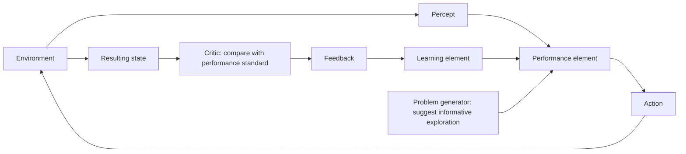

# Module 2: Intelligent Agents

An intelligent agent perceives its environment, chooses actions, and aims to meet a task's performance measure. The environment and decision structure shape the agent design, from reflex rules to planning, learning, and problem-solving.

## Nature of Task Environments

An agent's task environment affects what it can know, how predictable its actions are, whether today's choices constrain later ones, and whether other decision-makers influence outcomes. These are separate dimensions: a task can be, for example, both partially observable and multi-agent, or discrete and sequential.

### Observability, Uncertainty, and Decision Dependence

An environment is **fully observable** when the agent's sensors provide the complete relevant state. It is **partially observable** when some relevant information is hidden or unavailable, as in poker, where a player cannot see opponents' cards. The course also uses **unobservable** for a setting where the agent receives no useful view of the state, such as a vehicle in total darkness without usable sensing.

An environment is **deterministic** when the current state and action determine the next state. It is **stochastic** when the next state is uncertain. A calculator is deterministic; weather and robot soccer are stochastic examples because outside factors or other agents can change the outcome. AIMA distinguishes stochastic models, which assign probabilities to outcomes, from nondeterministic models, which list possible outcomes without probabilities.

:::tip[Think It Through]
**Prompt:** Why is robot soccer stochastic even if the robot's own kicking action is predictable?

**Answer:** Other agents can change the outcome: a goalkeeper may block the shot. The kick alone does not determine the next state. In the course's classification this is stochastic; a formal model is stochastic when it assigns probabilities to the possible outcomes.
:::

An **episodic** task consists of independent decisions: each percept-action episode does not affect the next, as when classifying separate images or filtering separate emails. A **sequential** task has decisions whose consequences carry forward. Chess is sequential because each move changes the board and the choices available later; investment decisions can also affect future choices and outcomes.

:::tip[Think It Through]
**Prompt:** An agent classifies each incoming image independently, while a chess agent's move changes the board for later turns. Which environment is episodic and which is sequential? What determines the difference?

**Answer:** Image classification is episodic because one classification does not affect later classifications. Chess is sequential because a move changes the board and therefore the states and actions that follow.
:::

⚠️ **Emphasised by lecturer:** Sequential decision-making is central to chess: a move is chosen partly for the position and options it creates later.

### Change, Representation, and Other Agents

A **static** environment does not change while the agent deliberates; a crossword puzzle or an untimed chess position is static. A **dynamic** environment can change while the agent is thinking, as with traffic or robot soccer. A **semi-dynamic** environment leaves the world state unchanged during deliberation but changes the agent's performance score as time passes; timed chess is the example.

#### Can a semi-dynamic environment exist without time?

Under this definition, no: semi-dynamic means the score changes as time passes even though the environment state remains unchanged. If neither the state nor the score changes while the agent thinks, the environment is static. If the state changes during deliberation, it is dynamic.

An environment is **discrete** when its states, percepts, and actions come from distinct countable possibilities. Chess has discrete board positions and moves, even though the number of possible positions is very large. An environment is **continuous** when relevant values vary over ranges, as with a taxi's position, speed, and steering angle.

A **single-agent** environment has one decision-making agent relevant to the task. A **multi-agent** environment includes other entities that perceive and act and can affect outcomes; it does not mean that one system has multiple sensors or performs multiple tasks. An English tutor and its student form a multi-agent environment because the student also perceives and acts, while books and notes do not.

Multi-agent settings may be **cooperative**, **competitive**, or partly both. Agents cooperate when some performance goals align; they compete when one agent's outcome conflicts with another's. These labels do not require agents to act as one or to have identical goals. In a hospital, a robot, staff, and patients may have partly aligned goals around safety and timely care while still acting independently. In traffic, avoiding collisions benefits all drivers, while competition for one parking space can coexist with that cooperation.

:::tip[Think It Through]
**Prompt:** A hospital robot shares corridors with patients, staff, and other robots. What makes this multi-agent, rather than merely dynamic?

**Answer:** Patients, staff, and other robots are separate entities that can perceive, act, and influence outcomes, so the environment is multi-agent. It is also dynamic if the corridor state changes while the robot deliberates. Some goals, such as safety and timely care, may align even though each agent acts independently.
:::

Some task descriptions also distinguish **known** from **unknown** environments. Known means the agent knows the effects of its actions (or their outcome probabilities); unknown means it must learn how actions affect the world. This is separate from observability: an agent can know the rules yet have hidden information, or see the complete state without knowing what its actions do. A card game can have known rules and hidden cards; a new game can show its entire state while the agent does not yet know what the controls do.

### Comparing Chess and Robot Soccer

Deep Blue is a chess-playing system. Its board is visible, legal moves have rule-determined effects, and each move changes the options for later turns. A soccer-playing robot shares a changing field with opponents and teammates; other players can move or block a shot while it acts. The table contrasts these task environments.

| Environment dimension | Chess (Deep Blue) | Robot soccer |
|---|---|---|
| Observability | Fully observable | Partially observable |
| Outcome | Deterministic | Stochastic |
| Decision dependence | Sequential | Sequential |
| Change during deliberation | Static; semi-dynamic if timed | Dynamic |
| State and actions | Discrete | Continuous |
| Number of agents | Multi-agent | Multi-agent |

### Previous-Exam Applications

Task-environment questions ask for labels **and** brief justifications. The scenario and its assumptions matter; do not treat a label as universal when the prompt leaves the setup open.

From Previous Question Papers

**Questions**
1. For a domestic trading agent, say whether its task is fully observable, multi-agent, stochastic, and episodic, giving one-line reasons. *(2019 Mid-sem Regular Q1d)*
2. Classify the task environment of an urban garbage-collection and segregation robot. *(Feb 2025 Mid-sem Makeup Q2c)*
3. Classify the task environment of a surveillance-based criminal-identification system. *(Jul 2025 Mid-sem Makeup Q1c)*
4. Classify the task environment of an automated manufacturing quality-control system. *(Jun 2025 Mid-sem Regular Q1c; ACI EC2 Sample1 Q3c)*
5. Classify the task environment of a smart hospital service robot. *(Jun 2026 Mid-sem Regular Set 1 Q2B)*
6. Classify the task environment of BheemaBot, a campus delivery robot. *(Jun 2026 Mid-sem Makeup Set 1 Q2B)*
7. Classify the task environment of a smart-home assistant. *(Jun 2026 Mid-sem Makeup Set 2 Q2B)*
8. Classify the task environment of an autonomous investment agent. *(Jun 2026 Mid-sem Regular Set 2 Q2B)*

**Answers**
1. **Multi-agent** is clear because the agent interacts with seller agents. The other labels depend on assumptions the prompt does not settle: full observability requires all decision-relevant information to be available; stochasticity depends on uncertain outcomes; episodicity depends on whether one purchase affects later purchases. State assumptions rather than asserting unsupported labels.
2. A plausible real-street model is partially observable, stochastic, sequential, dynamic, continuous, and multi-agent: sensors provide limited views; crowds and vehicles affect outcomes; route and collection choices affect later states; the physical scene changes; movement has continuous values; and people and vehicles act.
3. The provided sample answer classifies it as fully observable, deterministic, dynamic, discrete, and multi-agent, assuming camera inputs capture the relevant features and matching follows a fixed process. People move during monitoring, match/no-match results are discrete, and people as well as the system affect the setting.
4. Under the paper's assumptions: fully observable, deterministic, episodic, static, discrete, and single-agent. Sensors capture the component attributes; classification is predictable; inspections are independent; the scene is stable during each inspection; outcomes are pass/fail; and the automated system is the only decision-maker.
5. Partially observable, multi-agent, stochastic, sequential, dynamic, continuous, and partly known: the robot cannot see every corridor state; patients and staff act; crowds and emergencies create uncertainty; actions affect later position and tasks; people move while it plans; motion and time vary continuously; and live conditions are not fully known.
6. Partially observable, multi-agent, stochastic, sequential, dynamic, continuous, and partly unknown. Crowds, rain, construction, and people deliberately blocking the path limit observation and make outcomes uncertain; route choices affect later delivery; and the campus can change while the robot moves.
7. Partially observable, multi-agent, stochastic, sequential, dynamic, mixed discrete/continuous, and partly unknown. Occupants and visitors act; sensor readings and intentions are incomplete; actions affect later comfort and energy use; and device states, temperature, movement, and usage patterns change over time.
8. Partially observable, stochastic, sequential, dynamic, continuous, and multi-agent. The agent cannot observe every market cause; prices and outcomes are uncertain; investment choices affect future wealth; markets change over time; values are numeric; and other traders affect outcomes.

Test Your Understanding

**Questions**
1. Classify an untimed chess game as fully or partially observable, deterministic or stochastic, episodic or sequential, static or dynamic, discrete or continuous, and single-agent or multi-agent. Explain one choice.

**Answers**
1. Fully observable, deterministic, sequential, static, discrete, and multi-agent. The complete board is visible; chess rules determine move effects; each move affects later states; an untimed board does not change while the agent thinks; moves and positions are discrete; and an opponent is another agent.

## Agent Functions and Architectures

An agent function describes which action to take for every possible percept history. An agent program implements that mapping on an architecture that receives percepts and carries out actions. Agent designs differ in what information they retain and how they use it to choose actions.

### Agent Functions and Table Lookup

A **percept** is the information sensed at one moment; a **percept sequence** is the full history of percepts. A table-driven program appends each new percept to the history and looks up the action assigned to that complete sequence.

This gives a direct implementation of an agent function, but the table becomes impractical. With each additional percept, the number of possible histories grows; the table can become enormous or unbounded. It takes too much time to construct and search, and an agent cannot realistically learn every entry. Looking up fixed entries also provides little autonomy.

:::tip[Think It Through]
**Prompt:** Why might a table-driven agent need the entire percept sequence, and what makes storing every possible sequence impractical?

**Answer:** Skipped. The agent function can assign different actions to identical current percepts depending on what it perceived earlier, so the lookup key is the full percept sequence. The number of possible sequences grows rapidly with their length, making the table too large and costly to build, search, or learn.
:::

### Reflex, Model-Based, Goal-Based, and Utility-Based Agents

A **simple reflex agent** chooses an action from the current percept using condition–action rules. In the two-room vacuum world, the agent senses whether its current square is dirty: if dirty, it sucks; if clean, it moves to the other square. It does not retain information about earlier percepts, so it cannot use history to infer the state of a square it cannot currently observe.

A **model-based reflex agent** keeps an internal state that summarizes relevant percept history and the agent's best estimate of the world. A **transition model** describes how actions and other changes affect the world; a **sensor model** describes how world states produce percepts. The agent updates its state from its previous state, last action, and new percept, then applies condition–action rules. Its estimate can remain uncertain when information is hidden.

:::tip[Think It Through]
**Prompt:** A vacuum agent sees `[A, Clean]`. In one situation square B is dirty; in another B is clean. Why might a simple reflex agent give the same response, while a model-based agent could respond differently?

**Answer:** The simple reflex agent sees the same current percept in both cases and applies the same rule. A model-based agent can use its internal state, updated from earlier percepts and actions, to distinguish what it believes about B. It can only do so if its observations or model support that estimate; the state is not guaranteed to be perfectly accurate.
:::

A **goal-based agent** adds information about a desired state and uses its model to consider which actions could achieve it. A driverless taxi that needs to reach a passenger's destination can compare possible turns by asking where each is expected to lead. Search and planning can help find action sequences that reach the goal.

A **utility-based agent** assigns values to outcomes so it can rank alternatives, not merely mark them as goal or non-goal. Several routes may reach the destination, but differ in safety, speed, and cost. Utility supports trade-offs among these qualities and, under uncertainty, choosing actions with the best expected utility.

:::tip[Think It Through]
**Prompt:** Two taxi routes reach the passenger's destination. One is faster but less safe; the other is slower but safer. Why can a utility-based agent distinguish them when a simple goal test cannot?

**Answer:** A goal test marks both routes as successful because both reach the destination. A utility function can rank their outcomes by desirability and trade off safety, speed, and cost.
:::

The course slides group five designs: simple reflex, model-based reflex, goal-based, utility-based, and learning-based agents. AIMA describes the first four as basic action-selection designs and explains learning as a capability that can improve any of them. These are compatible views: a learning agent can, for example, improve a model-based or utility-based performance element.

### Learning Agents

A **performance element** selects an external action from the agent's percepts and state; it is the action-selection part of the agent. A **learning element** changes the performance element so it can make better choices in the future. A **critic** evaluates the result against a fixed performance standard and provides feedback. A **problem generator** suggests exploratory actions that may produce informative experience, even if an action is not currently the best-known choice.

In the braking example, a car agent perceives a red signal and the performance element applies the brake. If the car overshoots the stopping point, the critic assigns negative feedback (the diagram shows `-2`) against the stopping standard. The learning element uses that feedback to adjust future braking choices. The example uses a change from `17 kN` to `15 kN` to illustrate adjustment; the point is to learn from the outcome, not to prescribe those values as general braking guidance.

:::tip[Think It Through]
**Prompt:** Why does a learning agent need a critic to evaluate its action? Isn't observing the red signal and the car's resulting position enough?

**Answer:** Percepts describe what the agent observed, but do not by themselves say whether the result met its performance standard. The critic evaluates the result and supplies feedback; the learning element uses it to improve the performance element.
:::

:::tip[Think It Through]
**Prompt:** In the red-light braking example, identify the performance element, critic, learning element, and problem generator. What should happen after the critic reports that the car overshot?

**Answer:** The performance element chooses and applies braking; the critic scores the stopping result against the standard; the learning element uses the negative feedback to improve future braking choices; and the problem generator suggests informative exploratory actions. The performance element's job is to act, while the performance standard defines what counts as success.
:::

### Representing Internal States

Agent components can represent the world in different ways. An **atomic representation** treats a state as an indivisible label; for a route-finding agent, the state might be only the current city, such as Arad. A **factored representation** describes a state with attributes, such as city, fuel level, and available money. A **structured representation** describes objects and their relationships, such as a truck blocking a road or a cow standing behind it. More expressive representations capture richer structure, but can make reasoning more complex.

:::tip[Think It Through]
**Prompt:** In the route-finding example, which representation records only “Arad,” and which could also record the agent's fuel level?

**Answer:** “Arad” alone is atomic. Recording both the city and fuel level is factored because the state has multiple attributes.
:::

🎯 **Exam hint:** Given a scenario, be prepared to choose an appropriate agent design; a diagram may also need to be identified as simple reflex, model-based, goal-based, utility-based, or learning-based.

From Previous Question Papers

**Questions**
1. Explain how a model-based agent maintains an internal state representing relevant aspects of the world, and give two possible representations of that state. *(Aug 2019 Mid-sem Makeup Q1a)*

**Answers**
1. It updates an internal state from earlier state information, its previous action, and new percepts using transition and sensor models. Two possible representations are atomic (a state as one indivisible label) and factored (a state as a set of attributes); structured representations are another option.

Test Your Understanding

**Questions**
1. In the red-light braking example, identify the learning agent's four components and state what should happen after the critic reports that the car overshot.

**Answers**
1. The performance element selects and applies braking; the critic evaluates the result against the performance standard; the learning element uses the negative feedback to improve future action selection; and the problem generator suggests informative exploratory actions. After an overshoot, the learning element should adjust the performance element's future braking choices.

