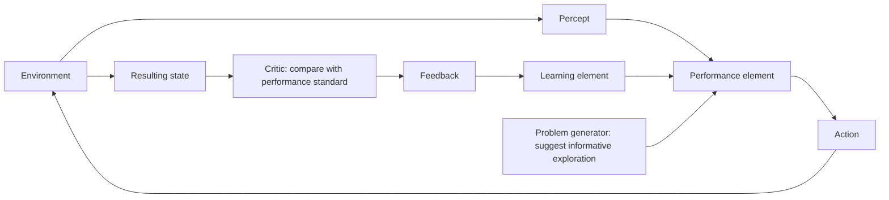
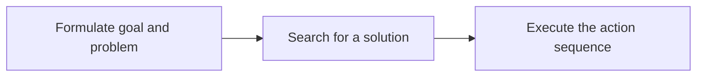
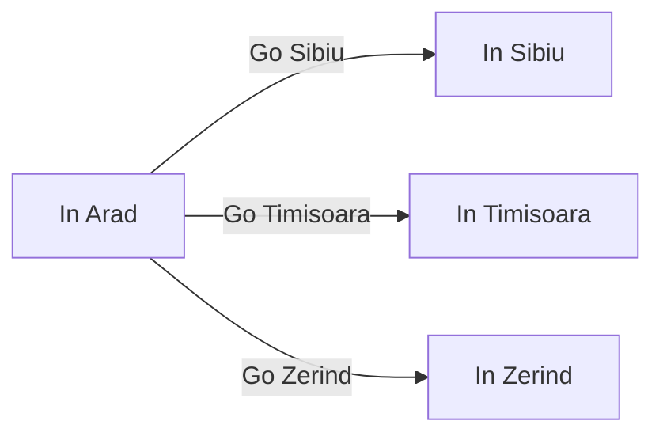

# Module 2: Intelligent Agents


An intelligent agent perceives its environment, chooses actions, and aims to meet a task's performance measure. The environment and decision structure shape the agent design, from reflex rules to planning, learning, and problem-solving.

## Nature of Task Environments

An agent's task environment affects what it can know, how predictable its actions are, whether today's choices constrain later ones, and whether other decision-makers influence outcomes. These are separate dimensions: a task can be, for example, both partially observable and multi-agent, or discrete and sequential.

### Common Task Environment Profiles

The dimensions can be combined to describe a task. These profiles assume the task is framed as shown; changing what the agent must do or what it can sense may change a classification.

| Task environment | Observable | Agents | Outcome | Episode | Change while thinking | State/actions |
|---|---|---|---|---|---|---|
| Crossword puzzle | Fully | Single | Deterministic | Sequential | Static | Discrete |
| Chess with a clock | Fully | Multi | Deterministic | Sequential | Semi-dynamic | Discrete |
| Poker | Partially | Multi | Stochastic | Sequential | Static | Discrete |
| Backgammon | Fully | Multi | Stochastic | Sequential | Static | Discrete |
| Taxi driving | Partially | Multi | Stochastic | Sequential | Dynamic | Continuous |
| Medical diagnosis | Partially | Single | Stochastic | Sequential | Dynamic | Continuous |
| Image analysis | Fully | Single | Deterministic | Episodic | Semi-dynamic | Continuous |
| Part-picking robot | Partially | Single | Stochastic | Episodic | Dynamic | Continuous |
| Refinery controller | Partially | Single | Stochastic | Sequential | Dynamic | Continuous |
| English tutor | Partially | Multi | Stochastic | Sequential | Dynamic | Discrete |

Medical diagnosis illustrates why assumptions matter. Choosing one diagnosis from a fixed list of symptoms can be episodic; choosing tests and following treatment over time makes the task sequential. The table uses the latter framing.

### Observability, Uncertainty, and Decision Dependence

An environment is **fully observable** when the agent's sensors provide the complete relevant state. It is **partially observable** when some relevant information is hidden or unavailable, as in poker, where a player cannot see opponents' cards. An **unobservable** environment provides no useful view of the state, such as a vehicle in total darkness without usable sensing.

An environment is **deterministic** when the current state and action determine the next state. It is **stochastic** when the next state is uncertain. A calculator is deterministic; weather and robot soccer are stochastic examples because outside factors or other agents can change the outcome. A stochastic model assigns probabilities to outcomes; a nondeterministic model lists possible outcomes without assigning probabilities.

:::tip[Think It Through]

**Prompt:** Why is robot soccer stochastic even if the robot's own kicking action is predictable?

**Answer:** Other agents can change the outcome: a goalkeeper may block the shot. The kick alone does not determine the next state. A stochastic model assigns probabilities to the possible outcomes.

:::

An **episodic** task consists of independent decisions: each percept-action episode does not affect the next, as when classifying separate images or filtering separate emails. A **sequential** task has decisions whose consequences carry forward. Chess is sequential because each move changes the board and the choices available later; investment decisions can also affect future choices and outcomes.

:::tip[Think It Through]

**Prompt:** An agent classifies each incoming image independently, while a chess agent's move changes the board for later turns. Which environment is episodic and which is sequential? What determines the difference?

**Answer:** Image classification is episodic because one classification does not affect later classifications. Chess is sequential because a move changes the board and therefore the states and actions that follow.

:::

⚠️ **Emphasised by lecturer:** Sequential decision-making is central to chess: a move is chosen partly for the position and options it creates later.

### Change, Representation, and Other Agents

A **static** environment does not change while the agent deliberates; a crossword puzzle or an untimed chess position is static. A **dynamic** environment can change while the agent is thinking, as with traffic or robot soccer. A **semi-dynamic** environment leaves the world state unchanged during deliberation but changes the agent's performance score as time passes; timed chess is the example.

#### Can a semi-dynamic environment exist without time?

Under this definition, no: semi-dynamic means the score changes as time passes even though the environment state remains unchanged. If neither the state nor the score changes while the agent thinks, the environment is static. If the state changes during deliberation, it is dynamic.

An environment is **discrete** when its states, percepts, and actions come from distinct countable possibilities. Chess has discrete board positions and moves, even though the number of possible positions is very large. An environment is **continuous** when relevant values vary over ranges, as with a taxi's position, speed, and steering angle.

A **single-agent** environment has one decision-making agent relevant to the task. A **multi-agent** environment includes other entities that perceive and act and can affect outcomes; it does not mean that one system has multiple sensors or performs multiple tasks. An English tutor and its student form a multi-agent environment because the student also perceives and acts, while books and notes do not.

Multi-agent settings may be **cooperative**, **competitive**, or partly both. Agents cooperate when some performance goals align; they compete when one agent's outcome conflicts with another's. These labels do not require agents to act as one or to have identical goals. In a hospital, a robot, staff, and patients may have partly aligned goals around safety and timely care while still acting independently. In traffic, avoiding collisions benefits all drivers, while competition for one parking space can coexist with that cooperation.

:::tip[Think It Through]

**Prompt:** A hospital robot shares corridors with patients, staff, and other robots. What makes this multi-agent, rather than merely dynamic?

**Answer:** Patients, staff, and other robots are separate entities that can perceive, act, and influence outcomes, so the environment is multi-agent. It is also dynamic if the corridor state changes while the robot deliberates. Some goals, such as safety and timely care, may align even though each agent acts independently.

:::

Some task descriptions also distinguish **known** from **unknown** environments. Known means the agent knows the effects of its actions (or their outcome probabilities); unknown means it must learn how actions affect the world. This is separate from observability: an agent can know the rules yet have hidden information, or see the complete state without knowing what its actions do. A card game can have known rules and hidden cards; a new game can show its entire state while the agent does not yet know what the controls do.

### Comparing Chess and Robot Soccer

Deep Blue is a chess-playing system. Its board is visible, legal moves have rule-determined effects, and each move changes the options for later turns. A soccer-playing robot shares a changing field with opponents and teammates; other players can move or block a shot while it acts. The table contrasts these task environments.

| Environment dimension | Chess (Deep Blue) | Robot soccer |
|---|---|---|
| Observability | Fully observable | Partially observable |
| Outcome | Deterministic | Stochastic |
| Decision dependence | Sequential | Sequential |
| Change during deliberation | Static; semi-dynamic if timed | Dynamic |
| State and actions | Discrete | Continuous |
| Number of agents | Multi-agent | Multi-agent |

### Previous-Exam Applications

Task-environment questions ask for labels **and** brief justifications. The scenario and its assumptions matter; do not treat a label as universal when the prompt leaves the setup open.

<details className="alert alert--info">
<summary>From Previous Question Papers</summary>

**Questions**
1. For a domestic trading agent, say whether its task is fully observable, multi-agent, stochastic, and episodic, giving one-line reasons. *(2019 Mid-sem Regular Q1d)*
2. Classify the task environment of an urban garbage-collection and segregation robot. *(Feb 2025 Mid-sem Makeup Q2c)*
3. Classify the task environment of a surveillance-based criminal-identification system. *(Jul 2025 Mid-sem Makeup Q1c)*
4. Classify the task environment of an automated manufacturing quality-control system. *(Jun 2025 Mid-sem Regular Q1c; ACI EC2 Sample1 Q3c)*
5. Classify the task environment of a smart hospital service robot. *(Jun 2026 Mid-sem Regular Set 1 Q2B)*
6. Classify the task environment of BheemaBot, a campus delivery robot. *(Jun 2026 Mid-sem Makeup Set 1 Q2B)*
7. Classify the task environment of a smart-home assistant. *(Jun 2026 Mid-sem Makeup Set 2 Q2B)*
8. Classify the task environment of an autonomous investment agent. *(Jun 2026 Mid-sem Regular Set 2 Q2B)*

**Answers**
1. **Multi-agent** is clear because the agent interacts with seller agents. The other labels depend on assumptions the prompt does not settle: full observability requires all decision-relevant information to be available; stochasticity depends on uncertain outcomes; episodicity depends on whether one purchase affects later purchases. State assumptions rather than asserting unsupported labels.
2. A plausible real-street model is partially observable, stochastic, sequential, dynamic, continuous, and multi-agent: sensors provide limited views; crowds and vehicles affect outcomes; route and collection choices affect later states; the physical scene changes; movement has continuous values; and people and vehicles act.
3. Under the assumption that cameras capture all relevant features and matching follows a fixed process, classify it as fully observable, deterministic, dynamic, discrete, and multi-agent. People move during monitoring, match/no-match results are discrete, and people as well as the system affect the setting.
4. Under the paper's assumptions: fully observable, deterministic, episodic, static, discrete, and single-agent. Sensors capture the component attributes; classification is predictable; inspections are independent; the scene is stable during each inspection; outcomes are pass/fail; and the automated system is the only decision-maker.
5. Partially observable, multi-agent, stochastic, sequential, dynamic, continuous, and partly known: the robot cannot see every corridor state; patients and staff act; crowds and emergencies create uncertainty; actions affect later position and tasks; people move while it plans; motion and time vary continuously; and live conditions are not fully known.
6. Partially observable, multi-agent, stochastic, sequential, dynamic, continuous, and partly unknown. Crowds, rain, construction, and people deliberately blocking the path limit observation and make outcomes uncertain; route choices affect later delivery; and the campus can change while the robot moves.
7. Partially observable, multi-agent, stochastic, sequential, dynamic, mixed discrete/continuous, and partly unknown. Occupants and visitors act; sensor readings and intentions are incomplete; actions affect later comfort and energy use; and device states, temperature, movement, and usage patterns change over time.
8. Partially observable, stochastic, sequential, dynamic, continuous, and multi-agent. The agent cannot observe every market cause; prices and outcomes are uncertain; investment choices affect future wealth; markets change over time; values are numeric; and other traders affect outcomes.

</details>

<details className="alert alert--info">
<summary>Test Your Understanding</summary>

**Questions**
1. Classify an untimed chess game as fully or partially observable, deterministic or stochastic, episodic or sequential, static or dynamic, discrete or continuous, and single-agent or multi-agent. Explain one choice.

**Answers**
1. Fully observable, deterministic, sequential, static, discrete, and multi-agent. The complete board is visible; chess rules determine move effects; each move affects later states; an untimed board does not change while the agent thinks; moves and positions are discrete; and an opponent is another agent.

</details>

## Agent Functions and Architectures

An agent function describes which action to take for every possible percept history. An agent program implements that mapping on an architecture that receives percepts and carries out actions. Agent designs differ in what information they retain and how they use it to choose actions.

### Agent Functions and Table Lookup

A **percept** is the information sensed at one moment; a **percept sequence** is the full history of percepts. A table-driven program appends each new percept to the history and looks up the action assigned to that complete sequence.

This gives a direct implementation of an agent function, but the table becomes impractical. With each additional percept, the number of possible histories grows; the table can become enormous or unbounded. It takes too much time to construct and search, and an agent cannot realistically learn every entry. Looking up fixed entries also provides little autonomy.

:::tip[Think It Through]

**Prompt:** Why might a table-driven agent need the entire percept sequence, and what makes storing every possible sequence impractical?

**Answer:** Skipped. The agent function can assign different actions to identical current percepts depending on what it perceived earlier, so the lookup key is the full percept sequence. The number of possible sequences grows rapidly with their length, making the table too large and costly to build, search, or learn.

:::

### Reflex, Model-Based, Goal-Based, and Utility-Based Agents

A **simple reflex agent** chooses an action from the current percept using condition–action rules. In the two-room vacuum world, the agent senses whether its current square is dirty: if dirty, it sucks; if clean, it moves to the other square. It does not retain information about earlier percepts, so it cannot use history to infer the state of a square it cannot currently observe.

A **model-based reflex agent** keeps an internal state that summarizes relevant percept history and the agent's best estimate of the world. A **transition model** describes how actions and other changes affect the world; a **sensor model** describes how world states produce percepts. The agent updates its state from its previous state, last action, and new percept, then applies condition–action rules. Its estimate can remain uncertain when information is hidden.

:::tip[Think It Through]

**Prompt:** A vacuum agent sees `[A, Clean]`. In one situation square B is dirty; in another B is clean. Why might a simple reflex agent give the same response, while a model-based agent could respond differently?

**Answer:** The simple reflex agent sees the same current percept in both cases and applies the same rule. A model-based agent can use its internal state, updated from earlier percepts and actions, to distinguish what it believes about B. It can only do so if its observations or model support that estimate; the state is not guaranteed to be perfectly accurate.

:::

A **goal-based agent** adds information about a desired state and uses its model to consider which actions could achieve it. A driverless taxi that needs to reach a passenger's destination can compare possible turns by asking where each is expected to lead. Search and planning can help find action sequences that reach the goal.

A **utility-based agent** assigns values to outcomes so it can rank alternatives, not merely mark them as goal or non-goal. Several routes may reach the destination, but differ in safety, speed, and cost. Utility supports trade-offs among these qualities and, under uncertainty, choosing actions with the best expected utility.

:::tip[Think It Through]

**Prompt:** Two taxi routes reach the passenger's destination. One is faster but less safe; the other is slower but safer. Why can a utility-based agent distinguish them when a simple goal test cannot?

**Answer:** A goal test marks both routes as successful because both reach the destination. A utility function can rank their outcomes by desirability and trade off safety, speed, and cost.

:::

Five useful designs to distinguish are simple reflex, model-based reflex, goal-based, utility-based, and learning-based agents. Learning can be added to any of the other four designs to improve its decision-making; for example, a learning element can improve a model-based or utility-based performance element.

### Learning Agents

A **performance element** selects an external action from the agent's percepts and state; it is the action-selection part of the agent. A **learning element** changes the performance element so it can make better choices in the future. A **critic** evaluates the result against a fixed performance standard and provides feedback. A **problem generator** suggests exploratory actions that may produce informative experience, even if an action is not currently the best-known choice.

In the braking example, a car agent perceives a red signal and the performance element applies the brake. If the car overshoots the stopping point, the critic assigns negative feedback (the diagram shows `-2`) against the stopping standard. The learning element uses that feedback to adjust future braking choices. The example uses a change from `17 kN` to `15 kN` to illustrate adjustment; the point is to learn from the outcome, not to prescribe those values as general braking guidance.



:::tip[Think It Through]

**Prompt:** Why does a learning agent need a critic to evaluate its action? Isn't observing the red signal and the car's resulting position enough?

**Answer:** Percepts describe what the agent observed, but do not by themselves say whether the result met its performance standard. The critic evaluates the result and supplies feedback; the learning element uses it to improve the performance element.

:::

:::tip[Think It Through]

**Prompt:** In the red-light braking example, identify the performance element, critic, learning element, and problem generator. What should happen after the critic reports that the car overshot?

**Answer:** The performance element chooses and applies braking; the critic scores the stopping result against the standard; the learning element uses the negative feedback to improve future braking choices; and the problem generator suggests informative exploratory actions. The performance element's job is to act, while the performance standard defines what counts as success.

:::

### Representing Internal States

Agent components can represent the world in different ways. An **atomic representation** treats a state as an indivisible label; for a route-finding agent, the state might be only the current city, such as Arad. A **factored representation** describes a state with attributes, such as city, fuel level, and available money. A **structured representation** describes objects and their relationships, such as a truck blocking a road or a cow standing behind it. More expressive representations capture richer structure, but can make reasoning more complex.

:::tip[Think It Through]

**Prompt:** In the route-finding example, which representation records only “Arad,” and which could also record the agent's fuel level?

**Answer:** “Arad” alone is atomic. Recording both the city and fuel level is factored because the state has multiple attributes.

:::

A **localist representation** assigns a concept to one memory location. A **distributed representation** encodes a concept as a pattern across multiple locations, with each location participating in representations of multiple concepts. Distributed representations can be more robust to noise or information loss: a small corruption can shift a pattern toward a nearby representation with related meaning rather than replacing one concept's dedicated location with an unrelated one.

This toy encoding illustrates the idea; its bit patterns are not a prescribed representation:

| Concept | Unit 1 | Unit 2 | Unit 3 | Unit 4 |
|---|---:|---:|---:|---:|
| Cat | 1 | 0 | 1 | 1 |
| Dog | 1 | 1 | 0 | 1 |
| Car | 0 | 1 | 1 | 0 |

:::tip[Think It Through]

**Prompt:** Why might a distributed representation tolerate a small memory error better than a localist representation?

**Answer:** A distributed representation stores a concept across a shared pattern of locations, so an error in one location changes part of the pattern rather than erasing a concept tied to one address. Nearby patterns can still represent related meanings, making the representation more robust to small amounts of noise or information loss.

:::

🎯 **Exam hint:** Given a scenario, be prepared to choose an appropriate agent design; a diagram may also need to be identified as simple reflex, model-based, goal-based, utility-based, or learning-based.

<details className="alert alert--info">
<summary>From Previous Question Papers</summary>

**Questions**
1. Explain how a model-based agent maintains an internal state representing relevant aspects of the world, and give two possible representations of that state. *(Aug 2019 Mid-sem Makeup Q1a)*

**Answers**
1. It updates an internal state from earlier state information, its previous action, and new percepts using transition and sensor models. Two possible representations are atomic (a state as one indivisible label) and factored (a state as a set of attributes); structured representations are another option.

</details>

<details className="alert alert--info">
<summary>Test Your Understanding</summary>

**Questions**
1. In the red-light braking example, identify the learning agent's four components and state what should happen after the critic reports that the car overshot.

**Answers**
1. The performance element selects and applies braking; the critic evaluates the result against the performance standard; the learning element uses the negative feedback to improve future action selection; and the problem generator suggests informative exploratory actions. After an overshoot, the learning element should adjust the performance element's future braking choices.

</details>

## Problem-Solving Agents and Formulation

A problem-solving agent plans when the right action is not immediately obvious. It formulates a goal and an abstract model of the relevant world, searches that model for a solution, then executes the resulting actions. A route-finding agent in Romania illustrates the process: starting in Arad, it must reach Bucharest before a scheduled departure. A map gives it information about roads and cities so it can search for a route before driving.



The solution is a path through the model, not an instruction to list every possible route. The agent explores the represented choices according to a search strategy until it finds a path to the goal or determines that none exists. Under a fully observable, discrete, known, deterministic model, the solution can be a fixed sequence of actions. In a partially observable or uncertain setting, the agent may instead need to adapt while acting.

:::tip[Think It Through]

**Prompt:** If the route-finding agent takes the first road it sees from Arad, what must it still determine before knowing whether that choice can reach Bucharest?

**Answer:** It must search or reason through the possible follow-up routes to see whether they lead to Bucharest. It need not enumerate every route; a search strategy determines which possibilities to explore and when it has found a solution.

:::

### Five Components of a Search Problem

A search problem gives the agent a precise model of the task. For the Arad-to-Bucharest journey, the five components are:

| Component | Meaning | Route-finding example |
|---|---|---|
| **Initial state** | The starting configuration | `In(Arad)` |
| **Actions** | Choices applicable in a state | From Arad: go to Sibiu, Timișoara, or Zerind |
| **Transition model** | The result of taking an action in a state | `Result(In(Arad), Go(Sibiu)) = In(Sibiu)` |
| **Goal test** | Checks whether a state satisfies the objective | Is the current city Bucharest? |
| **Path cost** | Numeric cost accumulated along a path | Road distance; the Arad–Sibiu action costs 140 km in the example |

For example, the transition model says that taking `Go(Sibiu)` from Arad results in the state `In(Sibiu)`. The goal test returns false there because Sibiu is not Bucharest. A sequence of actions forms a path; its cost is the sum of its action costs. A lowest-cost path among those reaching a goal is an optimal solution.

:::tip[Think It Through]

**Prompt:** From `In(Arad)`, if the action is `Go(Sibiu)`, what state should the transition model return, and how should the goal test evaluate it?

**Answer:** It returns `In(Sibiu)`. The goal test is false because the destination is Bucharest, not Sibiu.

:::

### Abstraction and State Spaces

A real journey contains far more detail than a route search needs. A traveler may care about scenery, companions, the radio, weather, traffic, or rest stops, but a simplified route model can represent the state as the current city and actions as drives along roads. This is **abstraction**: remove irrelevant detail while retaining enough information for the solution to remain valid and its actions to be carried out.

A **state** is the information needed to decide what to do for the task. The **state space** is the set of states reachable from the initial state. It can be represented as a graph: nodes are states, edges are actions, and a path is a sequence of connected states. For the route problem, the first available transitions from Arad are:



The two-location vacuum world provides a small state-space example. A state records the agent's location (A or B) and whether each of the two squares is dirty or clean. There are $2 \times 2^2 = 8$ possible states. The actions are `Left`, `Right`, and `Suck` (with `NoOp` also possible). Moving changes the agent's location unless it is already at that boundary; sucking cleans the current square if it is dirty. The goal test succeeds when both squares are clean, and each action costs one step.

:::tip[Think It Through]

**Prompt:** Why are there eight states in the two-location vacuum world, and what do the nodes and arrows in its state graph represent?

**Answer:** The agent can be in either of two locations, and each location can independently be clean or dirty, giving $2 \times 2 \times 2 = 8$ configurations. Each node represents one configuration; each arrow represents an action that transitions to another configuration.

:::

The 8-puzzle is a 3×3 board with numbered tiles 1–8 and one blank. A legal action slides an adjacent tile into the blank, and the goal test checks whether the board matches the target arrangement. The start position shown is:

```text
1 2 3
8 _ 4
7 6 5
```

Because the blank is in the center, it has four legal first moves: up, right, down, and left. The state-space fragment shows the resulting boards and some of their successors; it is not the complete state space. Each edge represents one tile-slide action. Each move costs one step, so the path cost is the number of moves.

#### Why are only half of the 8-puzzle arrangements reachable?

Ignore the blank and read the numbered tiles row by row. An **inversion** is a pair of tiles that appears in the opposite order from the goal. The goal sequence `1,2,3,4,5,6,7,8` has zero inversions, which is even.

If the blank moves horizontally, the relative order of numbered tiles does not change. If it moves vertically on a 3×3 board, the tile it swaps with passes two numbered tiles in the row-by-row ordering, changing the inversion count by an even amount. Thus, legal moves preserve whether the inversion count is even or odd.

Exactly half of all $9!$ arrangements have even parity: swapping any two numbered tiles pairs an even arrangement with an odd one. Starting from the goal, the puzzle can reach only the matching parity class. The standard 8-puzzle has $9!/2 = 181{,}440$ reachable arrangements. The parity argument explains why the other half cannot be reached; the stated count also relies on the standard reachability result for this puzzle.

### Previous-Exam Problem Formulations

Several exams ask for a complete problem formulation. State assumptions when positions, action costs, or sensing details are unspecified; a formulation must be precise enough to determine valid actions and resulting states.

<details className="alert alert--info">
<summary>From Previous Question Papers</summary>

**Questions**
1. Formulate the monkey-and-bananas problem with a 3-foot monkey, bananas suspended from an 8-foot ceiling, and two movable, stackable, climbable 3-foot crates. *(Aug 2019 Mid-sem Makeup Q1b)*
2. Give a complete problem formulation for an urban garbage-collection and segregation robot. *(Feb 2025 Mid-sem Makeup Q2a)*
3. Give a complete problem formulation for a surveillance-based criminal-identification system. *(Jul 2025 Mid-sem Makeup Q1a)*
4. Give a complete problem formulation for an automated manufacturing quality-control system. *(Jun 2025 Mid-sem Regular Q1a; ACI EC2 Sample1 Q3a)*

**Answers**
1. **Initial state:** monkey on the floor, bananas suspended overhead, and both crates at their specified starting positions. **Actions:** walk, push a crate, stack crates, climb, and grasp. **Transition model:** update the monkey's position, crate positions/stacking, and whether the monkey is on a crate after each action. **Goal test:** the monkey has grasped the bananas. **Path cost:** for example, minimize the number of actions; state this as an assumption because the question gives no cost metric. The exact crate locations and reachability constraints must also be specified for an implementation.
2. **Initial state:** robot and waste locations are represented within the designated collection area. **Actions:** move, detect/classify waste, pick it up, and place it in the appropriate compartment. **Transition model:** actions update the robot's location, collected waste, and compartment contents. **Goal test:** the area is serviced and collected waste is sorted as required. **Path cost:** a stated measure combining travel, time, energy, safety, and collection objectives; the prompt does not prescribe exact weights.
3. **Initial state:** cameras are operating, the known-criminal database is loaded, and no people have yet been classified. **Actions:** capture video, extract features, compare with the database, classify, and alert law enforcement when a match is found. **Transition model:** each scan updates the person's match status and triggers the corresponding alert, ignore, or logging action. **Goal test:** captured individuals are processed and matches are flagged for follow-up. **Path cost:** minimize false matches and latency while controlling resource use and maintaining alert accuracy.
4. **Initial state:** the production line is active, components are arriving, sensors are initialized, and none have been inspected. **Actions:** scan a component, compare it with standards, classify it as accept/reject, route it, log results, and raise threshold alerts. **Transition model:** each inspection updates the component's status and sends it to the appropriate destination. **Goal test:** all components are inspected and only acceptable components proceed to shipment. **Path cost:** minimize classification errors while maintaining throughput and inspection efficiency.

</details>

<details className="alert alert--info">
<summary>Test Your Understanding</summary>

**Questions**
1. In the Romania route-finding problem, what does the abstract state represent? Name two real-trip details the model can ignore, and explain why.

**Answers**
1. The state represents the current city; roads connect states and correspond to actions. Details such as scenery and the radio can be omitted because they do not affect finding a route to Bucharest.

</details>

## Search Trees, Frontiers, and Strategy Evaluation

Once a problem has been formulated as states and actions, a search algorithm explores possible paths toward a goal. It builds a search tree over the state-space graph; the order in which it expands nodes is its **search strategy**.

### States, Nodes, and the Frontier

A **state** is a configuration of the world. A **node** is a search record for a state along a particular path; it stores the state, its parent node, the action from that parent, and the accumulated path cost $g(n)$. The search tree can therefore contain multiple nodes for one state when different paths reach it.

For example, routes `A → B → D` and `A → C → D` reach the same state, D. The state-space graph has one node for D with incoming edges from B and C. The search tree may contain two D nodes because each records a different parent, action sequence, and path cost.

:::tip[Think It Through]

**Prompt:** Why might a search tree contain two nodes for one state?

**Answer:** Different paths can reach the same state. The state-space graph represents that state once, but the search tree records each path separately, so its nodes have different parent paths and possibly different path costs.

:::

The **frontier** is the set of generated but not yet expanded nodes. A search strategy selects the next node from this set. Common queue choices are:

| Data structure | Which node is selected next? |
|---|---|
| FIFO queue | The earliest inserted node |
| LIFO queue or stack | The most recently inserted node |
| Priority queue | The node with the best assigned priority |

:::tip[Think It Through]

**Prompt:** What is the set of generated but not yet expanded nodes called? If it is stored in a FIFO queue, which node is selected next?

**Answer:** It is the frontier. FIFO selects the earliest inserted node.

:::

### Evaluating Search Strategies

The order in which nodes are expanded determines a strategy's behavior. Strategies are compared along several dimensions:

- **Completeness:** Does it find a solution whenever one exists?
- **Time complexity:** How many nodes does it generate?
- **Space complexity:** How many nodes may it need to keep in memory?
- **Optimality:** Does it find a least-cost solution?
- **Systematicity:** Does it visit each search node at most once?

Let $b$ denote the maximum branching factor, $d$ the depth of the shallowest goal, and $m$ the maximum depth of the state space, which may be infinite. A strategy may be complete without being optimal: it could find a valid solution but not the least-cost one.

:::tip[Think It Through]

**Prompt:** A strategy is guaranteed to find a solution whenever one exists, but may return a higher-cost path. Is it complete? Is it optimal?

**Answer:** It is complete because it finds a solution whenever one exists. It is not necessarily optimal because the solution it returns may not have the least path cost.

:::

**Traversal** means choosing a state, generating its successors, and deciding which state to expand next. **Uninformed search** uses only the problem definition to generate successors and test for goals. **Informed search** uses additional guidance to rank non-goal states by how promising they appear. Breadth-first, depth-first, uniform-cost, depth-limited, iterative-deepening, and bidirectional search are prerequisites for later material, but are outside this lecture's stated exam syllabus.

### Previous-Exam Questions

Search questions often ask for a state representation, a search structure, or the criteria used to compare strategies. Algorithm-specific comparisons require the details of those algorithms; the general criteria alone do not determine every table entry.

<details className="alert alert--info">
<summary>From Previous Question Papers</summary>

**Questions**
1. For the wolf–goat–cabbage river-crossing problem, give a concise state representation, initial and goal states, and describe the node data structure; then choose DFS or BFS for this instance. *(Jan 2020 Mid-sem Makeup Q1d–e; ACI EC2 Sample2 Q1d–e)*
2. Is Uniform-Cost Search, as presented, tree search or graph search? Why? *(Jan 2020 Mid-sem Makeup Q2b; ACI EC2 Sample2 Q2b)*
3. Evaluate breadth-first search by completeness, optimality, time, and space. *(Apr 2025 End-sem Regular Q2b)*
4. Compare IDDFS, UCS, A*, and MBA* by completeness, optimality, time, and space. *(Aug 2019 Mid-sem Regular Q2a)*
5. Compare finding a path with IDA* at runtime against precomputing and storing paths for all start/goal pairs. *(Aug 2019 Mid-sem Makeup Q2a)*

**Answers**
1. Represent a state by which riverbank holds each of the farmer, wolf, goat, and cabbage; the initial state has all four on the starting bank, and the goal has all four on the opposite bank. A node stores the state, parent, action, and path cost. The provided answer key recommends DFS for this specific state graph, claiming it expands fewer nodes; this is instance-specific, not a general rule that DFS beats BFS.
2. Use graph search with a reached-state record so repeated states and cycles are not needlessly expanded. For cost-sensitive search, retain or update the best known path cost to a reached state.
3. Breadth-first search is complete and is optimal when every action has equal cost. Its time and space grow exponentially with the shallowest goal depth because it generates and retains the nodes through that depth; the textbook expresses both as $O(b^d)$ under its depth convention.
4. The question asks for the four evaluation dimensions defined here. The algorithm-specific table entries require properties of IDDFS, UCS, A*, and MBA* not established in this topic, so they should be completed when those methods are covered rather than guessed from the metric names.
5. Runtime search performs work for each query, while precomputation moves work and storage before queries and can make later retrieval faster. Exact complexity depends on how paths are represented and which path set is stored; the current topic does not provide enough detail to give a precise comparison.

</details>

<details className="alert alert--info">
<summary>Test Your Understanding</summary>

**Questions**
1. What is the set of generated but not yet expanded nodes called? If it is stored in a FIFO queue, which node is selected next?

**Answers**
1. The frontier; the earliest inserted node is selected next.

</details>

## Search Prerequisites and Application Exercises

The final exercises apply agent and environment descriptions to familiar tasks. They also preview the next stage of search: comparing unguided exploration with search guided by an estimate of which states look promising.

### Uninformed and Informed Search

**Uninformed search** uses the problem definition to generate successor states and test for a goal, without extra guidance about which non-goal state is more promising. The prerequisite methods are breadth-first search, uniform-cost search, depth-first search, depth-limited search, iterative-deepening depth-first search, and bidirectional search. These algorithms are background for later search material, not part of this lecture's stated exam syllabus.

These methods can be slow because they explore without a heuristic estimate. **Informed search** adds guidance—such as an estimate of distance to the goal—to prioritize promising states. The next search material develops this idea.

### English Tutor and Grid-Robot Exercises

An English tutor such as Grammarly receives a person's text and responds by underlining possible issues and suggesting corrections. One reasonable PEAS description, assuming the goal is useful corrections that preserve the writer's intended meaning, is:

| PEAS element | English tutor |
|---|---|
| **Performance measure** | Correctly identify issues and provide useful corrections while preserving intended meaning |
| **Environment** | The user's text, document/editor, and writing context |
| **Actuators** | Underlines, highlights, and suggested corrections |
| **Sensors** | Entered text and subsequent user edits |

The performance measure and exact inputs are assumptions because the exercise does not specify their weights or interface. The tutoring service and its user are both agents: each can perceive and act.

The path-finding robot exercise shows a 6-by-7 grid numbered 1–42, with the robot at cell 7, a lock/goal at cell 29, and blocked cells at 9, 15, 21, 28, 31, and 34. It can move up, down, left, or right. If a state is just the robot's location, the grid has 36 open-cell states. Under the assumption that the full fixed map is known, the environment is fully observable, single-agent, deterministic, static, sequential, and discrete. If the robot senses only adjacent cells, it is partially observable instead.

| PEAS element | Path-finding robot |
|---|---|
| **Performance measure** | Reach the goal with a low path cost, such as few moves |
| **Environment** | Grid cells, blocked locations, start cell, and locked goal cell |
| **Actuators** | Move up, down, left, or right |
| **Sensors** | Current position and the grid/map; whether the full map is known is an assumption |

### Classifying Familiar Tasks

The 15-puzzle is a sliding-tile game in which the player moves tiles into a blank space to reach a target arrangement. Under the standard formulation, it is fully observable, single-agent, deterministic, sequential, static, and discrete. Poker is partially observable, multi-agent, stochastic, sequential, static, and discrete. Taxi driving is partially observable, multi-agent, stochastic, sequential, dynamic, and continuous.

Medical diagnosis is partially observable, stochastic, and dynamic in the comparison table; it is listed as single-agent and sequential under that table's formulation. Other formulations can differ: one-shot diagnosis can be episodic, while a diagnostic process with tests and ongoing treatment is sequential. A patient or skeptical staff can also introduce a multi-agent aspect if they are treated as decision-making agents.

<details className="alert alert--info">
<summary>Test Your Understanding</summary>

**Questions**
1. For an English tutor such as Grammarly, give one item for each PEAS component.
2. In the path-finding robot grid, assuming the full map is known and blocked cells are fixed, how many location states are available? How would observability change if the robot sensed only adjacent cells?

**Answers**
1. **P:** accurately identify issues and suggest useful corrections. **E:** the user's text/editor and writing context. **A:** underline or highlight issues and suggest corrections. **S:** entered text and user edits.
2. There are 36 open-cell location states (42 cells minus 6 blocked cells), assuming state means position only. With the full map known, it is fully observable; with only adjacent-cell sensing, it is partially observable.

</details>