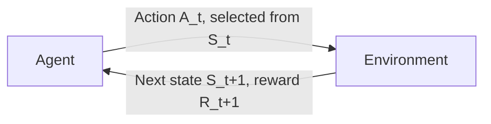
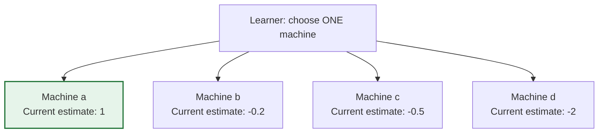
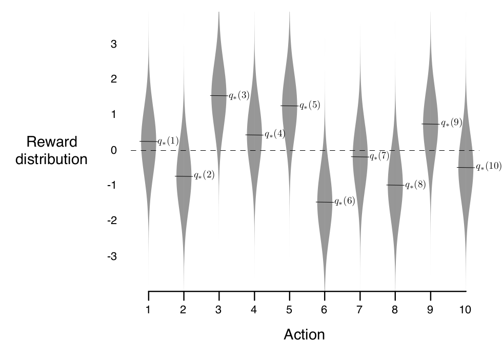
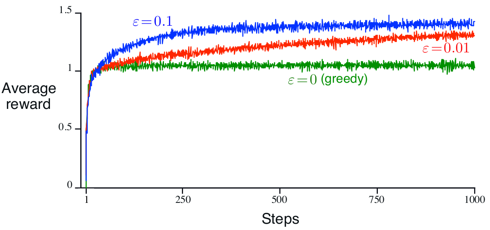
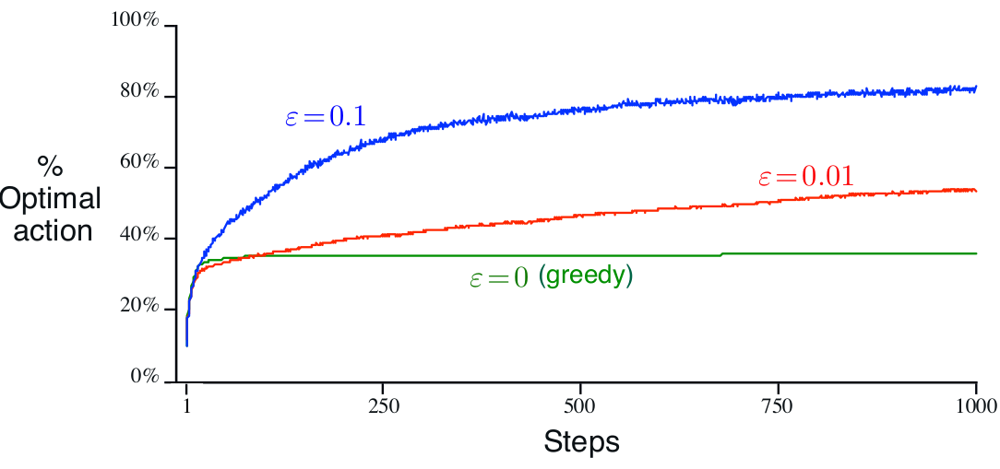

# Module 1 - Getting Started with Reinforcement Learning

## Learning Through Interaction and Reward

*Slides 4, 11*

Reinforcement learning is an interactive form of learning: a learner acts in an environment and receives feedback about the consequences. This is why it is also described as **feedback-based** or **reward-based** learning. These terms emphasize different parts of the same process.

The learner uses feedback to adjust its choices toward a goal. Reward helps guide that adjustment; it does not provide a correct action label for every decision. Autonomous driving and gaming are application examples.

Learning to ride a bicycle illustrates the interaction. Pushing off is an action. Moving forward without falling is positive feedback; falling is negative feedback, or a penalty. The learner uses these consequences to adjust its next attempt, including choices about posture, pushing, and steering. The goal is to learn to ride without falling.

<details className="alert alert--info">
<summary>Test Your Understanding</summary>

**Questions**
1. What role does reward play in goal-directed learning?
2. How do reward-based, feedback-based, and interactive learning describe the same idea?
3. What role does the goal play, beyond receiving rewards?
4. When you push off and move forward without falling, what is the action and what is the feedback?
5. What does falling tell the learner, and how can that inform its next attempt?
6. What is the goal in the bicycle example?

**Answers**
1. Reward is feedback that guides the learner's choices toward a goal by encouraging useful behavior.
2. The learner interacts with an environment by taking actions; the consequences provide feedback, often represented as rewards, which the learner uses to adjust future choices.
3. The goal is the outcome the learner is trying to reach. Rewards guide behavior toward that outcome; a coach is not part of this explanation.
4. Pushing off is the action; moving forward without falling is positive feedback.
5. Falling is negative feedback or a penalty. It informs the learner to adjust choices such as posture, pushing, and steering on the next attempt.
6. The goal is to learn to ride a bicycle without falling.

</details>
## Comparing Learning Paradigms

*Slides 13–14*

The three paradigms differ in the kind of information available to the learner and how it learns from that information.

| Paradigm | Data and feedback | Typical task or aim | Example algorithms | Applications |
| --- | --- | --- | --- | --- |
| Supervised learning | Labeled data with a target output; the learner compares its prediction with the target and reduces the difference. | Regression and classification; calculate or predict outcomes. | Linear regression, logistic regression, SVM, KNN | Risk evaluation, sales forecasting |
| Unsupervised learning | Unlabeled data without a target answer; the learner searches for patterns. | Clustering and association; discover underlying patterns. | K-means, C-means, Apriori | Recommendation systems, anomaly detection |
| Reinforcement learning | The learner interacts with an environment and gathers experience through state, action, and reward sequences. | Learn a sequence of actions; balance exploration of alternatives with using actions that have worked well. | Q-learning, SARSA | Self-driving cars, gaming, healthcare |

Supervised learning has a target for each training example, so the learner can compare its output with the correct answer. Unsupervised learning has no such labels and instead looks for structure in the data; in some workflows, this pattern discovery can come before supervised learning.

Reinforcement learning does not begin with a predefined set of correct actions. Its experience is collected through interaction: the agent encounters a state, takes an action, and receives a reward as the environment responds. The reward evaluates the consequence, rather than supplying a correct action label.

### Tea-Making Analogy

The three learning paradigms can also be distinguished by how someone learns to make tea:

- **Supervised learning:** Follow a supplied recipe. The correct procedure is already given.
- **Unsupervised learning:** Study many tea-making videos without a recipe and infer a procedure from the examples. The learner is finding patterns in supplied data, not receiving reward from its own attempts.
- **Reinforcement learning:** Try a mixture, taste the result, and adjust the next attempt. Feedback such as “too bitter” or “too much milk” guides changes to the ingredients.

### Classification Activity

| Scenario | Paradigm | Reason |
| --- | --- | --- |
| Classify new images using thousands of labeled cat and dog images. | Supervised learning | The examples already have class labels. |
| Group shopping-app customers by purchase behavior. | Unsupervised learning | The groups are discovered from behavior data rather than preset labels. |
| A robot tries actions in a maze and receives a reward when it reaches the goal. | Reinforcement learning | It learns through actions and reward feedback from the environment. |
| Predict a house price from past house data. | Supervised learning | This is regression from examples with target prices. |
| Group news articles into topics. | Unsupervised learning | The system discovers topic groupings in the articles. |
| Train an AI agent to play chess. | Reinforcement learning | The agent learns through game interaction and outcomes. |

<details className="alert alert--info">
<summary>Test Your Understanding</summary>

**Questions**
1. What kind of data does supervised learning start with, and what does unsupervised learning look for?
2. Where does reinforcement learning get its experience?
3. How does supervised feedback differ from reward in reinforcement learning?
4. Following a recipe book to make tea: which learning paradigm is this, and why?
5. Inferring a procedure from many unlabeled tea-making videos: which paradigm is this, and why is it not reinforcement learning?
6. When tasters say the tea is bitter or has too much milk, what role does that feedback play in the learner's next attempt?
7. Classify each scenario: labeled cat/dog images; customer groups based on purchase behavior; a reward-guided maze robot; house-price prediction from past data; unlabeled news articles grouped by topic; an AI agent learning chess.

**Answers**
1. Supervised learning starts with labeled data and target outputs. Unsupervised learning uses unlabeled data to look for patterns such as clusters or associations.
2. The learner collects experience by interacting with the environment after taking actions; this experience includes states, actions, and rewards.
3. Supervised learning provides a correct target label for each training example. Reinforcement learning provides reward feedback about an action's consequence, rather than a label naming the correct action.
4. Supervised learning, because the recipe provides the correct procedure and steps in advance.
5. Unsupervised learning, because the learner infers a procedure from unlabeled examples. It is not reinforcement learning because it is not learning from rewards received after its own actions in the tea-making environment.
6. The feedback signals how to adjust the next attempt, such as reducing the tea leaves if it is bitter or reducing the milk if there is too much.
7. Supervised; unsupervised; reinforcement; supervised; unsupervised; reinforcement, respectively.

</details>
## The Agent–Environment Loop and RL Components

*Slides 16–25*

Reinforcement learning is organized around repeated interaction between an **agent** and an **environment**. The agent observes the current situation, chooses an action, and receives a new situation and reward from the environment. The agent is the learner; the environment is the outside world in which it operates.



At time step $t$, the agent receives state $S_t$ and chooses action $A_t$. The environment then transitions to state $S_{t+1}$ and returns reward $R_{t+1}$ for the action taken from $S_t$. Thus, $R_{t+1}$ evaluates $A_t$, not the next action. Repeating this cycle creates sequential experience.

The goal is to maximize cumulative reward. Individual rewards still contribute to that total: an action with little or negative immediate reward may be useful if it leads to better rewards later. Rewards can be delayed or sparse. For example, studying may receive an evaluative signal only after an exam weeks later.

### Core Elements

| Element | Meaning |
| --- | --- |
| **Agent** | The learner that selects actions to perform a task. In bicycle learning, the person learning to ride is the agent. |
| **Environment** | The world outside the agent in which it operates. For bicycle riding, this includes the surrounding area and road. |
| **State ($S$)** | The agent's current situation. An action can move it to a different state. |
| **Action ($A$)** | What the agent does at a time step. Examples include a child walking, a car accelerating or braking, and a vacuum robot moving. |
| **Reward ($R$)** | Positive or negative feedback given based on the action's outcome. |
| **Policy ($\pi$)** | The agent's strategy for choosing actions from states. $\pi(a\mid s)$ denotes the probability of choosing action $a$ in state $s$. |
| **Value function** | An estimate of how good a state is, or how good it is to take a particular action in a state. The slides distinguish state-value and action-value functions. |
| **Model of the environment** | An optional component that predicts the next state and reward from a state and action. Such predictions can support planning. |

A policy can be **stochastic**, assigning probabilities to multiple actions in a state, such as 60% for going up and 40% for going right. It can be **deterministic**, choosing one action with probability 1 and the alternatives with probability 0. An action is a single choice; a policy is the strategy that guides choices across states.

Reinforcement learning is characterized by sequential decision-making, where time and the order of actions matter. It does not use a teacher to provide a correct label for every action; feedback comes as a reward signal, which may be delayed or sparse.

<details className="alert alert--info">
<summary>Test Your Understanding</summary>

**Questions**
1. In the bicycle example, who is the agent and what is the environment?
2. Which action does reward $R_{t+1}$ evaluate: $A_t$ or $A_{t+1}$?
3. Why might maximizing cumulative reward call for an action whose immediate reward is small or delayed?

**Answers**
1. The person learning to ride is the agent; the bicycle and surrounding area, including the road, are the environment.
2. $R_{t+1}$ evaluates $A_t$, the action taken from state $S_t$.
3. The action may lead to greater rewards later. Individual rewards still count toward cumulative reward, including rewards received after a delay.

</details>
## Value Learning and Step-Size Choices

Learning a value function turns experience into estimates that can guide future choices. The estimates need to become more accurate with experience, but they may also need to keep changing when the environment changes. The step size controls how strongly each new experience revises an existing estimate.

### Tic-Tac-Toe and State Values

In tic-tac-toe, the agent chooses moves with the aim of eventually winning against its opponent. A board position is a state, and the opponent is part of the environment. The agent stores an estimate of its probability of eventually winning from each position.

| Board position | Initial value |
| --- | --- |
| Already won | $1$ |
| Already lost, or drawn | $0$ |
| Outcome not yet known | $0.5$ |

The value $0.5$ is an initial guess for a non-terminal position, not a known probability or a permanent value.

#### What Is V(St) Called?

**$V$ is the state-value function:** the whole mapping from states to their values. **$V(S_t)$ is the state value of $S_t$:** the single number obtained by evaluating that function at the given state. The whole table represents the function; one state's entry is its value.

In this particular setup, $V(S_t)=0.52$ means an estimated 52% chance of eventually winning from that board position. State values do not always represent probabilities; this interpretation belongs to the tic-tac-toe setup.

### Learning From Successive Estimates

After a greedy move, information from a later position adjusts the estimate of the earlier position:

$$
V(S_t)\leftarrow V(S_t)+\alpha\left[V(S_{t+1})-V(S_t)\right].
$$

Here, $S_t$ is the earlier state, $S_{t+1}$ is the later state, and $\alpha$ is the step-size parameter. The difference $V(S_{t+1})-V(S_t)$ gives the direction and size of the discrepancy. Multiplying it by $\alpha$ determines how much correction to apply. This is a temporal-difference update: it uses the difference between estimates at successive times.

The update changes an estimate in the value table, not the board position itself. A more promising later position pulls the earlier estimate upward; a less promising one pulls it downward.

:::tip[Think It Through]

**Prompt:** Suppose $V(S_t)=0.50$, $V(S_{t+1})=0.70$, and $\alpha=0.10$. What is the updated value of $V(S_t)$, and why should it move in that direction?

**Answer:** $V(S_t)=0.50+0.10(0.70-0.50)=0.52$. It increases because the later state has a higher estimated probability of winning. The update moves the earlier estimate 10% of the way toward the later estimate.

:::
#### How Do Values Start Changing When Unknown States All Have Value 0.5?

A transition between two states both valued at $0.5$ produces no correction. Learning starts because terminal outcomes have known values: a win has value $1$, while a loss or draw has value $0$. These outcomes break the initial equality, and changed estimates can then influence earlier states through repeated experience.

For illustration, consider updates along a path toward a win:

$$
s_A\;(0.5)\longrightarrow s_B\;(0.5)\longrightarrow\text{Win}\;(1).
$$

With $\alpha=0.1$ and updates made as play proceeds, the initial update of $s_A$ changes nothing:

$$
V(s_A)\leftarrow 0.5+0.1(0.5-0.5)=0.5.
$$

Reaching the winning position changes the estimate of $s_B$:

$$
V(s_B)\leftarrow 0.5+0.1(1-0.5)=0.55.
$$

On a later visit to the same transition, $s_A$ has a different target. If $V(s_B)$ is still $0.55$, then:

$$
V(s_A)\leftarrow 0.5+0.1(0.55-0.5)=0.505.
$$

Information about winning has now reached an earlier state, even though that state does not immediately produce a win. Repeated experience allows this information to spread farther backward. Losses and draws similarly pull preceding estimates downward.

Not every transition needs to produce a nonzero update. What matters is that experience connects the states to informative outcomes and that the relevant transitions are revisited. With these online updates, changing $s_B$ does not automatically revise $s_A$ earlier in the same game.

### Step Size and Continuing Adaptation

The step size controls how strongly new experience changes the current estimate. Using the same earlier value $0.50$ and later value $0.70$:

| Step size | Updated value | Effect |
| --- | --- | --- |
| $\alpha=0.10$ | $0.52$ | A small adjustment toward $0.70$ |
| $\alpha=0.80$ | $0.66$ | A much larger adjustment toward $0.70$ |

A larger step size makes learning more responsive, but estimates can fluctuate more as different experiences arrive. A smaller step size makes each adjustment gentler, but learning and adaptation are slower.

⚠️ **Emphasised by Prof. Vimal:** becoming good against familiar opponents does not guarantee being good against a new opponent with an unfamiliar strategy. The agent's experience may not cover everything it needs to learn.

Setting $\alpha=0$ permanently stops value learning:

$$
V(S_t)\leftarrow V(S_t)+0\left[V(S_{t+1})-V(S_t)\right]=V(S_t).
$$

The agent can still play, but its stored values no longer change in response to outcomes.

:::tip[Think It Through]

**Prompt:** Suppose the agent plays many games against familiar opponents, then sets $\alpha=0$. A new opponent arrives with an unfamiliar strategy. Can the agent's stored state values adapt to that opponent? Explain using the update rule.

**Answer:** No. Multiplying the discrepancy by zero makes every correction zero, so the state values never update in light of new experiences against the new opponent.

:::
The appropriate schedule depends on whether the aim is to settle or to keep adapting:

| Situation | Step-size choice and consequence |
| --- | --- |
| One fixed opponent | Decrease $\alpha$ appropriately over time so that estimates can settle toward the true winning probabilities. Approaching zero is different from setting it to zero prematurely and freezing errors. |
| Opponents whose strategies slowly change | Retain a responsive positive step size so that new experience can revise the estimates. A suitable constant positive step size is one option. |
| A relatively large constant $\alpha$ | Updates are responsive but more sensitive to individual experiences and changing strategies. |
| A very small constant $\alpha$ | Updates continue, but adaptation is slow. |

⚠️ **Emphasised by Prof. Vimal:** keeping the ability to learn matters when an unexpected strategy appears. A positive step size permits updates, although merely keeping it above zero does not prevent adaptation from becoming too slow if it becomes extremely small.

:::tip[Think It Through]

**Prompt:** Suppose an agent's value estimates keep fluctuating while it uses a constant positive $\alpha$. Is that alone enough to conclude that learning has failed? Why or why not?

**Answer:** No. The environment, including the opponent, may keep changing, so each new experience may induce useful learning. A constant positive step size continues to respond to new experience; fluctuations alone do not establish failure.

:::
### Action Selection Versus Value Updates

Action selection chooses the move; $\alpha$ controls the subsequent value update. Increasing $\alpha$ does not itself provide a mechanism for trying exploratory moves. Changed value estimates may indirectly change later choices, but updating values and selecting exploratory actions are different operations.

### Connecting Components and Method Families

An autonomous-driving agent aims to reach its destination safely. Its state description uses sensor information, its actions are the available driving controls, and rewards evaluate consequences. In the illustrative reward scheme, driving at the speed limit receives $+4$, while leaving the road or ignoring a stop line receives penalties. Multiple criteria may contribute to the reward, making its design important.

At a broad level, **model-based methods** use predictions of environmental behaviour, while **model-free methods** learn from experience without an explicit environment model.

<details className="alert alert--info">
<summary>From Previous Question Papers</summary>

**Questions**
1. [Write the answer in an A4 Sheet, Scan & Upload] Consider tic-tac-toe to answer this question. Assume that states are numbered from $S_1$ to $S_n$. Write the temporal difference rule for learning each state's value. [0.5 M] Explain various elements and the workings of this rule. [1.5 M] *(January 2024 Midsem Regular Q1b)*
2. [Write the answer in an A4 Sheet, Scan & Upload] Consider tic-tac-toe to answer this question. Assume that states are numbered from $S_1$ to $S_n$. Let the value of the current state be $4.5$, and all its possible successor/predecessor states have a value of $2.7$. Use $0.9$ to be the parameter value for any parameter you need to use to solve this problem. Given this, revise the estimate of the value of the current state using your answer to (b). Explain your answer. [2 M] *(January 2024 Midsem Regular Q1c)*
3. [Write the answer in an A4 Sheet, Scan & Upload] Consider the RL agent learning the game of tic-tac-toe, by playing against different randomly chosen opponents. Consider the temporal difference rule being used in this context. Can $\alpha$ be used to encourage exploration? [1 M] Why or why not? [2 M] *(July 2024 Midsem Regular Q1b)*

**Answers**
1. $V(S_t)\leftarrow V(S_t)+\alpha[V(S_{t+1})-V(S_t)]$. The earlier estimate moves toward the later estimate; the difference gives the discrepancy and $\alpha$ controls the fraction applied as a correction.
2. $V_{\text{new}}=4.5+0.9(2.7-4.5)=2.88$. The estimate moves 90% of the way toward the lower successor value. These numerical values are generic state values, not winning probabilities.
3. Not directly. $\alpha$ controls the size of value updates, not the selection of exploratory moves. Changing estimates may indirectly change later choices, but increasing $\alpha$ does not itself create an exploration mechanism.

</details>
<details className="alert alert--info">
<summary>Test Your Understanding</summary>

**Questions**
1. You want your agent's estimates to settle against one fixed opponent. A friend wants their agent to keep adapting against opponents whose strategies slowly change. How should these different aims influence the choice of step-size schedule?

**Answers**
1. For a fixed opponent, decrease $\alpha$ appropriately toward zero so that estimates can settle, rather than setting it to zero prematurely and freezing errors. For changing opponents, retain a responsive positive step size, for example a suitable constant, to allow continuing adaptation. Reducing $\alpha$ without ever making it exactly zero still permits updates, but an extremely small value can make adaptation too slow.

</details>
## Bandit Formulation and Action-Value Estimates

Tic-tac-toe involves decisions across changing board positions. A **$k$-armed bandit** removes that complication: the learner repeatedly faces the same choice among $k$ actions. This isolates the problem of learning which action is worthwhile from reward feedback, without having to learn different choices for different states.

⚠️ **Emphasised by Prof. Vimal:** this simplified setting builds foundations for fuller reinforcement learning problems.

### Four Machines and Repeated Choices

Imagine four slot machines, called $a$, $b$, $c$, and $d$. Each machine represents an available **action**, also called an **arm**, not a different state. On each round, the learner chooses one machine, receives its numerical reward, and then faces the same four choices again.

Only the selected machine supplies an observed reward. The learner does not observe what the other three machines would have produced on that round. The objective is to **maximize expected total reward across repeated choices**, not merely chase the largest possible individual payout.

### Stationary Does Not Mean Identical Rewards

In the initial setup, each action has its own unknown, stationary reward distribution. **Stationary** means that its probabilities of producing different rewards do not change over time. Individual outcomes can still differ.

:::tip[Think It Through]

**Prompt:** Suppose the same machine gives reward $0$ on one pull and $5$ on the next. Does that, by itself, contradict the assumption that its reward distribution is stationary? Why?

**Answer:** No. Different trials of the same action can produce different rewards from the same stationary distribution. Stationarity fixes the reward probabilities, not the payout on every attempt. These are repeated selections of the same action, not different actions merely because their outcomes differ.

:::
### True Action Values and Their Estimates

An action is best because it has the highest expected reward, not because it once produced a large payout. Its **true action value** is the mean of its reward distribution:

$$
q_*(a)\doteq\mathbb{E}[R_t\mid A_t=a].
$$

This reads: the true value of action $a$ is defined as the expected reward when that action is selected. The dotted equality means **defined as**, not approximately equal or estimated as.

| Symbol | Meaning |
| --- | --- |
| $a$ | A particular action, such as selecting the fourth machine |
| $A_t$ | The action actually selected on round $t$ |
| $R_t$ | The reward received from that selection |
| $q_*(a)$ | The action's true mean reward, unknown to the learner |
| $Q_t(a)$ | The learner's current estimate of that mean |

There is no state argument in the basic bandit because the same decision situation repeats. Each action has a true value, including poor actions. The star does not mean that every action is optimal; the optimal action is the one with the highest true value.

For one illustrative case, the true means are:

| Machine | True mean reward |
| --- | --- |
| $a$ | $-0.50$ |
| $b$ | $-0.20$ |
| $c$ | $0.10$ |
| $d$ | $0.11$ |

If these true values were known, selecting $d$ would maximize expected reward. The difficulty is that the learner has estimates, not access to this true-value table.

#### Why Does the Fourth Machine Have Two Different True Values?

Two illustrative cases assign the fourth machine different true means: $q_*(d)=0.11$ in one and $q_*(d)=1$ in another. There is no stated change of setting that explains this difference. It is an unexplained inconsistency, not evidence that learning changes a stationary action's true mean. Which value was intended throughout is not established.

Keep the cases separate and state each case's assumed values explicitly. Machine $d$ is best under either assignment because the next-highest true mean is $0.10$, although the size of its advantage differs.

By contrast, a true mean of $1$ and an estimate of $-2$ are not contradictory. The estimate can be based on only two observed rewards, $-2,-2$, and need not equal the true mean. Distinguish an inconsistent assignment of two true means from a legitimate difference between a true mean and its estimate.

:::tip[Think It Through]

**Prompt:** After another pull, the learner revises its estimate of the fourth machine. Under our stationary assumption, does that mean the machine's true action value has changed too? Why or why not?

**Answer:** No. The true action value stays fixed because the reward distribution is stationary. New observations revise the learner's estimate of that fixed value. The estimate is updated using each new observation, although its numerical value need not change if the new reward equals its current average.

:::
### Sample-Average Action-Value Estimates

A simple way to estimate an action's true mean is to average the rewards obtained when that particular action was selected. This is the **sample-average method**:

$$
Q_t(a)=\frac{\sum_{i=1}^{t-1}R_i\,\mathbf{1}_{\{A_i=a\}}}{\sum_{i=1}^{t-1}\mathbf{1}_{\{A_i=a\}}}.
$$

The indicator $\mathbf{1}_{\{A_i=a\}}$ is $1$ when action $a$ was selected on round $i$, and $0$ otherwise. It filters the history so that the numerator adds rewards from action $a$ only, while the denominator counts selections of that action, not all rounds.

The subscript $t$ identifies the estimate available when choosing on round $t$. It uses observations from before that round. If an action has never been selected, there is nothing to average; use an initial estimate such as $0$ instead of dividing by zero.

For the four machines, suppose the first ten pulls produced these observed histories:

| Machine | Observed rewards | Number of pulls | Sample-average estimate |
| --- | --- | --- | --- |
| $a$ | $-1,-1,5$ | $3$ | $1$ |
| $b$ | $-0.2,-0.2$ | $2$ | $-0.2$ |
| $c$ | $-0.5,-0.5,-0.5$ | $3$ | $-0.5$ |
| $d$ | $-2,-2$ | $2$ | $-2$ |

For example:

$$
Q_{11}(a)=\frac{-1-1+5}{3}=1.
$$

There have been ten pulls overall, but only three contributed to machine $a$'s estimate. These sample averages are the learner's estimates, not the true means.

### Greedy Action Selection

A **greedy action-selection rule** chooses an action with the highest current estimated value:

$$
A_t=\operatorname*{arg\,max}_a Q_t(a).
$$

The operation **arg max** returns which action has the highest estimate, rather than returning that estimate itself. If several actions tie for highest, any of them is greedy; the tie can be broken randomly.

The four-machine diagram shows the current estimates from the observed histories:



The arrows represent alternatives, not four simultaneous pulls. The highlight marks the current greedy choice, not a proven optimal machine.

:::tip[Think It Through]

**Prompt:** Using only the observed-reward table, which machine would a greedy rule choose? Does that establish that this machine has the highest true mean reward?

**Answer:** It chooses machine $a$ because $Q_{11}(a)=1$ is the highest current estimate. This establishes only that $a$ looks best under the available estimates, not that it has the highest true mean. The estimates, and therefore their ranking, can change as new experience arrives.

:::
Only the selected machine receives a new observation, so only its sample-average estimate is updated. If machine $d$ is never tried again, its estimate can remain at $-2$ even though its true mean is higher. Always selecting the currently best-looking action can leave misleading estimates of other actions uncorrected.

### Bandit Applications

A bandit formulation identifies the repeatedly available options, the reward observed for a selected option, and the objective across repeated choices. It uses a simplified setting without having to choose differently across changing states.

Cloud-configuration tuning is one example. A learner repeatedly chooses among server configurations under comparable conditions, observes the selected configuration's throughput, and aims to maximize expected total throughput. Each configuration is an arm; only the chosen configuration supplies an observed reward.

| Setting | Arms | Possible reward |
| --- | --- | --- |
| Advertisement selection | Candidate advertisements | Click or purchase |
| Website testing | Alternative layouts | Conversion |
| Controlled treatment selection | Treatment options | Improvement score |
| Investment selection | Investment alternatives | Return |

These are simplified formulations: the basic stationary bandit repeatedly presents the same options and assumes each action's reward distribution remains fixed.

<details className="alert alert--info">
<summary>From Previous Question Papers</summary>

**Questions**
1. [Write the answer in A4 Sheet, Scan & Upload] Write any one use-case (application) which can be modeled as a multi-armed bandit for its solution. Your answer should have all the elements that identify the use case and can be modeled as a multi-armed bandit problem. [2 M]
   **Workplace variant:** [Write the answer in A4 Sheet, Scan & Upload] Write any one use-case (application) from your workplace which can be modeled as a multi-armed bandit for its solution. Your answer should have all the elements that identify the use case and can be modeled as a multi-armed bandit problem. [Vague description of application will be penalized.] [1.5 M] *(January 2024 Midsem Regular Q2a; July 2024 Midsem Regular Q2c)*

**Answers**
1. In cloud-configuration tuning, a learner repeatedly chooses one server configuration from a fixed set under comparable conditions. Configurations are the arms, observed throughput is the reward, and the objective is to maximize expected total throughput. Only the selected configuration supplies feedback. The basic stationary formulation assumes each configuration's reward distribution remains fixed.

</details>
<details className="alert alert--info">
<summary>Test Your Understanding</summary>

**Questions**
1. Before round 11, machine $a$ has observed rewards $-1,-1,5$, and machine $d$ has observed rewards $-2,-2$. In a hypothetical continuation, the learner chooses $d$ on round 11 and receives reward $4$. What are $Q_{12}(d)$ and $Q_{12}(a)$? Show which rewards and denominator belong in each calculation, and explain why machine $a$'s estimate does or does not change.

**Answers**
1. $Q_{12}(d)=(-2-2+4)/3=0$, and $Q_{12}(a)=(-1-1+5)/3=1$. Both denominators count selections of the relevant machine, not all eleven rounds. Machine $a$ was not selected on round 11, so it has no new reward and its sample-average estimate remains unchanged. $Q_{12}$ names the estimates available after round 11 and before choosing on round 12.

</details>
## Exploration, Exploitation, and Epsilon-Greedy Selection

Current action-value estimates can be misleading. Choosing the action that looks best uses existing knowledge, while trying alternatives can improve that knowledge. The conflict is between obtaining reward now and gathering information that may improve future choices.

### Why Exploration Can Be Worthwhile

Return to the four-machine example after the original ten pulls, before the hypothetical extra pull in the preceding quiz. In this illustrative case, the true mean of machine $d$ is $1$:

| Machine | Current estimate | True mean, unknown to the learner |
| --- | --- | --- |
| $a$ | $1$ | $-0.5$ |
| $d$ | $-2$ | $1$ |

The learner sees $a$ as promising and $d$ as poor, although their true means tell a different story.

- **Exploitation:** choose the currently best-looking action to obtain reward using existing knowledge.
- **Exploration:** try alternatives to improve knowledge, potentially discovering a better action.

Exploration may sacrifice reward now, but useful information can improve many later choices. Endlessly testing alternatives without using what has been learned also sacrifices reward.

⚠️ **Emphasised by Prof. Vimal:** exploration acknowledges that current estimates are imperfect, not established true values.

:::tip[Think It Through]

**Prompt:** Would you be equally willing to try a poorly known machine with one pull remaining and with 1,000 pulls remaining? Explain how the remaining opportunities affect the usefulness of learning.

**Answer:** With one pull remaining, use the currently best estimate to maximize expected reward; there is no later choice that can benefit from the new information. With 1,000 pulls remaining, exploration may be worthwhile because what is learned can improve many later choices. Pulling a machine does not improve its stationary true mean. Its estimate may rise or fall; the purpose is to discover whether it is better than currently believed.

:::
### The Epsilon-Greedy Rule

**$\varepsilon$-greedy**, also called **near-greedy selection**, balances the two purposes using a random branch:

| Probability | Selection rule |
| --- | --- |
| $1-\varepsilon$ | Choose an action with the highest current estimate |
| $\varepsilon$ | Choose uniformly at random from all $k$ actions |

Uniformly means that each action has an equal chance within the random branch. The choice there is independent of the action-value estimates, and the greedy action is included among the available choices.

The parameter $\varepsilon$ controls action selection. It is different from $\alpha$, which controls the size of value updates. At $\varepsilon=0$, selection is purely greedy; at $\varepsilon=1$, selection is purely uniform random choice.

For $\varepsilon=0.2$, the direct greedy branch is used 80% of the time and the random branch 20% of the time. This does not mean the greedy action is selected only 80% of the time, because it can also be selected randomly.

:::tip[Think It Through]

**Prompt:** With four machines, one uniquely greedy machine $a$, and $\varepsilon=0.2$, what is the total probability of selecting $a$? Account for both routes by which it can be selected.

**Answer:** $P(A_t=a)=0.80+0.20/4=0.85$, or 85%. Direct greedy selection contributes $0.80$, and the random branch contributes $0.20\times\frac14=0.05$. Each of the other machines receives probability $0.05$.

:::
### Selection Probabilities

For a uniquely greedy action $g$, split the calculation into the two mutually exclusive branches:

| Branch | Probability of branch | Probability of choosing $g$ within it |
| --- | --- | --- |
| Direct greedy selection | $1-\varepsilon$ | $1$ |
| Uniform random selection | $\varepsilon$ | $1/k$ |

Multiply the branch probability by the conditional probability of selecting $g$ within that branch, then add the two routes:

$$
P(A_t=g)=1(1-\varepsilon)+\frac1k\varepsilon=1-\varepsilon+\frac{\varepsilon}{k}.
$$

A non-greedy action can be selected only through the random branch, so each such action has probability $\varepsilon/k$.

| Number of actions | $\varepsilon$ | Greedy action | Each non-greedy action |
| --- | --- | --- | --- |
| $4$ | $0.2$ | $0.85$ | $0.05$ |
| $4$ | $0.4$ | $0.70$ | $0.10$ |
| $2$ | $0.5$ | $0.75$ | $0.25$ |

For the two-action case, the direct greedy branch contributes $0.5$, and random selection contributes another $0.5\times0.5=0.25$. Their sum is $0.75$.

⚠️ **Emphasised by Prof. Vimal:** excluding the greedy action from the random branch is a common mistake. It changes the algorithm and the resulting selection probabilities. Random choice includes all available actions, not only the non-greedy ones.

:::tip[Think It Through]

**Prompt:** If $\varepsilon=1$, does the uniquely greedy action still have a higher selection probability than the other actions? Explain using the branches or formula.

**Answer:** No. The direct greedy branch has probability zero, so each action is chosen uniformly with probability $1/k$. The uniquely greedy action receives no extra probability from its estimate.

:::
### Implementation and Value Updates

The selection rule uses a uniform random draw to decide which branch to follow:

```text
epsilon = 0.05

SelectAction:
	Draw a uniform random number between 0 and 1.
	If the number is greater than epsilon:
		Return an action with the highest current estimate.
	Otherwise:
		Return an action chosen uniformly from all actions.
```

The first random draw decides which branch to use. Within the random branch, a further random choice decides which action to take. After observing the reward, update the selected action's estimate.

A complete direct sample-average version maintains a reward history for each action:

```text
For each action:
	Set its estimate to 0 and its reward history to empty.

Repeat:
	Draw a uniform random number between 0 and 1.
	If the number is greater than epsilon:
		Choose an action with the highest current estimate.
	Otherwise:
		Choose uniformly from all actions.

	Observe the chosen action's reward.
	Append it to that action's reward history.
	Set that action's estimate to the average of its history.
```

Scanning $k$ estimates requires work proportional to $k$. This direct history-based version also recomputes an average; incremental estimation addresses that cost.

### Accurate Estimates Do Not Eliminate Random Choices

With a fixed $\varepsilon>0$, every action continues to have a selection probability of at least $\varepsilon/k$. In the infinite-run limit, each action is sampled repeatedly, and its sample-average estimate converges to its true mean under the basic stationary bandit assumptions.

Learning the values and selecting actions are different processes. Even accurate estimates do not remove the random branch. A fixed positive $\varepsilon$ keeps allowing non-greedy choices.

In practice, $\varepsilon$ may start higher when estimates are poorly informed and decrease as experience accumulates. Reducing it trades continued information gathering for greater use of current knowledge.

:::tip[Think It Through]

**Prompt:** Suppose all estimates eventually equal the true action values, there is one uniquely best action, and $\varepsilon=0.1$ remains fixed. Will the agent then always choose that best action? Why or why not?

**Answer:** No. The random branch remains active with probability $0.1$ and can select any action, including a non-best one. It can also select the best action, so $P(\text{best})=0.9+0.1/k$, and $P(\text{non-best})=0.1(k-1)/k$. For four actions, these are $0.925$ and $0.075$, respectively. Ten percent is the random-branch probability, not the probability of choosing a non-best action.

:::
### When Pure Greedy Selection Is Preferable

If the stationary true values are already known and one action is uniquely best, exploration provides no useful new information and sometimes selects inferior actions. Pure greedy selection can then outperform a method that retains a positive $\varepsilon$.

<details className="alert alert--info">
<summary>From Previous Question Papers</summary>

**Questions**
1. [Write the answer in A4 Sheet, Scan & Upload] **(b)** Write down a bandit algorithm that is $\varepsilon$-greedy. [Note: only a formal algorithm pseudo-code will be accepted as an answer.] [2 M] Comment on the efficiency of this algorithm. [0.5 M] **(c)** How does this algorithm balance exploration vs exploitation trade-off? Explain. [1.5 M] *(January 2024 Midsem Regular Q2b; January 2024 Midsem Regular Q2c)*
2. [Write the answer in A4 Sheet, Scan & Upload] State one situation in which a greedy action selection works better than $\varepsilon$-greedy action selection. [1.0 M] *(July 2024 Midsem Regular Q2b)*
3. You have the following Q-values for four arms of a bandit: $Q_1=25$, $Q_2=32$, $Q_3=7$, $Q_4=3$. Use $\varepsilon$-greedy with $\varepsilon=0.3$ to compute the probability of selecting each arm. [2 Marks] Also, identify which arm will be chosen in exploitation. [1 Mark] *(Compre Sample Paper 2 Q6a)*

**Answers**
1. The formal direct sample-average algorithm is:
   ```text
   For each action:
       Set its estimate to 0 and its reward history to empty.

   Repeat:
       Draw a uniform random number between 0 and 1.
       If the number is greater than epsilon:
           Choose an action with the highest current estimate.
       Otherwise:
           Choose uniformly from all actions.

       Observe the chosen action's reward.
       Append it to that action's reward history.
       Set that action's estimate to the average of its history.
   ```
   Scanning $k$ estimates requires work proportional to $k$, and this direct version also recomputes the selected action's average. The branch of probability $1-\varepsilon$ exploits current estimates; the branch of probability $\varepsilon$ keeps all actions available for random selection and further learning.
2. When the stationary true action values are known and one action is uniquely best, greedy selection always chooses that action. A positive $\varepsilon$ sometimes selects inferior actions without providing useful new information.
3. Arm 2 is greedy because $Q_2=32$ is highest. $P(A=2)=1-0.3+0.3/4=0.775$. Each other arm has probability $0.3/4=0.075$. Exploitation selects arm 2.

</details>
<details className="alert alert--info">
<summary>Test Your Understanding</summary>

**Questions**
1. An $\varepsilon$-greedy agent has five available actions, with exactly one uniquely greedy action. Its probability of selecting that greedy action is $0.84$. What is $\varepsilon$, and what is the selection probability of each non-greedy action? Show how you obtain both.
2. The combined probability of all four non-greedy actions is $0.16$. What is the probability of each one after dividing $0.16$ among the four?

**Answers**
1. $0.84=1-\varepsilon+\varepsilon/5=1-4\varepsilon/5$, so $\varepsilon=(1-0.84)\times5/4=0.20$. Each non-greedy action receives $\varepsilon/5=0.04$. Their combined probability is $4\times0.04=0.16$, not $0.16$ per action.
2. Each non-greedy action receives $0.16/4=0.04$.

</details>
## Reward Noise and the 10-Armed Testbed

A short sequence of lucky or unlucky rewards can make an action look misleadingly good or bad. The 10-armed testbed compares action-selection strategies across many bandit problems so that their performance is not judged from a single fortunate or unfortunate run. Interpreting its results requires distinguishing reward noise, estimates, and the truly optimal action.

### Reward Variation and Limited Samples

An action's mean is its expected reward. Its variance describes how widely individual rewards vary around that mean. A stationary mean does not imply low variance: an action can have a fixed true mean while producing widely varying rewards. Greater reward variation generally makes estimating the mean from a small sample harder.

Consider the earlier four-machine example:

| Machine | Observed rewards | Current estimate |
| --- | --- | --- |
| $a$ | $-1,-1,5$ | $1$ |
| $d$ | $-2,-2$ | $-2$ |

Machine $a$ shows substantial variation, whereas the two observations of $d$ are identical. These observations describe the samples collected, not the full underlying distributions.

:::tip[Think It Through]

**Prompt:** Do the two identical rewards from machine $d$ establish that its underlying reward distribution has zero variance, or that its estimated mean is accurate? Explain what these observations can and cannot tell us.

**Answer:** No to both. The observations establish only that those two rewards matched. They do not prove zero underlying variance or an accurate mean estimate. A poorly sampled action can look consistent simply because very little of its behaviour has been observed.

:::
Exploring only machines whose observed rewards vary can therefore be misleading. A machine such as $d$ can have a stable-looking but inaccurate estimate and still deserve further testing.

### Generating the Test Problems

The testbed contains 2,000 independently generated bandit problems, each with ten actions. There are two separate sources of randomness.

First, generate one problem by drawing each action's true mean:

$$
q_*(a)\sim\mathcal{N}(0,1).
$$

The ten means can differ, but remain fixed throughout that problem's run. Second, whenever the learner selects action $A_t$, draw its reward:

$$
R_t\mid A_t\sim\mathcal{N}\!\left(q_*(A_t),1\right).
$$

The notation $\mathcal{N}(\text{mean},\text{variance})$ denotes a normal distribution. Zero is the centre of the distribution used to generate true means; it is not every action's true mean. Each action's actual reward distribution is centred on its own true mean and has variance $1$.



*Ten actions with different true reward means and reward variance $1$.*

Each gray shape represents one action's reward distribution. The centres differ because the true means differ. The action numbers identify alternatives, not successive time steps.

#### What Does Method Mean Here?

A method is an action-selection strategy being compared:

| Method | Selection behaviour |
| --- | --- |
| Greedy, $\varepsilon=0$ | Always choose a highest-estimated-value action |
| $\varepsilon$-greedy, $\varepsilon=0.01$ | Use the uniform random branch with probability $0.01$ |
| $\varepsilon$-greedy, $\varepsilon=0.1$ | Use the uniform random branch with probability $0.1$ |

All three use sample averages to estimate action values. What differs is how they select actions, not the value-estimation technique.

#### Is It 1,000 Selections or 2,000 Runs?

Both numbers apply, but they count different things. One run means applying one method to one ten-armed bandit problem for 1,000 pulls. Each method is tested on 2,000 different problems, giving 2,000 runs per method.

$$
2{,}000\text{ runs}\times1{,}000\text{ pulls per run}=2{,}000{,}000\text{ pulls per method}.
$$

The graphs average results at matching step numbers across runs. For example, average reward at step 100 combines the reward received on the 100th pull of each of the 2,000 runs. It does not collapse all 1,000 steps into one average.

#### Why Average Across Many Different Problems?

One run can be strongly affected by its particular problem and early reward sequence. A greedy method might try the truly best machine early, receive encouraging rewards, and keep selecting it. In another run, early rewards might make a poor machine look best and encourage repeated selection of that machine instead.

Averaging across many independent problems reduces the influence of a lucky or unlucky individual run and reveals average behaviour across the testbed. It is not a guarantee of success on every problem.

:::tip[Think It Through]

**Prompt:** Why would averaging across 2,000 different bandit problems give a more useful comparison than judging the methods from one problem alone?

**Answer:** One run cannot rule out lucky or unlucky initial observations, or the influence of one particular problem. Averaging across 2,000 problems gives a more useful picture of each strategy's average behaviour on the testbed.

:::
:::tip[Think It Through]

**Prompt:** Imagine that a greedy method tries the truly best machine early in one run and receives encouraging rewards. In another run, early rewards make a poor machine look best. If we judged greedy selection from only the first run, could we tell whether its success came from a generally good strategy or fortunate early observations?

**Answer:** No. A single successful run does not distinguish a generally effective strategy from good luck in the initial observations. Comparing many runs reduces the influence of that luck.

:::
### Reading the Performance Graphs

Both graphs use step number within a run on the horizontal axis, but their vertical axes answer different questions.



*Average reward at each step, averaged across 2,000 runs.*

The average-reward graph measures the reward received on step $t$, averaged across runs. It is not cumulative reward up to that step.



*Percentage of runs selecting their truly optimal action at each step.*

The optimal-action graph measures the percentage of runs that selected their own problem's truly best action on step $t$. Optimal means highest true mean, not highest current estimate.

Near step 1,000, the plotted values are approximately:

| Strategy | Average reward | Optimal-action selections |
| --- | --- | --- |
| Blue: $\varepsilon=0.1$ | $1.4$ | $80\%$ |
| Red: $\varepsilon=0.01$ | $1.3$ | $50\%$ |
| Green: greedy | $1.0$ | $35\%$ |

Greedy selection improves quickly initially but often settles on a suboptimal action after misleading early observations. The $\varepsilon=0.1$ method tests alternatives more frequently and discovers better actions faster. The $\varepsilon=0.01$ method continues improving, but its less frequent exploration makes discovery slower.

A roughly flat greedy curve does not mean estimates stop updating. For example, rewards $7$ followed by $-3$ change an action's sample average from $7$ to $2$. Greedy choices can change when estimates change; there is simply no deliberate random-exploration branch.

:::tip[Think It Through]

**Prompt:** The blue method uses its direct greedy branch 90% of the time, yet selects the truly optimal action only about 80% of the time near step 1,000. How can both statements be true?

**Answer:** The direct greedy branch chooses the highest current estimate, which can still belong to a truly inferior action. Some direct-greedy selections therefore miss the optimum, while random selections can sometimes find it. The difference is not merely that the percentages use different aggregations: even at the same step across runs, 90% can use the greedy branch while only about 80% select the truly best action. The 90% is a probability at each selection, not a guarantee of exactly 900 such selections in 1,000 steps.

:::
:::tip[Think It Through]

**Prompt:** When the greedy branch is used, does it choose the action with the highest true mean $q_*(a)$, or the highest estimate $Q_t(a)$? Could those be different actions?

**Answer:** It chooses a highest estimate $Q_t(a)$. That action need not have the highest true mean because the estimates can still rank the actions incorrectly.

:::
### Longer Runs and the Exploration Trade-Off

Once the uniquely best action is correctly identified, its selection probability with ten arms is:

$$
P(\text{optimal})=1-\varepsilon+\frac{\varepsilon}{10}.
$$

| Fixed $\varepsilon$ | Optimal-action probability once correctly identified |
| --- | --- |
| $0.1$ | $0.91$ |
| $0.01$ | $0.991$ |

The $\varepsilon=0.1$ method discovers good actions faster, but $\varepsilon=0.01$ sacrifices fewer later selections to random alternatives. On this stationary testbed, the smaller value has better asymptotic performance once estimates identify the best action reliably.

This does not guarantee that the smaller value wins in every individual run, by step 2,000, or in a changing environment. The displayed graphs do not establish an exact crossover point.

⚠️ **Emphasised by Prof. Vimal:** starting with more exploration and reducing it later can combine faster discovery with greater exploitation afterward.

:::tip[Think It Through]

**Prompt:** Does the 99.1% long-run figure prove that $\varepsilon=0.01$ must outperform $\varepsilon=0.1$ during the first 1,000 pulls? Why or why not?

**Answer:** No. The long-run probability applies once the best action is correctly identified. With less exploration, the $\varepsilon=0.01$ method can take longer to identify it, and the displayed first 1,000 steps favour $\varepsilon=0.1$. Better asymptotic performance under the stationary testbed assumptions is not a guarantee for every finite run or an exact crossover step.

:::
### Reward Variance and Changing Values

The useful balance between exploration and exploitation depends on the task, not just the number of steps already taken.

| Condition | Consequence |
| --- | --- |
| Reward variance rises from $1$ to $10$ | Noisier observations make identifying the best action harder. More exploration may be needed for longer. |
| Rewards are deterministic and stationary | Trying every arm once reveals its true value; afterward, selecting the best avoids unnecessary exploration. |
| True values change over time | Old knowledge can become outdated. Continued exploration is needed even if rewards are deterministic at each moment. |

The changing-machine example imagines an unseen adjustment altering a machine's reward distribution. A previously poor arm can become best without the learner noticing unless it tries that arm again. Deterministic rewards alone do not justify stopping exploration permanently; they must also stay fixed over time.

<details className="alert alert--info">
<summary>Test Your Understanding</summary>

**Questions**
1. In a ten-armed bandit with known deterministic rewards, an agent tries every arm once. It then stops exploring and always chooses the arm with the highest observed reward. What additional assumption makes this strategy sound over time? If that assumption does not hold, how could the agent miss a better arm?
2. For the strategy of trying every arm once and then stopping exploration to remain sound, must the deterministic rewards stay fixed over time, or may they change? What is that assumption called?

**Answers**
1. The rewards must also be stationary: each arm's deterministic reward stays fixed over time. One observation per arm then reveals its true value and permits repeated selection of the best. If rewards change, an untried arm can improve without the learner noticing, so continued exploration can be useful.
2. They must stay fixed over time. This is the stationarity assumption.

</details>
## Identifying Random Selections

An observed action does not always reveal which branch of $\varepsilon$-greedy selection produced it. A non-greedy action requires the random branch, but a greedy action can be selected by either branch. To classify a selection, compare the action's estimate with the current maximum before incorporating its reward.

### Greedy Actions and Ties

Every action tied for the highest estimate counts as greedy. A greedy action does not need to be uniquely better than the alternatives. If all estimates are zero, all actions are greedy, and the direct greedy branch can choose any of them by breaking the tie.

Even if tie-breaking uses randomness, that does not prove that the $\varepsilon$ random branch was used. Random tie-breaking within the greedy branch and uniform random selection from all actions are different mechanisms.

An estimate of zero is not itself evidence of a non-greedy action. What matters is whether it is below the highest estimate at selection time.

### A Four-Action Sequence

Consider four actions, denoted $1,2,3,4$, with sample-average action-value estimates and initial values:

$$
Q_1(1)=Q_1(2)=Q_1(3)=Q_1(4)=0.
$$

The observed sequence is:

| Step $t$ | Action $A_t$ | Reward $R_t$ |
| --- | --- | --- |
| $1$ | $1$ | $1$ |
| $2$ | $2$ | $1$ |
| $3$ | $2$ | $2$ |
| $4$ | $2$ | $2$ |
| $5$ | $3$ | $0$ |

The task is to identify where random selection definitely occurred and where it could possibly have occurred. Use the estimates available before each choice, then update only the selected action's estimate using the reward received afterward.

### The First Two Selections

At step 1, all estimates are zero, so action 1 is one of four tied greedy actions. Its selection is compatible with either branch.

:::tip[Think It Through]

**Prompt:** At step 1, all estimates are zero and action 1 is selected. Can we conclude that the random branch was definitely used, or could the direct greedy branch also have selected action 1? Why?

**Answer:** Either branch could have selected action 1. All four actions tie for the highest estimate, so each is greedy. The direct greedy branch can select action 1 by breaking the tie. Random selection may have occurred, but is not established by the observed action.

:::
After receiving $R_1=1$, the estimates before step 2 are:

$$
\bigl(Q_2(1),Q_2(2),Q_2(3),Q_2(4)\bigr)=(1,0,0,0).
$$

Now action 1 is uniquely greedy, but the observed choice is action 2.

:::tip[Think It Through]

**Prompt:** Step 2 selects action 2 from estimates $(1,0,0,0)$. Could the direct greedy branch select action 2 now, or must this selection have come from the random branch? Why?

**Answer:** It must have come from the random branch. Action 2's estimate of $0$ is below action 1's estimate of $1$, so action 2 is non-greedy at this point.

:::
### Following the Remaining Estimates

Step 2 gives action 2 its first reward, $1$, so its estimate becomes $1$. Its next two rewards are both $2$, giving:

$$
Q_4(2)=\frac{1+2}{2}=1.5,
\qquad
Q_5(2)=\frac{1+2+2}{3}=\frac53.
$$

The estimates before the remaining selections are:

| Step | Estimates for actions $(1,2,3,4)$ | Selected action | Random branch required? |
| --- | --- | --- | --- |
| $3$ | $(1,1,0,0)$ | $2$ | No; action 2 ties with action 1 for highest estimate |
| $4$ | $(1,1.5,0,0)$ | $2$ | No; action 2 is uniquely greedy |
| $5$ | $(1,\frac53,0,0)$ | $3$ | Yes; action 3 is below action 2 |

:::tip[Think It Through]

**Prompt:** At steps 3 and 4, was the random branch definitely used, or only possibly used?

**Answer:** Only possibly used. Action 2 is greedy at both steps: tied for highest at step 3 and uniquely highest at step 4. Either the direct greedy branch or the random branch could have selected it.

:::
:::tip[Think It Through]

**Prompt:** At step 5, which conclusion applies, and why?

**Answer:** The random branch was certainly used. The chosen action 3 has estimate $0$, below action 2's estimate of $5/3$. The decisive fact is that its estimate is below the maximum, not merely that it is zero.

:::
The complete distinction is:

- **Definitely random:** steps $2$ and $5$.
- **Could have been random:** all five steps, because the random branch can also select a greedy action.
- **Ambiguous between the branches:** steps $1,3,4$.

Step 5's reward is zero, so action 3's sample-average estimate remains zero. This does not change how its selection is classified. A reward received afterward cannot retroactively determine the branch used for the selection; it affects the estimates available for future choices.

### Recommendation Example

A recommendation system can use the same reasoning when choosing one genre for an individual and observing a rating. The available genres are $a,b,c,d$, and observed rewards are ratings in $\{0,1,2,3\}$.

For the twelve-selection example below, initial estimates depend on a student-ID digit. To illustrate the calculation, assume that digit is $0$, giving zero initial estimates. This is an explicit illustrative assumption, not the learner's actual ID digit.

With that initialization, random selection is required at steps $2,3,4,6,9,12$. For example, before step 4, $Q(a)=2$ while $Q(b)=3$, so choosing $a$ requires the random branch. Before step 7, $Q(b)=Q(d)=2$ are both maximal, so choosing $b$ does not prove random selection. Different initial values can change these classifications.

A tied initial maximum is not proof of exploration. The classification must follow the estimates at each selection, rather than treating every initially tied choice as necessarily random.

<details className="alert alert--info">
<summary>From Previous Question Papers</summary>

**Questions**
1. Considering Netflix's personalised video recommendation for an individual, where Netflix suggests a genre from the available list of genres $\{a,b,c,d\}$ and observes the reward (satisfactory rating) in $\{0,1,2,3\}$ from the individual, let's analyse the following sequence of tried genres and rewards: $1:(a,2)$, $2:(b,3)$, $3:(c,1)$, $4:(a,1)$, $5:(b,1)$, $6:(d,2)$, $7:(b,1)$, $8:(d,1)$, $9:(c,3)$, $10:(c,3)$, $11:(c,1)$, $12:(d,1)$. Assuming the initial value of all the actions are the same as the last digit of your student ID divided by $2$, please provide answers in this specific context. **(a) (Stationary case)** Which of those suggestions are exploratory in nature assuming $\varepsilon$-greedy action selection and action values are obtained by sample averages? Why? [1.5 M] *(July 2023 Midsem Regular Q2a)*

**Answers**
1. Under the explicit illustrative assumption that the last ID digit is $0$, all initial estimates are zero. The selections at steps $2,3,4,6,9,12$ are definitely exploratory because their chosen actions have estimates below the current maximum. At steps $1,5,7,8,10,11$, the chosen action is greedy, so either branch could have selected it. The random branch could have occurred at any step. Compare estimates before each choice and update the selected action's sample average afterward. For a different last ID digit, recompute using the required initial value; the listed forced-random steps are not a universal answer for every initialization.

</details>
<details className="alert alert--info">
<summary>Test Your Understanding</summary>

**Questions**
1. Before a selection, the estimates are $(Q(1),Q(2),Q(3),Q(4))=(1,0,0,0)$. Action 2 has never been tried. The agent selects it and receives reward $4$, so its estimate becomes $Q(2)=4$. Someone concludes: "That was a greedy selection because action 2 now has the highest estimate." Is that conclusion valid? Which branch must have produced the selection, and why?

**Answers**
1. No. Before selection, action 1 had the highest estimate, $1$, while action 2's estimate was $0$. Selecting action 2 therefore required the random branch. Its later reward and updated estimate do not affect how the completed selection is classified; they can affect future selections.

</details>