# Module 1 - Getting Started with Reinforcement Learning

## Learning Through Interaction and Reward

Reinforcement learning is an interactive form of learning: a learner acts in an environment and receives feedback about the consequences. This is why it is also described as **feedback-based** or **reward-based** learning. These terms emphasize different parts of the same process.

The learner uses feedback to adjust its choices toward a goal. Reward helps guide that adjustment; it does not provide a correct action label for every decision. Autonomous driving and gaming are application examples.

Learning to ride a bicycle illustrates the interaction. Pushing off is an action. Moving forward without falling is positive feedback; falling is negative feedback, or a penalty. The learner uses these consequences to adjust its next attempt, including choices about posture, pushing, and steering. The goal is to learn to ride without falling.

<details className="alert alert--info">
<summary>Test Your Understanding</summary>

**Questions**
1. What role does reward play in goal-directed learning?
2. How do reward-based, feedback-based, and interactive learning describe the same idea?
3. What role does the goal play, beyond receiving rewards?
4. When you push off and move forward without falling, what is the action and what is the feedback?
5. What does falling tell the learner, and how can that inform its next attempt?
6. What is the goal in the bicycle example?

**Answers**
1. Reward is feedback that guides the learner's choices toward a goal by encouraging useful behavior.
2. The learner interacts with an environment by taking actions; the consequences provide feedback, often represented as rewards, which the learner uses to adjust future choices.
3. The goal is the outcome the learner is trying to reach. Rewards guide behavior toward that outcome.
4. Pushing off is the action; moving forward without falling is positive feedback.
5. Falling is negative feedback or a penalty. It informs the learner to adjust choices such as posture, pushing, and steering on the next attempt.
6. The goal is to learn to ride a bicycle without falling.

</details>

## What RL Is, When to Use It, and What It Learns

Reinforcement learning is a way of learning, not a particular model. It is suited to situations where useful information about the environment comes from acting in it, and its aim is to learn good behavior rather than to generalize from a fixed dataset. These features place it alongside supervised and unsupervised learning as a distinct paradigm.

### An Approach to Learning, Not a Kind of Network

Reinforcement learning is not a type of neural network, nor an alternative to one. It is an approach to learning: goal-oriented learning through interaction with an environment.

The learning process may resemble other forms of learning, but the data and setting differ sharply from ordinary deep learning:

- **Deep learning on a dataset:** the data is given in advance and stays fixed.
- **Reinforcement learning:** the data is collected on the go, by interacting with the environment. It is sequential in nature, forming a state–action–reward sequence.

Neural networks can still be used inside reinforcement learning. **Deep reinforcement learning** uses deep-learning components to replace one or other aspects of the classic reinforcement learning components, for example by representing the policy with a neural network.

### Rewarding Desired Behavior

One definition describes reinforcement learning as rewarding desired behaviors and punishing undesired ones. Instead of one input producing one output, the algorithm can produce a variety of outputs and is trained to select the right one based on certain variables.

What counts as good or bad behavior is determined by the reward the environment gives back, not by a label attached to every action. The resulting cycle is:

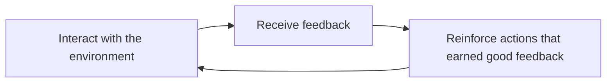

### When Reinforcement Learning Is Appropriate

In large environments, reinforcement learning can be used in three situations:

1. **A model of the environment is known, but an analytic solution is not available:** how the environment works is known, but the best behavior cannot be calculated directly by a formula.
2. **Only a simulation model of the environment is given:** this is the subject of simulation-based optimization.
3. **The only way to collect information about the environment is to interact with it.**

Chess illustrates the second and third situations. The board and rules are known, but nothing else about how a game will unfold is given: only a simulation model of the environment is available. The opponent's play is not known in advance; it can be learned only by playing, so data collection happens through interaction.

More generally, reinforcement learning suits problems in which decisions are sequential, outcomes are uncertain, and actions influence future opportunities.

### What Each Paradigm Learns

All three learning paradigms learn parameters $\theta$, but they learn different objects:

| Paradigm | What is learned | Applications |
| --- | --- | --- |
| Supervised learning | $p_\theta(y\mid x)$: the label $y$ given an input $x$ | Classification, regression |
| Unsupervised learning | $p_\theta(x)$: a description of the data itself | Inference, generation |
| Reinforcement learning | $\pi_\theta(a\mid s)$: the action $a$ given a state $s$ | Prediction, control |

Supervised and unsupervised learning generalize from given data, either to predict labels or to describe the data. Reinforcement learning instead learns **good behavior**: looking at the situation and taking the right action.

⚠️ **Emphasized by instructor:** whenever the aim is described as learning good behavior, read *behavior* as looking at the situation and taking the right action. Good behavior is described by a policy, so the task is to learn a good policy.

The policy $\pi_\theta(a\mid s)$ is a probabilistic function: for a given state, it gives the probability of selecting each action. The parameters $\theta$ are whatever defines that function. If the policy is a neural network, $\theta$ consists of its weights; if it is a polynomial function, $\theta$ consists of its coefficients.

Consider moving a coin on a board in one of four directions. The state is the board configuration, and the possible actions are up, left, down, and right. The policy gives $\pi(\text{up}\mid s)$, $\pi(\text{left}\mid s)$, $\pi(\text{down}\mid s)$, and $\pi(\text{right}\mid s)$. If moving up is the right choice, learning should produce a policy that gives up a high probability.

<details className="alert alert--info">
<summary>Test Your Understanding</summary>

**Questions**
1. Someone claims that reinforcement learning is a newer kind of neural network that replaces deep learning. What is wrong with this claim, and how does reinforcement learning's data differ from that of deep learning?
2. Supervised learning learns $p_\theta(y\mid x)$, while reinforcement learning learns $\pi_\theta(a\mid s)$. What does each represent, and why is reinforcement learning described as learning behavior rather than learning from a dataset?
3. Which situation for using reinforcement learning fits each case? (a) The board and rules of chess are known, but nothing else about how a game will unfold is given. (b) An unfamiliar opponent's play can be learned only by playing against them.

**Answers**
1. Reinforcement learning is an approach to learning, comparable to supervised and unsupervised learning, not a type of network or an alternative to neural networks. Neural networks can be part of it, for example by learning the parameters of the policy. Deep learning typically uses a fixed dataset given in advance, whereas reinforcement learning collects its data through interaction, as a sequential state–action–reward sequence.
2. $p_\theta(y\mid x)$ predicts a label given an input. $\pi_\theta(a\mid s)$ gives the probability of each action in a state. Reinforcement learning learns behavior because the policy decides what to do in each situation, and it learns this from reward feedback gathered through interaction rather than by generalizing from a given labeled dataset.
3. (a) Only a simulation model of the environment is given. (b) The only way to collect information about the environment is to interact with it.

</details>

## Comparing Learning Paradigms

The three paradigms differ in the kind of information available to the learner and how it learns from that information.

| Paradigm | Data and feedback | Typical task or aim | Example algorithms | Applications |
| --- | --- | --- | --- | --- |
| Supervised learning | Labeled data with a target output; the learner compares its prediction with the target and reduces the difference. | Regression and classification; calculate or predict outcomes. | Linear regression, logistic regression, SVM, KNN | Risk evaluation, sales forecasting |
| Unsupervised learning | Unlabeled data without a target answer; the learner searches for patterns. | Clustering and association; discover underlying patterns. | K-means, C-means, Apriori | Recommendation systems, anomaly detection |
| Reinforcement learning | The learner interacts with an environment and gathers experience through state, action, and reward sequences. | Learn a sequence of actions; balance exploration of alternatives with using actions that have worked well. | Q-learning, SARSA | Self-driving cars, gaming, healthcare |

Supervised learning has a target for each training example, so the learner can compare its output with the correct answer. Unsupervised learning has no such labels and instead looks for structure in the data; in some workflows, this pattern discovery can come before supervised learning.

Reinforcement learning does not begin with a predefined set of correct actions. Its experience is collected through interaction: the agent encounters a state, takes an action, and receives a reward as the environment responds. The reward evaluates the consequence, rather than supplying a correct action label.

### Tea-Making Analogy

The three learning paradigms can also be distinguished by how someone learns to make tea:

- **Supervised learning:** Follow a supplied recipe. The correct procedure is already given.
- **Unsupervised learning:** Study many tea-making videos without a recipe and infer a procedure from the examples. The learner is finding patterns in supplied data, not receiving reward from its own attempts.
- **Reinforcement learning:** Try a mixture, taste the result, and adjust the next attempt. Feedback such as “too bitter” or “too much milk” guides changes to the ingredients.

### Classification Activity

| Scenario | Paradigm | Reason |
| --- | --- | --- |
| Classify new images using thousands of labeled cat and dog images. | Supervised learning | The examples already have class labels. |
| Group shopping-app customers by purchase behavior. | Unsupervised learning | The groups are discovered from behavior data rather than preset labels. |
| A robot tries actions in a maze and receives a reward when it reaches the goal. | Reinforcement learning | It learns through actions and reward feedback from the environment. |
| Predict a house price from past house data. | Supervised learning | This is regression from examples with target prices. |
| Group news articles into topics. | Unsupervised learning | The system discovers topic groupings in the articles. |
| Train an AI agent to play chess. | Reinforcement learning | The agent learns through game interaction and outcomes. |

<details className="alert alert--info">
<summary>Test Your Understanding</summary>

**Questions**
1. What kind of data does supervised learning start with, and what does unsupervised learning look for?
2. Where does reinforcement learning get its experience?
3. How does supervised feedback differ from reward in reinforcement learning?
4. Following a recipe book to make tea: which learning paradigm is this, and why?
5. Inferring a procedure from many unlabeled tea-making videos: which paradigm is this, and why is it not reinforcement learning?
6. When tasters say the tea is bitter or has too much milk, what role does that feedback play in the learner's next attempt?
7. Classify each scenario: labeled cat/dog images; customer groups based on purchase behavior; a reward-guided maze robot; house-price prediction from past data; unlabeled news articles grouped by topic; an AI agent learning chess.

**Answers**
1. Supervised learning starts with labeled data and target outputs. Unsupervised learning uses unlabeled data to look for patterns such as clusters or associations.
2. The learner collects experience by interacting with the environment after taking actions; this experience includes states, actions, and rewards.
3. Supervised learning provides a correct target label for each training example. Reinforcement learning provides reward feedback about an action's consequence, rather than a label naming the correct action.
4. Supervised learning, because the recipe provides the correct procedure and steps in advance.
5. Unsupervised learning, because the learner infers a procedure from unlabeled examples. It is not reinforcement learning because it is not learning from rewards received after its own actions in the tea-making environment.
6. The feedback signals how to adjust the next attempt, such as reducing the tea leaves if it is bitter or reducing the milk if there is too much.
7. Supervised; unsupervised; reinforcement; supervised; unsupervised; reinforcement, respectively.

</details>

## The Agent–Environment Loop and RL Components

Reinforcement learning is organized around repeated interaction between an **agent** and an **environment**. The agent observes the current situation, chooses an action, and receives a new situation and reward from the environment. The agent is the learner; the environment is the outside world in which it operates.

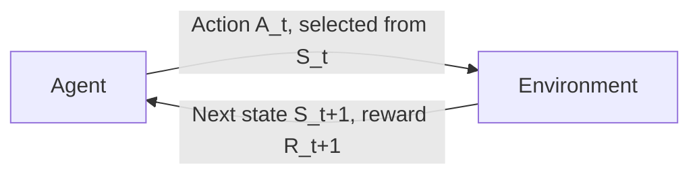

At time step $t$, the agent receives state $S_t$ and chooses action $A_t$. The environment then transitions to state $S_{t+1}$ and returns reward $R_{t+1}$ for the action taken from $S_t$. Thus, $R_{t+1}$ evaluates $A_t$, not the next action. Repeating this cycle creates sequential experience.

The goal is to maximize cumulative reward. Individual rewards still contribute to that total: an action with little or negative immediate reward may be useful if it leads to better rewards later. Rewards can be delayed or sparse. For example, studying may receive an evaluative signal only after an exam weeks later.

### Core Elements

| Element | Meaning |
| --- | --- |
| **Agent** | The learner that selects actions to perform a task. In bicycle learning, the person learning to ride is the agent. |
| **Environment** | The world outside the agent in which it operates. For bicycle riding, this includes the surrounding area and road. |
| **State ($S$)** | The agent's current situation. An action can move it to a different state. |
| **Action ($A$)** | What the agent does at a time step. Examples include a child walking, a car accelerating or braking, and a vacuum robot moving. |
| **Reward ($R$)** | Positive or negative feedback given based on the action's outcome. |
| **Policy ($\pi$)** | The agent's strategy for choosing actions from states. $\pi(a\mid s)$ denotes the probability of choosing action $a$ in state $s$. |
| **Value function** | An estimate of how good a state is, or how good it is to take a particular action in a state. There are two kinds: state-value functions and action-value functions. |
| **Model of the environment** | An optional component that predicts the next state and reward from a state and action. Such predictions can support planning. |

A policy can be **stochastic**, assigning probabilities to multiple actions in a state, such as 60% for going up and 40% for going right. It can be **deterministic**, choosing one action with probability 1 and the alternatives with probability 0. An action is a single choice; a policy is the strategy that guides choices across states.

Reinforcement learning is characterized by sequential decision-making, where time and the order of actions matter. It does not use a teacher to provide a correct label for every action; feedback comes as a reward signal, which may be delayed or sparse.

<details className="alert alert--info">
<summary>Test Your Understanding</summary>

**Questions**
1. In the bicycle example, who is the agent and what is the environment?
2. Which action does reward $R_{t+1}$ evaluate: $A_t$ or $A_{t+1}$?
3. Why might maximizing cumulative reward call for an action whose immediate reward is small or delayed?

**Answers**
1. The person learning to ride is the agent; the bicycle and surrounding area, including the road, are the environment.
2. $R_{t+1}$ evaluates $A_t$, the action taken from state $S_t$.
3. The action may lead to greater rewards later. Individual rewards still count toward cumulative reward, including rewards received after a delay.

</details>

## Value Learning and Step-Size Choices

Learning a value function turns experience into estimates that can guide future choices. The estimates need to become more accurate with experience, but they may also need to keep changing when the environment changes. The step size controls how strongly each new experience revises an existing estimate.

### Tic-Tac-Toe and State Values

In tic-tac-toe, the agent chooses moves with the aim of eventually winning against its opponent. A board position is a state, and the opponent is part of the environment. The agent stores an estimate of its probability of eventually winning from each position.

| Board position | Initial value |
| --- | --- |
| Already won | $1$ |
| Already lost, or drawn | $0$ |
| Outcome not yet known | $0.5$ |

The value $0.5$ is an initial guess for a non-terminal position, not a known probability or a permanent value.

#### What Is $V(S_t)$ Called?

**$V$ is the state-value function:** the whole mapping from states to their values. **$V(S_t)$ is the state value of $S_t$:** the single number obtained by evaluating that function at the given state. The whole table represents the function; one state's entry is its value.

In this particular setup, $V(S_t)=0.52$ means an estimated 52% chance of eventually winning from that board position. State values do not always represent probabilities; this interpretation belongs to the tic-tac-toe setup.

### Learning From Successive Estimates

After a greedy move, information from a later position adjusts the estimate of the earlier position:

$$
V(S_t)\leftarrow V(S_t)+\alpha\left[V(S_{t+1})-V(S_t)\right].
$$

Here, $S_t$ is the earlier state, $S_{t+1}$ is the later state, and $\alpha$ is the step-size parameter. The difference $V(S_{t+1})-V(S_t)$ gives the direction and size of the discrepancy. Multiplying it by $\alpha$ determines how much correction to apply. This is a temporal-difference update: it uses the difference between estimates at successive times.

The update changes an estimate in the value table, not the board position itself. A more promising later position pulls the earlier estimate upward; a less promising one pulls it downward.

:::tip[Think It Through]
**Prompt:** Suppose $V(S_t)=0.50$, $V(S_{t+1})=0.70$, and $\alpha=0.10$. What is the updated value of $V(S_t)$, and why should it move in that direction?

**Answer:** $V(S_t)=0.50+0.10(0.70-0.50)=0.52$. It increases because the later state has a higher estimated probability of winning. The update moves the earlier estimate 10% of the way toward the later estimate.
:::

#### How Do Values Start Changing When Unknown States All Have Value 0.5?

A transition between two states both valued at $0.5$ produces no correction. Learning starts because terminal outcomes have known values: a win has value $1$, while a loss or draw has value $0$. These outcomes break the initial equality, and changed estimates can then influence earlier states through repeated experience.

For illustration, consider updates along a path toward a win:

$$
s_A\;(0.5)\longrightarrow s_B\;(0.5)\longrightarrow\text{Win}\;(1).
$$

With $\alpha=0.1$ and updates made as play proceeds, the initial update of $s_A$ changes nothing:

$$
V(s_A)\leftarrow 0.5+0.1(0.5-0.5)=0.5.
$$

Reaching the winning position changes the estimate of $s_B$:

$$
V(s_B)\leftarrow 0.5+0.1(1-0.5)=0.55.
$$

On a later visit to the same transition, $s_A$ has a different target. If $V(s_B)$ is still $0.55$, then:

$$
V(s_A)\leftarrow 0.5+0.1(0.55-0.5)=0.505.
$$

Information about winning has now reached an earlier state, even though that state does not immediately produce a win. Repeated experience allows this information to spread farther backward. Losses and draws similarly pull preceding estimates downward.

Not every transition needs to produce a nonzero update. What matters is that experience connects the states to informative outcomes and that the relevant transitions are revisited. With these online updates, changing $s_B$ does not automatically revise $s_A$ earlier in the same game.

### Step Size and Continuing Adaptation

The step size controls how strongly new experience changes the current estimate. Using the same earlier value $0.50$ and later value $0.70$:

| Step size | Updated value | Effect |
| --- | --- | --- |
| $\alpha=0.10$ | $0.52$ | A small adjustment toward $0.70$ |
| $\alpha=0.80$ | $0.66$ | A much larger adjustment toward $0.70$ |

A larger step size makes learning more responsive, but estimates can fluctuate more as different experiences arrive. A smaller step size makes each adjustment gentler, but learning and adaptation are slower.

⚠️ **Emphasized by instructor:** becoming good against familiar opponents does not guarantee being good against a new opponent with an unfamiliar strategy. The agent's experience may not cover everything it needs to learn.

Setting $\alpha=0$ permanently stops value learning:

$$
V(S_t)\leftarrow V(S_t)+0\left[V(S_{t+1})-V(S_t)\right]=V(S_t).
$$

The agent can still play, but its stored values no longer change in response to outcomes.

:::tip[Think It Through]
**Prompt:** Suppose the agent plays many games against familiar opponents, then sets $\alpha=0$. A new opponent arrives with an unfamiliar strategy. Can the agent's stored state values adapt to that opponent? Explain using the update rule.

**Answer:** No. Multiplying the discrepancy by zero makes every correction zero, so the state values never update in light of new experiences against the new opponent.
:::

The appropriate schedule depends on whether the aim is to settle or to keep adapting:

| Situation | Step-size choice and consequence |
| --- | --- |
| One fixed opponent | Decrease $\alpha$ appropriately over time so that estimates can settle toward the true winning probabilities. Approaching zero is different from setting it to zero prematurely and freezing errors. |
| Opponents whose strategies slowly change | Retain a responsive positive step size so that new experience can revise the estimates. A suitable constant positive step size is one option. |
| A relatively large constant $\alpha$ | Updates are responsive but more sensitive to individual experiences and changing strategies. |
| A very small constant $\alpha$ | Updates continue, but adaptation is slow. |

⚠️ **Emphasized by instructor:** keeping the ability to learn matters when an unexpected strategy appears. A positive step size permits updates, although merely keeping it above zero does not prevent adaptation from becoming too slow if it becomes extremely small.

:::tip[Think It Through]
**Prompt:** Suppose an agent's value estimates keep fluctuating while it uses a constant positive $\alpha$. Is that alone enough to conclude that learning has failed? Why or why not?

**Answer:** No. The environment, including the opponent, may keep changing, so each new experience may induce useful learning. A constant positive step size continues to respond to new experience; fluctuations alone do not establish failure.
:::

### Action Selection Versus Value Updates

Action selection chooses the move; $\alpha$ controls the subsequent value update. Increasing $\alpha$ does not itself provide a mechanism for trying exploratory moves. Changed value estimates may indirectly change later choices, but updating values and selecting exploratory actions are different operations.

### Connecting Components and Method Families

Consider an autonomous-driving agent whose aim is to reach its destination safely. Its state description uses sensor information, its actions are the available driving controls, and rewards evaluate the consequences of its actions. Suppose its reward scheme gives $+4$ for driving at the speed limit and penalties for leaving the road or ignoring a stop line. Multiple criteria may contribute to the reward, making its design important.

At a broad level, **model-based methods** use predictions of environmental behavior, while **model-free methods** learn from experience without an explicit environment model.

<details className="alert alert--success">
<summary>From Previous Question Papers</summary>

**Questions**
1. [Write the answer in an A4 Sheet, Scan & Upload] Consider tic-tac-toe to answer this question. Assume that states are numbered from $S_1$ to $S_n$. Write the temporal difference rule for learning each state's value. [0.5 M] Explain various elements and the workings of this rule. [1.5 M] *(January 2024 Midsem Regular Q1b)*
2. [Write the answer in an A4 Sheet, Scan & Upload] Consider tic-tac-toe to answer this question. Assume that states are numbered from $S_1$ to $S_n$. Let the value of the current state be $4.5$, and all its possible successor/predecessor states have a value of $2.7$. Use $0.9$ to be the parameter value for any parameter you need to use to solve this problem. Given this, revise the estimate of the value of the current state using your answer to (b). Explain your answer. [2 M] *(January 2024 Midsem Regular Q1c)*
3. [Write the answer in an A4 Sheet, Scan & Upload] Consider the RL agent learning the game of tic-tac-toe, by playing against different randomly chosen opponents. Consider the temporal difference rule being used in this context. Can $\alpha$ be used to encourage exploration? [1 M] Why or why not? [2 M] *(July 2024 Midsem Regular Q1b)*

**Answers**
1. $V(S_t)\leftarrow V(S_t)+\alpha[V(S_{t+1})-V(S_t)]$. The earlier estimate moves toward the later estimate; the difference gives the discrepancy and $\alpha$ controls the fraction applied as a correction.
2. $V_{\text{new}}=4.5+0.9(2.7-4.5)=2.88$. The estimate moves 90% of the way toward the lower successor value. These numerical values are generic state values, not winning probabilities.
3. Not directly. $\alpha$ controls the size of value updates, not the selection of exploratory moves. Changing estimates may indirectly change later choices, but increasing $\alpha$ does not itself create an exploration mechanism.

</details>

<details className="alert alert--info">
<summary>Test Your Understanding</summary>

**Questions**
1. You want your agent's estimates to settle against one fixed opponent. A friend wants their agent to keep adapting against opponents whose strategies slowly change. How should these different aims influence the choice of step-size schedule?

**Answers**
1. For a fixed opponent, decrease $\alpha$ appropriately toward zero so that estimates can settle, rather than setting it to zero prematurely and freezing errors. For changing opponents, retain a responsive positive step size, for example a suitable constant, to allow continuing adaptation. Reducing $\alpha$ without ever making it exactly zero still permits updates, but an extremely small value can make adaptation too slow.

</details>

## Bandit Formulation and Action-Value Estimates

Tic-tac-toe involves decisions across changing board positions. A **$k$-armed bandit** removes that complication: the learner repeatedly faces the same choice among $k$ actions. This isolates the problem of learning which action is worthwhile from reward feedback, without having to learn different choices for different states.

⚠️ **Emphasized by instructor:** this simplified setting builds foundations for fuller reinforcement learning problems.

### Four Machines and Repeated Choices

Imagine four slot machines, called $a$, $b$, $c$, and $d$. Each machine represents an available **action**, also called an **arm**, not a different state. On each round, the learner chooses one machine, receives its numerical reward, and then faces the same four choices again.

Only the selected machine supplies an observed reward. The learner does not observe what the other three machines would have produced on that round. The objective is to **maximize expected total reward across repeated choices**, not merely chase the largest possible individual payout.

### Stationary Does Not Mean Identical Rewards

In the initial setup, each action has its own unknown, stationary reward distribution. **Stationary** means that its probabilities of producing different rewards do not change over time. Individual outcomes can still differ.

:::tip[Think It Through]
**Prompt:** Suppose the same machine gives reward $0$ on one pull and $5$ on the next. Does that, by itself, contradict the assumption that its reward distribution is stationary? Why?

**Answer:** No. Different trials of the same action can produce different rewards from the same stationary distribution. Stationarity fixes the reward probabilities, not the payout on every attempt. These are repeated selections of the same action, not different actions merely because their outcomes differ.
:::

### True Action Values and Their Estimates

An action is best because it has the highest expected reward, not because it once produced a large payout. Its **true action value** is the mean of its reward distribution:

$$
q_*(a)\doteq\mathbb{E}[R_t\mid A_t=a].
$$

This reads: the true value of action $a$ is defined as the expected reward when that action is selected. The dotted equality means **defined as**, not approximately equal or estimated as.

| Symbol | Meaning |
| --- | --- |
| $a$ | A particular action, such as selecting the fourth machine |
| $A_t$ | The action actually selected on round $t$ |
| $R_t$ | The reward received from that selection |
| $q_*(a)$ | The action's true mean reward, unknown to the learner |
| $Q_t(a)$ | The learner's current estimate of that mean |

There is no state argument in the basic bandit because the same decision situation repeats. Each action has a true value, including poor actions. The star does not mean that every action is optimal; the optimal action is the one with the highest true value.

For one illustrative case, the true means are:

| Machine | True mean reward |
| --- | --- |
| $a$ | $-0.50$ |
| $b$ | $-0.20$ |
| $c$ | $0.10$ |
| $d$ | $0.11$ |

If these true values were known, selecting $d$ would maximize expected reward. The difficulty is that the learner has estimates, not access to this true-value table.

:::tip[Think It Through]
**Prompt:** After another pull, the learner revises its estimate of the fourth machine. Under our stationary assumption, does that mean the machine's true action value has changed too? Why or why not?

**Answer:** No. The true action value stays fixed because the reward distribution is stationary. New observations revise the learner's estimate of that fixed value. The estimate is updated using each new observation, although its numerical value need not change if the new reward equals its current average.
:::

### Sample-Average Action-Value Estimates

A simple way to estimate an action's true mean is to average the rewards obtained when that particular action was selected. This is the **sample-average method**:

$$
Q_t(a)=\frac{\sum_{i=1}^{t-1}R_i\,\mathbf{1}_{\{A_i=a\}}}{\sum_{i=1}^{t-1}\mathbf{1}_{\{A_i=a\}}}.
$$

The indicator $\mathbf{1}_{\{A_i=a\}}$ is $1$ when action $a$ was selected on round $i$, and $0$ otherwise. It filters the history so that the numerator adds rewards from action $a$ only, while the denominator counts selections of that action, not all rounds.

The subscript $t$ identifies the estimate available when choosing on round $t$. It uses observations from before that round. If an action has never been selected, there is nothing to average; use an initial estimate such as $0$ instead of dividing by zero.

For the four machines, suppose the first ten pulls produced these observed histories:

| Machine | Observed rewards | Number of pulls | Sample-average estimate |
| --- | --- | --- | --- |
| $a$ | $-1,-1,5$ | $3$ | $1$ |
| $b$ | $-0.2,-0.2$ | $2$ | $-0.2$ |
| $c$ | $-0.5,-0.5,-0.5$ | $3$ | $-0.5$ |
| $d$ | $-2,-2$ | $2$ | $-2$ |

For example:

$$
Q_{11}(a)=\frac{-1-1+5}{3}=1.
$$

There have been ten pulls overall, but only three contributed to machine $a$'s estimate. These sample averages are the learner's estimates, not the true means.

### Greedy Action Selection

A **greedy action-selection rule** chooses an action with the highest current estimated value:

$$
A_t=\operatorname*{arg\,max}_a Q_t(a).
$$

The operation **arg max** returns which action has the highest estimate, rather than returning that estimate itself. If several actions tie for highest, any of them is greedy; the tie can be broken randomly.

The four-machine diagram shows the current estimates from the observed histories:

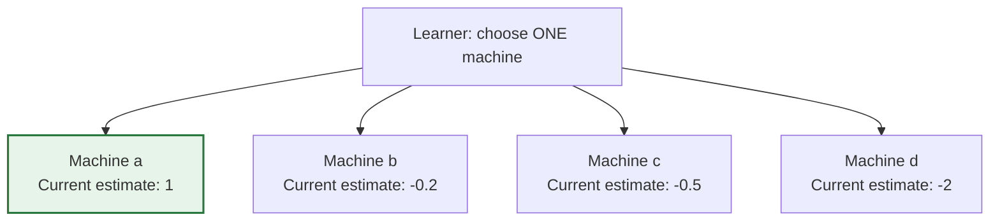

The arrows represent alternatives, not four simultaneous pulls. The highlight marks the current greedy choice, not a proven optimal machine.

:::tip[Think It Through]
**Prompt:** Using only the observed-reward table, which machine would a greedy rule choose? Does that establish that this machine has the highest true mean reward?

**Answer:** It chooses machine $a$ because $Q_{11}(a)=1$ is the highest current estimate. This establishes only that $a$ looks best under the available estimates, not that it has the highest true mean. The estimates, and therefore their ranking, can change as new experience arrives.
:::

Only the selected machine receives a new observation, so only its sample-average estimate is updated. If machine $d$ is never tried again, its estimate can remain at $-2$ even though its true mean is higher. Always selecting the currently best-looking action can leave misleading estimates of other actions uncorrected.

### Bandit Applications

A bandit formulation identifies the repeatedly available options, the reward observed for a selected option, and the objective across repeated choices. It uses a simplified setting without having to choose differently across changing states.

Cloud-configuration tuning is one example. A learner repeatedly chooses among server configurations under comparable conditions, observes the selected configuration's throughput, and aims to maximize expected total throughput. Each configuration is an arm; only the chosen configuration supplies an observed reward.

| Setting | Arms | Possible reward |
| --- | --- | --- |
| Advertisement selection | Candidate advertisements | Click or purchase |
| Website testing | Alternative layouts | Conversion |
| Controlled treatment selection | Treatment options | Improvement score |
| Investment selection | Investment alternatives | Return |

These are simplified formulations: the basic stationary bandit repeatedly presents the same options and assumes each action's reward distribution remains fixed.

<details className="alert alert--success">
<summary>From Previous Question Papers</summary>

**Questions**
1. [Write the answer in A4 Sheet, Scan & Upload] Write any one use-case (application) which can be modeled as a multi-armed bandit for its solution. Your answer should have all the elements that identify the use case and can be modeled as a multi-armed bandit problem. [2 M]
   **Workplace variant:** [Write the answer in A4 Sheet, Scan & Upload] Write any one use-case (application) from your workplace which can be modeled as a multi-armed bandit for its solution. Your answer should have all the elements that identify the use case and can be modeled as a multi-armed bandit problem. [Vague description of application will be penalized.] [1.5 M] *(January 2024 Midsem Regular Q2a; July 2024 Midsem Regular Q2c)*

**Answers**
1. In cloud-configuration tuning, a learner repeatedly chooses one server configuration from a fixed set under comparable conditions. Configurations are the arms, observed throughput is the reward, and the objective is to maximize expected total throughput. Only the selected configuration supplies feedback. The basic stationary formulation assumes each configuration's reward distribution remains fixed.

</details>

<details className="alert alert--info">
<summary>Test Your Understanding</summary>

**Questions**
1. Before round 11, machine $a$ has observed rewards $-1,-1,5$, and machine $d$ has observed rewards $-2,-2$. In a hypothetical continuation, the learner chooses $d$ on round 11 and receives reward $4$. What are $Q_{12}(d)$ and $Q_{12}(a)$? Show which rewards and denominator belong in each calculation, and explain why machine $a$'s estimate does or does not change.

**Answers**
1. $Q_{12}(d)=(-2-2+4)/3=0$, and $Q_{12}(a)=(-1-1+5)/3=1$. Both denominators count selections of the relevant machine, not all eleven rounds. Machine $a$ was not selected on round 11, so it has no new reward and its sample-average estimate remains unchanged. $Q_{12}$ names the estimates available after round 11 and before choosing on round 12.

</details>

## Exploration, Exploitation, and Epsilon-Greedy Selection

Current action-value estimates can be misleading. Choosing the action that looks best uses existing knowledge, while trying alternatives can improve that knowledge. The conflict is between obtaining reward now and gathering information that may improve future choices.

### Why Exploration Can Be Worthwhile

Consider the four machines again, with the observed histories from the first ten pulls. This time, take a separate illustrative case in which machine $d$'s true mean is $1$ rather than the $0.11$ used earlier, while machine $a$'s true mean is still $-0.5$:

| Machine | Current estimate | True mean, unknown to the learner |
| --- | --- | --- |
| $a$ | $1$ | $-0.5$ |
| $d$ | $-2$ | $1$ |

The learner sees $a$ as promising and $d$ as poor, although their true means tell a different story.

- **Exploitation:** choose the currently best-looking action to obtain reward using existing knowledge.
- **Exploration:** try alternatives to improve knowledge, potentially discovering a better action.

Exploration may sacrifice reward now, but useful information can improve many later choices. Endlessly testing alternatives without using what has been learned also sacrifices reward.

⚠️ **Emphasized by instructor:** exploration acknowledges that current estimates are imperfect, not established true values.

:::tip[Think It Through]
**Prompt:** Would you be equally willing to try a poorly known machine with one pull remaining and with 1,000 pulls remaining? Explain how the remaining opportunities affect the usefulness of learning.

**Answer:** With one pull remaining, use the currently best estimate to maximize expected reward; there is no later choice that can benefit from the new information. With 1,000 pulls remaining, exploration may be worthwhile because what is learned can improve many later choices. Pulling a machine does not improve its stationary true mean. Its estimate may rise or fall; the purpose is to discover whether it is better than currently believed.
:::

### The Epsilon-Greedy Rule

**$\varepsilon$-greedy**, also called **near-greedy selection**, balances the two purposes using a random branch:

| Probability     | Selection rule                                     |
| --------------- | -------------------------------------------------- |
| $1-\varepsilon$ | Choose an action with the highest current estimate |
| $\varepsilon$   | Choose uniformly at random from all $k$ actions    |

Uniformly means that each action has an equal chance within the random branch. The choice there is independent of the action-value estimates, and the greedy action is included among the available choices.

The parameter $\varepsilon$ controls action selection. It is different from $\alpha$, which controls the size of value updates. At $\varepsilon=0$, selection is purely greedy; at $\varepsilon=1$, selection is purely uniform random choice.

For $\varepsilon=0.2$, the direct greedy branch is used 80% of the time and the random branch 20% of the time. This does not mean the greedy action is selected only 80% of the time, because it can also be selected randomly.

:::tip[Think It Through]
**Prompt:** With four machines, one uniquely greedy machine $a$, and $\varepsilon=0.2$, what is the total probability of selecting $a$? Account for both routes by which it can be selected.

**Answer:** $P(A_t=a)=0.80+0.20/4=0.85$, or 85%. Direct greedy selection contributes $0.80$, and the random branch contributes $0.20\times\frac14=0.05$. Each of the other machines receives probability $0.05$.
:::

### Selection Probabilities

For a uniquely greedy action $g$, split the calculation into the two mutually exclusive branches:

| Branch | Probability of branch | Probability of choosing $g$ within it |
| --- | --- | --- |
| Direct greedy selection | $1-\varepsilon$ | $1$ |
| Uniform random selection | $\varepsilon$ | $1/k$ |

Multiply the branch probability by the conditional probability of selecting $g$ within that branch, then add the two routes:

$$
P(A_t=g)=1(1-\varepsilon)+\frac1k\varepsilon=1-\varepsilon+\frac{\varepsilon}{k}.
$$

A non-greedy action can be selected only through the random branch, so each such action has probability $\varepsilon/k$.

| Number of actions | $\varepsilon$ | Greedy action | Each non-greedy action |
| --- | --- | --- | --- |
| $4$ | $0.2$ | $0.85$ | $0.05$ |
| $4$ | $0.4$ | $0.70$ | $0.10$ |
| $2$ | $0.5$ | $0.75$ | $0.25$ |

For the two-action case, the direct greedy branch contributes $0.5$, and random selection contributes another $0.5\times0.5=0.25$. Their sum is $0.75$.

⚠️ **Emphasized by instructor:** excluding the greedy action from the random branch is a common mistake. It changes the algorithm and the resulting selection probabilities. Random choice includes all available actions, not only the non-greedy ones.

:::tip[Think It Through]
**Prompt:** If $\varepsilon=1$, does the uniquely greedy action still have a higher selection probability than the other actions? Explain using the branches or formula.

**Answer:** No. The direct greedy branch has probability zero, so each action is chosen uniformly with probability $1/k$. The uniquely greedy action receives no extra probability from its estimate.
:::

### Implementation and Value Updates

The selection rule uses a uniform random draw to decide which branch to follow:

```text
epsilon = 0.05

SelectAction:
	Draw a uniform random number between 0 and 1.
	If the number is greater than epsilon:
		Return an action with the highest current estimate.
	Otherwise:
		Return an action chosen uniformly from all actions.
```

The first random draw decides which branch to use. Within the random branch, a further random choice decides which action to take. After observing the reward, update the selected action's estimate.

A complete direct sample-average version maintains a reward history for each action:

```text
For each action:
	Set its estimate to 0 and its reward history to empty.

Repeat:
	Draw a uniform random number between 0 and 1.
	If the number is greater than epsilon:
		Choose an action with the highest current estimate.
	Otherwise:
		Choose uniformly from all actions.

	Observe the chosen action's reward.
	Append it to that action's reward history.
	Set that action's estimate to the average of its history.
```

Scanning $k$ estimates requires work proportional to $k$. This direct history-based version also recomputes an average; incremental estimation addresses that cost.

### Accurate Estimates Do Not Eliminate Random Choices

With a fixed $\varepsilon>0$, every action continues to have a selection probability of at least $\varepsilon/k$. In the infinite-run limit, each action is sampled repeatedly, and its sample-average estimate converges to its true mean under the basic stationary bandit assumptions.

Learning the values and selecting actions are different processes. Even accurate estimates do not remove the random branch. A fixed positive $\varepsilon$ keeps allowing non-greedy choices.

In practice, $\varepsilon$ may start higher when estimates are poorly informed and decrease as experience accumulates. Reducing it trades continued information gathering for greater use of current knowledge.

:::tip[Think It Through]
**Prompt:** Suppose all estimates eventually equal the true action values, there is one uniquely best action, and $\varepsilon=0.1$ remains fixed. Will the agent then always choose that best action? Why or why not?

**Answer:** No. The random branch remains active with probability $0.1$ and can select any action, including a non-best one. It can also select the best action, so $P(\text{best})=0.9+0.1/k$, and $P(\text{non-best})=0.1(k-1)/k$. For four actions, these are $0.925$ and $0.075$, respectively. Ten percent is the random-branch probability, not the probability of choosing a non-best action.
:::

### When Pure Greedy Selection Is Preferable

If the stationary true values are already known and one action is uniquely best, exploration provides no useful new information and sometimes selects inferior actions. Pure greedy selection can then outperform a method that retains a positive $\varepsilon$.

<details className="alert alert--success">
<summary>From Previous Question Papers</summary>

**Questions**
1. [Write the answer in A4 Sheet, Scan & Upload] **(b)** Write down a bandit algorithm that is $\varepsilon$-greedy. [Note: only a formal algorithm pseudo-code will be accepted as an answer.] [2 M] Comment on the efficiency of this algorithm. [0.5 M] **(c)** How does this algorithm balance exploration vs exploitation trade-off? Explain. [1.5 M] *(January 2024 Midsem Regular Q2b; January 2024 Midsem Regular Q2c)*
2. [Write the answer in A4 Sheet, Scan & Upload] State one situation in which a greedy action selection works better than $\varepsilon$-greedy action selection. [1.0 M] *(July 2024 Midsem Regular Q2b)*
3. You have the following Q-values for four arms of a bandit: $Q_1=25$, $Q_2=32$, $Q_3=7$, $Q_4=3$. Use $\varepsilon$-greedy with $\varepsilon=0.3$ to compute the probability of selecting each arm. [2 Marks] Also, identify which arm will be chosen in exploitation. [1 Mark] *(Compre Sample Paper 2 Q6a)*

**Answers**
1. The formal direct sample-average algorithm is:
   ```text
   For each action:
       Set its estimate to 0 and its reward history to empty.

   Repeat:
       Draw a uniform random number between 0 and 1.
       If the number is greater than epsilon:
           Choose an action with the highest current estimate.
       Otherwise:
           Choose uniformly from all actions.

       Observe the chosen action's reward.
       Append it to that action's reward history.
       Set that action's estimate to the average of its history.
   ```
   Scanning $k$ estimates requires work proportional to $k$, and this direct version also recomputes the selected action's average. The branch of probability $1-\varepsilon$ exploits current estimates; the branch of probability $\varepsilon$ keeps all actions available for random selection and further learning.
2. When the stationary true action values are known and one action is uniquely best, greedy selection always chooses that action. A positive $\varepsilon$ sometimes selects inferior actions without providing useful new information.
3. Arm 2 is greedy because $Q_2=32$ is highest. $P(A=2)=1-0.3+0.3/4=0.775$. Each other arm has probability $0.3/4=0.075$. Exploitation selects arm 2.

</details>

<details className="alert alert--info">
<summary>Test Your Understanding</summary>

**Questions**
1. An $\varepsilon$-greedy agent has five available actions, with exactly one uniquely greedy action. Its probability of selecting that greedy action is $0.84$. What is $\varepsilon$, and what is the selection probability of each non-greedy action? Show how you obtain both.

**Answers**
1. $0.84=1-\varepsilon+\varepsilon/5=1-4\varepsilon/5$, so $\varepsilon=(1-0.84)\times5/4=0.20$. Each non-greedy action receives $\varepsilon/5=0.04$. Their combined probability is $4\times0.04=0.16$.

</details>

## Reward Noise and the 10-Armed Testbed

A short sequence of lucky or unlucky rewards can make an action look misleadingly good or bad. The 10-armed testbed compares action-selection strategies across many bandit problems so that their performance is not judged from a single fortunate or unfortunate run. Interpreting its results requires distinguishing reward noise, estimates, and the truly optimal action.

### Reward Variation and Limited Samples

An action's mean is its expected reward. Its variance describes how widely individual rewards vary around that mean. A stationary mean does not imply low variance: an action can have a fixed true mean while producing widely varying rewards. Greater reward variation generally makes estimating the mean from a small sample harder.

Consider the earlier four-machine example:

| Machine | Observed rewards | Current estimate |
| --- | --- | --- |
| $a$ | $-1,-1,5$ | $1$ |
| $d$ | $-2,-2$ | $-2$ |

Machine $a$ shows substantial variation, whereas the two observations of $d$ are identical. These observations describe the samples collected, not the full underlying distributions.

:::tip[Think It Through]
**Prompt:** Do the two identical rewards from machine $d$ establish that its underlying reward distribution has zero variance, or that its estimated mean is accurate? Explain what these observations can and cannot tell us.

**Answer:** No to both. The observations establish only that those two rewards matched. They do not prove zero underlying variance or an accurate mean estimate. A poorly sampled action can look consistent simply because very little of its behavior has been observed.
:::

Exploring only machines whose observed rewards vary can therefore be misleading. A machine such as $d$ can have a stable-looking but inaccurate estimate and still deserve further testing.

### Generating the Test Problems

The testbed contains 2,000 independently generated bandit problems, each with ten actions. There are two separate sources of randomness.

First, generate one problem by drawing each action's true mean:

$$
q_*(a)\sim\mathcal{N}(0,1).
$$

The ten means can differ, but remain fixed throughout that problem's run. Second, whenever the learner selects action $A_t$, draw its reward:

$$
R_t\mid A_t\sim\mathcal{N}\!\left(q_*(A_t),1\right).
$$

The notation $\mathcal{N}(\text{mean},\text{variance})$ denotes a normal distribution. Zero is the center of the distribution used to generate true means; it is not every action's true mean. Each action's actual reward distribution is centered on its own true mean and has variance $1$.

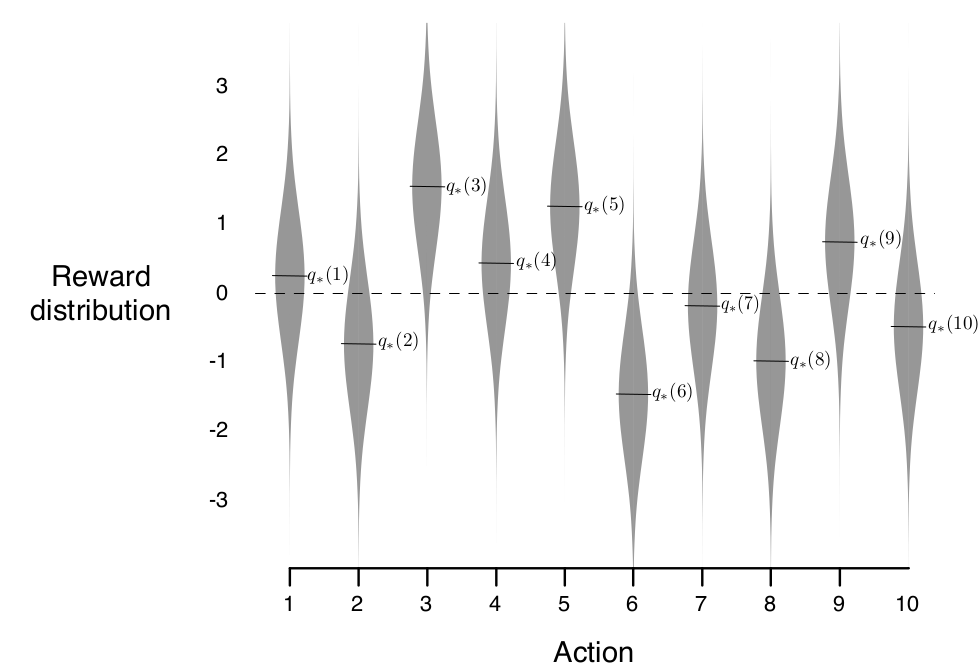

*Ten actions with different true reward means and reward variance $1$.*

Each gray shape represents one action's reward distribution. The centers differ because the true means differ. The action numbers identify alternatives, not successive time steps.

#### What Does Method Mean Here?

A method is an action-selection strategy being compared:

| Method | Selection behavior |
| --- | --- |
| Greedy, $\varepsilon=0$ | Always choose a highest-estimated-value action |
| $\varepsilon$-greedy, $\varepsilon=0.01$ | Use the uniform random branch with probability $0.01$ |
| $\varepsilon$-greedy, $\varepsilon=0.1$ | Use the uniform random branch with probability $0.1$ |

All three use sample averages to estimate action values. What differs is how they select actions, not the value-estimation technique.

#### Is It 1,000 Selections or 2,000 Runs?

Both numbers apply, but they count different things. One run means applying one method to one ten-armed bandit problem for 1,000 pulls. Each method is tested on 2,000 different problems, giving 2,000 runs per method.

$$
2{,}000\text{ runs}\times1{,}000\text{ pulls per run}=2{,}000{,}000\text{ pulls per method}.
$$

The graphs average results at matching step numbers across runs. For example, average reward at step 100 combines the reward received on the 100th pull of each of the 2,000 runs. It does not collapse all 1,000 steps into one average.

#### Why Average Across Many Different Problems?

One run can be strongly affected by its particular problem and early reward sequence. A greedy method might try the truly best machine early, receive encouraging rewards, and keep selecting it. In another run, early rewards might make a poor machine look best and encourage repeated selection of that machine instead.

Averaging across many independent problems reduces the influence of a lucky or unlucky individual run and reveals average behavior across the testbed. It is not a guarantee of success on every problem.

:::tip[Think It Through]
**Prompt:** Why would averaging across 2,000 different bandit problems give a more useful comparison than judging the methods from one problem alone?

**Answer:** One run cannot rule out lucky or unlucky initial observations, or the influence of one particular problem. Averaging across 2,000 problems gives a more useful picture of each strategy's average behavior on the testbed.
:::

:::tip[Think It Through]
**Prompt:** Imagine that a greedy method tries the truly best machine early in one run and receives encouraging rewards. In another run, early rewards make a poor machine look best. If we judged greedy selection from only the first run, could we tell whether its success came from a generally good strategy or fortunate early observations?

**Answer:** No. A single successful run does not distinguish a generally effective strategy from good luck in the initial observations. Comparing many runs reduces the influence of that luck.
:::

### Reading the Performance Graphs

Both graphs use step number within a run on the horizontal axis, but their vertical axes answer different questions.

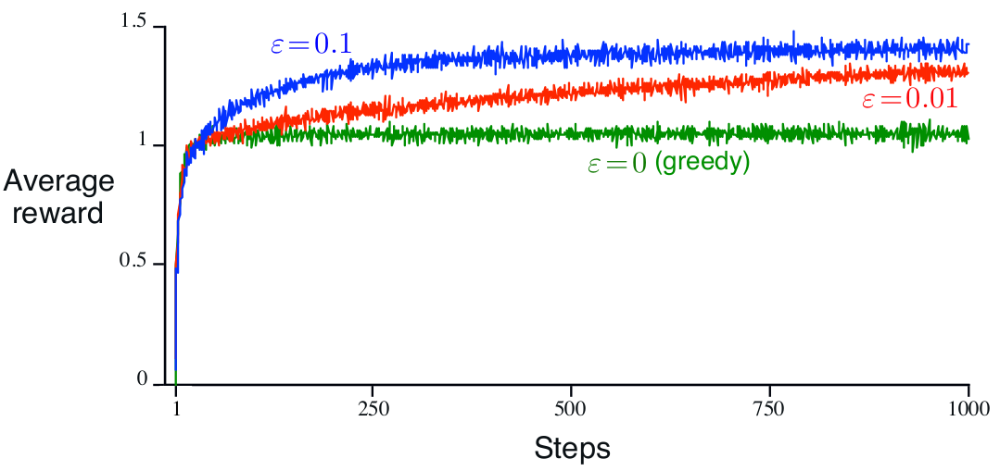

*Average reward at each step, averaged across 2,000 runs.*

The average-reward graph measures the reward received on step $t$, averaged across runs. It is not cumulative reward up to that step.

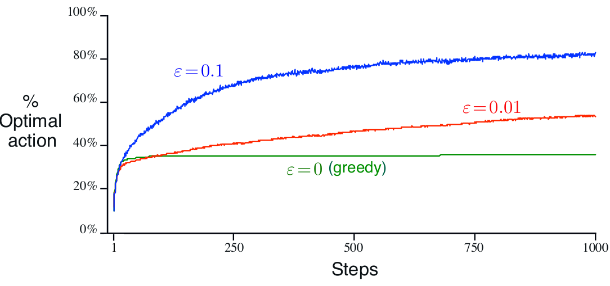

*Percentage of runs selecting their truly optimal action at each step.*

The optimal-action graph measures the percentage of runs that selected their own problem's truly best action on step $t$. Optimal means highest true mean, not highest current estimate.

Near step 1,000, the plotted values are approximately:

| Strategy | Average reward | Optimal-action selections |
| --- | --- | --- |
| Blue: $\varepsilon=0.1$ | $1.4$ | $80\%$ |
| Red: $\varepsilon=0.01$ | $1.3$ | $50\%$ |
| Green: greedy | $1.0$ | $35\%$ |

Greedy selection improves quickly initially but often settles on a suboptimal action after misleading early observations. The $\varepsilon=0.1$ method tests alternatives more frequently and discovers better actions faster. The $\varepsilon=0.01$ method continues improving, but its less frequent exploration makes discovery slower.

A roughly flat greedy curve does not mean estimates stop updating. For example, rewards $7$ followed by $-3$ change an action's sample average from $7$ to $2$. Greedy choices can change when estimates change; there is simply no deliberate random-exploration branch.

:::tip[Think It Through]
**Prompt:** The blue method uses its direct greedy branch 90% of the time, yet selects the truly optimal action only about 80% of the time near step 1,000. How can both statements be true?

**Answer:** The direct greedy branch chooses the highest current estimate, which can still belong to a truly inferior action. Some direct-greedy selections therefore miss the optimum, while random selections can sometimes find it. The difference is not merely that the percentages use different aggregations: even at the same step across runs, 90% can use the greedy branch while only about 80% select the truly best action. The 90% is a probability at each selection, not a guarantee of exactly 900 such selections in 1,000 steps.
:::

:::tip[Think It Through]
**Prompt:** When the greedy branch is used, does it choose the action with the highest true mean $q_*(a)$, or the highest estimate $Q_t(a)$? Could those be different actions?

**Answer:** It chooses a highest estimate $Q_t(a)$. That action need not have the highest true mean because the estimates can still rank the actions incorrectly.
:::

### Longer Runs and the Exploration Trade-Off

Once the uniquely best action is correctly identified, its selection probability with ten arms is:

$$
P(\text{optimal})=1-\varepsilon+\frac{\varepsilon}{10}.
$$

| Fixed $\varepsilon$ | Optimal-action probability once correctly identified |
| --- | --- |
| $0.1$ | $0.91$ |
| $0.01$ | $0.991$ |

The $\varepsilon=0.1$ method discovers good actions faster, but $\varepsilon=0.01$ sacrifices fewer later selections to random alternatives. On this stationary testbed, the smaller value has better asymptotic performance once estimates identify the best action reliably.

This does not guarantee that the smaller value wins in every individual run, by step 2,000, or in a changing environment. The displayed graphs do not establish an exact crossover point.

⚠️ **Emphasized by instructor:** starting with more exploration and reducing it later can combine faster discovery with greater exploitation afterward.

:::tip[Think It Through]
**Prompt:** Does the 99.1% long-run figure prove that $\varepsilon=0.01$ must outperform $\varepsilon=0.1$ during the first 1,000 pulls? Why or why not?

**Answer:** No. The long-run probability applies once the best action is correctly identified. With less exploration, the $\varepsilon=0.01$ method can take longer to identify it, and the displayed first 1,000 steps favor $\varepsilon=0.1$. Better asymptotic performance under the stationary testbed assumptions is not a guarantee for every finite run or an exact crossover step.
:::

### Reward Variance and Changing Values

The useful balance between exploration and exploitation depends on the task, not just the number of steps already taken.

| Condition | Consequence |
| --- | --- |
| Reward variance rises from $1$ to $10$ | Noisier observations make identifying the best action harder. More exploration may be needed for longer. |
| Rewards are deterministic and stationary | Trying every arm once reveals its true value; afterward, selecting the best avoids unnecessary exploration. |
| True values change over time | Old knowledge can become outdated. Continued exploration is needed even if rewards are deterministic at each moment. |

Imagine that an unseen adjustment, such as maintenance on a slot machine, changes one machine's reward distribution partway through play. A previously poor arm can become best without the learner noticing unless it tries that arm again. Deterministic rewards alone do not justify stopping exploration permanently; they must also stay fixed over time.

<details className="alert alert--info">
<summary>Test Your Understanding</summary>

**Questions**
1. In a ten-armed bandit with known deterministic rewards, an agent tries every arm once. It then stops exploring and always chooses the arm with the highest observed reward. What additional assumption makes this strategy sound over time? If that assumption does not hold, how could the agent miss a better arm?

**Answers**
1. The rewards must also be stationary: each arm's deterministic reward stays fixed over time. One observation per arm then reveals its true value and permits repeated selection of the best. If rewards change, an untried arm can improve without the learner noticing, so continued exploration can be useful. This requirement is the stationarity assumption.

</details>

## Identifying Random Selections

An observed action does not always reveal which branch of $\varepsilon$-greedy selection produced it. A non-greedy action requires the random branch, but a greedy action can be selected by either branch. To classify a selection, compare the action's estimate with the current maximum before incorporating its reward.

### Greedy Actions and Ties

Every action tied for the highest estimate counts as greedy. A greedy action does not need to be uniquely better than the alternatives. If all estimates are zero, all actions are greedy, and the direct greedy branch can choose any of them by breaking the tie.

Even if tie-breaking uses randomness, that does not prove that the $\varepsilon$ random branch was used. Random tie-breaking within the greedy branch and uniform random selection from all actions are different mechanisms.

An estimate of zero is not itself evidence of a non-greedy action. What matters is whether it is below the highest estimate at selection time.

### A Four-Action Sequence

Consider four actions, denoted $1,2,3,4$, with sample-average action-value estimates and initial values:

$$
Q_1(1)=Q_1(2)=Q_1(3)=Q_1(4)=0.
$$

The observed sequence is:

| Step $t$ | Action $A_t$ | Reward $R_t$ |
| --- | --- | --- |
| $1$ | $1$ | $1$ |
| $2$ | $2$ | $1$ |
| $3$ | $2$ | $2$ |
| $4$ | $2$ | $2$ |
| $5$ | $3$ | $0$ |

The task is to identify where random selection definitely occurred and where it could possibly have occurred. Use the estimates available before each choice, then update only the selected action's estimate using the reward received afterward.

### The First Two Selections

At step 1, all estimates are zero, so action 1 is one of four tied greedy actions. Its selection is compatible with either branch.

:::tip[Think It Through]
**Prompt:** At step 1, all estimates are zero and action 1 is selected. Can we conclude that the random branch was definitely used, or could the direct greedy branch also have selected action 1? Why?

**Answer:** Either branch could have selected action 1. All four actions tie for the highest estimate, so each is greedy. The direct greedy branch can select action 1 by breaking the tie. Random selection may have occurred, but is not established by the observed action.
:::

After receiving $R_1=1$, the estimates before step 2 are:

$$
\bigl(Q_2(1),Q_2(2),Q_2(3),Q_2(4)\bigr)=(1,0,0,0).
$$

Now action 1 is uniquely greedy, but the observed choice is action 2.

:::tip[Think It Through]
**Prompt:** Step 2 selects action 2 from estimates $(1,0,0,0)$. Could the direct greedy branch select action 2 now, or must this selection have come from the random branch? Why?

**Answer:** It must have come from the random branch. Action 2's estimate of $0$ is below action 1's estimate of $1$, so action 2 is non-greedy at this point.
:::

### Following the Remaining Estimates

Step 2 gives action 2 its first reward, $1$, so its estimate becomes $1$. Its next two rewards are both $2$, giving:

$$
Q_4(2)=\frac{1+2}{2}=1.5,
\qquad
Q_5(2)=\frac{1+2+2}{3}=\frac53.
$$

The estimates before the remaining selections are:

| Step | Estimates for actions $(1,2,3,4)$ | Selected action | Random branch required? |
| --- | --- | --- | --- |
| $3$ | $(1,1,0,0)$ | $2$ | No; action 2 ties with action 1 for highest estimate |
| $4$ | $(1,1.5,0,0)$ | $2$ | No; action 2 is uniquely greedy |
| $5$ | $(1,\frac53,0,0)$ | $3$ | Yes; action 3 is below action 2 |

:::tip[Think It Through]
**Prompt:** At steps 3 and 4, was the random branch definitely used, or only possibly used?

**Answer:** Only possibly used. Action 2 is greedy at both steps: tied for highest at step 3 and uniquely highest at step 4. Either the direct greedy branch or the random branch could have selected it.
:::

:::tip[Think It Through]
**Prompt:** At step 5, which conclusion applies, and why?

**Answer:** The random branch was certainly used. The chosen action 3 has estimate $0$, below action 2's estimate of $5/3$. The decisive fact is that its estimate is below the maximum, not merely that it is zero.
:::

The complete distinction is:

- **Definitely random:** steps $2$ and $5$.
- **Could have been random:** all five steps, because the random branch can also select a greedy action.
- **Ambiguous between the branches:** steps $1,3,4$.

Step 5's reward is zero, so action 3's sample-average estimate remains zero. This does not change how its selection is classified. A reward received afterward cannot retroactively determine the branch used for the selection; it affects the estimates available for future choices.

<details className="alert alert--success">
<summary>From Previous Question Papers</summary>

**Questions**
1. Considering Netflix's personalised video recommendation for an individual, where Netflix suggests a genre from the available list of genres $\{a,b,c,d\}$ and observes the reward (satisfactory rating) in $\{0,1,2,3\}$ from the individual, let's analyse the following sequence of tried genres and rewards: $1:(a,2)$, $2:(b,3)$, $3:(c,1)$, $4:(a,1)$, $5:(b,1)$, $6:(d,2)$, $7:(b,1)$, $8:(d,1)$, $9:(c,3)$, $10:(c,3)$, $11:(c,1)$, $12:(d,1)$. Assuming the initial value of all the actions are the same as the last digit of your student ID divided by $2$, please provide answers in this specific context. **(a) (Stationary case)** Which of those suggestions are exploratory in nature assuming $\varepsilon$-greedy action selection and action values are obtained by sample averages? Why? [1.5 M] *(July 2023 Midsem Regular Q2a)*

**Answers**
1. Under the explicit illustrative assumption that the last ID digit is $0$, all initial estimates are zero. The selections at steps $2,3,4,6,9,12$ are definitely exploratory because their chosen actions have estimates below the current maximum. At steps $1,5,7,8,10,11$, the chosen action is greedy, so either branch could have selected it. The random branch could have occurred at any step. Compare estimates before each choice and update the selected action's sample average afterward. For a different last ID digit, recompute using the required initial value; the listed forced-random steps are not a universal answer for every initialization.

</details>

<details className="alert alert--info">
<summary>Test Your Understanding</summary>

**Questions**
1. Before a selection, the estimates are $(Q(1),Q(2),Q(3),Q(4))=(1,0,0,0)$. Action 2 has never been tried. The agent selects it and receives reward $4$, so its estimate becomes $Q(2)=4$. Someone concludes: "That was a greedy selection because action 2 now has the highest estimate." Is that conclusion valid? Which branch must have produced the selection, and why?

**Answers**
1. No. Before selection, action 1 had the highest estimate, $1$, while action 2's estimate was $0$. Selecting action 2 therefore required the random branch. Its later reward and updated estimate do not affect how the completed selection is classified; they can affect future selections.

</details>

## Incremental Updates and Non-Stationary Rewards

Sample-average estimates can be computed without storing every reward, by repeatedly correcting the old estimate toward each new reward. Writing the update this way exposes a step size, and the choice of step size decides whether learning gradually stops or continues indefinitely. Continuing to learn matters because, in most reinforcement learning problems, reward distributions change over time.

### Computing the Average Incrementally

Consider a single action. Let $R_i$ be the reward received after the $i$-th selection of that action, and let $Q_n$ be its estimate after $n-1$ selections:

$$
Q_n\doteq\frac{R_1+R_2+\cdots+R_{n-1}}{n-1}.
$$

Storing every reward and recomputing the sum would make memory and computation grow with each new reward. Instead, the new average can be written in terms of the old average and the newest reward:

$$
\begin{aligned}
Q_{n+1}&=\frac{1}{n}\sum_{i=1}^{n}R_i
&&\text{average of all } n \text{ rewards}\\
&=\frac{1}{n}\Bigl(R_n+\sum_{i=1}^{n-1}R_i\Bigr)
&&\text{separate the newest reward}\\
&=\frac{1}{n}\Bigl(R_n+(n-1)\frac{1}{n-1}\sum_{i=1}^{n-1}R_i\Bigr)
&&\text{multiply and divide by } n-1\\
&=\frac{1}{n}\bigl(R_n+(n-1)Q_n\bigr)
&&\text{the inner average is } Q_n\\
&=\frac{1}{n}\bigl(R_n+nQ_n-Q_n\bigr)
&&\text{expand}\\
&=Q_n+\frac{1}{n}\bigl[R_n-Q_n\bigr].
\end{aligned}
$$

This gives exactly the same value as averaging all the rewards, but requires memory only for $Q_n$ and $n$.

⚠️ **Emphasized by instructor:** this expression matters beyond bandits. The new estimate is the old estimate plus a small correction, a form shared by many machine learning update rules:

$$
\text{NewEstimate}\leftarrow\text{OldEstimate}+\text{StepSize}\,\bigl[\text{Target}-\text{OldEstimate}\bigr].
$$

| Part | In the sample-average update |
| --- | --- |
| Old estimate | $Q_n$ |
| Target | $R_n$, the newly received reward that pulls the estimate toward it |
| Error | $R_n-Q_n$ |
| Step size | $\frac1n$ |

The step size $\frac1n$ decreases with each update. In general, the step size is written $\alpha$ or $\alpha_t(a)$, and it may be constant or vary from step to step. The tic-tac-toe temporal-difference update has the same shape: an earlier estimate moves toward a later estimate by the fraction $\alpha$.

:::tip[Think It Through]
**Prompt:** An action's current estimate is $Q_4=3$, and its 4th reward is $R_4=7$. Compute $Q_5$. If the next reward is also $7$, compute $Q_6$. What happens to the size of each update?

**Answer:** $Q_5=3+\frac14(7-3)=4$ and $Q_6=4+\frac15(7-4)=4.6$. A further reward of $7$ gives $Q_7=4.6+\frac16(7-4.6)=5.0$. The estimate keeps moving toward $7$, but the corrections shrink from $1.0$ to $0.6$ to $0.4$ because the step size $\frac1n$ becomes smaller with each reward.
:::

:::tip[Think It Through]
**Prompt:** What happens to the step size $\frac1n$ as $n$ becomes very large? Why is that a problem for a shopper who opened an Amazon account at 19 and whose preferences have changed by age 40?

**Answer:** The step size approaches zero, so each new reward barely changes the estimate and learning almost stops. After two decades of history, the shopper's changed preferences would hardly affect the estimates, even though the recommendations should follow them.
:::

### Keeping the Step Size From Vanishing

To keep learning, the step size must not approach zero. Replacing $\frac1n$ with a small constant $\alpha$ gives:

$$
Q_{n+1}=Q_n+\alpha\bigl[R_n-Q_n\bigr].
$$

Every new reward then moves the estimate by the same fraction of its error, however many rewards have already been seen, so learning always continues. Another option is to start with a larger step size, such as $0.5$, reduce it gradually through values such as $0.4$, $0.3$, $0.2$, and $0.1$, and then hold it at a fixed level so that learning never stops.

| Step size | Influence of each reward | Suited to |
| --- | --- | --- |
| $\frac1n$, sample average | Every reward counts equally; later corrections become tiny | Stationary reward distributions |
| Constant $\alpha$ | Recent rewards keep a noticeable influence | Non-stationary reward distributions |

### A Complete Bandit Algorithm

The following algorithm combines incremental updates with $\varepsilon$-greedy action selection.

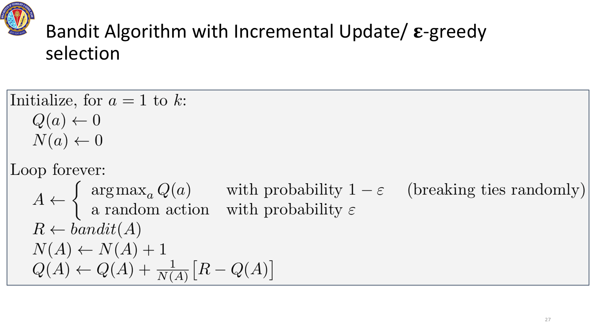

*A bandit algorithm with incremental sample-average updates and $\varepsilon$-greedy action selection.*

- **Initialize:** every action starts with estimate $Q(a)=0$ and selection count $N(a)=0$.
- **Select:** with probability $1-\varepsilon$, choose the action with the highest estimate, breaking ties randomly; with probability $\varepsilon$, choose a random action. This selection rule appears in the same form in many papers and should be recognized as $\varepsilon$-greedy.
- **Act:** $\text{bandit}(A)$ performs the action and returns its reward.
- **Update:** increment the selected action's count, then apply the incremental update with step size $\frac{1}{N(A)}$.

Replacing $\frac{1}{N(A)}$ with a constant, such as $\alpha=0.01$, lets the same algorithm continue learning forever.

:::tip[Think It Through]
**Prompt:** The algorithm addresses two different problems: balancing exploration with exploitation, and coping with rewards that may change. Which part addresses each, and what change makes it handle changing rewards?

**Answer:** Choosing the greedy action with probability $1-\varepsilon$ and a random action with probability $\varepsilon$ balances exploration and exploitation. The value update is where changing rewards are handled, once $\frac{1}{N(A)}$ is replaced by a constant step size $\alpha$ so that learning never stops.
:::

:::tip[Think It Through]
**Prompt:** With constant $\alpha=0.2$, an action's estimate is $Q=10$ and its next two rewards are $14$ and $16$. Compute the two updated estimates. Would the $\frac1n$ rule follow this rise faster or slower once $n$ is large?

**Answer:** $10+0.2(14-10)=10.8$, then $10.8+0.2(16-10.8)=11.84$. The estimate moves upward, which is appropriate if the action's reward distribution has improved. Once $n$ is large, the $\frac1n$ rule would follow the rise more slowly because each new reward is multiplied by a very small step size.
:::

### Where Bandits Are Used in Practice

Slot machines, online advertisements, treatment choices, and server-workload decisions can be modeled as multi-armed bandits. However, the plain bandit has limited direct application. Real decisions usually need more context: a treatment would not be chosen from a patient's name alone, but from details such as age and health conditions. Bringing in context makes the formulation far more useful. The plain bandit serves mainly as a small, restricted setting for learning the key concepts underlying reinforcement learning.

### Non-Stationary Problems

Most reinforcement learning problems are non-stationary: the reward distributions of the actions change over time. It is therefore sensible to give more weight to recent rewards than to long-past rewards.

- **Online recommendations:** a shopper's interests shift with life stages, such as moving from college to a job, marriage, and career growth, and with the seasons. Recommendations that suited an earlier profile may no longer appeal.
- **Clinical trials:** several treatment protocols tested on a few thousand people over a few months may be reasonably stationary. In wider use, patients' backgrounds, climate, and food habits differ from the trial sample, so treatment outcomes can drift.
- **Other systems:** slot-machine payouts can change after maintenance, and the best cloud configuration can change with workload and traffic.

The plain-language remedy is to keep learning always: remain open to new experience rather than treating what was learned once as final. A constant step size is the formal version of this idea.

### The Exponential Recency-Weighted Average

Unfolding the constant-step-size update shows how it weights past rewards:

$$
\begin{aligned}
Q_{n+1}&=Q_n+\alpha\bigl[R_n-Q_n\bigr]\\
&=\alpha R_n+(1-\alpha)Q_n\\
&=\alpha R_n+(1-\alpha)\bigl[\alpha R_{n-1}+(1-\alpha)Q_{n-1}\bigr]\\
&=\alpha R_n+(1-\alpha)\alpha R_{n-1}+(1-\alpha)^2Q_{n-1}\\
&=\alpha R_n+(1-\alpha)\alpha R_{n-1}+(1-\alpha)^2\alpha R_{n-2}+\cdots+(1-\alpha)^{n-1}\alpha R_1+(1-\alpha)^nQ_1\\
&=(1-\alpha)^nQ_1+\sum_{i=1}^{n}\alpha(1-\alpha)^{n-i}R_i.
\end{aligned}
$$

The estimate is a weighted average of the initial estimate $Q_1$ and all past rewards. The newest reward receives weight $\alpha$, and a reward observed $n-i$ steps ago receives weight $\alpha(1-\alpha)^{n-i}$. Because $0<1-\alpha<1$, each step back in time multiplies the weight by $1-\alpha$, so the weights of older rewards decay exponentially. The initial estimate retains only the small weight $(1-\alpha)^n$. This is why the method is called an **exponential recency-weighted average**.

#### What Is Q1 in the Unfolded Formula?

There is no $Q_0$ in this indexing. $Q_1$ is the initial estimate, set before any reward has been observed, such as $0$. The first reward $R_1$ produces $Q_2$, and so on. With $n=3$, three rewards have been observed and the formula gives $Q_4$.

:::tip[Think It Through]
**Prompt:** With $\alpha=0.5$ and $n=3$, what weights do $R_3$, $R_2$, $R_1$, and $Q_1$ receive in the unfolded formula? Do they sum to $1$, and which term receives the most weight?

**Answer:** $R_3$ receives $0.5$, $R_2$ receives $0.5(0.5)=0.25$, $R_1$ receives $0.5(0.5)^2=0.125$, and $Q_1$ receives $(0.5)^3=0.125$. The weights sum to $1$, so the estimate is a genuine weighted average. The newest reward receives the most weight, and each older reward receives half the weight of the next newer one. The initial estimate still holds $0.125$ of the weight, a lasting bias toward the starting value.
:::

:::tip[Think It Through]
**Prompt:** What happens if $\alpha=1$? Where does all the weight go, and what kind of learner results?

**Answer:** The update becomes $Q_{n+1}=R_n$. All the weight goes to the most recent reward, while earlier rewards and the initial estimate receive weight $0$. The learner reacts completely to the latest reward and retains no memory of earlier ones.
:::

### Convergence Conditions for Step Sizes

A sequence of step sizes $\alpha_n(a)$ guarantees convergence of the estimates with probability $1$ when:

$$
\sum_{n=1}^{\infty}\alpha_n(a)=\infty
\qquad\text{and}\qquad
\sum_{n=1}^{\infty}\alpha_n^2(a)<\infty.
$$

- **First condition:** the steps remain large enough to eventually overcome the initial estimate and random fluctuations.
- **Second condition:** the steps eventually become small enough for the estimates to settle.

The sample-average step size $\frac1n$ satisfies both conditions. A constant $\alpha$ fails the second, so its estimates never completely converge and keep responding to the most recent rewards. This is exactly what a non-stationary problem requires.

<details className="alert alert--success">
<summary>From Previous Question Papers</summary>

**Questions**
1. What is the difference between stationary and non-stationary multi-armed bandit problems? [1 Mark] Write down one technique which you use to handle non-stationarity. [1 Mark] *(Compre Sample QP-2 Q6b; Sample QP-1 Q5b)*
2. How do you use the learning rule $Q_{k+1}=Q_k+\alpha[R_k-Q_k]$ for a non-stationary MAB problem? Explain in two well-articulated statements. [2.0 M] *(July 2024 Midsem Regular Q3a)*
3. Explain why sample-average updating fails under non-stationarity and give an alternative update rule. [2 Marks] *(Midsem Regular Set 2, 21-Jun-2026 Q1c)*
4. A user's preference shifts after step 5. Apply the constant step-size update with $\alpha=0.3$ to $Q_5(S)=0.5$ given reward $R_6=1$, and explain why it is better than the sample average in this non-stationary setting. [2 Marks] *(Midsem Makeup Set 1, 28-Jun-2026 Q1c)*
5. An online pharma platform recommends adherence interventions S, T, R, and C. The observations are $(1,S,7)$, $(2,T,5)$, $(3,R,6)$, $(4,C,4)$, $(5,S,8)$, $(6,T,6)$, $(7,R,7)$, $(8,C,5)$. Estimate the best intervention using only the exponential recency-weighted average update with $\alpha=0.5$ and zero initial values. [3 Marks] Illustrate the significance of $\alpha$. What happens if $\alpha=1$ is set instead? *(Dec 2025 Midsem Q3a–b)*
6. The reward sequences for three arms are X: $2,1,9,8,7$; Y: $8,7,2$; Z: $1$. Compute the estimates using (a) a constant step size $\alpha=0.3$ with zero initial values and (b) the sample-average rule. (c) Do the methods agree on the greedy action at $t=10$, and which is more reliable after the shift? [2 + 2 + 2 Marks] *(Midsem Makeup Set 2, 28-Jun-2026 Q1a–c)*
7. A food platform recommends restaurants R1, R2, and R3, with reward $+1$ for an order and $0$ otherwise. R1 received rewards $1,1$; R2 received $0,1,1$; R3 received $1,0$. Using incremental averaging, compute $Q(R1)$, $Q(R2)$, and $Q(R3)$, showing each update. [2 Marks] *(DRL Midsem Regular Q1a; Midsem Regular Set 1, 21-Jun-2026 Q1a)*
8. A clinical trial is modelled as a stationary multi-armed bandit. (a) Explain, in terms of how patients enter the trial over time, one reason the stationarity assumption could mislead the clinician. [1 Mark] (c) T3 has $Q=0.3$ after $2$ selections and is recommended next with observed reward $1$. Update $Q(T3)$ using the sample-average update and the constant step-size update with $\alpha=0.4$. Which would you trust more if patient demographics shift, and why? [2 Marks] *(Sep 2026 Endsem Regular, parts a and c)*
9. For the Netflix genre sequence $1:(a,2)$, $2:(b,3)$, $3:(c,1)$, $4:(a,1)$, $5:(b,1)$, $6:(d,2)$, $7:(b,1)$, $8:(d,1)$, $9:(c,3)$, $10:(c,3)$, $11:(c,1)$, $12:(d,1)$: **(b) (Non-Stationary case)** Which suggestions are exploratory assuming $\varepsilon$-greedy selection and weighted averages with $\alpha=0.5$? Why? [1.5 M] **(c)** Compare the answers to the stationary and non-stationary cases and explain the difference. *(July 2023 Midsem Regular Q2b–c)*

**Answers**
1. In a stationary bandit, each arm's reward distribution remains fixed over time; in a non-stationary bandit, it changes. One technique is a constant step-size update, $Q_{n+1}=Q_n+\alpha[R_n-Q_n]$, which forms an exponential recency-weighted average.
2. Keep $\alpha$ constant in $(0,1]$ rather than using $\frac1k$, so the step size never vanishes and each new reward retains a fixed influence. The estimate then becomes an exponential recency-weighted average that tracks changing true values instead of settling on outdated ones.
3. The sample average gives every reward equal weight through the step size $\frac1n$, so as $n$ grows new rewards barely change the estimate and it becomes stale. Use a constant step-size update, $Q_{n+1}=Q_n+\alpha[R_n-Q_n]$ with $0<\alpha<1$, which gives more weight to recent rewards and tracks changing reward distributions.
4. $Q_6(S)=0.5+0.3(1-0.5)=0.65$. The constant step size gives older rewards exponentially decaying weight and keeps a fixed weight on the newest reward, so it adapts quickly to the shift. The sample average weights every reward equally, so each new observation has a shrinking influence and the estimate stays biased toward pre-shift behavior.
5. $Q(S)$: $0\to3.5\to5.75$; $Q(T)$: $0\to2.5\to4.25$; $Q(R)$: $0\to3\to5$; $Q(C)$: $0\to2\to3.5$. The best intervention is S. $\alpha$ determines how strongly the newest response counts. With $\alpha=1$, each estimate equals that intervention's latest reward ($S=8$, $T=6$, $R=7$, $C=5$): S remains best, but only on its latest outcome, with no memory of earlier responses.
6. (a) $Q(X)=5.35$, $Q(Y)=3.246$, $Q(Z)=0.3$, so the greedy action is X. (b) $Q(X)=5.4$, $Q(Y)=5.667$, $Q(Z)=1$, so the greedy action is Y. (c) The methods disagree. The constant step-size estimate is more reliable after the shift because it reflects X's recent rise and Y's recent fall, whereas the sample average remains biased by older rewards.
7. Using $Q_{n+1}=Q_n+\frac1n[R_n-Q_n]$ with zero initial values: $Q(R1)$: $0\to1\to1$, giving $1.0$; $Q(R2)$: $0\to0\to0.5\to0.667$; $Q(R3)$: $0\to1\to0.5$.
8. (a) Patients join over time, and their demographics or conditions can drift, so each treatment's outcome distribution may change and fixed true values become misleading. (c) Sample average: $0.3+\frac13(1-0.3)=0.533$. Constant step size: $0.3+0.4(1-0.3)=0.58$. If demographics shift, the constant step-size estimate is more trustworthy because it keeps responding to recent patients.
9. Under the illustrative assumption of zero initial values, the definitely exploratory steps are $2,3,4,6,8,9,12$, because each chosen action's estimate is below the current maximum. With sample averages they are $2,3,4,6,9,12$. The difference is step 8: with $\alpha=0.5$, a single reward of $2$ raises $Q(d)$ only from $0$ to $1$, below $Q(b)=1.125$, so choosing $d$ required the random branch. With sample averages, that reward sets $Q(d)=2$, making $d$ greedy. The difference arises because constant step-size estimates retain weight on the initial value. For a different ID digit, recompute using the required initial value.

</details>

<details className="alert alert--info">
<summary>Test Your Understanding</summary>

**Questions**
1. An action's estimate is $Q=5.0$ and its next reward is $R=9.0$. Compute the update using (a) the sample-average step size with $n=4$ and (b) a constant step size $\alpha=0.25$. For a reward arriving 100 selections later, which method gives it the same influence, and which gives it far less?
2. A streaming platform tests four recommendation widgets, and user preferences change during a major sports event. Should it use sample averages or a constant step size? Justify using stationarity.
3. Which step-size convergence condition does a constant $\alpha$ fail? What does that mean for the estimates, and why is it useful in a non-stationary problem?

**Answers**
1. (a) $5.0+\frac14(9.0-5.0)=6.0$. (b) $5.0+0.25(9.0-5.0)=6.0$. The constant step size gives a reward 100 selections later the same weight, $0.25$, while the sample-average step size, $\frac1n$, gives it far less.
2. A constant step size. The reward distributions are non-stationary because preferences change with the sports event. Sample averages would weight old and new rewards equally, so learning would slow down too much to adapt.
3. It fails $\sum_{n}\alpha_n^2(a)<\infty$. The estimates never completely converge and keep responding to the most recent rewards. This is useful when the reward distributions change, because learning continues.

</details>

## Optimistic Initial Values

Every estimate starts from some initial value, and that starting point influences what the learner does early on. Choosing initial values deliberately higher than any reward the learner is likely to see makes even purely greedy selection try many actions. This gives a simple burst of exploration without an $\varepsilon$ parameter, but the effect fades and cannot respond to later changes.

### Bias From Initial Estimates

All the methods discussed so far are biased by their initial estimates $Q_1(a)$:

- **Sample averages:** the bias disappears once every action has been selected at least once. With step size $\frac1n$, the first update replaces the initial value completely: $Q_2=Q_1+1\cdot(R_1-Q_1)=R_1$.
- **Constant step size:** the bias is permanent, though it decreases over time, because $Q_1$ retains weight $(1-\alpha)^n$.

This bias is usually not a problem and can be helpful: initial values offer an easy way to supply prior knowledge about what level of rewards can be expected. The downside is that they become parameters the user must choose, even if only by setting them all to zero.

### Using Optimism to Encourage Exploration

On the 10-armed testbed, the true action values are drawn from $\mathcal N(0,1)$, so they are mostly well below about $1.5$. Setting every initial estimate to $+5$ is therefore wildly optimistic. Combined with purely greedy selection, this produces exploration:

1. All actions start equally attractive, so the first greedy choice simply breaks a tie. This tie-break is not itself an exploration move.
2. The selected action almost certainly returns a reward far below its optimistic estimate.
3. Its estimate is revised downward, making it less attractive than the untried actions that remain optimistic.
4. Greedy selection moves to another still-optimistic action, which also disappoints, and the process repeats.

As a result, all actions are tried several times before the value estimates converge, even though greedy actions are selected all the time. This can be described as a programming hack: force a burst of exploration at the beginning, then rely on greedy selection without explicit exploration.

:::tip[Think It Through]
**Prompt:** An arm starts at $Q_1=10$ and its first reward is $3$. Compute its new estimate using (a) sample averages and (b) a constant step size $\alpha=0.1$. Under which rule does the arm stay optimistic for longer?

**Answer:** (a) With sample averages, the first step size is $1$: $Q_2=10+1\cdot(3-10)=3$. The initial value is replaced completely. (b) $10+0.1(3-10)=9.3$. The arm stays optimistic for longer under the constant step size, because several disappointing rewards are needed to wear down the optimism. An illustration that averages the initial value with the first reward, $\frac{10+3}{2}=6.5$, corresponds to $\alpha=0.5$ rather than to the sample average.
:::

:::tip[Think It Through]
**Prompt:** In the constant step-size case, the other nine arms remain untouched at $10$. Will greedy selection choose the tried arm, now at $9.3$, on the next step? What does this show about how exploration happens without $\varepsilon$?

**Answer:** No. Its estimate is below the nine untried arms at $10$, so greedy selection breaks a tie among those nine. Exploration arises from disappointment together with greedy selection: each tried arm falls below the untried ones, so greedy selection works through all of them without any random choice.
:::

#### Why Is It Called Exploration If Selection Is Always Greedy?

Tie-breaking is not the exploration; it only decides the order in which equally optimistic actions are tried. Exploration means trying less-known actions to obtain new information. Optimistic estimates make every untried action look best, so purely greedy selection is repeatedly drawn to actions it knows little about. The exploration is defined by this effect rather than by a random choice.

| | $\varepsilon$-greedy | Optimistic initial values |
| --- | --- | --- |
| Source of exploration | A deliberate random choice with probability $\varepsilon$ | Inflated estimates that make less-tried actions look best |
| Action selection | Random part of the time | Always greedy, $\varepsilon=0$ |
| Duration | For as long as $\varepsilon>0$ | Until the optimism wears off |

Ties arise only because all actions start at the same optimistic value. The mechanism would still work if the initial values differed, provided they were all well above the rewards actually obtained.

### Performance and Limitations

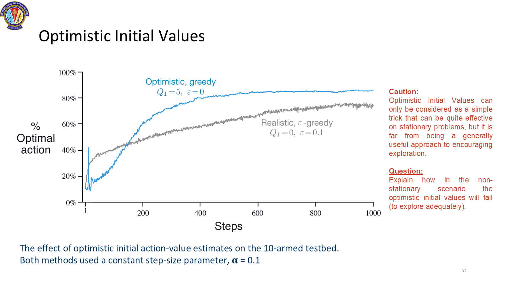

*Percentage of optimal-action selections on the 10-armed testbed for optimistic greedy selection and realistic $\varepsilon$-greedy selection.*

The graph compares two methods, both using a constant step size $\alpha=0.1$:

- **Optimistic, greedy:** $Q_1=5$ and $\varepsilon=0$.
- **Realistic, $\varepsilon$-greedy:** $Q_1=0$ and $\varepsilon=0.1$.

The horizontal axis shows steps from $1$ to $1000$, and the vertical axis shows the percentage of runs choosing the truly optimal action at each step. Initially, the optimistic method performs worse because it explores more. It soon overtakes $\varepsilon$-greedy, because its exploration decreases with time, and stays ahead for the displayed 1000 steps. Early in its curve there are visible oscillations and spikes during the burst of exploration.

The initial burst takes the optimistic method quickly to the best action, after which its curve flattens. The $\varepsilon$-greedy curve keeps rising and moves closer over time, since continuing exploration remains a solid method.

⚠️ **Emphasized by instructor:** optimistic initialization is not a general technique to use in new algorithms for real problems unless you know what you are doing. It is suitable for problems where an initial burst of exploration is sufficient.

Optimistic initial values are a simple trick that can be quite effective on stationary problems, but they are far from a generally useful way to encourage exploration. Their drive to explore is temporary, coming only from the initial conditions. If the task changes and creates a renewed need for exploration, the method cannot help: the beginning of time occurs only once. The same criticism applies to sample averages, which also treat the beginning of time as special by averaging all later rewards with equal weight.

:::tip[Think It Through]
**Prompt:** Explain how optimistic initial values fail to explore adequately in a non-stationary problem. Suppose the true values change after step 500: what has happened to the optimistic estimates by then, and why does greedy selection not return to the other arms?

**Answer:** By then, the optimism has worn off and the estimates have settled near the rewards actually received. Learning continues for whichever arm greedy selection keeps choosing, because its estimate is still updated. The other arms are no longer selected, so their estimates are not revised. If one of them improves after step 500, neither random selection nor remaining optimism sends the learner back to discover it.
:::

:::tip[Think It Through]
**Prompt:** Netflix recommends one of four genres, $a$, $b$, $c$, and $d$, to a viewer and observes a satisfaction rating in $\{0,1,2,3\}$. The sequence of genres and ratings is $1:(a,2)$, $2:(b,3)$, $3:(c,1)$, $4:(a,1)$, $5:(b,1)$, $6:(d,2)$, $7:(b,1)$, $8:(d,1)$, $9:(c,3)$, $10:(c,3)$, $11:(c,1)$, $12:(d,1)$. Selection is $\varepsilon$-greedy with sample-average estimates. With all initial values $0$, the definitely random choices are at steps $2,3,4,6,9,12$. If every genre instead starts at $5$, so that the estimates before step 2 are $(2,5,5,5)$, are the choices of $b$ at step 2 and $c$ at step 3 still definitely random?

**Answer:** No. At step 2, $b$ is tied with $c$ and $d$ at the maximum estimate $5$; at step 3, $c$ is tied with $d$ at $5$. Both selections are greedy, so either branch could have made them.
:::

With every genre starting at $5$, the estimates before each choice are:

| Step | Estimates $(a,b,c,d)$ | Chosen | Definitely random? |
| --- | --- | --- | --- |
| $1$ | $(5,5,5,5)$ | $a$ | No; tie |
| $2$ | $(2,5,5,5)$ | $b$ | No; tied maximum |
| $3$ | $(2,3,5,5)$ | $c$ | No; tied maximum |
| $4$ | $(2,3,1,5)$ | $a$ | Yes; untried $d$ remains at $5$ |
| $5$ | $(1.5,3,1,5)$ | $b$ | Yes; untried $d$ remains at $5$ |
| $6$ | $(1.5,2,1,5)$ | $d$ | No; greedy |
| $7$ | $(1.5,2,1,2)$ | $b$ | No; tied maximum |
| $8$ | $(1.5,1.667,1,2)$ | $d$ | No; greedy |
| $9$ | $(1.5,1.667,1,1.5)$ | $c$ | Yes |
| $10$ | $(1.5,1.667,2,1.5)$ | $c$ | No; greedy |
| $11$ | $(1.5,1.667,2.333,1.5)$ | $c$ | No; greedy |
| $12$ | $(1.5,1.667,2,1.5)$ | $d$ | Yes |

With optimistic initial values, the definitely random steps become $4,5,9,12$. The first tries of $b$, $c$, and $d$ become greedy, because untried genres look best. Choosing an already-tried genre while an untried genre remains at $5$ becomes definitely exploratory, as at step 5.

<details className="alert alert--success">
<summary>From Previous Question Papers</summary>

**Questions**
1. For the Netflix genre sequence $1:(a,2)$, $2:(b,3)$, $3:(c,1)$, $4:(a,1)$, $5:(b,1)$, $6:(d,2)$, $7:(b,1)$, $8:(d,1)$, $9:(c,3)$, $10:(c,3)$, $11:(c,1)$, $12:(d,1)$, with ratings in $\{0,1,2,3\}$: **(d)** If we initialise all the action values to be $5$, will the exploratory moves behave differently? Explain. *(July 2023 Midsem Regular Q2d)*

**Answers**
1. Yes. A value of $5$ is optimistic because ratings never exceed $3$. With sample averages, the definitely exploratory steps become $4,5,9,12$, compared with $2,3,4,6,9,12$ for zero initial values. The first tries of untried genres, at steps $2$, $3$, and $6$, become greedy because those genres still hold the optimistic value $5$. Choosing an already-tried genre while an untried one remains at $5$ becomes definitely exploratory, as at step $5$.

</details>

<details className="alert alert--info">
<summary>Test Your Understanding</summary>

**Questions**
1. With sample averages, why does an optimistic initial value of $5$ influence each arm only until its first selection? Why does a constant step size $\alpha=0.1$ lead to all actions being tried several times before the estimates settle?
2. Initial estimates are set to $+5$ on a bandit whose rewards are typically around $+20$. Will this encourage exploration as on the 10-armed testbed? What makes an initial value optimistic?

**Answers**
1. With sample averages, the first update uses step size $1$, so the estimate becomes the first reward; for example, $5+1\cdot(3-5)=3$. With $\alpha=0.1$, the same reward changes the estimate only to $5+0.1(3-5)=4.8$. The arm remains attractive, so it and the other arms are tried several times before the optimism wears off.
2. No. An initial value is optimistic only if it is higher than the rewards likely to be observed. With rewards around $+20$, $+5$ is pessimistic. The first selected arm would most likely have its estimate raised above $5$, and greedy selection would keep choosing it instead of exploring the other arms.

</details>

## Upper-Confidence-Bound Action Selection

Exploration is needed because action-value estimates are uncertain. $\varepsilon$-greedy explores by choosing randomly, giving every non-greedy action the same chance regardless of how promising or how poorly known it is. Upper-confidence-bound (UCB) selection directs exploration instead: it prefers actions whose estimates are close to the best or whose estimates are still uncertain, without needing an $\varepsilon$ parameter.

### Why Indiscriminate Exploration Is Wasteful

$\varepsilon$-greedy forces non-greedy actions to be tried, but indiscriminately, with no preference for those that are nearly greedy or particularly uncertain. A clearly poor action that has been tried many times receives the same random chance as a promising action tried only twice. It is better to select among non-greedy actions according to their potential for actually being optimal, taking into account both how close their estimates are to the maximum and the uncertainty in those estimates. $\varepsilon$ must also be specified and adjusted to the length of experience, which UCB avoids.

### The UCB Rule

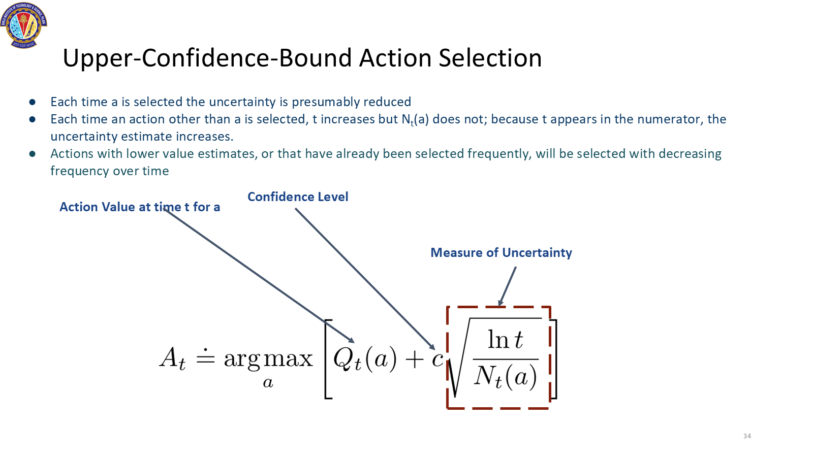

*The UCB action-selection rule, with its action-value, uncertainty, and confidence-level terms.*

$$
A_t\doteq\operatorname*{arg\,max}_a\left[Q_t(a)+c\sqrt{\frac{\ln t}{N_t(a)}}\right]
$$

| Term | Meaning |
| --- | --- |
| $Q_t(a)$ | The current estimate of action $a$'s value. On its own, maximizing it is greedy selection. |
| $\sqrt{\dfrac{\ln t}{N_t(a)}}$ | A measure of uncertainty in the estimate. $t$ is the current time step, and $N_t(a)$ is the number of times $a$ has been selected before $t$. |
| $c>0$ | The confidence level, controlling how much weight uncertainty receives. |

- $\ln$ is the natural logarithm.
- If $N_t(a)=0$, action $a$ is treated as a maximizing action, so untried actions are selected first.
- Using $t$ directly would make the uncertainty term explode; the logarithm damps its growth. Because $\ln t$ grows without bound, every action is eventually selected again.

The bracketed quantity acts as an upper bound on the possible true value of the action, with $c$ determining the confidence level. Its uncertainty term behaves as follows:

- **When $a$ is selected:** $N_t(a)$ increases, so its uncertainty presumably decreases.
- **When another action is selected:** $t$ increases but $N_t(a)$ does not, so the uncertainty of $a$ increases.
- **Over time:** actions with lower value estimates, or actions already selected frequently, are selected with decreasing frequency.

A new team member illustrates the idea. One impressive presentation does not prove that the newcomer is the best on the team, but with so few opportunities, uncertainty about that person is high, which justifies giving more opportunities. Colleagues observed many times carry little uncertainty and are judged mainly by their track record.

:::tip[Think It Through]
**Prompt:** Action $a_1$ has $Q=1.0$ after $10$ selections, and $a_2$ has $Q=0.8$ after $2$ selections. With $t=12$, natural logarithms, and $c=2$, compute both UCB scores. Which action is selected, even though its estimate is lower?

**Answer:** With $\ln12=2.485$, $a_1$ scores $1.0+2\sqrt{2.485/10}=1.997$ and $a_2$ scores $0.8+2\sqrt{2.485/2}=3.029$. UCB selects $a_2$ because, after only two selections, its uncertainty term is much larger. With $t=20$, the scores are $2.095$ and $3.248$, giving the same choice.
:::

:::tip[Think It Through]
**Prompt:** Suppose that action is selected, so $t$ becomes $13$ and its count increases by one, while the other action's count is unchanged. Which way does each action's uncertainty term move?

**Answer:** The selected action, $a_2$, has its count increase from $2$ to $3$, so its uncertainty term falls from $\sqrt{2.485/2}=1.115$ to $\sqrt{2.565/3}=0.925$. The unselected action, $a_1$, keeps $N=10$ while $t$ increases, so its uncertainty term rises slightly from $0.498$ to $\sqrt{2.565/10}=0.506$. Being selected shrinks an action's uncertainty; being passed over increases it.
:::

### Balancing Proven Value and Uncertainty

Uncertainty does not always win. If $a_1$ instead has $Q=5$ after $10$ selections, then with $t=12$ it scores $5+0.997=5.997$, while $a_2$ still scores $3.029$, so $a_1$ is selected. A strong proven value outweighs a newcomer's uncertainty. If $a_1$ keeps being selected while $a_2$ is not, $a_2$'s uncertainty term gradually grows until it eventually receives another chance. Exploration is handled automatically by the combination of estimated value and uncertainty.

With four actions at $t=50$ and $c=1$, where $\ln50=3.912$:

| Action | $Q_t(a)$ | $N_t(a)$ | UCB score |
| --- | --- | --- | --- |
| $a_1$ | $1.10$ | $25$ | $1.50$ |
| $a_2$ | $1.20$ | $20$ | $1.64$ |
| $a_3$ | $0.70$ | $4$ | $1.69$ |
| $a_4$ | $0.90$ | $1$ | $2.88$ |

UCB selects $a_4$. It is not greedy by its estimate alone, but it has been selected only once, so its uncertainty term is large.

To use UCB in the bandit algorithm, replace the $\varepsilon$-greedy selection step: compute the UCB score for each of the $k$ actions and return the action with the maximum score. The value updates remain the same.

### Performance, Parameter Choice, and Limitations

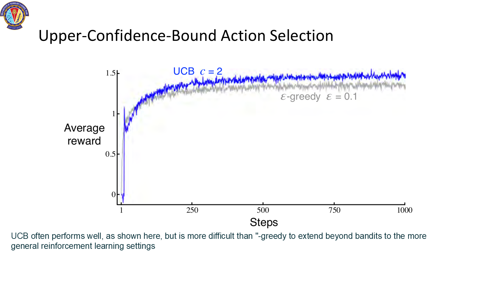

*Average reward of UCB selection with $c=2$ and $\varepsilon$-greedy selection with $\varepsilon=0.1$ on the 10-armed testbed.*

The graph plots average reward against steps for both methods. UCB generally performs better than $\varepsilon$-greedy, except in the first $k$ steps, when it selects randomly among the as-yet-untried actions while all actions are equally uncertain.

$c$ is a hyperparameter chosen by experimentation. A larger $c$ gives more weight to uncertainty and so produces more exploration; a smaller $c$ makes UCB closer to greedy selection. Setting $c$ is a broader decision than setting $\varepsilon$: an $\varepsilon$ that is too small may fail to keep up with a rapidly changing world, while one that is too large wastes choices on exploration when the world is steady. UCB is popular partly because it does not require working with $\varepsilon$, and UCB-style selection appears frequently in more advanced reinforcement learning algorithms.

UCB often performs well, but it is more difficult than $\varepsilon$-greedy to extend beyond bandits to general reinforcement learning:

- **Non-stationary problems:** methods more complex than the constant step-size approach would be needed.
- **Large state spaces:** especially when using function approximation, the idea of UCB action selection is usually not practical.

UCB relies on meaningful action counts and is most natural in bandit settings.

#### What Does a Large State Space Mean?

A state is the agent's current situation, and the state space is the set of all situations it could be in. A bandit has only one situation: the same $k$ actions are faced every time, so a single count per action, $N_t(a)$, keeps growing as each action is tried. In full reinforcement learning, there are many states, and the best action depends on the state. Examples include tic-tac-toe board positions, chess or Go positions, and the raw pixels of a game screen. A large state space has so many states that a separate table entry for every one becomes impractical.

UCB would need a count for each state–action pair. When states are numerous, most are visited rarely or never, so their counts carry little information. Function approximation, which learns a function that generalizes across states instead of storing a table, makes UCB usually impractical. $\varepsilon$-greedy needs no counts and applies the same random rule in any state.

:::tip[Think It Through]
**Prompt:** A past exam asked how more exploration can be incorporated into UCB. What would you change in the formula, and why does it increase exploration?

**Answer:** Increase $c$. A larger $c$ does not increase the uncertainty itself; it increases the weight given to the uncertainty term, so less-tried actions win more often. Another accepted option is to use the UCB values as the action values of an $\varepsilon$-greedy selector, adding random exploration.
:::

:::tip[Think It Through]
**Prompt:** On the 10-armed testbed, every $N_t(a)$ starts at $0$. What does UCB do during the first 10 steps, and how does this explain the early dip in its curve?

**Answer:** Every untried action is treated as maximizing, so UCB tries each of the 10 arms once during the first 10 steps. These choices are effectively random among the untried actions, so the reward is like that of an arbitrary arm. $\varepsilon$-greedy, meanwhile, is already partly exploiting, so UCB starts lower before overtaking it.
:::

<details className="alert alert--success">
<summary>From Previous Question Papers</summary>

**Questions**
1. Predict whether a lab test will be recommended during the 9th visit, framing this as a multi-armed bandit with UCB parameter $C=2$. Recommending a lab test (Yes) received feedback ratings $1,10,5,1$, and not recommending it (No) received $5,5,5,1$. [2 Marks] How can more exploration be incorporated into the UCB? State the changes. [1 Mark] *(Compre Sample QP-1, parts a–b)*
2. A food platform recommends restaurants R1, R2, and R3. After 7 sessions, R1 has $Q=1.00$ from $2$ selections, R2 has $Q=0.667$ from $3$, and R3 has $Q=0.50$ from $2$. Apply UCB with $c=2$ to determine the action at session 8. [2 Marks] *(DRL Midsem Regular Q1b; Midsem Regular Set 1, 21-Jun-2026 Q1b)*
3. A news app recommends categories. Tech has $Q=0.5$ from $2$ selections, Sports $Q=0.667$ from $3$, Politics $Q=1.0$ from $2$, and Entertainment $Q=1.0$ from $1$. (a) Using UCB with $c=1.5$, identify the next action to select. [2 Marks] (b) What is the $\varepsilon$-greedy action at the end of time step 8 if $\varepsilon=0.2$? [2 Marks] *(Sample QP-1 Q1a–b)*
4. A hospital trial compares treatments T1, T2, and T3, with T1 at $Q=0.6$ from $4$ selections, T2 at $Q=0.5$ from $6$, and T3 at $Q=0.3$ from $2$. Using $t=13$ and $c=1$: (i) compute each UCB score and state the recommendation; (ii) for close contenders T1 and T3, solve $Q(T1)+c\sqrt{\ln t/N(T1)}=Q(T3)+c\sqrt{\ln t/N(T3)}$ for the critical $c^*$, and state which is preferred above and below it. [3 Marks] *(Sep 2026 Endsem Regular, part b)*
5. What is the significance of the confidence level in UCB-based selection? Justify using the online pharma adherence-intervention use case. [1 Mark] *(Dec 2025 Midsem Q3c)*
6. Compare $\varepsilon$-greedy, optimistic initial values, and UCB. Provide one advantage and one drawback for each. [3 Marks] *(Compre Sample QP-2 Q5a; Sample QP-1 Q5a)*
7. Consider encouraging exploration by optimistic initial values and UCB. Provide one scenario when each approach is useful and one when it is not. *(July 2024 Midsem Regular Q3b)*
8. An agent chooses Medication (M) or Therapy (T), with reward $+1$ for recovery and $-1$ otherwise. The history is $1:(M,+1)$, $2:(M,-1)$, $3:(T,+1)$, $4:(T,+1)$, $5:(T,-1)$, $6:(M,+1)$, $7:(T,-1)$, $8:(M,r)$. (a) Using UCB with $c=1$ and sample averages, what is the maximum integer $r$ for which the UCB score of Therapy exceeds that of Medication at the 9th decision point? [4 Marks] (b) Using a non-stationary update with $\alpha=0.5$ and $Q_1(M)=0$, compute $Q(M)$ at $t=9$ as a function of $r$. [4 Marks] (c) Compare the two update methods and comment on how sensitive the treatment choice is to $r$. [2 Marks] *(DRL Unknown Endsem Regular Q1)*
9. A traffic controller chooses North–South vehicle flow (A1), East–West vehicle flow (A2), or pedestrian crossing (A3), with rewards $1:(A1,1)$, $2:(A3,3)$, $3:(A2,1)$, $4:(A3,3)$. (a) Using UCB with $C=1$, find the action at the fifth step. If it is preferred more frequently, what is its impact on real-time traffic? (b) Which real-world traffic scenario could lead to under-exploration of A1, and how can UCB be changed to compensate? (c) If the chosen action is greedy, compute greedy and non-greedy probabilities under $\varepsilon$-greedy with $\varepsilon=0.6$. [2 + 2 + 2 Marks] *(Compre Makeup, Sept 2025, Q1)*
10. A lab-test recommender chooses Recommend (A1) or Not Recommend (A2), with rewards $1:(A1,+1)$, $2:(A2,-1)$, $3:(A2,+1)$, $4:(A1,+1)$, $5:(A1,-1)$. (a) Using UCB with $C=1$, find the action at the sixth step and its impact on patient satisfaction if preferred more frequently. (b) How sensitive is the choice to the reward scale if the positive reward is doubled, or the negative reward is doubled? (c) Suggest a technique in action-value estimation to tackle noisy rewards, with a numerical illustration. [2 + 2 + 2 Marks] *(Compre Regular, Sept 2025, Q1)*

**Answers**
1. With $t=8$ and $4$ selections each, both actions receive the same bonus, $2\sqrt{\ln8/4}=1.44$. Yes: $Q=\frac{1+10+5+1}{4}=4.25$, giving $5.69$. No: $Q=\frac{5+5+5+1}{4}=4$, giving $5.44$. A lab test is recommended. To incorporate more exploration, increase $C$, or use the UCB values as action values for $\varepsilon$-greedy selection.
2. With $\ln7=1.946$: R1 scores $1.00+2\sqrt{1.946/2}=2.973$, R2 scores $2.277$, and R3 scores $2.473$. R1 is selected.
3. (a) With $t=9$ and $\ln9=2.197$: Tech $2.072$, Sports $1.949$, Politics $2.572$, Entertainment $3.223$. Entertainment is selected. (b) Politics and Entertainment tie for the highest estimate. With probability $0.8$, one of them is selected by breaking the tie randomly; with probability $0.2$, one of the four categories is selected at random.
4. (i) With $\ln13=2.565$: T1 scores $1.401$, T2 $1.154$, and T3 $1.432$, so T3 is recommended. (ii) $c^*=\dfrac{Q(T1)-Q(T3)}{\sqrt{\ln t/N(T3)}-\sqrt{\ln t/N(T1)}}=\dfrac{0.3}{1.1325-0.8008}\approx0.90$. Above $c^*$, the less-tried T3 is preferred; below it, T1, with the higher estimate, is preferred.
5. The confidence level $c$ determines how much importance is given to exploring infrequently tried actions. A larger $c$ makes rarely tried interventions more likely to be recommended, while a smaller $c$ relies more on interventions with the best current estimates.
6. $\varepsilon$-greedy is simple and keeps exploring, but explores indiscriminately and requires tuning $\varepsilon$. Optimistic initial values encourage exploration without $\varepsilon$, even under greedy selection, but the exploration is temporary and unsuited to non-stationary problems. UCB directs exploration toward near-greedy or uncertain actions, but is harder to extend beyond bandits to non-stationary problems and large state spaces.
7. Optimistic initial values are useful in stationary problems where an early burst of exploration is sufficient, but not when values change later. UCB is useful in bandit settings with meaningful action counts, but is difficult with non-stationary problems and large state spaces, especially with function approximation.
8. (a) M and T each have $4$ selections, so their uncertainty bonuses are equal and cancel. $Q(T)=\frac{1+1-1-1}{4}=0$ and $Q(M)=\frac{1-1+1+r}{4}=\frac{1+r}{4}$. Therapy exceeds Medication when $r<-1$, so the maximum integer is $r=-2$; at $r=-1$ the scores tie. (b) $Q(M)$: $0\to0.5\to-0.25\to0.375\to0.375+0.5(r-0.375)=0.1875+0.5r$. (c) With sample averages, $Q(M)=0.25+0.25r$, so $r$ has weight $\frac14$; with $\alpha=0.5$, the newest reward has weight $0.5$, making $Q(M)$ twice as sensitive. Under constant step size, $Q(T)=-0.5625$ after its recent $-1$ rewards, so Therapy wins only for $r<-1.5$. For integer rewards, $r\le-2$ favors Therapy either way, but the switching point moves from $-1$ to $-1.5$.
9. (a) With $t=5$ and $\ln5=1.609$: A1 $1+\sqrt{1.609}=2.269$, A2 $2.269$, and A3 $3+\sqrt{1.609/2}=3.897$. A3 is selected; using $t=4$ gives the same choice. Preferring pedestrian crossing more frequently makes vehicle flows wait longer, so congestion may grow. (b) If A1 was tried only during light North–South traffic, its estimate stays low; when traffic increases during rush hour, sample-average estimates and a slowly growing $\ln t$ revisit it too rarely. Increase $c$, or estimate values with a constant step size so recent rewards dominate. (c) $P(\text{A3})=1-0.6+0.6/3=0.6$, and $P(\text{A1})=P(\text{A2})=0.2$.
10. (a) A1 has $Q=\frac13$ from $3$ selections and A2 has $Q=0$ from $2$. With $t=6$ and $\ln6=1.792$, A1 scores $0.333+\sqrt{1.792/3}=1.106$ and A2 scores $0.947$, so A1 is selected. Preferring A1 moves average satisfaction toward its higher estimate. (b) The uncertainty term does not depend on reward scale, but $Q$ does. With rewards $+2/-1$, $Q(\text{A1})=1$ and $Q(\text{A2})=0.5$, giving $1.773$ versus $1.447$. With rewards $+1/-2$, $Q(\text{A1})=0$ and $Q(\text{A2})=-0.5$, giving $0.773$ versus $0.447$. A1 remains selected. Larger reward magnitudes make the estimate dominate the uncertainty term, so $c$ should suit the reward scale. (c) Use a small step size, or sample averages over more observations, so one noisy reward does not swing the estimate. For A1's rewards $+1,+1,-1$, $\alpha=0.1$ gives $0.1\to0.19\to0.071$, whereas $\alpha=0.9$ gives $0.9\to0.99\to-0.801$.

</details>

<details className="alert alert--info">
<summary>Test Your Understanding</summary>

**Questions**
1. At $t=51$ with $c=1$, arm $X$ has $Q=0.2$ after $1$ selection, and arm $Y$ has $Q=1.0$ after $50$ selections. Compute both UCB scores using natural logarithms. Which arm is selected, and how would $\varepsilon$-greedy treat $X$ differently?
2. What two difficulties make UCB harder than $\varepsilon$-greedy to extend beyond bandits to general reinforcement learning?

**Answers**
1. With $\ln51=3.932$, $X$ scores $0.2+\sqrt{3.932/1}=2.18$ and $Y$ scores $1.0+\sqrt{3.932/50}=1.28$, so UCB selects $X$. Under $\varepsilon$-greedy, the greedy branch selects $Y$, and $X$ can be chosen only through the random branch with probability $\varepsilon/k$, the same chance as any other non-greedy arm despite its single selection.
2. Non-stationary problems, which require more complex methods, and large state spaces, especially with function approximation, where UCB is usually not practical.

</details>

## Policy-Based Methods and Gradient Bandits (Optional)

:::note[Optional]
This topic is optional and not included in the exam syllabus.
:::

Every method so far learns action values and then chooses actions from them. Policy-based methods skip the values and learn directly which action to choose. In a bandit, this means learning a numerical preference for each action, turning preferences into probabilities with softmax, and adjusting the preferences by gradient ascent according to whether rewards beat a baseline.

### Value-Based and Policy-Based Methods

| | Value-based methods | Policy-based methods |
| --- | --- | --- |
| What is learned | Action values $Q(a)$ | Which action to choose |
| How actions are chosen | From the values, for example by greedy, $\varepsilon$-greedy, or UCB selection | A model outputs action preferences directly |
| Core of learning | Estimating values correctly | Learning the model's parameters |

In policy-based methods, the two steps of value-based methods, estimating values and then choosing from them, are combined. The model can be pictured as a network that takes the state as input and produces action preferences as output. Neither family is simply better; the choice depends on the problem, and many practical algorithms learn both values and policies. Policy-based methods are developed in detail later in the course.

### Preferences and Softmax

Instead of action-value estimates, each action receives a numerical preference $H_t(a)$. A larger preference means the action is selected more often, but a preference has no interpretation in terms of reward.

Choosing $A_t=\operatorname*{arg\,max}_a H_t(a)$ is **hardmax**: deterministic selection without exploration. **Softmax** instead converts the preferences into a valid probability distribution:

$$
\Pr\{A_t=a\}=\frac{e^{H_t(a)}}{\sum_{b=1}^{k}e^{H_t(b)}}=\pi_t(a).
$$

$\pi_t(a)$ denotes the probability of taking action $a$ at time $t$. Initially, all preferences are equal, for example all $0$, so all actions are equally likely.

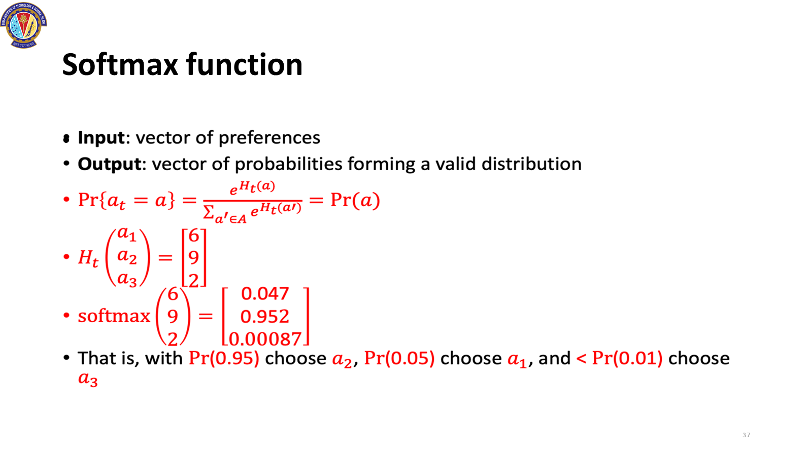

*Softmax converts the preferences $(6,9,2)$ into selection probabilities.*

| Action | $H_t(a)$ | $e^{H_t(a)}$ | $\pi_t(a)$ |
| --- | --- | --- | --- |
| $a_1$ | $6$ | $403.4$ | $0.047$ |
| $a_2$ | $9$ | $8103.1$ | $0.952$ |
| $a_3$ | $2$ | $7.4$ | $0.00087$ |

Action $a_2$ is selected about 95% of the time, $a_1$ about 5%, and $a_3$ less than 1%. Every action retains some probability, while higher preferences receive much more of it.

:::tip[Think It Through]
**Prompt:** If $1000$ is added to every preference, so that $(6,9,2)$ becomes $(1006,1009,1002)$, what happens to the softmax probabilities? What does this show about which aspect of the preferences matters?

**Answer:** Nothing changes. Since $e^{H+1000}=e^{1000}e^{H}$, the factor $e^{1000}$ appears in both the numerator and the denominator and cancels. The probabilities remain $0.047$, $0.952$, and $0.00087$. Only the relative preferences, the differences between them, matter.
:::

Softmax is preferred over hardmax for two reasons. It builds exploration into selection, and it produces a differentiable policy. If $a_1$ is found to perform relatively well, its probability can be increased by changing $H(a_1)$ in the direction of $\frac{\partial\Pr(a_1)}{\partial H(a_1)}$. Under hardmax, this derivative is not available.

:::tip[Think It Through]
**Prompt:** Under hardmax, $H(a_1)$ is raised from $6$ to $6.5$ while $H(a_2)=9$. How does $\Pr(a_1)$ change, and why does this make gradient-based learning impossible with hardmax?

**Answer:** $\Pr(a_1)$ remains exactly $0$, because $a_2$ is still the arg max. Under hardmax, the probability is flat almost everywhere and jumps abruptly where the arg max switches. There is no smooth signal indicating how to adjust $H(a_1)$, so a gradient cannot guide learning.
:::

### The Gradient-Bandit Update

After selecting $A_t$ and receiving $R_t$, the reward is compared with a baseline $\bar R_t$, the average of rewards so far. A reward above the baseline should make $A_t$ more likely; a reward below it should make $A_t$ less likely. Following the gradient of $\Pr(A_t)$ gives the idea:

$$
\begin{aligned}
H_{t+1}(A_t)&=H_t(A_t)+\alpha(R_t-\bar R_t)\frac{\partial\Pr(A_t)}{\partial H(A_t)},\\
H_{t+1}(a)&=H_t(a)+\alpha(R_t-\bar R_t)\frac{\partial\Pr(A_t)}{\partial H(a)}\qquad\forall a\neq A_t.
\end{aligned}
$$

The softmax derivative is $\frac{\partial\pi_t(x)}{\partial H_t(a)}=\pi_t(x)\bigl(\mathbf{1}_{a=x}-\pi_t(a)\bigr)$, where $\mathbf{1}_{a=x}$ is $1$ when $a=x$ and $0$ otherwise. The update rule used is:

$$
\begin{aligned}
H_{t+1}(A_t)&=H_t(A_t)+\alpha(R_t-\bar R_t)\bigl(1-\pi_t(A_t)\bigr),\\
H_{t+1}(a)&=H_t(a)-\alpha(R_t-\bar R_t)\pi_t(a)\qquad\forall a\neq A_t.
\end{aligned}
$$

- **Selected action:** its preference moves in the direction of $R_t-\bar R_t$.
- **Non-selected actions:** their preferences move in the opposite direction, each in proportion to its probability.
- **Step size:** $\alpha>0$.
- **Baseline:** $\bar R_t$ is the average of all rewards up to and including time $t$, computed incrementally, or with a constant step size for non-stationary problems.

This rule equals the earlier form divided by $\pi_t(A_t)$. Its expected update equals the gradient of the expected reward $\mathbb{E}[R_t]$, so the gradient-bandit algorithm is an instance of **stochastic gradient ascent** and has robust convergence properties.

With three actions at equal preferences $0$, each $\pi_t(a)=\frac13$. If $\alpha=0.1$, $A_t=a_2$, $R_t=2$, and $\bar R_t=1$, then $R_t-\bar R_t=1$:

$$
\Delta H(a_2)=0.1\cdot1\cdot\left(1-\tfrac13\right)=0.0667,
\qquad
\Delta H(a_1)=\Delta H(a_3)=-0.1\cdot1\cdot\tfrac13=-0.0333.
$$

The selected action becomes more likely because its reward exceeded the baseline, and the preference changes sum to zero.

### Why the Baseline Matters

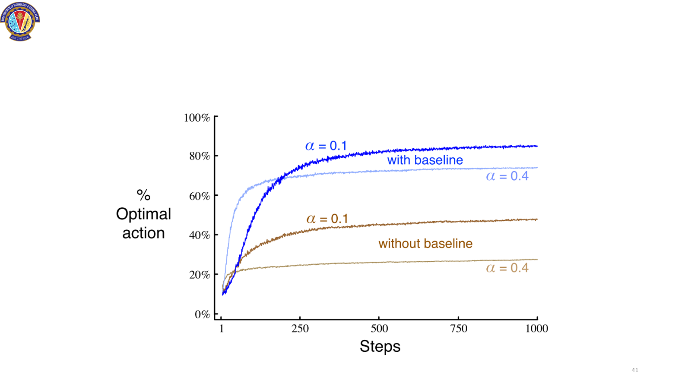

*Optimal-action percentage of the gradient-bandit algorithm with and without a reward baseline when true action values are near $+4$.*

The graph uses a variant of the 10-armed testbed whose true action values are drawn around $+4$ instead of $0$. With the baseline, both $\alpha=0.1$ and $\alpha=0.4$ reach roughly 80% optimal-action selection, because the baseline adapts immediately to the higher reward level. Without it, with $\bar R_t=0$, performance is clearly worse: every reward is positive, so the selected action's preference always increases regardless of whether the action was good.

The baseline can be any scalar that does not depend on the selected action. It does not change the expected update, but it affects the update's variance and therefore the rate of convergence.

## Bandit Summary and Contextual Bandits

The bandit problems studied so far involve a single repeated situation. They provide a restricted setting for learning exploration, exploitation, and action selection. Real decisions usually depend on the situation, so the next step is to associate actions with situations. Contextual bandits do this while still assuming that actions affect only immediate rewards, which places them between bandits and the full reinforcement learning problem.

### What the Bandit Setting Taught

| Aspect | Summary |
| --- | --- |
| Problem | Choose the action that results in the highest expected reward. |
| Assumptions | Actions' expected rewards are unknown; the same problem is faced over and over; an action's outcome can be observed once it is chosen. |
| Approach | Learn actions' expected rewards through exploration, which is value-based, or learn a policy directly, which is policy-based; then exploit the learnt knowledge to choose the best action. |
| Methods | Greedy selection with optimistic initial estimates, $\varepsilon$-greedy selection, UCB selection, and gradient ascent with softmax. |

The bandit setting provides a first experience of balancing exploration and exploitation, handling stationary and non-stationary reward distributions, and comparing action-selection methods. On the 10-armed testbed, UCB appears to perform best among these methods. Each performs best at an intermediate value of its parameter and is fairly insensitive to the exact setting.

### Associative and Non-Associative Tasks

The tasks discussed so far are **non-associative**: there is only one situation, so different actions never need to be associated with different situations. The learner either finds the single best action in a stationary task or tracks it as it changes in a non-stationary task. A general reinforcement learning task has more than one situation, and its goal is to learn a **policy**: a mapping from situations to the actions that are best in those situations.

Suppose several different bandit tasks exist and one is presented at random on each step. Without any information identifying the task, this appears to be a single non-stationary bandit whose true action values change randomly from step to step. Methods for non-stationary problems can be tried, but they work well only if the true action values change slowly.

If a distinctive clue identifies the task, for example a slot machine whose display color changes with its action values, the learner can learn a policy such as "if red, select arm 1; if green, select arm 2." Making the context explicit in this way usually performs much better and calls for special approaches.

This setting is called **associative search**, because it involves both trial-and-error search for the best actions and association of those actions with the situations in which they are best. It is now commonly called a **contextual bandit**.

### Contextual Bandits

In a contextual bandit, at each time step the learner observes a context $x_t$, selects an action $A_t$, and receives a reward for that selected action. The objective is to learn which actions work well in which contexts.

A contextual bandit is not yet the full reinforcement learning problem. Like full reinforcement learning, it learns a policy; like an ordinary bandit, each action affects only the immediate reward. If actions also affect the next situation, the problem becomes full reinforcement learning.

- **Chess:** a move changes the board and constrains future moves; a blunder may be impossible to recover from many moves later. Actions affect future situations and rewards, so this is full reinforcement learning.
- **Diagnosing a stream of patients:** each patient's context, such as age, habits, and reports, is examined before a decision is made, and the decision for one patient does not affect the next patient. This is a contextual bandit.
- **Treating one patient over time:** each prescription changes how the patient responds next, so the treatment process is full reinforcement learning.

| Problem | Situations | Does the action affect the next situation? |
| --- | --- | --- |
| Multi-armed bandit | One | No |
| Contextual bandit | Many, observed as context | No; it affects only the immediate reward |
| Full reinforcement learning | Many states | Yes |

| Application | Context | Actions | Reward |
| --- | --- | --- | --- |
| Online advertising | User profile, device, query, page type, time of day | Candidate advertisements | Click, or a higher reward for a purchase |
| News or content recommendation | Interests, recent browsing, location, session features | Articles, videos, posts | Click, dwell time, completion |
| Clinical decision support | Patient record, symptoms, history, age, risk indicators | Candidate treatments | Recovery indicator or improvement score |
| Information retrieval | Search query, intent features, user profile | Ranked or selected results | Relevance or click |
| Adaptive tutoring | Learner profile, recent answers, mastery level | Next exercise, hint, or explanation | Correctness or learning gain |

In information retrieval, two people searching for the most exciting movie around may receive different recommendations, such as *Ramayana* or *Evil Dead*, depending on their profiles. Context can be represented as an $n$-dimensional feature vector, and actions are selected according to the probability of each action given that context vector. Contextual bandits are a stepping stone to the full reinforcement learning problem.

<details className="alert alert--success">
<summary>From Previous Question Papers</summary>

**Questions**
1. For the Netflix genre recommendation problem, assuming there are $n$ individuals whose likings on movies are different, how would you extend the solution based on armed bandits in this case? [1.5 M] *(July 2023 Midsem Regular Q2e)*
2. A new feature is introduced in a news app where the recommendation system must consider the sequence of previously viewed articles and the user's mood inferred from interaction patterns to generate the next recommendation. Can this setting be effectively modelled using a multi-armed bandit approach? Justify in no more than two well-reasoned statements. [1 mark] *(Sample QP-1 Q1c)*
3. A hospital begins recording each patient's age, baseline pain severity, and prior medication history before assigning one of treatments T1, T2, and T3, and uses this information when deciding which treatment to try. (i) Explain why this turns the problem from an ordinary multi-armed bandit into a contextual bandit, and state what plays the role of the context. (ii) Explain why maintaining a single estimate $Q_t(a)$ per treatment is no longer sufficient, and state what the learner would need to estimate instead. [2 Marks] *(Sep 2026 Endsem Regular, part d)*

**Answers**
1. Make the user the context. The simplest extension maintains a separate set of genre estimates for each individual. More generally, it is a contextual bandit: the user's identity or profile, such as recent watch history, is observed before recommending, and the learner learns which genre works best for which context.
2. No. The recommendation depends on a sequential state consisting of viewing history and mood, and each recommendation can change that state and thus affect later recommendations. Tracking the state and learning to act well in each state is the full reinforcement learning problem rather than a bandit.
3. (i) Side information is observed before each decision, and the best treatment can differ between patients, so the problem becomes a contextual bandit. The context is the patient's age, baseline pain severity, and prior medication history. (ii) A single $Q_t(a)$ averages over all patients and ignores these differences. The learner must estimate context-dependent values, the expected reward of each treatment given the patient's context, so that it can learn a policy from contexts to treatments.

</details>

<details className="alert alert--info">
<summary>Test Your Understanding</summary>

**Questions**
1. Classify each as a multi-armed bandit, contextual bandit, or full reinforcement learning problem, with one reason: (a) a website chooses one of five homepage banners for every visitor without knowing anything about visitors; (b) an advertising system chooses an advertisement using the visitor's device, location, and time of day, and its choice does not affect who visits next; (c) a tutoring agent chooses the next exercise for one student, and each exercise changes the student's mastery level, which affects what the next exercise should be.
2. Several bandit tasks are presented at random, and the learner is not told which task it faces. Why might non-stationary methods perform poorly, and what changes when a clue identifies the task?

**Answers**
1. (a) Multi-armed bandit: there is a single situation and a fixed set of banners. (b) Contextual bandit: the context is observed before choosing, and the action affects only the immediate reward. (c) Full reinforcement learning: each action changes the student's mastery level, which is the next situation.
2. The actions do not change the environment; the task is selected at random on every step regardless of the action. Without a clue, the learner faces a bandit whose true values change randomly from step to step, and non-stationary methods can track only values that change slowly. With a clue, the learner can learn a policy mapping each clue to the best arm for that task, which is associative search or a contextual bandit.

</details>

## Quick Reference

### Definitions and Keywords

| Term | Definition |
| --- | --- |
| Deep reinforcement learning | Reinforcement learning in which deep-learning components replace one or other of the classic components, such as the policy. |
| Policy $\pi(a\mid s)$ | The agent's strategy: the probability of selecting action $a$ in state $s$. |
| Stochastic vs deterministic policy | A stochastic policy spreads probability over several actions; a deterministic policy gives one action probability $1$. |
| State-value function $V(s)$ | An estimate of how good it is to be in a state; in tic-tac-toe, the estimated probability of eventually winning. |
| Action-value function | An estimate of how good it is to take a particular action, in a state or, for bandits, in the single situation. |
| Model of the environment | An optional component predicting the next state and reward from a state and action, used for planning. |
| Model-based vs model-free | Model-based methods use predictions of environment behavior; model-free methods learn from experience without an explicit model. |
| Temporal-difference update | An update that moves an earlier estimate toward a later estimate using the difference between successive estimates. |
| Step size $\alpha$ | The fraction of the error applied to an estimate in each update; controls how strongly new experience changes it. |
| $k$-armed bandit | A repeated choice among $k$ actions in one situation, receiving a reward only for the selected action, aiming to maximize expected total reward. |
| True action value $q_*(a)$ | The expected reward of action $a$; unknown to the learner. |
| Estimated action value $Q_t(a)$ | The learner's current estimate of $q_*(a)$ before choosing on round $t$. |
| Sample-average method | Estimating an action's value by averaging the rewards received when that action was selected. |
| Greedy action | An action with the highest current estimate; ties all count as greedy. |
| Optimal action | The action with the highest true value, which need not be the current greedy action. |
| Exploitation vs exploration | Exploitation chooses the currently best-looking action; exploration tries less-known actions to gain information. |
| $\varepsilon$-greedy selection | Choose a greedy action with probability $1-\varepsilon$ and an action uniformly from all $k$ actions with probability $\varepsilon$. |
| Definitely vs possibly random | A non-greedy choice must come from the random branch; a greedy choice could come from either branch. |
| Stationary vs non-stationary | A stationary action's reward distribution stays fixed over time; a non-stationary one changes. |
| 10-armed testbed | 2,000 randomly generated ten-armed bandit problems, each run for 1,000 steps, used to compare methods by averaged performance. |
| Incremental implementation | Computing the new estimate from the old estimate and newest reward, storing only $Q_n$ and $n$. |
| Exponential recency-weighted average | A constant-step-size estimate whose weights on past rewards decay exponentially with age. |
| Optimistic initial values | Initial estimates set above likely rewards so that even greedy selection explores early. |
| UCB selection | Choosing the action maximizing its estimate plus an uncertainty bonus that favors less-tried actions. |
| Confidence level $c$ | The UCB hyperparameter that weights the uncertainty term; larger values give more exploration. |
| Large state space | So many states that a separate table entry, or meaningful action counts, for each one becomes impractical. |
| Function approximation | Learning a function that generalizes across states instead of storing a table. |
| Value-based vs policy-based | Value-based methods choose actions from learned values; policy-based methods learn which action to choose directly. |
| Action preference $H_t(a)$ | A numerical preference, not a reward estimate, converted to a selection probability by softmax. |
| Softmax | Converts preferences into probabilities proportional to $e^{H_t(a)}$; only relative preferences matter. |
| Reward baseline $\bar R_t$ | The average reward so far; gradient-bandit preferences rise when a reward beats it and fall otherwise. |
| Non-associative task | A task with a single situation, so no action needs to be associated with a particular situation. |
| Associative search / contextual bandit | Learning which actions are best in which observed contexts, when actions affect only immediate reward. |
| Full reinforcement learning problem | A problem in which actions affect both rewards and the next situation. |

### Exam Formulas

**Tic-tac-toe temporal-difference rule**

$$
V(S_t)\leftarrow V(S_t)+\alpha\left[V(S_{t+1})-V(S_t)\right]
$$

**True action value**

$$
q_*(a)\doteq\mathbb{E}[R_t\mid A_t=a]
$$

**Sample-average estimate**

$$
Q_t(a)=\frac{\sum_{i=1}^{t-1}R_i\,\mathbf{1}_{\{A_i=a\}}}{\sum_{i=1}^{t-1}\mathbf{1}_{\{A_i=a\}}}
$$

Use an initial value, such as $0$, if the action has never been selected.

**Greedy selection**

$$
A_t=\operatorname*{arg\,max}_a Q_t(a)
$$

**$\varepsilon$-greedy selection probabilities**, for one uniquely greedy action $g$ among $k$ actions:

$$
P(A_t=g)=1-\varepsilon+\frac{\varepsilon}{k},
\qquad
P(A_t=a)=\frac{\varepsilon}{k}\quad\text{for each non-greedy } a
$$

**Incremental sample-average update**

$$
Q_{n+1}=Q_n+\frac{1}{n}\bigl[R_n-Q_n\bigr]
$$

**General update form**

$$
\text{NewEstimate}\leftarrow\text{OldEstimate}+\text{StepSize}\,\bigl[\text{Target}-\text{OldEstimate}\bigr]
$$

**Constant step-size update for non-stationary problems**, with $\alpha\in(0,1]$:

$$
Q_{n+1}=Q_n+\alpha\bigl[R_n-Q_n\bigr]
$$

**Exponential recency-weighted average**

$$
Q_{n+1}=(1-\alpha)^nQ_1+\sum_{i=1}^{n}\alpha(1-\alpha)^{n-i}R_i
$$

**Step-size convergence conditions**, satisfied by $\frac1n$ but not by a constant $\alpha$:

$$
\sum_{n=1}^{\infty}\alpha_n(a)=\infty,
\qquad
\sum_{n=1}^{\infty}\alpha_n^2(a)<\infty
$$

**UCB action selection**, using natural logarithms; an action with $N_t(a)=0$ is treated as maximizing:

$$
A_t\doteq\operatorname*{arg\,max}_a\left[Q_t(a)+c\sqrt{\frac{\ln t}{N_t(a)}}\right]
$$

**Softmax action probabilities** (optional topic)

$$
\pi_t(a)=\Pr\{A_t=a\}=\frac{e^{H_t(a)}}{\sum_{b=1}^{k}e^{H_t(b)}}
$$

**Gradient-bandit preference update** (optional topic)

$$
\begin{aligned}
H_{t+1}(A_t)&=H_t(A_t)+\alpha(R_t-\bar R_t)\bigl(1-\pi_t(A_t)\bigr),\\
H_{t+1}(a)&=H_t(a)-\alpha(R_t-\bar R_t)\pi_t(a)\qquad\forall a\neq A_t
\end{aligned}
$$
