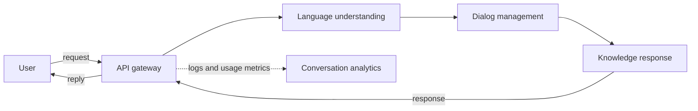

# Module 1 - Introduction to AI Systems and Architecture

AI architecture turns a trained model into a dependable, useful system. The topics move from the system's components and quality goals through AI-specific design challenges and the architect's decisions, ending with reference architectures and deployment approaches.

## 1. From an AI model to an AI system

An **AI model** is trained using data and can perform inference. By itself, it is not usually a complete, useful product.

An **AI system** is an end-to-end engineering solution built to provide a useful outcome to a user. It includes the model and the surrounding components needed to supply data, run inference, integrate the model into an application, and monitor system behavior.

**Architecture** is the blueprint for organizing these components and their interactions. It helps coordinate stakeholder needs and makes it possible to locate problems, make corrections, and deploy changes. AI systems can behave non-deterministically, so monitoring and guardrails are important.

Test Your Understanding

**Questions**

1. How is an AI model different from an AI system?

**Answers**

1. A model is trained on data and can perform inference. A system is an end-to-end engineering solution that includes the model and components for data, inference, application use, and monitoring.

## 2. AI technology stack

The stack has six layers:

1. **Hardware** — compute, storage, and networking.
2. **Data** — data ingestion, storage, preparation, and feature engineering.
3. **Model** — the trained machine-learning or deep-learning model.
4. **Inference** — running the model on new inputs.
5. **Application** — integrating AI into an application for users.
6. **Monitoring** — tracking performance, data drift, and model health.

The layers work together: the model depends on data and hardware, inference runs the model, the application uses its results, and monitoring helps identify issues.

AI systems can also be described by scope:

- **Narrow AI** is designed for specific tasks or limited domains, such as image recognition, spam filters, and recommendation engines.
- **General AI** is a theoretical system with human-level capabilities across domains.

Test Your Understanding

**Questions**

1. What are the six layers of the AI technology stack?

**Answers**

1. Hardware, data, model, inference, application, and monitoring.

## 3. Qualities of a well-architected AI system

- **Performance:** responsive, accurate results with low latency.
- **Scalability:** ability to handle growing workloads and datasets.
- **Efficiency:** effective use of compute, energy, and operational resources.
- **Reliability:** consistent operation, including handling unusual inputs or failures.
- **Security:** protection of data and the system.
- **Explainability:** visibility into how the system reaches decisions, supporting trust, compliance, and debugging.

Explainability matters because stakeholders may need to understand why the system behaved or responded in a particular way. Since AI models can behave unexpectedly, guardrails and logs of inputs and outputs can support auditing and help explain system responses.

Test Your Understanding

**Questions**

1. Name qualities of a well-architected AI system and explain one.

**Answers**

1. Performance, efficiency, explainability, and reliability are important qualities. Explainability helps stakeholders understand why the system behaved a certain way. Guardrails and input/output logs can support auditing and explanation.

## 4. Traditional software, AI-enabled software, and AI evolution

Traditional software generally follows fixed rules in code and can produce consistent outputs. AI-enabled software uses learned, heuristic or probabilistic behavior and may be non-deterministic. Traditional systems may be deterministic; this is not an absolute distinction.

AI-system performance depends on both code and data, including data quality, quantity, and timeliness. AI systems may evolve through feedback loops and need monitoring and adaptation. Their design must also account for model uncertainty, data pipelines, and human oversight.

A production ML system is more than its algorithm. It includes the business requirements, user and developer interfaces, data stack, model development and monitoring processes, model updates, and infrastructure that delivers those capabilities.

### Rule-based and machine-learning spam filters

A rule-based spam filter applies manually written rules, such as flagging suspicious domains or message patterns. It can work for recognizable patterns, but:

- Spammers can change wording or disguise keywords.
- Broad rules can flag legitimate email, while sophisticated spam can evade rules.
- Maintaining many evolving rules becomes difficult.
- Rules may not reflect each user's preferences.

A machine-learning filter learns from labelled spam and non-spam emails. It can learn combinations of patterns and context, adapt through periodic retraining, and support user-specific preferences. Examples of approaches include Naive Bayes, SVM, and deep learning.

### Machine learning, deep learning, and LLMs

- **Machine learning:** often simpler and more resource-efficient.
- **Deep learning:** can perform well at large scale, but may require extensive representative labelled data and substantial compute. Large models can increase inference latency and cost.
- **Language-model progression:** pre-trained models; generative models; multimodal models; and smaller language models. Smaller models can reduce latency and cost, with some accuracy trade-off.

Test Your Understanding

**Questions**

1. How does traditional software behavior differ from AI-enabled software?
2. What are two challenges with rule-based spam filtering, and how can ML help?
3. What challenge can deep learning introduce, and how can smaller language models help?

**Answers**

1. Traditional software generally follows rules in code and may produce deterministic, consistent outputs. AI-enabled software uses learned behavior and can be probabilistic or non-deterministic; it is not necessarily explainable.
2. Rules may fail as spam patterns change and may not account for personal preferences. ML can learn patterns and context from labelled emails and can adapt through retraining.
3. Large deep-learning models can increase inference latency and cost. Smaller language models can reduce both, with a possible accuracy trade-off.

## 5. AI workload challenges, complexity, and system requirements

### Challenges in AI system design

AI architecture has to account for more than the choice of model. The field changes quickly, with new research, architectures, and terminology that can make design choices age quickly. Teams must compare alternatives such as classical machine learning, deep learning, and LLMs, each with different levels of complexity, interpretability, scalability, and suitability for a task.

Real-world data may be incomplete, biased, scarce, or otherwise imperfect. It may need augmentation, cleaning, and validation. Resource limits also matter: sophisticated models can demand substantial compute, while deployed systems must balance accuracy and performance against latency, cost, and energy use. These connected concerns make AI design a systems problem rather than a model-only problem.

### Types of complexity in AI systems

AI systems have several related forms of complexity:

- **Integration complexity:** Frameworks and code bases may have dependencies, versions, and APIs that must work together. A model library may not fit the existing technology stack without adaptation.
- **Functional complexity:** Autonomous decisions must meet system objectives. Monitoring, alerts, retraining, human override, and logging can help detect and respond to incorrect or outdated behavior. Logs also create privacy and storage considerations.
- **Technical complexity:** AI workloads can demand substantial compute, memory, and storage. They may also have strict response-time, cybersecurity, and scaling requirements.
- **Verification complexity:** Probabilistic outputs make testing harder than checking fixed outputs. Testing should consider edge cases, adversarial inputs, and out-of-distribution data; integration testing can reveal failures that unit tests miss.
- **Human-interface complexity:** People need clear roles for configuration, oversight, and intervention. The system should clarify how conflicts between a user's direction and an AI recommendation are handled, and how decisions can be explained.

For example, a pedestrian-detection model may perform well on its test dataset but fail in adverse weather or unusual lighting. Testing only the expected examples would miss these situations.

### ML system requirements

Four broad requirements for ML systems are:

- **Reliability:** Continue performing the intended function at the required level despite hardware or software faults or human error. ML systems can fail silently: a prediction function may run correctly while its prediction is wrong.
- **Scalability:** Handle growth in model complexity, request volume, or the number of models. Scaling may require additional resources as well as automation for model monitoring, retraining, and artifact management.
- **Maintainability:** Enable contributors to understand and update the system. Document code, version code, data, and artifacts, and make models reproducible so others can investigate and fix problems.
- **Adaptability:** Respond to changing data distributions and business requirements, including updating the system without interrupting service.

These are distinct from **performance**, which concerns how well or quickly the system performs a task. Scalability is about the system's ability to handle growth in workload, models, or complexity; a system can be performant at its current load yet not scale well as demand increases.

AI/ML systems also have important non-functional requirements such as **explainability, fairness, and privacy**, alongside reliability and adaptability. The architecture needs to make room for these requirements as well as maintainability and scalability.

Test Your Understanding

**Questions**

1. Name three AI system-design challenges and briefly explain one.
2. What are the five types of complexity in AI systems? Give an example of why testing can be difficult.
3. What are the four broad ML-system requirements? How do maintainability and adaptability differ?

**Answers**

1. Challenges include imperfect or biased data, the range of possible model approaches, and computational-resource constraints. Data quality matters because model performance and system responses depend on the quality, quantity, and representativeness of the data. Data may need cleaning, augmentation, and validation.
2. Integration, functional, technical, verification, and human-interface complexity. For example, a pedestrian-detection model can pass tests on its test dataset yet fail in adverse weather or unusual lighting. Probabilistic outputs and unfamiliar inputs make it difficult to rely only on fixed test cases or unit tests.
3. Reliability, scalability, maintainability, and adaptability. Maintainability concerns how readily people can understand, reproduce, and update the system; adaptability concerns whether it can respond to changing data distributions or business requirements. Scalability concerns handling growth, while performance concerns how well or quickly the system performs at a given workload.

## 6. The AI architect's role and decision process

### The architect's role

Systems can fail even when their individual components have been built correctly, if the overall system does not solve the right problem. The architect connects stakeholder needs to a feasible design, communicates the system vision, and helps coordinate development.

For AI-enabled systems, the architect works with stakeholders, data scientists, AI engineers, and other technical specialists. The role includes defining requirements, developing models and design artifacts, guiding integration, identifying non-functional requirements, and helping plan how AI decisions will be tested—including unusual or off-nominal cases. The architect also helps assess whether the completed system meets stakeholder needs.

### The 5W+H framework

The architect can use six questions to understand the system context:

- **Who** will use or be affected by the system?
- **What** is the system's purpose, and what constraints, technologies, data, or computational needs apply?
- **Why** are the requirements and design choices needed?
- **When** are delivery, integration, or retraining milestones expected?
- **Where** will the system run, and where will its data come from or be stored?
- **How** will the system be tested, integrated, secured, monitored, and measured?

These questions should be considered in light of cost, schedule, performance, compliance, and security. The framework is a way to organize inquiry, not a fixed solution that fits every project.

### The architectural cycle

Architecture develops iteratively through analysis, synthesis, evaluation, and review:

1. **Analysis:** Break down system functions and sub-functions; identify important non-functional requirements and the metrics that will guide decisions.
2. **Synthesis:** Develop feasible design concepts using appropriate technologies, processes, patterns, and tactics.
3. **Evaluation:** Compare and prioritize concepts with modeling, systems analysis, prototypes, or decision matrices.
4. **Review:** Discuss the design with relevant stakeholders, who decide how to proceed.

The cycle may repeat as the team learns more and refines its first-order design.

### Balancing technical strengths and stakeholder needs

The architect must consider not only whether a technology can perform a task, but whether the system meets stakeholder, business, compliance, and operational needs.

For example, a financial-fraud system may use a deep network to identify unusual transactions, but the network may not provide the reasoning required for compliance. A symbolic classification approach can provide a chain of reasoning but may be less effective at finding unusual patterns. A combined architecture uses the deep network as a first filter and passes tagged transactions to a symbolic classification engine.

Stakeholder and domain understanding can be developed through existing documentation, market and competitor research, interviews, workshops, focused meetings, and rapid prototypes.

### Selecting an AI approach

- **Traditional machine learning:** suited to structured data and clearly defined problems, such as fraud detection, predictive maintenance, or segmentation.
- **Deep learning:** suited to unstructured data requiring complex pattern recognition, such as image, language, or audio tasks.
- **Foundation models with retrieval-augmented generation (RAG):** suited to knowledge-intensive tasks, conversational interfaces, or access to real-time information. Retrieval can provide relevant domain-specific context, including proprietary information when the system is designed to use it.

The choice should be evaluated against business alignment, data readiness, performance needs, model evolution, compute and storage requirements, integration complexity, and latency constraints. A structured workflow is to define the vision and requirements, assess the data, select an architecture, plan infrastructure, prototype and validate, then plan implementation with testing, monitoring, and feedback.

### Team roles and architecting artifacts

Three key roles shape the work:

- **Vision holder:** focuses on customer needs and communicates the system vision.
- **Technology expert:** understands technologies such as databases, middleware, user interfaces, compute, networking, storage, ML frameworks, and deployment.
- **AI engineer:** ensures AI components fit the vision and operate within technology constraints.

Artifacts make the purpose and design understandable across the team. Examples include a **Concept of Operations (CONOPS)**, UML/SysML diagrams, non-functional-requirement specifications, metric definitions, software tactics, and patterns.

A **CONOPS is a document** describing why the system is needed and how it is expected to operate. For an AI system, it explains how users interact with AI capabilities, how AI outputs are presented, how users or customers can affect decisions or outputs, which major actors are involved, and how the system connects with other systems.

A CONOPS is broader than a single user story or feature specification: it describes the operational context of the overall system. It can be accompanied by diagrams, but is not itself a diagram. Use-case diagrams, activity diagrams, and component diagrams are separate artifacts that can illustrate particular parts of the system.

For example, a fraud-detection CONOPS could describe the financial institution's purpose, the staff who review flagged transactions, how AI-generated flags and explanations reach those staff, how their decisions affect the outcome, and how the system interacts with transaction-processing systems. The associated diagrams could separately show user actions, process flow, or system components.

Test Your Understanding

**Questions**

1. What does 5W+H help an AI architect clarify?
2. What are the four stages of the architectural cycle?
3. When are traditional ML, deep learning, and foundation models with RAG appropriate? What does a CONOPS describe?

**Answers**

1. It organizes questions about who is affected, what the system is for and constrained by, why requirements and design choices matter, when activities occur, where the system and data are located, and how the system is implemented, tested, integrated, secured, monitored, and measured. These considerations are weighed against cost, schedule, performance, compliance, and security.
2. Analysis decomposes functions and identifies important requirements and metrics. Synthesis develops feasible design concepts. Evaluation compares and prioritizes concepts through modeling, analysis, prototypes, or decision matrices. Review brings the design to stakeholders, who decide how to proceed. The cycle can repeat.
3. Traditional ML is suited to structured data and clearly defined problems. Deep learning is suited to unstructured data requiring complex pattern recognition. Foundation models with RAG are suited to knowledge-intensive tasks, conversational interfaces, or real-time information access; retrieval can supply relevant domain-specific context. A CONOPS document describes why the overall system is needed and how actors use and interact with it, including its AI capabilities and connections to other systems. It is broader than an individual user story or feature specification.

## 7. Reference architecture and deployment for AI systems

### A reference architecture and its components

A reference architecture gives a structured view of major system components and how they fit together. It provides a starting point for designing a particular system, not a fixed blueprint that every AI system must copy.

An AI system architecture can include:

- **Data components:** structured, semi-structured, and unstructured data. Data quality, quantity, and relevance affect model performance and generalization.
- **Algorithmic frameworks:** traditional machine learning, deep learning, or reinforcement learning, selected for the problem, available data, and performance needs.
- **Model architectures:** from simple linear models to ensembles and deep neural networks.
- **Infrastructure:** compute such as GPUs, TPUs, FPGAs, or clusters; scalable storage; and networking for training and inference.
- **Development frameworks:** tools such as TensorFlow, PyTorch, and Hugging Face.
- **Deployment approach:** how components are packaged, connected, operated, and maintained.

The components influence one another. For example, a model choice affects compute and storage requirements, while data volume and response-time targets influence infrastructure and deployment design.

### Microservice architectures

A microservice architecture divides an AI system into smaller services that communicate through well-defined APIs. Each service has a focused responsibility and can be developed, deployed, updated, or scaled independently.

Benefits include:

- Independent development and deployment, supporting agility.
- Scaling a high-demand service without scaling every service.
- Fault isolation, so a failure can remain limited to one component.
- Freedom to select suitable technologies for different tasks.

Microservices also introduce costs and complexity:

- More orchestration, monitoring, service discovery, load balancing, and failure handling.
- Inter-service communication can add latency.
- Data consistency across distributed services can require special handling.

### Conversational-AI example

A conversational-AI system uses an **API gateway** and four services:

The main response path is synchronous; the dotted path represents logging and analytics that can run asynchronously.

1. **API gateway:** receives user requests, starts or identifies a session, routes requests, and returns the reply.
2. **Language understanding service:** classifies intent and extracts entities from the user's message.
3. **Dialog management service:** controls the conversation flow and maintains or retrieves session state.
4. **Knowledge response service:** retrieves relevant information or uses templates to prepare a response.
5. **Conversation analytics service:** processes interaction logs and usage metrics for reports and analysis.

A typical response path is synchronous where the user is waiting: the gateway forwards the message for language understanding, dialog management uses the recognized intent and session state to decide what is needed, and the knowledge response service retrieves or composes an answer. The gateway then delivers it to the user.

Logging and analytics can run asynchronously so that they do not delay the main response. Dialog management is stateful because it tracks conversation context. Language understanding can often be stateless, which can simplify scaling. Separate services can be updated or scaled independently, but their communication, latency, fault handling, and data boundaries must be designed deliberately.

### System qualities and data organization

The architecture should address:

- **Scalability:** horizontal scaling adds resources to distribute work; vertical scaling increases the capacity of existing resources; distributed computing spreads processing across multiple nodes.
- **Performance:** hardware acceleration, parallel processing, and algorithm optimization can help meet processing and latency requirements.
- **Reliability:** fault tolerance, graceful error handling, and redundancy help limit disruption when components fail.
- **Security:** encryption can protect data at rest and in transit; access control limits who can use system resources; model robustness helps address adversarial inputs.

Data catalogs and ontologies can support data management:

- A **data catalog** records metadata such as data location, schema, lineage, and quality.
- An **ontology** represents the meaning of data elements and their relationships in a domain.

### Cloud-native AI deployment

Cloud-native AI components are designed to use cloud capabilities. This differs from **lift-and-shift**, which moves an existing system to the cloud without redesigning it to use cloud-native features.

Cloud-native deployment can use building blocks such as:

- **Containerization** packages applications for consistency across development, testing, and production.
- **Orchestration** manages container deployment, scaling, and operations.
- **Microservices** separate functionality into independently managed components.
- **Serverless computing** supports event-driven workloads without directly managing the underlying servers.
- **Managed AI services** provide hosted capabilities for building, training, or deploying models.

Cloud platforms can offer scalability, flexibility, and pay-as-you-go cost models. The deployment choice should still fit the system's requirements and constraints.

### The algorithm is only one part of an ML system

A production ML system includes much more than its algorithm. It also includes:

- Business requirements that establish the system's purpose.
- Interfaces through which users and developers interact with it.
- A data stack.
- Processes and logic for developing, monitoring, and updating models.
- Deployment and monitoring.
- Infrastructure and hardware.

The model is one component in an engineered system; the surrounding components support its delivery and ongoing operation.

Test Your Understanding

**Questions**

1. What are the main parts of the conversational-AI architecture, and what does each do?
2. Name one benefit and one challenge of microservices. Why might analytics calls be asynchronous?
3. How does cloud-native deployment differ from simply moving an existing system to the cloud? Name two parts of a production ML system besides the algorithm.

**Answers**

1. The API gateway receives and routes user requests and returns responses. The language understanding service identifies intent and extracts entities. Dialog management controls conversation flow and session state. The knowledge response service retrieves information or prepares a reply. Conversation analytics handles logs and usage metrics. “Data extraction” is not the service name in this architecture; retrieval and response preparation belong to the knowledge response service. Analytics is distinct from session management and is not itself the whole system-monitoring function.
2. A benefit is that an individual service can be scaled independently as demand changes. A challenge is the extra complexity of orchestration, monitoring, and inter-service communication, which may also add latency. Analytics and logging can run asynchronously so they do not block or delay the response the user is waiting for.
3. Cloud-native components are designed to use features such as containers, orchestration, microservices, serverless computing, or managed services. Lift-and-shift moves an existing system without redesigning it to take advantage of those features. Other ML-system components include business requirements, user/developer interfaces, a data stack, model-development and monitoring processes, deployment, infrastructure, and hardware.

